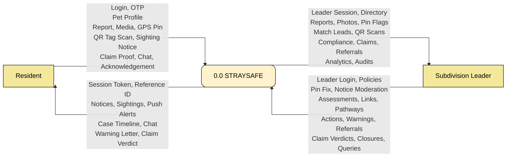
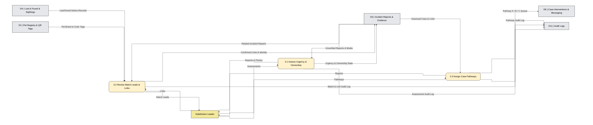
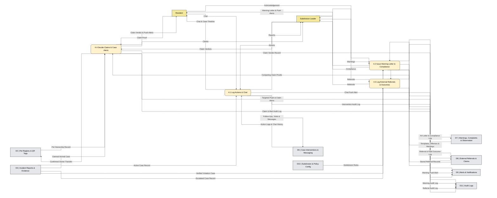
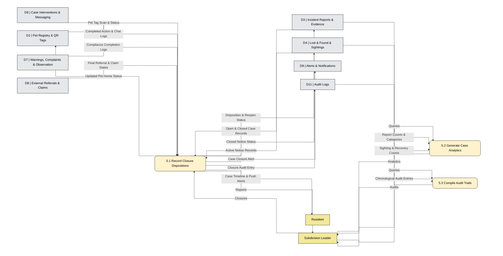

# STRAY-SAFE 2.0 — Data Flow Diagrams (Level 0 & Divided Level 1 Modules 1.0–5.0)

Balanced **Gane & Sarson Mermaid.js Data Flow Diagrams** matching your **Level 0 Context Diagram** (`Resident ↔ STRAYSAFE ↔ Subdivision Leader`) and dividing **DFD Level 1** into **5 clean, standalone module diagrams** (`Modules 1.0–5.0`) with **short, specific data flow labels** and 100% Level 0 ↔ Diagrams 2–6 balancing.

---

## 1. Diagram 1 — DFD Level 0 (Context Diagram)

---

## 2. Diagram 2 — DFD Level 1 (Module 1.0: Auth, Accounts, Pets & QR Tags)

```mermaid
%%{init: {'flowchart': {'curve': 'stepAfter', 'nodeSpacing': 40, 'rankSpacing': 160}}}%%
flowchart LR
    classDef entity fill:#F3E89B,stroke:#000000,color:#000000
    classDef process fill:#FFF2CC,stroke:#000000,rx:12,ry:12,color:#000000
    classDef store fill:#E5E7EB,stroke:#000000,color:#000000

    subgraph DATA_STORES[" "]
        direction TB
        D1["D1 | Users & Authentication"]:::store
        D2["D2 | Pet Registry & QR Tags"]:::store
        D9["D9 | Alerts & Notifications"]:::store
        D10["D10 | Subdivision & Policy Config"]:::store
        D11["D11 | Audit Logs"]:::store
    end

    subgraph PROCESSES[" "]
        direction TB
        P1_1["1.1 Register & Verify Resident"]:::process
        P1_2["1.2 Authenticate Subdivision Leader"]:::process
        P1_3["1.3 Manage Pet Profile & QR Tag"]:::process
        P1_4["1.4 Manage User Accounts & Policies"]:::process
    end

    subgraph ENTITIES[" "]
        direction TB
        RES["Resident"]:::entity
        SL["Subdivision Leader"]:::entity
    end

    style DATA_STORES fill:transparent,stroke:transparent
    style PROCESSES fill:transparent,stroke:transparent
    style ENTITIES fill:transparent,stroke:transparent

    %% 1.1 Register & Verify Resident
    RES -->|"Login, OTP"| P1_1
    P1_1 -->|"Session Token"| RES
    D1 -->|"Credential Hash & OTP"| P1_1
    P1_1 -->|"New Account & JWT Session"| D1
    D10 -->|"Password Rules"| P1_1
    P1_1 -->|"OTP Verification Alert"| D9
    P1_1 -->|"Resident Auth Log"| D11

    %% 1.2 Authenticate Subdivision Leader
    SL -->|"Leader Login"| P1_2
    P1_2 -->|"Leader Session"| SL
    D1 -->|"Leader Account & Role"| P1_2
    P1_2 -->|"Leader JWT Session"| D1
    D10 -->|"Session Timeout Rules"| P1_2
    P1_2 -->|"Leader Auth Log"| D11

    %% 1.3 Manage Pet Profile & QR Tag
    RES -->|"Pet Profile"| P1_3
    P1_3 -->|"Notices"| RES
    D2 -->|"Saved Pet & Tag Token"| P1_3
    P1_3 -->|"Pet Profile & QR Tag Record"| D2
    P1_3 -->|"Pet Registry Log"| D11

    %% 1.4 Manage User Accounts & Policies
    SL -->|"Policies"| P1_4
    P1_4 -->|"Directory"| SL
    D1 -->|"User Accounts & Roles"| P1_4
    P1_4 -->|"Role & Activation Writes"| D1
    D10 -->|"Subdivision Policy Config"| P1_4
    P1_4 -->|"Updated Subdivision Policies"| D10
    P1_4 -->|"Account & Policy Audit Log"| D11
```

---

## 3. Diagram 3 — DFD Level 1 (Module 2.0: Reporting, Geofence, Notices & QR Scans)

```mermaid
%%{init: {'flowchart': {'curve': 'stepAfter', 'nodeSpacing': 40, 'rankSpacing': 160}}}%%
flowchart LR
    classDef entity fill:#F3E89B,stroke:#000000,color:#000000
    classDef process fill:#FFF2CC,stroke:#000000,rx:12,ry:12,color:#000000
    classDef store fill:#E5E7EB,stroke:#000000,color:#000000

    subgraph DATA_STORES[" "]
        direction TB
        D2["D2 | Pet Registry & QR Tags"]:::store
        D3["D3 | Incident Reports & Evidence"]:::store
        D4["D4 | Lost & Found & Sightings"]:::store
        D9["D9 | Alerts & Notifications"]:::store
        D10["D10 | Subdivision & Policy Config"]:::store
        D11["D11 | Audit Logs"]:::store
    end

    subgraph PROCESSES[" "]
        direction TB
        P2_1["2.1 Submit Report & GPS Pin"]:::process
        P2_2["2.2 Validate Geofence & Pin Fix"]:::process
        P2_3["2.3 Publish & Moderate Notices"]:::process
        P2_4["2.4 Log Sighting & QR Tag Scan"]:::process
    end

    subgraph ENTITIES[" "]
        direction TB
        RES["Resident"]:::entity
        SL["Subdivision Leader"]:::entity
    end

    style DATA_STORES fill:transparent,stroke:transparent
    style PROCESSES fill:transparent,stroke:transparent
    style ENTITIES fill:transparent,stroke:transparent

    %% 2.1 Submit Report & GPS Pin
    RES -->|"Report, Media, GPS Pin"| P2_1
    P2_1 -->|"Reference ID"| RES
    P2_1 -->|"Reports & Photos"| SL
    D2 -->|"Linked Pet Snapshot"| P2_1
    P2_1 -->|"Report, Media & GPS Pin"| D3
    P2_1 -->|"Submission Alert"| D9

    %% 2.2 Validate Geofence & Pin Fix
    SL -->|"Pin Fix"| P2_2
    P2_2 -->|"Case Timeline"| RES
    P2_2 -->|"Pin Flags"| SL
    D10 -->|"Geofence Polygon"| P2_2
    D3 -->|"Submitted Coordinates"| P2_2
    P2_2 -->|"Validated & Fixed GPS Pin"| D3
    P2_2 -->|"Pin Fix Audit Log"| D11

    %% 2.3 Publish & Moderate Notices
    RES -->|"Sighting Notice"| P2_3
    SL -->|"Notice Moderation"| P2_3
    P2_3 -->|"Notices"| RES
    P2_3 -->|"Reports"| SL
    D2 -->|"Missing Pet Photo & Traits"| P2_3
    D4 -->|"Existing Lost/Found Notices"| P2_3
    P2_3 -->|"Published Notice Record"| D4
    P2_3 -->|"Community Notice Alert"| D9
    P2_3 -->|"Moderation Audit Log"| D11

    %% 2.4 Log Sighting & QR Tag Scan
    RES -->|"QR Tag Scan & Sighting Notice"| P2_4
    P2_4 -->|"Sightings & Push Alerts"| RES
    P2_4 -->|"QR Scans"| SL
    D4 -->|"Active Notice Records"| P2_4
    P2_4 -->|"Sighting Pin & Recovery State"| D4
    D2 -->|"Active Tag Token"| P2_4
    P2_4 -->|"QR Scan Location & Message"| D2
    P2_4 -->|"QR Scan & Sighting Alert"| D9
    P2_4 -->|"Sighting & Scan Audit Log"| D11
```

---

## 4. Diagram 4 — DFD Level 1 (Module 3.0: Assessment, Match Leads & Pathways)

---

## 5. Diagram 5 — DFD Level 1 (Module 4.0: Interventions, Warnings, Claims & Referrals)

---

## 6. Diagram 6 — DFD Level 1 (Module 5.0: Closure, Analytics & Audit Trails)

---

## 7. Level 0 ↔ Diagrams 2–6 Balancing Check

| Level 0 Flow | Exact Level 0 Labels | Covered In |
| :--- | :--- | :--- |
| **`Resident` → `STRAYSAFE`** | `Login, OTP`, `Pet Profile`, `Report`, `Media`, `GPS Pin`, `QR Tag Scan`, `Sighting Notice`, `Claim Proof`, `Chat`, `Acknowledgement` | **Diagram 2** (`1.1`, `1.3`) · **Diagram 3** (`2.1`, `2.3`, `2.4`) · **Diagram 5** (`4.1`, `4.2`, `4.4`) |
| **`STRAYSAFE` → `Resident`** | `Session Token`, `Reference ID`, `Notices`, `Sightings`, `Push Alerts`, `Case Timeline`, `Chat`, `Warning Letter`, `Claim Verdict` | **Diagram 2** (`1.1`, `1.3`) · **Diagram 3** (`2.1`, `2.2`, `2.3`, `2.4`) · **Diagram 5** (`4.1`, `4.2`, `4.4`) · **Diagram 6** (`5.1`) |
| **`Subdivision Leader` → `STRAYSAFE`** | `Leader Login`, `Policies`, `Pin Fix`, `Notice Moderation`, `Assessments`, `Links`, `Pathways`, `Actions`, `Warnings`, `Referrals`, `Claim Verdicts`, `Closures`, `Queries` | **Diagram 2** (`1.2`, `1.4`) · **Diagram 3** (`2.2`, `2.3`) · **Diagram 4** (`3.1`, `3.2`, `3.3`) · **Diagram 5** (`4.1`, `4.2`, `4.3`, `4.4`) · **Diagram 6** (`5.1`, `5.2`, `5.3`) |
| **`STRAYSAFE` → `Subdivision Leader`** | `Leader Session`, `Directory`, `Reports`, `Photos`, `Pin Flags`, `Match Leads`, `QR Scans`, `Compliance`, `Claims`, `Referrals`, `Analytics`, `Audits` | **Diagram 2** (`1.2`, `1.4`) · **Diagram 3** (`2.1`, `2.2`, `2.3`, `2.4`) · **Diagram 4** (`3.1`, `3.2`, `3.3`) · **Diagram 5** (`4.1`, `4.2`, `4.3`, `4.4`) · **Diagram 6** (`5.1`, `5.2`, `5.3`) |
