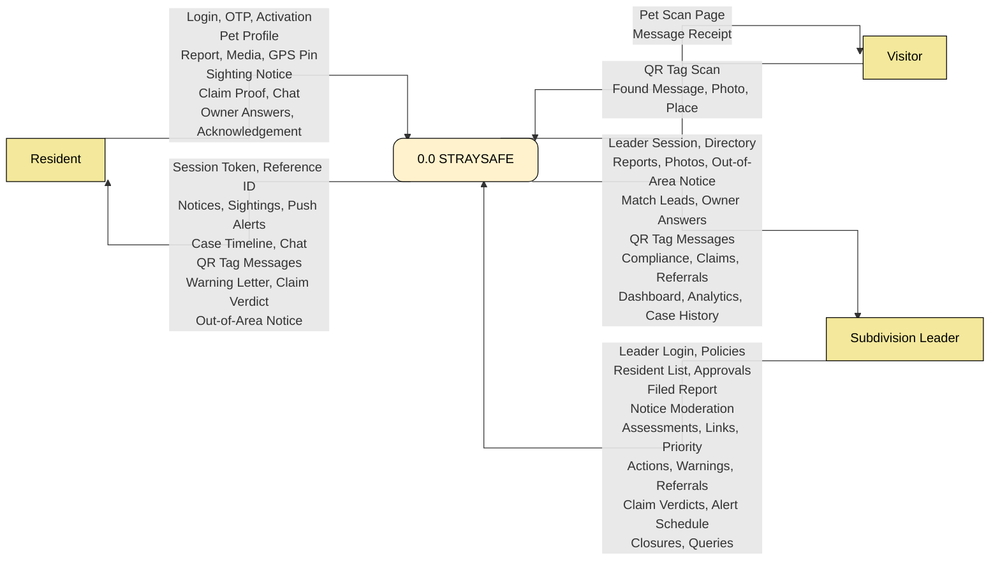
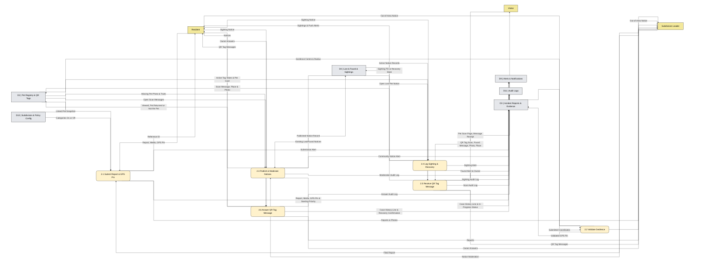
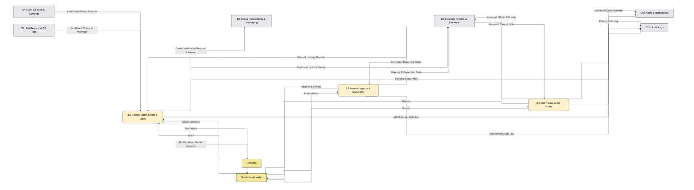
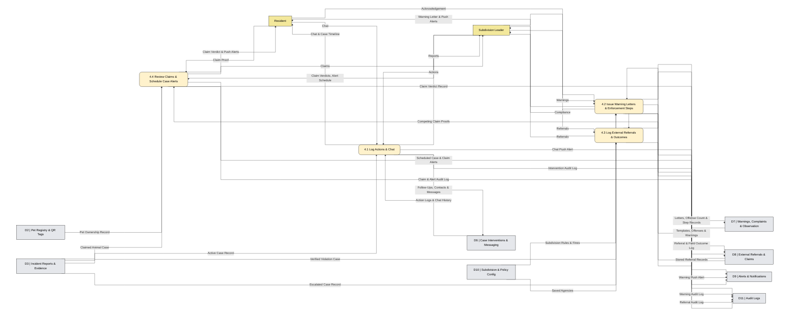
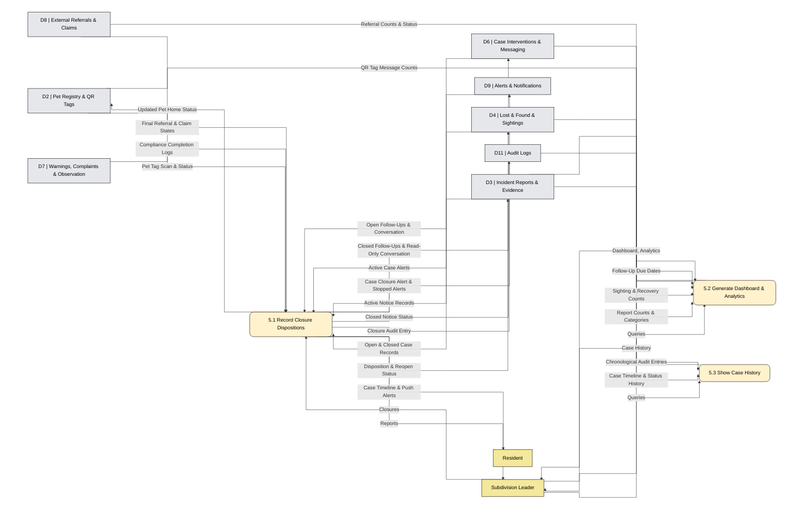

# STRAY-SAFE 2.0 — Data Flow Diagrams (Level 0 & Divided Level 1 Modules 1.0–5.0)

Balanced **Gane & Sarson Mermaid.js Data Flow Diagrams** for the system **as it works today (updated 2026-11-24)**. **Diagram 1 (Level 0)** is the context diagram `Resident ↔ STRAYSAFE ↔ Subdivision Leader`, plus the `Visitor` who scans a pet's QR tag. **DFD Level 1** is divided into **5 standalone module diagrams** (`Modules 1.0–5.0`, Diagrams 2–6) with **short, specific data flow labels**, and every Level 0 flow is balanced against Diagrams 2–6 (section 7).

> **Scope notes (kept from earlier decisions):** AI features, the heatmap and the Barangay as an entity are **not drawn** (removed on 2026-11-19, and the Barangay is contacted outside the system). The Administrator is not drawn: the system has no administrator role. **Data store `D5` is not used** (the numbering skips from `D4` to `D6`); the stores are listed in section 2.

---

## 1. Diagram 1 — DFD Level 0 (Context Diagram)

---

## 2. Data stores

| Store | Label | What it holds today |
| :--- | :--- | :--- |
| `D1` | Users & Authentication | Resident and Leader accounts, the official resident list, invitations, applications, sessions |
| `D2` | Pet Registry & QR Tags | Registered pets, each pet's permanent QR tag, and the messages left through it with their states (New, Viewed, Pet Returned, Not the Pet) |
| `D3` | Incident Reports & Evidence | Reports (six categories), photos and videos, GPS pins, assessment, priority, assigned officer, links and merges, closure |
| `D4` | Lost & Found & Sightings | Lost-pet and found-animal notices, sightings, possible recoveries |
| `D6` | Case Interventions & Messaging | Follow-ups, contact logs, resident–administration conversations, owner verification requests |
| `D7` | Warnings, Complaints & Observation | Warning letters and templates, offense counts, enforcement steps (summons, fine record, meeting), observation periods |
| `D8` | External Referrals & Claims | Referrals to outside agencies and their outcomes, ownership claims and verdicts |
| `D9` | Alerts & Notifications | In-app notifications, push alerts, scheduled case alerts, e-mail queue |
| `D10` | Subdivision & Policy Config | Reporting coverage area (centre and radius), categories on or off, animal policies and fines, follow-up limits, saved referral agencies, password rules |
| `D11` | Audit Logs | The append-only audit trail |

---

## 3. Diagram 2 — DFD Level 1 (Module 1.0: Accounts, Resident Records, Pets & QR Tags)

```mermaid
%%{init: {'flowchart': {'curve': 'stepAfter', 'nodeSpacing': 40, 'rankSpacing': 160}}}%%
flowchart LR
    classDef entity fill:#F3E89B,stroke:#000000,color:#000000
    classDef process fill:#FFF2CC,stroke:#000000,rx:12,ry:12,color:#000000
    classDef store fill:#E5E7EB,stroke:#000000,color:#000000

    subgraph DATA_STORES[" "]
        direction TB
        D1["D1 | Users & Authentication"]:::store
        D2["D2 | Pet Registry & QR Tags"]:::store
        D9["D9 | Alerts & Notifications"]:::store
        D10["D10 | Subdivision & Policy Config"]:::store
        D11["D11 | Audit Logs"]:::store
    end

    subgraph PROCESSES[" "]
        direction TB
        P1_1["1.1 Register & Activate Resident"]:::process
        P1_2["1.2 Authenticate Subdivision Leader"]:::process
        P1_3["1.3 Manage Pet Profile & QR Tag"]:::process
        P1_4["1.4 Manage Resident Records & Policies"]:::process
    end

    subgraph ENTITIES[" "]
        direction TB
        RES["Resident"]:::entity
        SL["Subdivision Leader"]:::entity
    end

    style DATA_STORES fill:transparent,stroke:transparent
    style PROCESSES fill:transparent,stroke:transparent
    style ENTITIES fill:transparent,stroke:transparent

    %% 1.1 Register & Activate Resident
    RES -->|"Login, OTP, Activation"| P1_1
    P1_1 -->|"Session Token"| RES
    D1 -->|"Credential Hash, OTP & Invitation"| P1_1
    P1_1 -->|"New Account & JWT Session"| D1
    D10 -->|"Password Rules"| P1_1
    P1_1 -->|"OTP & Activation Alert"| D9
    P1_1 -->|"Resident Auth Log"| D11

    %% 1.2 Authenticate Subdivision Leader
    SL -->|"Leader Login"| P1_2
    P1_2 -->|"Leader Session"| SL
    D1 -->|"Leader Account & Role"| P1_2
    P1_2 -->|"Leader JWT Session"| D1
    D10 -->|"Session Timeout Rules"| P1_2
    P1_2 -->|"Leader Auth Log"| D11

    %% 1.3 Manage Pet Profile & QR Tag
    RES -->|"Pet Profile"| P1_3
    P1_3 -->|"Notices"| RES
    D2 -->|"Saved Pet & Tag Token"| P1_3
    P1_3 -->|"Pet Profile & Permanent QR Tag"| D2
    P1_3 -->|"Pet Registry Log"| D11

    %% 1.4 Manage Resident Records & Policies
    SL -->|"Resident List, Approvals"| P1_4
    SL -->|"Policies"| P1_4
    P1_4 -->|"Directory"| SL
    D1 -->|"Resident Records & Applications"| P1_4
    P1_4 -->|"Approved & Invited Accounts"| D1
    D10 -->|"Subdivision Policy Config"| P1_4
    P1_4 -->|"Updated Subdivision Policies"| D10
    P1_4 -->|"Invitation E-mail Alert"| D9
    P1_4 -->|"Record & Policy Audit Log"| D11
```

---

## 4. Diagram 3 — DFD Level 1 (Module 2.0: Reporting, Geofence, Notices, Sightings & QR Tag Messages)

---

## 5. Diagram 4 — DFD Level 1 (Module 3.0: Assessment, Match Leads & Priority)

---

## 6. Diagram 5 — DFD Level 1 (Module 4.0: Interventions, Enforcement, Claims & Referrals)

---

## 7. Diagram 6 — DFD Level 1 (Module 5.0: Closure, Dashboard, Analytics & Case History)

---

## 8. Level 0 ↔ Diagrams 2–6 Balancing Check

| Level 0 Flow | Exact Level 0 Labels | Covered In |
| :--- | :--- | :--- |
| **`Resident` → `STRAYSAFE`** | `Login, OTP, Activation`, `Pet Profile`, `Report`, `Media`, `GPS Pin`, `Sighting Notice`, `Claim Proof`, `Chat`, `Owner Answers`, `Acknowledgement` | **Diagram 2** (`1.1`, `1.3`) · **Diagram 3** (`2.1`, `2.3`, `2.4`, `2.6`) · **Diagram 4** (`3.2`) · **Diagram 5** (`4.1`, `4.2`, `4.4`) |
| **`STRAYSAFE` → `Resident`** | `Session Token`, `Reference ID`, `Notices`, `Sightings`, `Push Alerts`, `Case Timeline`, `Chat`, `QR Tag Messages`, `Warning Letter`, `Claim Verdict`, `Out-of-Area Notice` | **Diagram 2** (`1.1`, `1.3`) · **Diagram 3** (`2.1`, `2.2`, `2.3`, `2.4`, `2.6`) · **Diagram 4** (`3.2`) · **Diagram 5** (`4.1`, `4.2`, `4.4`) · **Diagram 6** (`5.1`) |
| **`Visitor` → `STRAYSAFE`** | `QR Tag Scan`, `Found Message`, `Photo`, `Place` | **Diagram 3** (`2.5`) |
| **`STRAYSAFE` → `Visitor`** | `Pet Scan Page`, `Message Receipt` | **Diagram 3** (`2.5`) |
| **`Subdivision Leader` → `STRAYSAFE`** | `Leader Login`, `Policies`, `Resident List`, `Approvals`, `Filed Report`, `Notice Moderation`, `Assessments`, `Links`, `Priority`, `Actions`, `Warnings`, `Referrals`, `Claim Verdicts`, `Alert Schedule`, `Closures`, `Queries` | **Diagram 2** (`1.2`, `1.4`) · **Diagram 3** (`2.1`, `2.3`) · **Diagram 4** (`3.1`, `3.2`, `3.3`) · **Diagram 5** (`4.1`, `4.2`, `4.3`, `4.4`) · **Diagram 6** (`5.1`, `5.2`, `5.3`) |
| **`STRAYSAFE` → `Subdivision Leader`** | `Leader Session`, `Directory`, `Reports`, `Photos`, `Out-of-Area Notice`, `Match Leads`, `Owner Answers`, `QR Tag Messages`, `Compliance`, `Claims`, `Referrals`, `Dashboard`, `Analytics`, `Case History` | **Diagram 2** (`1.2`, `1.4`) · **Diagram 3** (`2.1`, `2.2`, `2.3`, `2.5`, `2.6`) · **Diagram 4** (`3.1`, `3.2`, `3.3`) · **Diagram 5** (`4.1`, `4.2`, `4.3`, `4.4`) · **Diagram 6** (`5.1`, `5.2`, `5.3`) |

---

## 9. What changed on 2026-11-24

| Change | Why |
| :--- | :--- |
| New external entity `Visitor` (Level 0 and Diagram 3) | A stranger who scans a pet's QR tag has no account. Before, the scan was drawn as a Resident action |
| New processes `2.5 Receive QR Tag Message` and `2.6 Answer QR Tag Message` | A message carries a place, a note and a photo; the owner answers (Viewed, Pet Returned, Not the Pet); the case gets a history line and moves to In progress; the Leader sees the message |
| `2.4` is now `Log Sighting & Recovery` only | The QR scan moved to `2.5` |
| `3.3 Assign Case Pathways` is now `3.3 Claim Case & Set Priority` | The system has no pathway step. A Leader claims a case, sets priority, and a reminder goes out when nobody does |
| `3.2` includes the owner's Confirm or Decline | The possible-owner flow: the Leader contacts the owner, the owner answers, the Leader verifies |
| `1.1` and `1.4` | Resident activation by e-mail link, and the Leader's official list import and approval of applications |
| `Geofence Polygon` is now `Geofence Centre & Radius`, and `2.2` is `Validate Geofence` | The coverage area is a centre point and a radius, and an out-of-area pin is refused with a notice. The current apps have **no Leader pin-fix screen**, so `Pin Fix` and `Pin Flags` were removed |
| `Confirmed Owner Transfer` removed from `4.4` | A claim never changes ownership by itself |
| `4.2` | Complaint enforcement: offense count and steps (letters, summons, fine record, meeting) |
| `5.1` closing a case | Closing ends the open follow-ups, makes the case conversation read-only and stops the case's active alerts, while referrals, warnings and claims are kept as history. `D6` and `D9` now have flows back from `5.1` |
| `5.2` | Now the Dashboard as well as Analytics |
| `5.3` is `Show Case History`, and the Leader receives `Case History` instead of `Audits` | The audit-log endpoint is limited to an administrator role, which the system does not have. The Leader reads each case's History tab, which is built from the case timeline and the audit entries |
