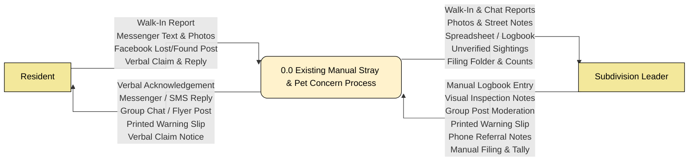
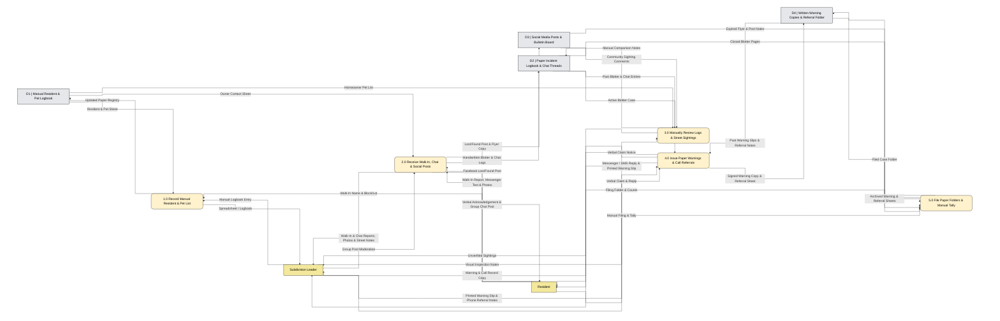

# STRAY-SAFE — Existing Manual Process Data Flow Diagrams (Before Proposed System)

**Gane & Sarson Mermaid.js Data Flow Diagrams (Level 0 & Level 1)** depicting the **existing manual workflow before STRAY-SAFE 2.0** (walk-ins, Messenger/SMS chats, Facebook group posts, paper logbooks, printed warning slips, and manual tallies), designed as the direct **"Before"** counterpart to [STRAY-SAFE-2.0-DFD.md](STRAY-SAFE-2.0-DFD.md).

---

## 1. Existing Manual Scope & Paper/Informal Stores

### 1.1 External Entities

| Entity                           | Role in Existing Manual Process                                                                                                                                                                                                                                                             |
| :------------------------------- | :------------------------------------------------------------------------------------------------------------------------------------------------------------------------------------------------------------------------------------------------------------------------------------------ |
| **`Resident`**           | Reports stray or nuisance animals via walk-in, SMS, or Messenger; posts lost/found pets on community Facebook groups or bulletin boards; receives verbal/printed warnings and informal chat replies.                                                                                        |
| **`Subdivision Leader`** | HOA Officer / Subdivision Head handling complaints manually: writes entries into physical logbooks/spreadsheets, visually inspects streets, checks past paper entries by memory, issues printed warning slips, places phone calls to external animal control/vets, and files paper folders. |

### 1.2 Informal / Manual Data Stores (`D1`–`D4`)

|     Store ID     | Label                                        | Existing Storage Medium                                                                                       |
| :--------------: | :------------------------------------------- | :------------------------------------------------------------------------------------------------------------ |
| **`D1`** | `Manual Resident & Pet Logbook`            | HOA master homeowner spreadsheet or paper registry (no pet QR tags, no digital pet matching)                  |
| **`D2`** | `Paper Incident Logbook & Chat Threads`    | Physical guardhouse/HOA blotter book plus scattered Messenger/SMS threads (no GPS pins or geofence checks)    |
| **`D3`** | `Social Media Posts & Bulletin Board`      | Unmoderated Facebook group posts and printed gate flyers for lost/found pets                                  |
| **`D4`** | `Written Warning Copies & Referral Folder` | Physical filing cabinet holding carbon copies of warning slips, claim notes, and external call/referral notes |

---

## 2. Existing Process — DFD Level 0 (Context Diagram)

---

## 3. Existing Process — DFD Level 1 (`1.0`–`5.0`)

---

## 4. Key Gaps Solved by Proposed STRAY-SAFE 2.0

*(Updated 2026-11-24 to match the system as it works today. The diagrams above describe the manual process before the system and are unchanged.)*

| Existing Manual Bottleneck | Proposed STRAY-SAFE 2.0 Improvement |
| :--- | :--- |
| Resident and pet lists live in a homeowner spreadsheet or paper registry; no way to know who is really a resident | The Subdivision Leader imports the official resident list (e-mail activation links) or approves residents who register themselves; pets are registered with photos and a permanent QR collar tag |
| Walk-in, SMS, and Messenger reports scatter across devices with no tracking code | Unified 6-category reporting with an automatic `Reference ID`, a GPS pin, a status timeline, and an automatic starting priority for injured and dangerous animals |
| Street descriptions only; no coverage boundary or map pin correction | Interactive Leaflet map with a reporting coverage area (centre point and radius) and Leader pin fix |
| Memory/logbook lookups miss repeat incidents and look-alikes | Match leads (`breed`, `colour`, `location`), possible pet owners with the owner's own confirmation, and case linking and merging |
| A person who finds a pet can only shout at the gate or comment on a Facebook post, and the owner may never see it | A QR collar tag (`/t/:token`) lets anyone, with or without an account, tell the owner where the pet is, with a place, a note and a photo; the owner answers (Viewed, Pet Returned, Not the Pet) and the Leader sees it on the case |
| Lost and found notices are unmoderated posts that nobody closes | Community notices published at once for a lost pet, reviewed by the Leader for a found animal, with sightings and closure when the pet is home |
| Loose paper warning slips with no acknowledgement or observation tracking | Standardized warning letters with delivery tracking, acknowledgement, observation periods, and for complaints an offense count and steps (letters, summons, fine record, meeting) |
| Phone referrals to outside agencies are not written down, and nobody follows up | A referral log per case (agency, contact, status, outcome) with follow-up dates; a referral never closes the case |
| Paper folders prevent quick trend counts or verifiable history | A Dashboard of what needs attention, case closures with a documented reason, analytics, and an append-only audit log |
