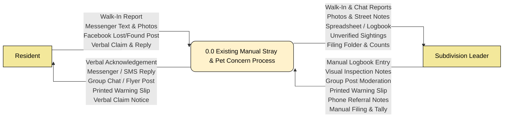
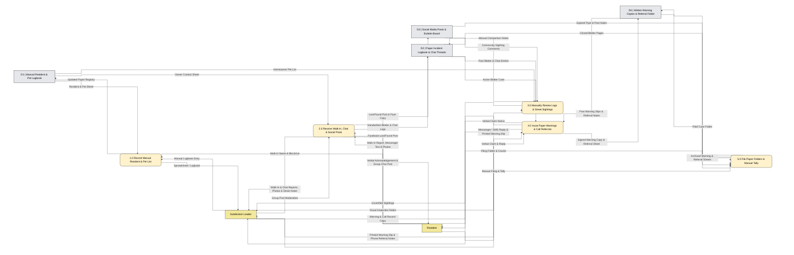

# STRAY-SAFE — Existing Manual Process Data Flow Diagrams (Before Proposed System)

**Gane & Sarson Mermaid.js Data Flow Diagrams (Level 0 & Level 1)** depicting the **existing manual workflow before STRAY-SAFE 2.0** (walk-ins, Messenger/SMS chats, Facebook group posts, paper logbooks, printed warning slips, and manual tallies), designed as the direct **"Before"** counterpart to [STRAY-SAFE-2.0-DFD.md](STRAY-SAFE-2.0-DFD.md).

---

## 1. Existing Manual Scope & Paper/Informal Stores

### 1.1 External Entities

| Entity                           | Role in Existing Manual Process                                                                                                                                                                                                                                                             |
| :------------------------------- | :------------------------------------------------------------------------------------------------------------------------------------------------------------------------------------------------------------------------------------------------------------------------------------------ |
| **`Resident`**           | Reports stray or nuisance animals via walk-in, SMS, or Messenger; posts lost/found pets on community Facebook groups or bulletin boards; receives verbal/printed warnings and informal chat replies.                                                                                        |
| **`Subdivision Leader`** | HOA Officer / Subdivision Head handling complaints manually: writes entries into physical logbooks/spreadsheets, visually inspects streets, checks past paper entries by memory, issues printed warning slips, places phone calls to external animal control/vets, and files paper folders. |

### 1.2 Informal / Manual Data Stores (`D1`–`D4`)

|     Store ID     | Label                                        | Existing Storage Medium                                                                                       |
| :--------------: | :------------------------------------------- | :------------------------------------------------------------------------------------------------------------ |
| **`D1`** | `Manual Resident & Pet Logbook`            | HOA master homeowner spreadsheet or paper registry (no pet QR tags, no digital pet matching)                  |
| **`D2`** | `Paper Incident Logbook & Chat Threads`    | Physical guardhouse/HOA blotter book plus scattered Messenger/SMS threads (no GPS pins or geofence checks)    |
| **`D3`** | `Social Media Posts & Bulletin Board`      | Unmoderated Facebook group posts and printed gate flyers for lost/found pets                                  |
| **`D4`** | `Written Warning Copies & Referral Folder` | Physical filing cabinet holding carbon copies of warning slips, claim notes, and external call/referral notes |

---

## 2. Existing Process — DFD Level 0 (Context Diagram)

---

## 3. Existing Process — DFD Level 1 (`1.0`–`5.0`)

---

## 4. Key Gaps Solved by Proposed STRAY-SAFE 2.0

| Existing Manual Bottleneck                                                       | Proposed STRAY-SAFE 2.0 Improvement                                                                           |
| :------------------------------------------------------------------------------- | :------------------------------------------------------------------------------------------------------------ |
| Walk-in, SMS, and Messenger reports scatter across devices with no tracking code | Unified 6-category reporting with automatic `Reference ID`, GPS pin, and status timeline                    |
| Street descriptions only; no geofence boundary or map pin correction             | Interactive Leaflet map with subdivision geofence validation and Leader pin fix                               |
| Memory/logbook lookups miss repeat incidents and look-alikes                     | Structured Match Leads (`breed`, `color`, `location`), case linking, and QR collar tags (`/t/:token`) |
| Loose paper warning slips with no acknowledgement or observation tracking        | Standardized warning letters, PDF delivery, acknowledgement tracking, and Owner Observation                   |
| Paper folders prevent quick trend counts or verifiable history                   | Digital case closures, case analytics, and immutable chronological audit logs                                 |
