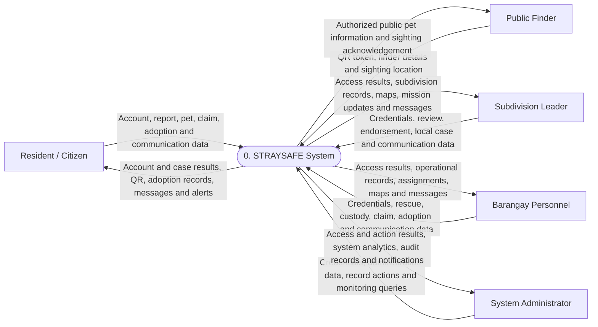
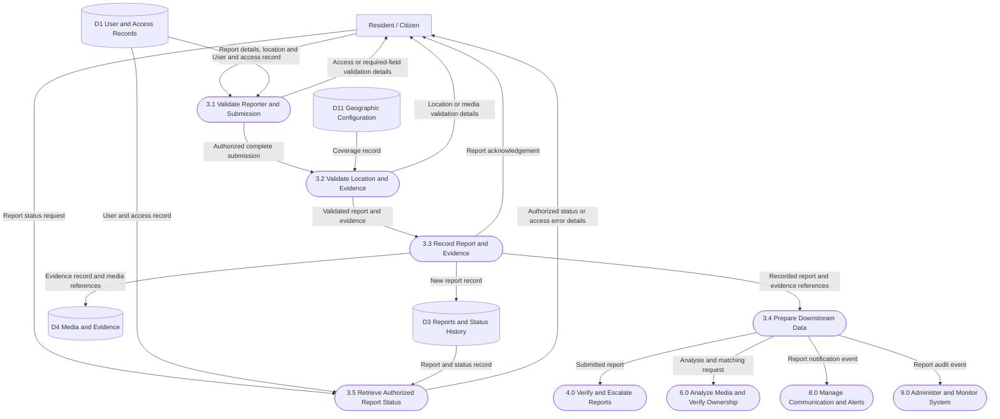

# StraySafe DFD creation guide

**Prepared:** October 11, 2026  
**Basis:** `STRAYSAFE (2).pdf`, especially PDF pp. 49–61, and the current StraySafe source.  
**Use:** A drawing plan for your manuscript's proposed-system DFD. The process/store assignments below are a recommended consistent model, not a claim that the existing diagram images have been visually verified.

## 1. What you are drawing

A Data Flow Diagram explains **what information enters the system, how it is processed, where it is stored, and what information comes out**.

For example:

`Resident → [Report details and evidence] → 3.0 Manage Stray Reports → [New report record] → D3 Reports`

Use three levels, following the convention stated on PDF p. 50:

| Diagram | What to draw | Numbering |
|---|---|---|
| Context diagram / Level 0 | The entire system as one process, with external actors and their inputs/outputs | `0` |
| Level 1 | Decompose the system into its nine major processes; add logical data stores | `1.0` through `9.0` |
| Level 2 | Decompose one Level 1 process into its internal operations | For process `3.0`: `3.1`, `3.2`, `3.3`, etc. |

Some schools call the context diagram separate from Level 0 and shift the other level names. Use your adviser's convention consistently; do not mix numbering conventions within the manuscript.

A DFD does not show screen navigation, button clicks, decision diamonds, or the order/timing of every step. Use a separate flowchart for questions such as “Approved?” and branches such as “Yes/No.” The DFD arrows carry information such as **Approval decision and remarks**.

## 2. Use one notation throughout

Your PDF describes processes as circles or rounded rectangles and stores as parallel lines or open rectangles. Choose one complete notation for all final figures. For example, use Gane–Sarson notation in your drawing tool:

| Element | Shape | Naming rule | StraySafe example |
|---|---|---|---|
| External entity | Rectangle | Person, organization, or external service | `Resident / Citizen` |
| Process | Numbered rounded rectangle | Verb + object | `4.0 Verify and Escalate Reports` |
| Data store | Numbered open-ended rectangle | Noun describing retained data | `D3 Reports and Status History` |
| Data flow | One-directional labeled arrow | Noun phrase describing transferred information | `Verified report and endorsement` |

Use separate arrows for reading and writing. Label both. “Report records” coming out of a store and “Updated report record” going into it are different flows.

The Mermaid examples below use convenient diagram shapes. Redraw their data-store nodes with your chosen DFD notation for the manuscript.

## 3. Set the system boundary first

Use **StraySafe application and its managed records/media** as the logical system boundary. Human actors are outside this boundary even if they work for the barangay.

Include these five external entities:

| ID | Entity | Why it is external |
|---|---|---|
| E1 | Resident / Citizen | Submits information and receives results |
| E2 | Public Finder | Uses a public pet QR link and provides a sighting |
| E3 | Subdivision Leader | Supplies verification, endorsement, and community decisions |
| E4 | Barangay Personnel | Supplies rescue, custody, claims, and adoption decisions |
| E5 | System Administrator | Supplies account/configuration changes and requests oversight information |

Barangay officers and field rescuers can be combined as E4 for readability. Explain their different permissions in the narrative. Split them into two entities only if the same distinction is reflected across the context and lower-level diagrams.

**Public Finder is not a fifth authenticated role.** The four authenticated roles remain resident, subdivision leader, barangay personnel, and administrator. Public QR access is an additional interaction.

YOLO running inside the application is an internal part of a process. MySQL is the technology behind data stores; React and FastAPI are implementation layers, not human actors.

For this logical model, cloud media storage is represented within D4. If your adviser asks for an implementation-oriented DFD, explicitly add external providers such as Gemini, Cloudinary, mapping/routing services, and the email service, with request/response flows. Add them to the context diagram too so the levels remain balanced. Do not mix provider-as-store and provider-as-external-entity representations without explaining the boundary.

## 4. Draw the context diagram first

Place one process in the center: **0 — STRAYSAFE System**. Put the five actors around it. Do not draw internal processes or data stores here.

Use this input/output inventory. You can split the grouped flows into shorter arrows in the final drawing.

| Entity | Entity → StraySafe: inputs | StraySafe → entity: outputs |
|---|---|---|
| Resident | Account/profile data; report details, evidence and location; pet/vaccination data; ownership proof; adoption application and follow-up evidence; case messages; tracking requests | Access/account results; report acknowledgements and status; pet profile and QR; match/claim results; catalog and adoption/certificate results; messages and community notifications |
| Public Finder | QR token; finder contact details and sighting location | Authorized public pet information; sighting acknowledgement |
| Subdivision Leader | Credentials; verification/merge/dispute decisions; endorsements; eligible local custody/claim/resolution updates; alerts; case messages and information requests | Access result; subdivision cases, maps and pet/custody records; decision/endorsement results; mission updates; messages and notifications |
| Barangay Personnel | Credentials; rescue approval/assignment and field evidence; custody/claim/handover updates; adoption decisions and monitoring; alerts; messages and operational queries | Access result; rescue requests and assignments; case/facility/claim/adoption records; operational maps; messages and notifications |
| Administrator | Credentials; user/role changes; coverage/landmark/settings changes; authorized case/record actions; monitoring queries | Access/action results; system records and analytics; audit records; operational notifications |

Keep real data in the arrows: animal **information** enters the system; the physical animal does not.

### Context diagram example

This example groups several data types into each arrow. The table above supplies the detailed data dictionary for those groups.

Do not label public QR output “all owner information.” Only show the information the public endpoint is authorized to disclose.

## 5. Define the nine Level 1 processes

This numbering follows the nine-process outline in your PDF while making each process's responsibility explicit.

| Process | Recommended name | Responsibilities / source anchors |
|---|---|---|
| 1.0 | Manage Users and Access | Registration, login, account/profile updates and access results; `routes/auth.py`, `users.py` |
| 2.0 | Manage Pets and QR Identification | Pet/vaccination records, QR generation, public lookup and sighting history; `pets.py`, `pet_qr.py` |
| 3.0 | Manage Stray Reports | Accept reports/media/location, provide report status, prepare reports for review and analysis; `reports.py` |
| 4.0 | Verify and Escalate Reports | Leader review, duplicate/identity disputes, merge/restore decisions, endorsements and eligible local resolution; `reports.py`, `rescue.py`, `matches.py` |
| 5.0 | Manage Rescue and Animal Custody | Barangay review/dispatch, field evidence, intake/observation/transfer/release/deceased outcomes and return execution; `rescue.py`, `holding.py`, `report_returns.py` |
| 6.0 | Analyze Media and Verify Ownership | Species/attribute/authenticity suggestions, duplicate/pet candidates, human-reviewed identity/claims and ownership decisions; AI utilities, `matches.py`, `claims.py`, `pet_ownership.py` |
| 7.0 | Manage Adoption | Eligibility/catalog, applications, staff tasks, verification, interviews/home visits, agreement/certificate, handover and monitoring; adoption routes |
| 8.0 | Manage Communication and Alerts | Notifications, community announcements, case messages, preferences and delivery records; notifications/announcements/chat/email code |
| 9.0 | Administer and Monitor System | Roles/configuration/coverage/landmarks, oversight analytics, audit recording and retrieval; `admin.py`, `audit_logs.py`, audit utilities |

P6 expands the PDF's matching/claims process to account for the actual image-analysis functions. Explain this in your manuscript. **AI suggestions are not ownership approvals.** Human decisions enter P6 from authorized users.

P9 records audit events from other processes, not just administrator activity. Its logical grouping does not mean every operation calls an `/admin` endpoint.

## 6. Define logical data stores

A DFD store may group several database tables. You do not need one store for every SQL table; that detail belongs in the ERD.

The first ten IDs preserve the store meanings described on PDF pp. 56–61. D11 is an explicit addition for geographic/system configuration that the system needs.

| Store | Name | Implementation examples |
|---|---|---|
| D1 | User and Access Records | `users`, `roles`, `positions`, OTP/revoked-token records |
| D2 | Pet and QR Records | `pets`, `pet_vaccinations`, `pet_qr_codes`, `pet_qr_scans`, `pet_history` |
| D3 | Reports and Status History | `reports`, `report_categories`, `report_status`, `status_history` |
| D4 | Media and Evidence | Managed image/video/document assets and their references; `report_media`, relevant pet/claim/adoption media references |
| D5 | Verification and Endorsement Records | `report_verifications`, `endorsement_letters`, `report_disputes`, `owner_warnings` |
| D6 | Analysis, Matches and Ownership Records | Analysis fields/cache/jobs, `report_matches`, `pet_claims`, `pet_owner_confirmations` |
| D7 | Rescue and Custody Records | `rescues`, `rescue_assignments`, `holding_animals`, `holding_timeline`, `report_returns` |
| D8 | Adoption Records | `adoptions`, assignments, verifications, interviews, home visits, agreements/certificates, monitoring and timelines |
| D9 | Communication and Delivery Records | `notifications`, preferences, `announcements`, chat threads/messages, `email_logs` |
| D10 | Audit Records | `audit_logs` |
| D11 | Geographic and System Configuration | `barangays`, `subdivisions`, `coverage_settings`, `landmarks`, `system_settings` |

Analysis fields can physically live on report/pet tables. D6 describes a logical information group, not an assertion that every analysis result has its own SQL table. Explain shared storage in your data dictionary to avoid contradicting the ERD.

## 7. Connect Level 1 using a flow inventory

Draw entity-to-process arrows first, then process-to-store arrows, then process-to-process arrows. Read this table as your connection checklist, not as execution order.

| Process | Actor interactions | Store reads | Store writes | Main process-to-process flows |
|---|---|---|---|---|
| 1.0 | E1/E3/E4/E5 → credentials/profile; ← access/account results | D1, D11 | D1 | → P8 account messages; → P9 access/account audit events |
| 2.0 | E1 → pet records; ← pet profile/QR/history. E2 → QR token/sighting; ← public profile/acknowledgement. Authorized staff/admin → pet queries/actions; ← permitted records/results | D1, D2 | D2, D4 | → P6 pet analysis request; → P8 QR sighting event; → P9 pet/scan audit events |
| 3.0 | E1 → report/status request; ← acknowledgement/status. Authorized staff/admin → report queries/actions; ← permitted records/results | D1, D3, D4, D11 | D3, D4 | → P4 submitted report; → P6 analysis/matching request; → P8 report event; → P9 report audit event |
| 4.0 | E3 → review/endorsement/local resolution decision; ← review queue/result. E1 → dispute evidence; ← dispute result. E4/E5 → authorized review queries/actions; ← results | D1, D3, D5, D6, D11 | D3, D4, D5 | P6 → candidate/analysis results; → P5 endorsed rescue request; → P8 review event; → P9 review audit event |
| 5.0 | E4 → approval/dispatch/rescue/custody data; ← requests, assignments and operational records. E3 → authorized local custody updates/query; ← local custody/mission records. E5 → oversight actions/query; ← results | D1, D3, D6, D7, D11 | D3, D4, D7 | P4 → endorsed request; P6 → approved owner-return decision; P7 → finalized adoption outcome; → P7 adoption-eligible animal; → P8 rescue/custody event; → P9 audit event |
| 6.0 | E1 → claim/confirmation evidence; ← candidate/claim results. E3/E4/E5 → authorized identity/claim decisions; ← analysis and review records | D1, D2, D3, D4, D6, D7, D11 | D2, D3, D4, D6 | P2/P3 → analysis requests; → P4 review suggestions; → P5 approved return decision; → P8 match/claim event; → P9 audit event |
| 7.0 | E1 → catalog/application/follow-up requests and evidence; ← catalog, decision, certificate and monitoring results. E4/E5 → authorized adoption decisions/actions; ← task/case results | D1, D2, D4, D7, D8 | D2, D4, D8 | P5 → eligible animal; → P5 finalized adoption outcome; → P8 adoption event; → P9 audit event |
| 8.0 | E1/E3/E4 → permitted messages, preferences and alert/query data; ← messages/alerts/results. E5 → notification queries; ← notifications | D1, D9, D11 | D4, D9 | P1–P7/P9 → notification events; → P9 communication audit events |
| 9.0 | E5 → role/configuration/oversight requests; ← results, analytics and audit records. Other authorized roles → permitted geographic/operational queries; ← allowed maps/records | D1–D11 as needed | D1, D10, D11 | P1–P8 → audit events; → P8 administrative notification event |

Use actual permissions when drawing each staff flow. A group-level E4 arrow does not grant every barangay employee approval authority. P9 oversight of operational records can read their stores; record changes should use the owning business process rather than inventing duplicate approval logic.

For a readable final figure, a grouped arrow such as **Rescue and custody records** can represent several related fields. Define those fields in the data dictionary. Duplicate entity/store symbols near processes if needed, marking them as the same E/D identifier; do not invent a new store just to avoid crossing lines.

## 8. Make Level 2 by decomposing one parent process

Start with **3.0 Manage Stray Reports**. Freeze its inputs/outputs before drawing children.

For a resident reporting/tracking decomposition, use this parent boundary:

| Direction | Boundary flow |
|---|---|
| Inputs | Resident report/status request; D1 user/access record; D11 coverage record; D3 existing report/status record |
| Outputs | Resident acknowledgement/status/error details; D3 new/updated report record; D4 evidence record; P4 submitted report; P6 analysis request; P8 report event; P9 report audit event |

If the Level 1 P3 also includes staff/admin report queries or media retrieval, include those flows in its complete Level 2 diagram too. The example below covers the **resident submission/tracking portion**, so do not present it as the full balanced P3 decomposition until those other parent flows are added.

Use these subprocesses:

1. **3.1 Validate Reporter and Submission:** verify access and required report information.
2. **3.2 Validate Location and Evidence:** check coverage/media constraints; return validation details if rejected.
3. **3.3 Record Report and Evidence:** save report/evidence references and prepare an acknowledgement.
4. **3.4 Prepare Review, Analysis and Notification Data:** produce the downstream requests/events.
5. **3.5 Retrieve Authorized Report Status:** handle a tracking request and return permitted case information.

### Level 2 example: resident reporting/tracking portion of 3.0

P4/P6/P8/P9 are neighboring processes shown as references outside the decomposed P3 boundary. They are not P3's children. The arrows describe information exchange, not a guarantee that every request executes synchronously or in the displayed order.

Then make detailed diagrams for the complex parts:

| Parent | Suggested children |
|---|---|
| 4.0 | Retrieve review case; validate evidence; review duplicates/disputes; record review decision; prepare endorsement/local-resolution result |
| 5.0 | Review rescue request; assign personnel; record field updates; record intake; update custody; record release/transfer/deceased outcome |
| 6.0 | Retrieve report/pet evidence; analyze media; rank candidate matches; receive human review/ownership proof; record identity/claim decision; prepare return/notification data |
| 7.0 | Determine catalog eligibility; receive application; assign verification tasks; record interview/home-visit results; record authorized decision; issue agreement/certificate; record handover; record monitoring |

Check the implemented stages before writing their inputs/outputs. Do not add subprocesses for veterinary diagnosis, automatic euthanasia decisions, or continuous GPS pet tracking; those are outside your stated scope.

## 9. Check balancing between levels

Balancing means lower-level diagrams preserve the parent's external information exchanges.

Example: the context diagram contains **Public Finder → StraySafe: QR token and sighting details**. Level 1 must show those inputs reaching P2, with **P2 → Public Finder: authorized pet information and sighting acknowledgement**. P2's Level 2 must retain both directions.

You may split a parent flow into component flows at the child level. For example, **Report submission data** can become description, coordinates, and evidence. Record that composition in the data dictionary. You may also add internal stores/flows inside a decomposition; do not introduce a new actor exchange absent from the parent.

Use a small balancing worksheet for each parent:

| Parent flow | Child process(es) carrying it | Present? |
|---|---|---|
| Resident report submission | 3.1 | Yes |
| User/access record | 3.1 and 3.5 | Yes |
| Coverage record | 3.2 | Yes |
| New report record | 3.3 → D3 | Yes |
| Report acknowledgement/validation details | 3.1/3.2/3.3 → Resident | Yes |
| Submitted report for review | 3.4 → 4.0 | Yes |
| Analysis request | 3.4 → 6.0 | Yes |
| Report status request/result | Resident → 3.5 → Resident | Yes |
| Other P3 staff/admin query or media flows | Add corresponding subprocess connections | Complete before claiming a full P3 diagram |

## 10. Fix these manuscript issues while redrawing

These are text-level observations; they do not establish whether the existing image arrows are wrong.

- **PDF p. 54:** the “Context Diagram Proposed” paragraph immediately discusses Level 1 and nine processes. Separate the one-process context explanation from the Level 1 explanation.
- **PDF pp. 55–56:** the context correctly includes a Public Finder, but the access paragraph says no one can use StraySafe without an account. Clarify the public QR exception and other implemented public views.
- **PDF pp. 55–56:** Figure 2.6 is used for both the proposed context and User & Access Management. Give every figure a unique consecutive number.
- **PDF pp. 57–65:** replace `Figure N.N` placeholders. Identify each figure's actual level and parent process.
- **PDF pp. 56–61:** keep process IDs and D1–D10 store definitions consistent across text, figures, and captions. Explicitly explain D11 if using this guide's configuration store.
- **PDF pp. 57–61:** diagrams organized around individual major processes may be Level 1 excerpts or Level 2 decompositions. An excerpt showing unchanged `2.0`/`3.0` nodes is not automatically Level 2; actual decomposition uses child IDs such as `3.1`.
- **PDF pp. 58–61:** explicitly account for AI analysis, messaging, alerts, configuration, and audit events from all relevant operations. Do not model notifications as resident-only if staff/admin also receive them.
- **Existing/manual DFD, pp. 51–54:** keep it separate from the proposed computerized DFD. Model the interview-supported complaint forms/logbooks/impound records and verbal/printed updates; do not insert AI or cloud databases into the manual baseline. Existing/manual diagrams may legitimately have fewer actors.

## 11. Draw it step by step in your chosen diagram editor

1. Create a blank landscape page and select the DFD shape library or consistent custom symbols.
2. Write the entity, process, store, and flow inventories before placing arrows.
3. Draw the context diagram with five actors and one system process.
4. Create a separate Level 1 page with all nine processes. Place the central report/review/rescue functions together, pets/ownership nearby, and communication/administration near the edge.
5. Add D1–D11 close to their main owning processes. Use repeated, clearly identified store symbols where needed.
6. Connect the actors to their processes using the Level 1 inventory. Label every arrow.
7. Connect each process's reads/writes and the listed neighboring-process exchanges.
8. Group related data flows or move repeated symbols to reduce crossing lines. Preserve their meanings.
9. Create separate Level 2 pages for selected processes and balance each against its parent.
10. Export readable vector/PDF figures or high-resolution images. Ensure labels remain legible at the actual manuscript page size.
11. Assign final figure numbers, captions, and matching narrative descriptions; check them after the figures are inserted.

Suggested captions:

- `Figure 2.X. Proposed StraySafe System Context Diagram (Level 0)`
- `Figure 2.X. Proposed StraySafe System Level 1 Data Flow Diagram`
- `Figure 2.X. Level 2 Decomposition of Process 3.0: Manage Stray Reports`

Use the final available figure numbers in your manuscript rather than retaining `2.X`.

## 12. Final DFD checklist

- [ ] One notation and level-numbering convention is used throughout.
- [ ] The context has one system process, the intended external entities, and no internal data stores.
- [ ] Public Finder appears and is distinguished from the four authenticated roles.
- [ ] Level 1 contains all nine defined processes with unique IDs.
- [ ] Every process has meaningful input and output; outputs can be explained by inputs and stored information.
- [ ] Every arrow has a clear data label, such as “Claim evidence” or “Review decision.”
- [ ] Every store has a unique, consistently reused D-number and a defined purpose.
- [ ] Entity ↔ store, store ↔ store, and actor ↔ actor shortcuts do not appear; information passes through a process.
- [ ] Data stores are not mistaken for ERD entities, and process nodes are not just screen names.
- [ ] Required human review appears separately from AI suggestions.
- [ ] Rescue, custody, adoption and ownership outcomes are connected through their exchanged records/decisions.
- [ ] Notifications, messages, alerts, and audit events are covered beyond resident-only delivery.
- [ ] Geography/configuration and authorized map/analytics queries are accounted for.
- [ ] External providers are handled consistently with the declared system boundary.
- [ ] Context → Level 1 and Level 1 → Level 2 boundaries balance.
- [ ] Any partial diagrams are labeled as excerpts, not claimed as complete balanced decompositions.
- [ ] Manual and proposed systems are shown separately.
- [ ] Figure numbers, captions, process names, store names, and narrative all agree.
- [ ] Figures remain readable in the submitted document.

## Reusable explanation for the manuscript

“The proposed StraySafe context diagram represents the application as a single process exchanging information with residents, public QR finders, subdivision leaders, barangay personnel, and system administrators. The Level 1 diagram decomposes the system into nine functions covering access management, pet identification, reporting, verification and escalation, rescue and custody, AI-assisted analysis and ownership verification, adoption, communication, and administration. Logical data stores group the records required by these functions. Selected Level 2 diagrams further decompose complex processes while preserving the information flows shown at the parent level.”

Adapt this paragraph to the final figures. It explains the model; it does not substitute for checking that every required arrow is actually drawn.
