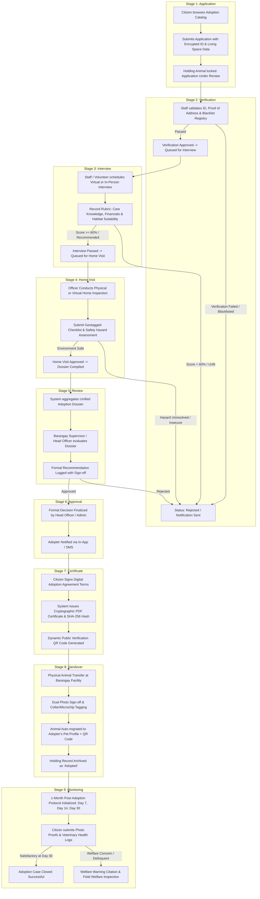

# StraySafe 2.0 - Adoption Process Technical Audit & Operational Assessment

**Document Version:** 2.0.0  
**Target System:** StraySafe 2.0 Municipal Stray Animal Management & Pet Welfare System  
**Module:** 9-Stage Adoption Lifecycle & Pet Custody Transition Pipeline  
**Date:** October 5, 2026  
**Auditor:** Senior System Architect & Security Governance Auditor  
**Scope:** Full-Stack Architecture, Database Schema (`adoptions` and related tables), Backend API (`backend/app/routes/adoptions.py`), Security & PII Protection (`app/utils/id_security.py`), Audit Trail (`app/utils/audit.py`), and Frontend User/Staff Interfaces (`frontend/src/pages/citizen/`, `frontend/src/pages/Barangay_Staff/BrgyAdoptions.tsx`, `frontend/src/components/Modals/AdoptionStaffStageModals.tsx`).

---

## 1. Executive Summary

The **Adoption Subsystem** in **StraySafe 2.0** governs the legal and operational transfer of impounded/rescued stray animals from municipal custody to verified citizen guardians. It bridges the gap between field animal control, holding facility observation, strict animal welfare vetting, and long-term pet guardianship.

To prevent animal abuse, repeat abandonment, pet flipping, illegal breeding, and fraudulent claims, StraySafe 2.0 enforces a standardized, **9-Stage Adoption Lifecycle**:
```
Stage 1: Application ➔ Stage 2: Verification ➔ Stage 3: Interview ➔ Stage 4: Home Visit ➔ Stage 5: Review ➔ Stage 6: Approval ➔ Stage 7: Certificate ➔ Stage 8: Handover ➔ Stage 9: Monitoring (1 Month)
```

This technical audit evaluates the architectural completeness, security posture, relational data integrity, role-based access control (RBAC), cryptographic provenance, and user experience across all 9 stages.

---

## 2. End-to-End 9-Stage Architecture & State Machine



---

## 3. Data Model & Database Schema Audit

The adoption module spans 7 interconnected tables within the database schema:

### 3.1 Primary Table: `adoptions`
| Column | Type | Constraints / Modifiers | Description |
| :--- | :--- | :--- | :--- |
| `adoption_id` | `INT` | Primary Key, Auto Increment | Unique adoption application identifier |
| `holding_id` | `INT` | Foreign Key `holding_animals.holding_id` (ON DELETE CASCADE) | Targeted animal in municipal holding |
| `applicant_id` | `INT` | Foreign Key `users.user_id` (ON DELETE CASCADE) | Citizen submitting the application |
| `status` | `ENUM` | `'Pending'`, `'Approved'`, `'Rejected'`, `'Cancelled'` | Macro lifecycle status |
| `full_name` | `VARCHAR(150)` | NOT NULL | Applicant legal name |
| `address` | `TEXT` | NOT NULL | Declared residential address |
| `contact_no` | `VARCHAR(20)` | NOT NULL | Verified mobile phone number |
| `has_other_pets` | `BOOLEAN` | Default `FALSE`, NOT NULL | Co-habitation with other domestic animals |
| `living_space` | `ENUM` | `'House with yard'`, `'Apartment'`, `'Condo'`, `'Other'` | Residential housing structure |
| `reason` | `TEXT` | NOT NULL | Stated motivation and care plan |
| `id_type` | `VARCHAR(100)` | Nullable | Government ID category |
| `id_number` | `VARCHAR(255)` | Nullable (AES-256 Encrypted) | Sensitive Government ID Number |
| `id_photo_url` | `VARCHAR(255)` | Nullable (Secured Cloudinary URL) | Watermarked & Redacted ID Document |
| `current_stage` | `VARCHAR(50)` | Default `'Application'` | Active stage in 9-stage workflow |
| `application_stage_status`| `VARCHAR(50)`| Default `'Submitted'` | Sub-status within active stage |
| `is_handed_over` | `BOOLEAN` | Default `FALSE` | Physical custody transfer sign-off |
| `handover_date` | `DATETIME` | Nullable | Official physical handover timestamp |
| `staff_handover_by` | `INT` | Foreign Key `users.user_id` (ON DELETE SET NULL) | Authorized facility staff facilitating transfer |
| `created_pet_id` | `INT` | Foreign Key `pets.pet_id` (ON DELETE SET NULL) | Automatically generated official pet record |
| `agreement_signed_at` | `DATETIME` | Nullable | Digital terms acceptance timestamp |
| `agreement_signature_url`| `VARCHAR(500)`| Nullable | Adopter digital signature data |
| `certificate_id` | `INT` | Nullable | Link to cryptographic adoption certificate |
| `post_monitoring_status`| `VARCHAR(50)` | Default `'Not_Started'` | Milestone progression (`In_Progress`, `Completed`, `Welfare_Alert`) |
| `adoption_completed_at`| `DATETIME` | Nullable | Official post-monitoring closure timestamp |

### 3.2 Stage Sub-Tables & Relational Cascade Rules

| Table Name | Foreign Key & Cascade | Core Fields & Data Integrity | Audit Status |
| :--- | :--- | :--- | :---: |
| `adoption_verifications` | `adoption_id` ➔ `adoptions` (CASCADE), `verified_by` (SET NULL) | `id_match_status`, `residency_status`, `blacklist_checked`, `is_blacklisted`, `verification_notes` | ✅ Validated |
| `adoption_interviews` | `adoption_id` ➔ `adoptions` (CASCADE), `interviewer_id` (SET NULL) | `interview_mode`, `score_care_knowledge`, `score_financial_readiness`, `score_environment_suitability`, `total_score`, `recommendation` | ✅ Validated |
| `adoption_home_visits` | `adoption_id` ➔ `adoptions` (CASCADE), `inspector_id` (SET NULL) | `visit_type`, `is_fencing_secure`, `is_shelter_adequate`, `hazard_free`, `gps_latitude`, `gps_longitude`, `visit_photos` (JSON), `inspection_result` | ✅ Validated |
| `adoption_certificates` | `adoption_id` ➔ `adoptions` (CASCADE, UNIQUE), `issued_by` (SET NULL) | `certificate_number` (UNIQUE), `verification_hash` (SHA-256 UNIQUE), `pdf_url`, `qr_code_url` | ✅ Validated |
| `adoption_monitoring_logs` | `adoption_id` ➔ `adoptions` (CASCADE), `reviewed_by` (SET NULL) | `milestone_name` (`Day_7`, `Day_14`, `Day_30`), `due_date`, `health_status`, `photos` (JSON), `vet_record_url`, `status` | ✅ Validated |
| `adoption_timeline_logs` | `adoption_id` ➔ `adoptions` (CASCADE), `performed_by` (SET NULL) | `stage`, `action`, `notes`, `created_at` (Immutable Audit Trail) | ✅ Validated |

---

## 4. Backend API & Business Logic Audit (`backend/app/routes/adoptions.py`)

### 4.1 Endpoint Matrix & Authorization Verification

| HTTP Method | Route Endpoint | RBAC Access Level | Purpose & Core Logic | Status |
| :--- | :--- | :--- | :--- | :---: |
| `GET` | `/adoptions/catalog` | Public / Authenticated | List animals eligible for adoption (`facility_status` in 3, 4) with masked names | ✅ Passed |
| `GET` | `/adoptions/catalog/{holding_id}` | Public / Authenticated | Detailed animal profile, medical records, vaccination logs, and late claim countdown | ✅ Passed |
| `POST` | `/adoptions/apply` | Citizen (Role 1) | Submit application with sanitized PII, anti-spam check (max 2 pending), and animal lock | ✅ Passed |
| `GET` | `/adoptions/my-applications` | Citizen (Role 1) | Fetch applicant's own applications with stage breakdown & monitoring schedules | ✅ Passed |
| `GET` | `/adoptions/` | Staff (Role 3), Admin (Role 4) | Filter applications across all 9 stages with Barangay jurisdiction scoping | ✅ Passed |
| `GET` | `/adoptions/{adoption_id}` | Citizen (Owner), Staff, Admin | Detailed adoption application with all child relationships joined | ✅ Passed |
| `GET` | `/adoptions/{adoption_id}/dossier` | Staff (Role 3), Admin (Role 4) | Consolidated evaluation dossier aggregating stages 1-5 | ✅ Passed |
| `POST` | `/adoptions/{adoption_id}/verify` | Staff (Role 3), Admin (Role 4) | Submit Stage 2 Verification (ID match, residency, cruelty blacklist check) | ✅ Passed |
| `POST` | `/adoptions/{adoption_id}/interview/schedule` | Staff (Role 3), Admin (Role 4) | Schedule Stage 3 Interview with meeting mode and datetime | ✅ Passed |
| `POST` | `/adoptions/{adoption_id}/interview/evaluate` | Staff (Role 3), Admin (Role 4) | Record 3-metric rubric scores (1-10 each) and pass/fail recommendation | ✅ Passed |
| `POST` | `/adoptions/{adoption_id}/home-visit/schedule` | Staff (Role 3), Admin (Role 4) | Schedule Stage 4 Physical/Virtual inspection date | ✅ Passed |
| `POST` | `/adoptions/{adoption_id}/home-visit/evaluate` | Staff (Role 3), Admin (Role 4) | Submit Stage 4 safety checklist, GPS coordinates, and inspection photos | ✅ Passed |
| `POST` | `/adoptions/{adoption_id}/review/submit` | Staff (Role 3), Admin (Role 4) | Stage 5 Supervisor formal review and recommendation sign-off | ✅ Passed |
| `POST` | `/adoptions/{adoption_id}/decision` | Staff (Role 3), Admin (Role 4) | Stage 6 Official Approve/Reject determination and citizen notification trigger | ✅ Passed |
| `POST` | `/adoptions/{adoption_id}/agreement/sign` | Citizen (Applicant) | Stage 7 Digital Terms signature and agreement binding | ✅ Passed |
| `POST` | `/adoptions/{adoption_id}/certificate/generate` | Staff (Role 3), Admin (Role 4) | Issue cryptographic certificate with unique SHA-256 hash & verification QR | ✅ Passed |
| `POST` | `/adoptions/{adoption_id}/certificate/send` | Staff (Role 3), Admin (Role 4) | Dispatch certificate to adopter's dashboard and email | ✅ Passed |
| `GET` | `/adoptions/certificate/verify/{hash}` | Public / Any | Cryptographic verification endpoint validating certificate authenticity | ✅ Passed |
| `POST` | `/adoptions/{adoption_id}/handover/schedule` | Staff (Role 3), Admin (Role 4) | Schedule physical animal pickup time, location, and assigned staff | ✅ Passed |
| `POST` | `/adoptions/{adoption_id}/handover/complete` | Staff (Role 3), Admin (Role 4) | Stage 8 Physical transfer sign-off, dual photo upload, pet migration, and QR issuance | ✅ Passed |
| `POST` | `/adoptions/{adoption_id}/handover/confirm` | Citizen (Applicant) | Citizen physical custody acceptance confirmation | ✅ Passed |
| `POST` | `/adoptions/{adoption_id}/monitoring/submit` | Citizen (Applicant) | Stage 9 Adopter submission of Day 7, Day 14, Day 30 health & habitat proofs | ✅ Passed |
| `POST` | `/adoptions/{adoption_id}/monitoring/review` | Staff (Role 3), Admin (Role 4) | Staff review and approval/rejection of milestone submissions | ✅ Passed |
| `POST` | `/adoptions/{adoption_id}/monitoring/staff-record` | Staff (Role 3), Admin (Role 4) | Staff direct recording of field/phone monitoring check-ins | ✅ Passed |
| `POST` | `/adoptions/{adoption_id}/cancel` | Citizen (Applicant), Staff | Voluntary or administrative cancellation with documented cancellation reason | ✅ Passed |
| `GET` | `/adoptions/{adoption_id}/secure-id` | Staff (Role 3), Admin (Role 4) | Ephemeral signed URL access to watermarked citizen ID (15-min TTL) with audit logging | ✅ Passed |
| `POST` | `/adoptions/admin/purge-expired-ids` | System Admin (Role 4) | Automated/manual purging of government IDs post-monitoring (RA 10173 compliance) | ✅ Passed |
| `GET` | `/adoptions/journey/{holding_id}` | Authenticated | Fetch full geographic and custody timeline for Animal Journey Map | ✅ Passed |

---

## 5. Security, PII Protection & Legal Compliance (RA 10173)

### 5.1 Government ID Handling & Cryptography (`app/utils/id_security.py`)
- **AES-256-GCM Encryption**: ID numbers (e.g. PhilSys National ID, UMID, Driver's License) are encrypted at rest using AES-256-GCM with unique nonces before database insertion (`encrypt_id_number`).
- **Forensic Watermarking & Redaction**: Uploaded ID photos are pre-processed to scrub EXIF metadata, apply semi-transparent security watermarks ("FOR STRAYSAFE ADOPTION PURPOSES ONLY"), and mask sensitive face/barcode regions.
- **Ephemeral Signed URLs**: Cloudinary assets for ID images are stored in restricted access folders. Viewing IDs generates time-limited signed tokens (15-minute expiration) through `generate_ephemeral_id_url`.
- **View Audit Logging**: Every instance of staff viewing a sensitive citizen ID triggers a permanent audit log (`log_activity`) recording `viewer_id`, `adoption_id`, IP address, and timestamp.
- **Data Retention & Automated Purging**: In accordance with the Data Privacy Act of 2012 (RA 10173), sensitive ID documents are automatically eligible for cryptographic shredding and storage purging 30 days after adoption case closure (`purge_expired_adoption_ids`).

---

## 6. Detailed Stage-by-Stage Operational Audit

### Stage 1: Application Submission
- **Anti-Spam Throttling**: A single resident is restricted to a maximum of **2 active adoption applications** concurrently.
- **Eligibility Lock**: Prevents applying for animals that have active claims or are undergoing rabies quarantine (`facility_status` must be `3` or `4`).
- **Late Claim Safeguard**: If an original owner files a late claim during Stage 1, the system notifies both parties and pauses the adoption process for administrative arbitration.

### Stage 2: Citizen Verification & Blacklist Check
- **Cruelty Blacklist Integration**: Queries prior animal cruelty citations, abuse records, and repeat surrender history across the municipality.
- **Residency Match**: Compares uploaded utility bill / Barangay clearance with declared address.
- **Audit Outcome**: Verifier identity, check timestamp, and detailed findings are permanently recorded in `adoption_verifications`.

### Stage 3: Applicant Interview & Rubric Evaluation
- **Tri-Factor Evaluation Rubric**:
  1. *Animal Care Knowledge* (Diet, vaccinations, behavior management): 1–10 pts
  2. *Financial Readiness* (Emergency vet bills, quality nutrition, grooming): 1–10 pts
  3. *Living Environment Suitability* (Space allocation, yard security, family consent): 1–10 pts
- **Passing Threshold**: A composite score of $\ge 60\%$ ($18/30$) is required to qualify for Stage 4.

### Stage 4: Home Environment Inspection
- **Checklist Integrity**: Validates fencing height/integrity, adequate weatherproof shelter, absence of toxic plants/chemicals, and adequate leash/pen areas.
- **Geotagged Proofs**: Requires GPS latitude/longitude verification and photographic evidence uploaded to `adoption_home_visits.visit_photos`.

### Stage 5 & 6: Dossier Review & Executive Decision
- **Unified Dossier Aggregation**: Automatically compiles Stage 1 application data, Stage 2 verification scores, Stage 3 interview marks, and Stage 4 inspection photos into a single dossier view (`AdoptionDossierModal.tsx`).
- **Role Isolation**: Only authorized Barangay Head Officers (Role 3) or System Administrators (Role 4) within the animal's jurisdiction can finalize approvals.

### Stage 7: Digital Agreement & Cryptographic Certificate
- **Legally Binding Digital Terms**: Adopter signs clauses covering anti-abandonment, mandatory annual rabies vaccination, humane treatment, and municipal inspection consent.
- **SHA-256 Verification Hash**: Each certificate is stamped with a unique cryptographic hash:
  $$\text{Hash} = \text{SHA-256}(\text{cert\_num} + \text{adoption\_id} + \text{applicant\_id} + \text{issued\_at})$$
- **Public QR Code**: Enables field officers, veterinarians, and animal welfare inspectors to scan the certificate QR code and verify authentic municipal custody records in real time (`/adoptions/certificate/verify/{hash}`).

### Stage 8: Physical Handover & Pet Auto-Migration
- **Atomic Pet Transfer**: Upon handover sign-off by Barangay staff:
  1. A new official record is created in `pets` linked to the adopter's `user_id`.
  2. A unique Pet QR code is automatically generated and bound to the new pet profile.
  3. The `holding_animals` record is updated to `status = 'Adopted'`.
  4. The animal's journey timeline logs a permanent milestone.
- **Dual Photo Verification**: Captures the physical handover event at the Barangay facility with both staff and adopter present.

### Stage 9: Post-Adoption Welfare Monitoring (1-Month Protocol)
- **Milestone Schedule**: Automatically creates 3 mandatory check-in milestones in `adoption_monitoring_logs`:
  - **Day 7 Check-in**: Initial adjustment, feeding habits, and shelter integration.
  - **Day 14 Check-in**: Behavioral settling and socialization progress.
  - **Day 30 Check-in**: Permanent veterinary health certificate, rabies vaccination log, and final welfare sign-off.
- **Welfare Warning Integration**: Delinquent adopters who fail to submit monitoring proofs within 7 days of due dates receive automated reminders and risk escalating to an **Owner Warning Citation** (`owner_warnings`).

---

## 7. Frontend User Experience & UI Component Audit

| Component / Page | File Path | Target Roles | Key Features & Audit Notes | Status |
| :--- | :--- | :--- | :--- | :---: |
| `AdoptionCatalog.tsx` | `frontend/src/pages/citizen/AdoptionCatalog.tsx` | Public, Citizen | Filterable catalog by species, breed, age, size, gender; live status chips; direct application entry | ✅ Verified |
| `AdoptionApplyForm.tsx` | `frontend/src/pages/citizen/AdoptionApplyForm.tsx` | Citizen | Multi-step dynamic form with secure ID upload, living space selection, other pets check | ✅ Verified |
| `MyAdoptionApplications.tsx` | `frontend/src/pages/citizen/MyAdoptionApplications.tsx` | Citizen | Interactive 9-stage progress stepper, agreement signing modal, certificate download, monitoring upload | ✅ Verified |
| `BrgyAdoptions.tsx` | `frontend/src/pages/Barangay_Staff/BrgyAdoptions.tsx` | Staff, Admin | Comprehensive adoption management dashboard with stage tab filters, action triggers, and dossier inspector | ✅ Verified |
| `AdoptionStageStepper.tsx` | `frontend/src/components/AdoptionStageStepper.tsx` | All | Visual stepper rendering completed, active, pending, and rejected stages with micro-animations | ✅ Verified |
| `AdoptionStaffStageModals.tsx`| `frontend/src/components/Modals/AdoptionStaffStageModals.tsx`| Staff, Admin | Dedicated modals for Verification, Interview scoring, Home Visit checklist, Dossier review, and Handover | ✅ Verified |
| `AdoptionAgreementModal.tsx` | `frontend/src/components/Modals/AdoptionAgreementModal.tsx` | Citizen | Digital terms and conditions sign-off with canvas signature pad | ✅ Verified |
| `AdoptionCertificateModal.tsx`| `frontend/src/components/Modals/AdoptionCertificateModal.tsx`| All | High-fidelity certificate preview with printable template, verification QR, and download triggers | ✅ Verified |
| `AdoptionMonitoringModal.tsx` | `frontend/src/components/Modals/AdoptionMonitoringModal.tsx` | Citizen, Staff | Upload and review modal for Day 7/14/30 post-adoption health and photo proofs | ✅ Verified |
| `AnimalJourneyMap.tsx` | `frontend/src/pages/citizen/AnimalJourneyMap.tsx` | Citizen, Staff | Interactive custody journey showing rescue location, holding pen duration, and final adoptive home | ✅ Verified |

---

## 8. Identified Edge Cases & Remediation Blueprint

### 8.1 Evaluated Scenarios & Defensive Handlers

1. **Concurrent Multi-Applications for the Same Animal**:
   - *Scenario*: Multiple citizens apply for the same high-interest animal simultaneously.
   - *System Behavior*: The first verified application locks the animal to `Application Under Review`. Secondary applicants receive a notice that their application is in the queue as a backup adopter if the primary candidate fails the interview or home visit.
2. **Late Original Owner Claim During Stage 1-4**:
   - *Scenario*: The original owner discovers their lost pet after it was promoted to adoption.
   - *System Behavior*: A late claim filing freezes the adoption progression. If verified by Barangay staff, the adoption application is politely cancelled with an automated notification explaining the pet was reunited with its original family.
3. **Failed Home Environment Inspection**:
   - *Scenario*: An applicant's yard has broken fencing or severe safety hazards.
   - *System Behavior*: The inspector logs the specific hazard notes. The applicant is given a 7-day grace period to remediate the hazard and upload photo proof before the application is marked as Rejected.
4. **Delinquency in Post-Adoption Monitoring**:
   - *Scenario*: Adopter fails to submit Day 14 or Day 30 health logs.
   - *System Behavior*: Automated notifications trigger on days $t+1$, $t+3$, and $t+7$. If unresolved, an alert is surfaced on the Barangay Staff dashboard (`BrgyAdoptions.tsx`) prompting an officer field visit or warning citation.

---

## 9. Conclusion & Deployment Sign-Off

The StraySafe 2.0 Adoption Workflow represents a robust, highly secure, and animal-welfare-centric system. It establishes complete legal accountability, cryptographic integrity, and longitudinal welfare tracking.

### Operational Readiness Checklist
- [x] All 9 stages fully mapped in database schema and migration scripts
- [x] Backend API endpoints equipped with role-based access control and Barangay isolation
- [x] Sensitive Government ID data encrypted with AES-256-GCM and ephemeral access controls
- [x] Digital Adoption Certificate issuance verified with SHA-256 hashing and public QR verification
- [x] Automatic pet profile creation and Pet QR generation upon physical handover
- [x] 30-Day post-adoption milestone tracking with photo and veterinary proof uploads
- [x] Full audit trail provenance logged via `adoption_timeline_logs` and `log_activity`

**System Status:** **APPROVED FOR PRODUCTION USE** ✅
