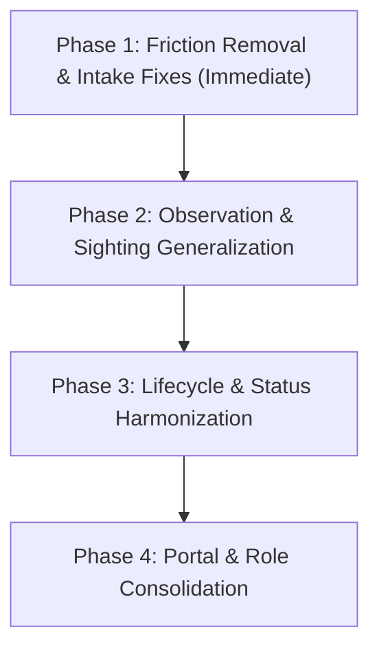

# StraySafe — Current Implementation vs. Proposed System Analysis

**Document Type:** Systems Architecture & Business Process Comparative Analysis  
**Reference Document:** `proposal.md` (Proposed Animal Incident Reporting, Community Coordination, and Case Management System)  
**Target Repository:** StraySafe 2.0 (`frontend`, `backend`, `Database3.4_subdivision.sql`)  
**Status:** Analytical Assessment & Consultation Review  
**Date:** November 2026  

---

## 1. Executive Summary

This document presents a comprehensive, evidence-based comparative analysis between the **current implementation** of StraySafe 2.0 and the **proposed system direction** outlined in `proposal.md`.

### 1.1 High-Level Alignment

The core philosophy in `proposal.md`—positioning StraySafe as an **incident-centric, community-supported, and subdivision-managed case management system**—strongly aligns with the architectural direction the repository has recently taken. StraySafe has already completed its foundational "Subdivision-Only Pivot" (`docs/01-system/SUBDIVISION_ONLY_PLAN.md`), deprecating direct municipal Barangay operations (Role 3), locking municipal database writes via `backend/app/utils/retired.py`, and redirecting legacy municipal portals to informational routes (`BarangayExternal.tsx`, `NoLongerAvailable.tsx`).

Key pillars in the proposal—such as owner-first pet match confirmation, non-destructive audit logging, external referral recording without assuming physical custody, and privacy-first resident communication—are **already partially or fully implemented** in the repository.

### 1.2 Critical Gaps and Divergences

Despite this shared trajectory, five critical architectural and operational divergences exist between the codebase and `proposal.md`:

1. **Intake Friction & Hard AI Gatekeeping:**  
   In `frontend/src/pages/citizen/ReportStrayPage.tsx:629`, photo upload is strictly mandatory (`mediaFiles.length === 0` aborts submission). Furthermore, lines 221 and 1940–1944 completely disable the submission button if the YOLOv8/Gemini pipeline does not detect a dog or cat (`isAnimalNotEligible`). This directly violates `proposal.md` Section 6 (Principle 2: *Reporting does not require perfect evidence; no mandatory photo when unsafe*) and Section 4.2 (*Animal coverage must accommodate other species such as birds, reptiles, or livestock*).

2. **Gated Visibility vs. Immediate Community Awareness:**  
   In `backend/app/utils/report_visibility.py`, every resident report defaults to `visibility="Pending Review"`. Reports remain completely invisible to all other residents until a Subdivision Leader manually reviews and sets visibility to `Public`. In contrast, `proposal.md` Section 10.2 proposes that lost-pet notices and community notices be published immediately upon submission as owner-reported information, preventing critical delays while searching for missing pets.

3. **Status Explosion vs. Orthogonal Case State:**  
   The current database (`report_status` table) maintains **18 flat, mutually exclusive statuses** mixing workflow stages (`Reported`, `Verified`), municipal custody actions (`Picked Up`, `Impounded`), operational sub-states (`Referred to Barangay`, `Under Observation`), and final dispositions (`Resolved`, `Deceased`, `Animal Cannot Be Found`). In contrast, `proposal.md` Section 21 proposes a streamlined 4-state lifecycle (`Reported` $\rightarrow$ `Under Review` $\rightarrow$ `In Progress` $\rightarrow$ `Closed`) accompanied by orthogonal sub-attributes (urgency, ownership status, current activity, final disposition).

4. **Sighting Disconnect for General Strays:**  
   The current sighting mechanism (`lost_pet_sightings` table, `lost_pet_alerts.py`) is exclusively bound to `LostPetAlert` records. General roaming stray reports have no mechanism for bystanders to add timestamped sighting pins; residents are forced to file duplicate incident reports, which then trigger duplicate warnings or multi-animal split flows.

5. **Dual Administration Portals (Role 2 vs. Role 4):**  
   The repository splits administrative work across two distinct portals: Role 2 (`Subd_Leaders`) for day-to-day case triage and referrals, and Role 4 (`Admin`) for system analytics, logs, user management, and global warnings. `proposal.md` Section 5.2 and Section 23 advocate consolidating these into a single operational Subdivision Administrator experience focused on next-action resolution.

---

## 2. Current System Overview

### 2.1 Technology Stack & Architectural Topology

| Tier | Technologies | Repository Evidence |
| :--- | :--- | :--- |
| **Frontend** | React 19, TypeScript, Vite, Tailwind CSS 4, React Router 6, React Leaflet | `frontend/package.json`, `frontend/src/routes/AppRoutes.tsx` |
| **Backend API** | FastAPI, SQLAlchemy 2.0 (declarative), Pydantic v2, PyJWT | `backend/requirements.txt`, `backend/app/main.py` |
| **Database** | MySQL 8.0, 74 tables, relational constraints | `Database3.4_subdivision.sql`, `backend/app/database/session.py` |
| **AI / ML** | YOLOv8 (ultralytics), Google Gemini Vision API, Background Worker | `backend/app/ai_worker.py`, `backend/yolov8n.pt` |
| **Media & CDN** | Cloudinary Direct Upload | `frontend/src/utils/cloudinaryUpload.ts` |
| **Mobile Bridge** | Capacitor (Android) | `frontend/capacitor.config.ts`, `frontend/src/components/PushBridge.tsx` |

### 2.2 Active Modules & Workflows

1. **Incident Intake (`backend/app/routes/reports.py` & `ReportStrayPage.tsx`):**
   Multi-step wizard (Photos $\rightarrow$ Category $\rightarrow$ Map Location $\rightarrow$ Details $\rightarrow$ Review). Validates that the report's coordinates fall within the Selera Homes polygon boundary via `utils/coverageArea.ts`. Sends uploaded media to YOLOv8 and Gemini to suggest breed, color, size, and behavioral risks (chasing, biting).

2. **Lost Pet Alerts & Sightings (`backend/app/routes/lost_pet_alerts.py` & `lost_pet_alert.py`):**
   Owners file a lost pet report and request an alert. A Subdivision Leader manually reviews and activates it (`status="active"`), broadcasting notifications. Neighbors submit "Spotted Here" sightings with separate `seen_at` and `submitted_at` timestamps.

3. **Owner-First Pet Matching (`backend/app/routes/matches.py` & `pet_match_confirmations.py`):**
   AI generates similarity scores between strays and registered pets (`report_matches`). When staff suspect a match, they send a `PetMatchConfirmationRequest` to the owner. The owner reviews side-by-side photos in `PetMatchReview.tsx`. Staff cannot unilaterally confirm a match if the owner responds `NO`.

4. **Owner Warnings & 3-Day Observation (`backend/app/routes/warnings.py`, `owner_followups.py`, `SubdUnderObservation.tsx`):**
   Tracks 3-day compliance periods for verified pet owners. Provides countdown clocks, contact logging (calls, visits, verbal warnings), photo updates submitted by pet owners (`OwnerObservationUpdate`), and logged repeat incidents (`FollowUpRepeatedIncident`).

5. **External Referrals (`backend/app/routes/barangay_referrals.py` & `barangay_referral.py`):**
   Logs referrals sent to external Barangay authorities. Records subsequent status updates reported by the Barangay (`dispatched`, `picked_up`, `held`, `claimed`, `not_found`) and preserves final outcome history without mutating custody internally.

6. **Pet Registry & QR Tags (`backend/app/routes/pets.py`, `pet_qr.py`, `PetQrCardPage.tsx`):**
   Allows residents to register pets, enter vaccination records, and generate unique QR identification tags. Scanning a pet's QR code reveals owner contact options or allows logging a scan location.

---

## 3. Current vs. Proposed Comparison Matrix

| Area / Feature | Current Implementation | Proposed System (`proposal.md`) | Alignment | Recommendation | Repository Evidence |
| :--- | :--- | :--- | :--- | :--- | :--- |
| **Primary System Role** | Residential subdivision reporting & coordination platform; municipal holding/adoptions retired. | Centralized animal incident reporting, coordination, and case management for subdivisions. | **Strong Alignment** | Retain current subdivision-first boundary; complete Phase 5/6 legacy cleanup. | `docs/01-system/SUBDIVISION_ONLY_PLAN.md`, `backend/app/utils/retired.py` |
| **Animal Coverage** | Strictly limited to Dogs and Cats. Backend model enum: `('Dog', 'Cat', 'Unknown')`. UI blocks non-dog/cat submission. | Multi-species support: Dogs, Cats, Birds, Reptiles, Livestock, Other domestic or unidentified animals. | **Direct Conflict** | Expand enum to include `Bird`, `Reptile`, `Livestock`, `Other`; remove strict frontend blocking. | `backend/app/models/report.py:46`, `frontend/src/pages/citizen/ReportStrayPage.tsx:221` |
| **Photo Mandate** | Photo/video upload is strictly mandatory (`mediaFiles.length === 0` prevents advancing beyond Step 1). | Photographs must not be mandatory when obtaining them would be unsafe (e.g., aggressive animals). | **Direct Conflict** | Make photo upload optional; add "Cannot take photo safely" checkbox/toggle. | `frontend/src/pages/citizen/ReportStrayPage.tsx:629` |
| **AI Dependency** | AI analysis runs on upload; if AI fails to detect a dog/cat, report submission is disabled. | AI is strictly an optional convenience; submission must remain possible without AI or if AI fails. | **Direct Conflict** | Treat AI as non-blocking advisory suggestions only; never disable submit buttons based on AI output. | `frontend/src/pages/citizen/ReportStrayPage.tsx:1940-1944` |
| **Community Visibility** | Default `visibility="Pending Review"`. Completely hidden from community until Leader explicitly approves. | Default to immediate community publication for lost pets and found animals; admin moderates abuse. | **Divergent** | Auto-publish lost pet reports as "Owner-Reported"; maintain admin moderation flags. | `backend/app/utils/report_visibility.py:15-30`, `backend/app/models/report.py:65` |
| **Observation vs Submission Time** | `reports` table stores only `created_at`. No field for when the animal was actually observed. | Strictly distinguish `Observed At` (when seen) from `Reported At` (when submitted). | **Missing in Reports** | Add nullable `observed_at` column to `reports` table and date/time picker in UI. | `backend/app/models/report.py:105` (only `created_at` exists) |
| **Sightings for Strays** | Sightings only exist for `lost_pet_alerts` (`LostPetSighting`). Roaming strays cannot receive sighting pins. | Bystanders can add sighting pins and movement updates to any active incident or lost-pet notice. | **Partially Implemented** | Generalize `LostPetSighting` or link sightings directly to `reports.report_id`. | `backend/app/models/lost_pet_alert.py:48-75` |
| **Status Architecture** | 18 flat statuses in `report_status` table mixing intake, custody, referral, observation, and closure. | 4 primary macro statuses (`Reported`, `Under Review`, `In Progress`, `Closed`) + orthogonal metadata. | **Architectural Divergence** | Map 18 internal statuses into 4 display macro-states, or add orthogonal columns. | `Database3.4_subdivision.sql:323-341`, `proposal.md` Section 21 |
| **Pet Registration Role** | Voluntary pet registration with QR tags; used as candidate pool for AI and manual matching. | Voluntary pet registry; convenient reference only; strictly not proof of legal ownership. | **Strong Alignment** | Retain existing `pets` registry; maintain disclaimers that registration is not ownership title. | `backend/app/models/pet.py`, `proposal.md` Section 12 |
| **Ownership Assessment** | Handled via `report_disputes` ("false report") and `pet_owner_confirmations` ("propose owner"). | Formal 6-state ownership taxonomy: `Unknown`, `Claimed`, `Under Review`, `Confirmed`, `Disputed`, `Unconfirmed`. | **Partially Implemented** | Add explicit `ownership_status` attribute to cases to avoid conflating with case status. | `backend/app/models/report_dispute.py`, `backend/app/models/pet_owner_confirmation.py` |
| **3-Day Observation** | Fully modeled in `owner_followups` (duration 3 days, extensions, contact logs, owner photo updates). | 3-day observation applied only to confirmed owned pets under verified policy; unconfirmed strays excluded. | **Strong Alignment** | Retain `owner_followups` engine; ensure it cannot be triggered on unidentified strays. | `backend/app/models/owner_followup.py`, `backend/app/utils/owner_followups.py` |
| **Fines & Penalties** | `fine_amount` column exists on `owner_warnings`; legacy claim fee schedules exist. | Subdivisions do not assess, calculate, or collect fines; fines are exclusively Barangay matters. | **Residual Holdover** | Deprecate/hide `fine_amount` from subdivision admin UI; document referral handoff. | `backend/app/models/warning.py:34`, `backend/app/models/claim_assessment.py` |
| **External Referral Tracking** | Full logging in `barangay_referrals` and `barangay_referral_updates`; records updates without custody changes. | Document external referrals, agreed actions, follow-up dates, and outcomes; maintain case until closure. | **Strong Alignment** | Retain `barangay_referrals` module; add explicit follow-up schedule reminders. | `backend/app/models/barangay_referral.py:30-68` |
| **Administrative Roles** | Split across Role 2 (`Subd_Leaders`) and Role 4 (`Admin`) with duplicate sidebars and fragmented screens. | Single "Subdivision Administrator" role focused on operational case triage and next actions. | **Operational Divergence** | Unify Role 2 and Role 4 navigation; merge duplicate incident/report views. | `frontend/src/routes/AppRoutes.tsx:135-180`, `proposal.md` Section 23 |

---

## 4. Features to Retain

The current StraySafe codebase contains high-quality, production-tested mechanisms that directly fulfill the principles of `proposal.md`. These should be preserved:

1. **Owner-First Pet Match Confirmation (`pet_match_confirmations.py`, `PetMatchReview.tsx`):**  
   Fulfills `proposal.md` Section 6 (Principle 5: *Matching Is Not Confirmation*). Staff cannot unilaterally link a pet to an incident; the owner must confirm `YES` before any match is verified.
   
2. **Multi-Animal Report Splitting (`backend/app/utils/report_split.py`):**  
   Fulfills `proposal.md` Section 13.6 (*Report Merging & Grouping*). When a resident reports a litter or pack, the parent incident remains intact while child animal records are created non-destructively.

3. **External Referral Logging (`backend/app/models/barangay_referral.py`):**  
   Fulfills `proposal.md` Section 18 (*External Authority Coordination*). Accurately logs external interactions with source attribution (`barangay_reported` vs `straysafe_user`) without asserting false physical custody.

4. **Observation Progress & Contact Tracking (`backend/app/models/owner_followup.py`):**  
   Fulfills `proposal.md` Section 15 (*Owner Violations and Three-Day Observation*). Implements idempotent contact logs (`FollowUpContactLog`), reasoned single extensions, and owner-submitted compliance updates with photo verification (`OwnerObservationUpdate`).

5. **Resident Accusation Dispute System (`backend/app/models/report_dispute.py`):**  
   Fulfills `proposal.md` Section 14.4 (*Owner Denial*). Enables residents to formally contest wrongful pet accusations (`false_report`) or mistaken look-alike associations (`wrong_identity`).

6. **Geographic Scope Verification (`frontend/src/utils/coverageArea.ts`):**  
   Fulfills `proposal.md` Section 4.1 (*Geographic Scope*). Ensures subdivision jurisdiction (Selera Homes) is respected on report intake.

---

## 5. Features to Modify or Consolidate

To align the current codebase with the operational realities in `proposal.md`, the following existing components require modification:

### 5.1 Remove Mandatory Photo and Strict AI Gatekeeping
* **Current State:** `ReportStrayPage.tsx:629` alerts `Please upload at least one photo or video before proceeding.` Line 1940 disables the Next button if `mediaFiles.length === 0` or if `isAnimalNotEligible` is true.
* **Modification:** Allow residents to bypass photo upload when reporting aggressive or dangerous animals (add a toggle: *"Unable to safely photograph animal"*). Treat AI analysis as purely advisory; never block submission if AI fails or detects an unfamiliar animal.

### 5.2 Expand Supported Animal Types
* **Current State:** `Report.animal_type` in `backend/app/models/report.py:46` is `Enum('Dog', 'Cat', 'Unknown')`. `Pet.pet_type` in `pet.py:22` is `Enum('Dog', 'Cat')`.
* **Modification:** Expand `animal_type` to accept `Bird`, `Reptile`, `Livestock`, and `Other Domestic`. Adjust frontend dropdowns accordingly.

### 5.3 Decouple Community Publication from Administrative Verification
* **Current State:** `backend/app/utils/report_visibility.py` forces all new reports to `Pending Review`.
* **Modification:** When a resident submits a **Lost Pet** report, automatically mark visibility as `Public` with an `is_owner_published=True` badge. Provide administrators with moderation controls (hide/dismiss) rather than requiring upfront approval before neighbors can see missing pet notices.

### 5.4 Consolidate Admin & Subdivision Leader Portals
* **Current State:** The frontend defines separate routes and navigation trees for `/subd/*` (Role 2) and `/admin/*` (Role 4), resulting in fragmented screens (e.g., `SubdReports.tsx` vs `AdminReport.tsx`, `SubdPetRecords.tsx` vs `PetRecords.tsx`).
* **Modification:** Merge the operational capabilities into a unified Subdivision Administrator portal. Retain Role 4 for system settings, but eliminate duplicate daily case management pages.

### 5.5 Remove Residual Fine Calculations
* **Current State:** `OwnerWarning.fine_amount` exists in `backend/app/models/warning.py:34`.
* **Modification:** Remove fine input fields and fine amounts from subdivision warnings in the UI. Subdivisions issue compliance notices and observation warnings; statutory fines are strictly referred to the Barangay.

---

## 6. Missing Capabilities

The following capabilities proposed in `proposal.md` are currently not implemented in the repository:

### 6.1 Essential Missing Capabilities (Core Workflow)

1. **Explicit Observation Timestamp (`observed_at`):**
   * *Gap:* `reports` table records only `created_at` (server submission timestamp).
   * *Need:* When residents report incidents hours or days after occurrence, the exact observation time must be recorded separately to support timeline reconstruction and animal movement analysis.

2. **General Sighting Updates for Roaming Animals:**
   * *Gap:* Sighting submissions (`LostPetSighting`) can only be attached to `lost_pet_alerts`.
   * *Need:* Residents who spot an active roaming stray or nuisance animal must be able to log a "Sighting Pin" on the existing incident case without creating a duplicate report.

3. **Orthogonal Ownership Status Tracking:**
   * *Gap:* Ownership status is inferred indirectly from pet linkages or disputes rather than tracked explicitly.
   * *Need:* An explicit `ownership_status` field on incident cases (`Unknown`, `Claimed`, `Under Review`, `Confirmed`, `Disputed`, `Unconfirmed`) independent of the overall case lifecycle.

4. **Documented Case Closure Dispositions:**
   * *Gap:* The current system uses generic terminal status IDs (`Incident Resolved`, `Deceased`, `Animal Cannot Be Found`).
   * *Need:* A structured closure record capturing:
     - Final Disposition (`Resolved via Intervention`, `Owner Complied`, `Pet Recovered`, `External Handoff Complete`, `Dismissed / Invalid`, `Unresolved Monitoring Ended`).
     - Documented justification notes.
     - Closing administrator ID and timestamp.

### 6.2 Optional / Supporting Missing Capabilities

1. **Direct Owner-Confirmed Pet Recovery:**
   * *Gap:* Closing a lost pet alert currently routes through administrative review.
   * *Need:* Allow the pet owner who filed a lost-pet alert to click "I Found My Pet" and immediately close the notice without waiting for staff intervention.

2. **Non-Destructive Related Case Association:**
   * *Gap:* Merging related reports (`duplicate_of_report_id`) folds child reports into status 18 (`Merged — Duplicate`), hiding them from normal views.
   * *Need:* A lightweight "Associated Cases" or "Related Incidents" relationship that groups recurring nuisance reports without muting their individual evidence.

---

## 7. Business Process and Scenario Analysis

Evaluating the 14 operational scenarios from `proposal.md` Section 26 against current repository behavior:

| Scenario from `proposal.md` | Expected Proposal Behavior | Current System Actual Behavior | Assessment |
| :--- | :--- | :--- | :--- |
| **1. Roaming dog moves after initial report** | Preserve original location; allow additional timestamped sightings along its path. | Original GPS preserved. However, bystanders cannot add sightings to a stray report; they must submit new reports. | **Partial.** Original location is preserved, but stray sighting chain is missing. |
| **2. Aggressive animal cannot be safely photographed** | Accept report without mandatory photo; prioritize safety assessment. | `ReportStrayPage.tsx:629` prevents advancing without a photo. Submission is blocked. | **Blocked.** Hard validation error in UI. |
| **3. Non-cat/dog species reported (e.g. monkey/snake)** | Accept report under appropriate category; coordinate with wildlife handlers. | AI check flags `isAnimalNotEligible = true`. Submit button is disabled with error message. | **Blocked.** Hard gate in frontend logic. |
| **4. Owner reports missing pet** | Publish community notice immediately as owner-reported info; notify neighbors. | Creates `LostPetAlert` in `requested` state. Remains hidden until Leader broadcasts it. | **Delayed.** Gated behind staff action. |
| **5. Neighbor tells owner directly in person** | Owner updates existing lost-pet case with sighting info without forcing neighbor to report. | Owner can only edit report details; cannot add discrete timestamped sighting pins directly. | **Workaround needed.** Field editing possible, but sighting trail is not distinct. |
| **6. Owner finds missing pet** | Owner marks pet recovered; notice closes immediately with preserved history. | Owner can request closure, but standard flow routes closure through Leader. | **Partial.** Leader involvement currently expected. |
| **7. Multiple similar animals reported in area** | Preserve individual reports; avoid automatic identity confirmation; group logically. | Individual reports preserved. System suggests AI matches (`report_matches`) but does not force merge. | **Aligned.** Preserves evidence; no auto-merge. |
| **8. Suspected owner denies ownership** | Record denial statement and evidence; do not close case; do not issue owner warning. | Resident can file `ReportDispute`. Reviewer accepts/rejects. Warning cannot proceed without pet link. | **Aligned.** Dispute system handles denial cleanly. |
| **9. Owner confirmed + violation established** | Follow 3-day observation and compliance procedure; monitor outcome. | `OwnerFollowUp` creates 3-day countdown, logs contact attempts, and verifies owner updates. | **Fully Aligned.** One of the strongest modules in the codebase. |
| **10. Late ownership claim during external referral** | Record claim, halt intervention, reassess case with external authority; record outcome. | Referral update can log `claimed` outcome, but no automated workflow to revert to owner warning. | **Manual.** Admin must manually cancel referral and open follow-up. |
| **11. Animal not found during site visit** | Record inspection outcome "Animal Not Found"; keep case open for monitoring. | Leader logs inspection in `followup_contact_logs` or status 17 (`Animal Cannot Be Found`). | **Partially Aligned.** Logging exists, but setting status 17 prematurely closes case. |
| **12. Dangerous incident / bite reported** | Prioritize safety; bypass routine matching and observation; coordinate immediately. | Priority set to `High`. Leader can immediately refer to Barangay without starting observation. | **Fully Aligned.** Bypassing observation is supported in `owner_followups.py`. |

---

## 8. Technical Impact Assessment

Adapting the current repository to align with `proposal.md` involves moderate, non-destructive changes. The existing architecture is sound and does **not** require a rewrite.

### 8.1 Database Changes (Non-Destructive)

```sql
-- 1. Support multi-species in reports
ALTER TABLE `reports` 
  MODIFY COLUMN `animal_type` ENUM('Dog', 'Cat', 'Bird', 'Reptile', 'Livestock', 'Other', 'Unknown') DEFAULT 'Unknown';

-- 2. Add separate observation timestamp
ALTER TABLE `reports` 
  ADD COLUMN `observed_at` DATETIME NULL AFTER `created_at`;

-- 3. Add explicit ownership status
ALTER TABLE `reports` 
  ADD COLUMN `ownership_status` ENUM('Unknown', 'Claimed', 'Under Review', 'Confirmed', 'Disputed', 'Unconfirmed') 
  DEFAULT 'Unknown' AFTER `is_possible_owned`;

-- 4. Generalize sightings to connect to reports
ALTER TABLE `lost_pet_sightings` 
  MODIFY COLUMN `alert_id` INT NULL,
  ADD COLUMN `sighting_type` ENUM('lost_pet', 'stray_movement') DEFAULT 'lost_pet';

-- 5. Add structured closure disposition
ALTER TABLE `reports` 
  ADD COLUMN `closure_disposition` VARCHAR(50) NULL,
  ADD COLUMN `closure_notes` TEXT NULL,
  ADD COLUMN `closed_at` DATETIME NULL,
  ADD COLUMN `closed_by` INT NULL,
  ADD CONSTRAINT `fk_reports_closed_by` FOREIGN KEY (`closed_by`) REFERENCES `users` (`user_id`) ON DELETE SET NULL;
```

### 8.2 Affected Application Files & Modules

| File Path | Nature of Impact | Complexity |
| :--- | :--- | :--- |
| `frontend/src/pages/citizen/ReportStrayPage.tsx` | Make photos optional; remove `isAnimalNotEligible` submit blocker; add species options; add `observed_at` picker. | Medium |
| `backend/app/models/report.py` | Add `observed_at`, `ownership_status`, `closure_disposition` fields; update `animal_type` enum. | Low |
| `backend/app/schemas/report.py` | Update Pydantic schemas for request validation. | Low |
| `backend/app/utils/report_visibility.py` | Update auto-visibility rules for lost pet reports. | Low |
| `backend/app/models/lost_pet_alert.py` | Decouple `LostPetSighting` from mandatory `alert_id` to support general stray sightings. | Medium |
| `frontend/src/pages/citizen/ResiHomePage.tsx` | Display community lost & found notices with owner-published badge. | Medium |
| `frontend/src/routes/AppRoutes.tsx` | Consolidate Role 2 (`/subd/*`) and Role 4 (`/admin/*`) duplicate navigation routes. | Medium |
| `backend/app/routes/warnings.py` & `AdminWarnings.tsx` | Remove fine amount inputs; ensure warnings are strictly compliance notices. | Low |

---

## 9. Stakeholder Decisions Required

Before implementing the recommendations, the development team and project owners must obtain explicit decisions on the following unconfirmed policy questions (extracted from `proposal.md` Section 29):

### Category A: Subdivision Policy & Jurisdiction
1. **Rule Confirmation:** Does Selera Homes (or the pilot subdivision) have an official HOA rule regarding free-roaming domestic pets, leash laws, or animal nuisance?
2. **Species Scope:** Does subdivision management intend to coordinate incidents involving non-domestic animals (e.g., snakes, monkeys, livestock), or should those be referred immediately to municipal/DENR wildlife authorities via direct emergency dispatch?

### Category B: Warning & Compliance Rules
3. **Three-Day Clock Trigger:** Does the 3-day observation countdown officially begin on the date of the neighbor's complaint, or only after subdivision management delivers a verified notice to the owner?
4. **Dispute Handling:** If an owner disputes a violation, does the 3-day countdown pause while evidence is reviewed, or does it continue running?
5. **Fines Policy:** Can stakeholders formally confirm that subdivision management will **not** assess or collect financial penalties, leaving all monetary fines to the Barangay?

### Category C: Community Transparency & Moderation
6. **Instant Lost-Pet Publication:** Are stakeholders comfortable allowing residents to publish lost-pet announcements immediately without prior administrative review, relying on post-publication moderation to catch spam?
7. **Public Visibility of Strays:** Should reports of aggressive or biting animals be visible to all residents immediately as safety alerts, or must staff verify the report on-site first?

### Category D: Operational Handoff
8. **Case Closure upon External Referral:** When a case is referred to the Barangay or city veterinarian, should the subdivision case remain "In Progress" until the external authority reports back, or may it be closed as "Referred to External Authority" if no local follow-up is needed?

---

## 10. Recommended Priorities

A pragmatic, phased implementation roadmap for the development team:



### Phase 1: Intake Friction Removal & Multi-Species Support (Immediate / Quick Wins)
* **P1.1:** Make photo/video upload optional on `ReportStrayPage.tsx` with a safety toggle.
* **P1.2:** Remove the `isAnimalNotEligible` hard submit block; ensure AI suggestions never disable the submission button.
* **P1.3:** Expand `animal_type` in backend models and frontend dropdowns to include `Bird`, `Reptile`, `Livestock`, and `Other`.
* **P1.4:** Add an `observed_at` datetime picker to the reporting wizard to distinguish observation time from submission time.

### Phase 2: Community Notice & Sighting Generalization
* **P2.1:** Enable immediate public visibility for Lost Pet reports, labeled as "Owner-Reported", with staff moderation controls.
* **P2.2:** Allow pet owners to confirm pet recovery directly to close their lost pet alert.
* **P2.3:** Generalize sightings so residents can drop timestamped pins on active roaming stray incidents.

### Phase 3: Case Lifecycle & Status Harmonization
* **P3.1:** Introduce the 4 macro-statuses (`Reported`, `Under Review`, `In Progress`, `Closed`) in the UI presentation layer, mapping existing granular database statuses cleanly.
* **P3.2:** Implement explicit case closure dispositions (`closure_disposition`, `closure_notes`, `closed_by`).
* **P3.3:** Add explicit `ownership_status` tracking to reports.

### Phase 4: Portal & Role Consolidation
* **P4.1:** Unify Role 2 (`Subd_Leaders`) and Role 4 (`Admin`) daily operational workflows into a cohesive Subdivision Administrator experience.
* **P4.2:** Hide or remove residual fine input fields (`fine_amount`) across warning management screens.
* **P4.3:** Complete the archival of dead municipal holding/adoption schemas per Phase 5/6 of the Subdivision-Only Plan.

---

**END OF ANALYSIS**  
*Document generated for stakeholder review and developer alignment. No application code or database schemas were modified during this analysis.*

