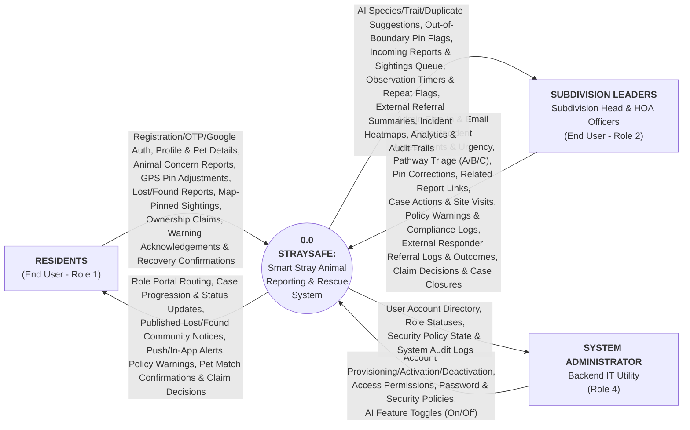

# STRAYSAFE: Data Flow Diagram (DFD) Guide — Level 0 & Level 1 (Per User & System-Wide)

This document provides the complete **Data Flow Diagrams (Level 0 and Level 1 Per User)** and a **Step-by-Step Drawing Guide** for **STRAYSAFE: Smart Stray Animal Reporting and Rescue System**, aligned directly with the 5-Module System Specification and the 59 MySQL tables in `straysafe_subdivision` (`StraySafe3.0.2.sql`).

> [!IMPORTANT]
> **Why Only 3 External Entities Appear on the DFD (No Barangay / External Authority Box):**
> In standard DFD rules, an **External Entity** must directly send data to or receive data from the **automated software boundary**. Because external responders are **non-account participants** who never log into or interact directly with the StraySafe software—and all referrals and field outcomes are logged on their behalf by **Subdivision Leaders**—drawing a separate External Authority or Barangay box on the DFD can mislead defense panelists into thinking there is still a separate responder portal. Therefore, only the **3 actual system roles** (**Residents**, **Subdivision Leaders**, and **System Administrator**) are drawn as External Entities.

---

## 1. Guide to Drawing Your DFD (Draw.io, Lucidchart, Canva, or Visual Paradigm)

When drawing your DFD for your capstone manuscript or defense slides, follow standard **Gane & Sarson** (or **Yourdon & Coad**) notation rules:

### 1.1 Standard DFD Symbols

| Component                                   | Gane & Sarson Symbol                 | Yourdon & Coad Symbol  | Naming Convention                                                                                                                                                                    |
| :------------------------------------------ | :----------------------------------- | :--------------------- | :----------------------------------------------------------------------------------------------------------------------------------------------------------------------------------- |
| **External Entity** (User / Role)     | Rectangle / Square                   | Rectangle / Square     | **Noun** (`Residents`, `Subdivision Leaders`, `System Administrator`)                                                                                                    |
| **Process** (Action / Function)       | Rounded Rectangle with top header    | Circle / Bubble        | **Number + Verb-Noun Phrase** (e.g., `1.3 Submit Animal Concern & Pin Location`)                                                                                             |
| **Data Store** (Database Table Group) | Open-ended Rectangle (`D1 \| Name`) | Two Parallel Lines     | **`D#` + Plural Noun** (e.g., `D3 Incident Reports & Evidence`)                                                                                                            |
| **Data Flow** (Arrow)                 | Solid Arrow (`--->`)               | Solid Arrow (`--->`) | **Specific Noun Phrase** describing data in motion (never write verbs like *"clicks"* or *"logs in"* on arrows; write `Login Credentials`, `Report Details & GPS Pin`) |

### 1.2 Golden DFD Rules for Capstone Defense (Avoid Common Mistakes)

1. **Only System-Boundary Actors Are External Entities:** Only include actors that directly input data into or receive output from the system (`Residents`, `Subdivision Leaders`, and `System Administrator`). External referral logging is a data flow between `Subdivision Leaders` and `Process 2.6`.
2. **No Entity-to-Entity Arrows:** External entities cannot pass data directly to each other inside the DFD. All data must go through a **Process**.
3. **No Entity-to-Data-Store Arrows:** An external user can never read from or write directly to a Data Store (`D1–D11`) without passing through a **Process** first.
4. **No Data-Store-to-Data-Store Arrows:** Data cannot move from `D2` to `D3` without a **Process** reading from `D2` and writing to `D3`.
5. **Every Process Must Have At Least One Input and One Output:** A process with only inputs is a *"Black Hole"*; a process with only outputs is a *"Miracle"*.
6. **Level Balancing (Consistency):** The net inputs and outputs entering/leaving a user in **Level 0** must match the inputs and outputs for that user across **Level 1**.

---

## 2. Logical Data Stores Mapped to `straysafe_subdivision` (All 59 SQL Tables)

Rather than drawing 59 separate database boxes on a DFD (which makes diagrams unreadable), standard DFD practice groups related physical MySQL tables into **11 Logical Data Stores (`D1` to `D11`)**. On your DFD diagrams, only write the **Logical Data Store Name** (e.g., `D8: External Referrals & Ownership Claims Store`), and keep the physical SQL table mapping in your manuscript's Data Dictionary table below:

| Data Store ID | Logical Data Store Name (Use This Label on DFD)            | Physical MySQL Tables in `straysafe_subdivision` (`StraySafe3.0.2.sql`)                                                                                                                   | Primary Modules Using Store            |
| :------------ | :--------------------------------------------------------- | :-------------------------------------------------------------------------------------------------------------------------------------------------------------------------------------------- | :------------------------------------- |
| **D1**  | **Users & Auth Store**                               | `users`, `roles`, `positions`, `otp_verifications`, `revoked_tokens`, `user_notification_preferences`                                                                             | Module 1, Module 5                     |
| **D2**  | **Pet Registry Store**                               | `pets`, `pet_history`, `pet_owner_confirmations`, `pet_match_confirmation_requests`                                                                                                   | Module 1, Module 2, Module 3, Module 5 |
| **D3**  | **Incident Reports & Evidence Store**                | `reports`, `report_categories`, `report_media`, `report_status`, `status_history`, `report_disputes`, `report_returns`                                                          | Module 2, Module 3, Module 4, Module 5 |
| **D4**  | **Lost & Found Notices & Sightings Store**           | `lost_pet_alerts`, `lost_pet_sightings`, `lost_pet_coordinations`, `lost_pet_coordination_messages`, `lost_found_matches`                                                           | Module 2, Module 3, Module 4, Module 5 |
| **D5**  | **AI Jobs & Matching Store**                         | `ai_jobs`, `ai_vision_comparisons`, `report_matches`, `manual_match_decisions`, `leader_identity_verifications`                                                                     | Module 1, Module 3, Module 5           |
| **D6**  | **Case Interventions, Follow-ups & Messaging Store** | `case_followups`, `case_contact_logs`, `case_links`, `case_message_threads`, `case_message_members`, `case_messages`, `chat_threads`, `chat_messages`                         | Module 3, Module 4, Module 5           |
| **D7**  | **Policy Warnings & Owner Observation Store**        | `owner_warnings`, `owner_followups`, `owner_observation_updates`, `owner_observation_update_photos`, `followup_contact_logs`, `followup_repeated_incidents`                       | Module 4, Module 5                     |
| **D8**  | **External Referrals & Ownership Claims Store**      | `barangay_referrals`, `barangay_referral_updates`, `ownership_claims`                                                                                                                   | Module 4, Module 5                     |
| **D9**  | **Alerts & Notifications Store**                     | `announcements`, `announcement_categories`, `announcement_media`, `case_alerts`, `case_alert_sends`, `notifications`, `email_logs`, `push_subscriptions`, `push_deliveries` | Module 1, Module 2, Module 4, Module 5 |
| **D10** | **System, AI & Geofence Settings Store**             | `subdivisions`, `barangays`, `landmarks`, `coverage_settings`, `system_settings`                                                                                                    | Module 1, Module 2, Module 3, Module 5 |
| **D11** | **Audit Logs Store**                                 | `audit_logs`                                                                                                                                                                                | Module 1, Module 3, Module 4, Module 5 |

---

## 3. DFD Level 0 (Context Diagram)

### 3.1 How to Draw DFD Level 0

1. Place **one single central process** (`0.0 STRAYSAFE: Smart Stray Animal Reporting and Rescue System`) in the middle of the canvas.
2. Place **Zero Data Stores** (Data stores `D1–D11` are strictly internal to the system and only appear starting in Level 1).
3. Place the **3 System Access Roles (External Entities)** around the central process:
   - **Left:** `Residents` (End User)
   - **Right:** `Subdivision Leaders – Subdivision Head & HOA Officers` (End User)
   - **Bottom:** `System Administrator – Role 4` (Backend Utility Only)

### 3.2 DFD Level 0 Visual Diagram



### 3.3 Level 0 Input & Output Data Flow Table (For Manuscript Documentation)

| External Entity (Role)                                                          | Inbound Data Flows (Entity $\rightarrow$ System `0.0`)                                                                                                                                                                                                                                                                                                                                                                                                                                                                                                                                                                                                                                                       | Outbound Data Flows (System `0.0` $\rightarrow$ Entity)                                                                                                                                                                                                                                                                                                                                                                                                                                                                                      |
| :------------------------------------------------------------------------------ | :--------------------------------------------------------------------------------------------------------------------------------------------------------------------------------------------------------------------------------------------------------------------------------------------------------------------------------------------------------------------------------------------------------------------------------------------------------------------------------------------------------------------------------------------------------------------------------------------------------------------------------------------------------------------------------------------------------------- | :----------------------------------------------------------------------------------------------------------------------------------------------------------------------------------------------------------------------------------------------------------------------------------------------------------------------------------------------------------------------------------------------------------------------------------------------------------------------------------------------------------------------------------------------- |
| **Residents** *(End User)*                                              | • Registration Details, Email OTP / Google Sign-In Credentials• Profile Updates, PH Phone Number & Notification Preferences• Optional Pet Registration Details & Photos• Animal Concern Reports (6 Categories, Media, Observation Date/Time)• GPS Coordinates & Manual Pin Adjustments• Follow-up Report Details & Map-Pinned Sightings (Firsthand/Secondhand)• Recovery Confirmations (Ordinary Lost-Pet Notices)• Ownership Claim Submissions & Supporting Proof• Warning Acknowledgements & Owner Observation Updates                                                                                                                                                                                | • Authenticated Resident Portal Session & Role Routing• Case Progression & Public Status Updates (Internal Notes Hidden)• Published Lost-Pet & Found/Unidentified Animal Notices• Targeted Push & In-App Community Alerts• Pet Match Confirmation Requests• Issued Policy Warnings (Verbal / 1st / 2nd / 3rd+ Escalation)• Ownership Claim Decisions (Approved / Rejected / Disputed)• Final Case Closure & Disposition Notifications                                                                                                    |
| **Subdivision Leaders – Subdivision Head & HOA Officers** *(End User)* | • Admin Credentials & Emailed Sign-In Verification Code• Profile & Notification Settings• Manual Pin Corrections & Out-of-Boundary Reviews• Lost/Found Notice Moderation & Scheduled Community Alerts• Incident Assessments, Urgency Levels & Ownership Evaluations• Response Pathway Classifications (Pathway A / B / C)• Related Report Confirmations/Rejections (No Record Merging)• Case Action Logs (Calls, Messages, Site Visits, Mediation, Follow-up Tasks)• Policy Warnings & Post-Warning Compliance Outcomes• External Responder Referral Logs & Field Outcomes• Ownership Claim Evaluations & Verified Handover Logs• Case Closure Dispositions, Reopening Reasons & Pet History Updates | • Authenticated `/subd-admin` Portal Session• Incoming Reports, Media, GPS Pins & Out-of-Boundary Flags• Automated AI Suggestions (Species, Visible Traits, Photo Authenticity, Duplicate/Related Candidates)• Active Sightings & Mediation Requests Queue• Warning Eligibility Checks, Repeat-Violation Flags & Observation Countdowns• Printable/Exportable External Referral Summaries & Status Trails• Pending Ownership Claims & Competing Claim Flags• Interactive Incident Heatmaps, Hotspot Analytics & Full Case Audit Trails |
| **System Administrator – Role 4** *(Backend Utility Only)*             | • Account Creation, Update, Activation & Deactivation Commands• Role & Access Permission Assignments• Password Policy & Security Parameter Configurations• AI Automated Check Toggles (Enable / Disable)                                                                                                                                                                                                                                                                                                                                                                                                                                                                                                     | • User Account Directory & Activation Statuses• Current Security & AI Toggle Configurations• Backend System & Account Audit Logs                                                                                                                                                                                                                                                                                                                                                                                                              |

---

## 4. DFD Level 1 — Per User (Role-by-Role Decomposition)

As requested, **Level 1 is structured per user role** for each of the **3 System Roles** (`Resident`, `Subdivision Leader`, and `System Administrator`) so each diagram clearly isolates the exact processes, inputs, outputs, and database stores (`D1`–`D11`) for that specific user.

---

### 4.1 Level 1 DFD: Resident (End User — Role 1)

#### How to Draw the Resident Level 1 DFD

- Place the **`RESIDENT`** entity on the **left side** of the page.
- Place **7 vertically stacked processes (`1.1` to `1.7`)** in the **center column**, corresponding to every capability a Resident performs across Modules 1, 2, 4, and 5.
- Place the **relevant Data Stores (`D1, D2, D3, D4, D5, D6, D7, D8, D9, D10`)** on the **right side** of the page.

#### Resident Level 1 Visual Diagram

```mermaid
flowchart LR
    RES["<b>RESIDENT</b><br/>(End User - Role 1)"]

    %% Resident Processes
    P1_1(["<b>1.1</b><br/>Register & Authenticate<br/>Resident Account<br/>(OTP / Google Sign-In)"])
    P1_2(["<b>1.2</b><br/>Manage Profile, Settings<br/>& Optional Pet Registry"])
    P1_3(["<b>1.3</b><br/>Submit Animal Concern<br/>Report & Pin Location"])
    P1_4(["<b>1.4</b><br/>Publish Lost/Found Notice<br/>& Track Report Status"])
    P1_5(["<b>1.5</b><br/>Submit Map-Pinned Sighting<br/>& Confirm Pet Recovery"])
    P1_6(["<b>1.6</b><br/>Submit Ownership Claim<br/>& Coordinate Return"])
    P1_7(["<b>1.7</b><br/>Acknowledge Warnings &<br/>Submit Observation Updates"])

    %% Data Stores
    D1[("D1: Users & Auth Store")]
    D2[("D2: Pet Registry Store")]
    D3[("D3: Incident Reports & Evidence")]
    D4[("D4: Lost & Found Notices & Sightings")]
    D5[("D5: AI Jobs & Matching Store")]
    D6[("D6: Case Interventions & Messaging")]
    D7[("D7: Warnings & Owner Observation")]
    D8[("D8: External Referrals & Claims")]
    D9[("D9: Alerts & Notifications Store")]
    D10[("D10: System & Geofence Settings")]

    %% Entity <-> Process Flows
    RES -- "Email, Password (12-128 chars),<br/>OTP Code / Google Token" --> P1_1
    P1_1 -- "Auth Session & Resident Portal Route" --> RES

    RES -- "Profile Edits, PH Phone (+63/09),<br/>Alert Prefs, Pet Photos & Traits" --> P1_2
    P1_2 -- "Saved Profile, Pet Record Cards &<br/>Match Confirmation Prompts" --> RES

    RES -- "Category (6 types), Animal Info,<br/>Observed Date/Time, Media, GPS Pin" --> P1_3
    P1_3 -- "Report Reference ID &<br/>Submission Confirmation" --> RES

    RES -- "Additional Report Details,<br/>Status Inquiry" --> P1_4
    P1_4 -- "Community Lost/Found Notices,<br/>Public Case Progression (Internal Notes Hidden)" --> RES

    RES -- "Map-Pinned Sighting (1st/2nd-hand),<br/>Location/Time, Owner Recovery Confirmation" --> P1_5
    P1_5 -- "Updated Sighting Map &<br/>Closed Lost-Pet Notice Status" --> RES

    RES -- "Ownership Claim & Proof,<br/>1-to-1 Coordination Messages" --> P1_6
    P1_6 -- "Claim Review Decision &<br/>Direct/Bridge Chat Messages" --> RES

    RES -- "Warning Acknowledgement,<br/>Compliance Photos & Notes" --> P1_7
    P1_7 -- "Issued Policy Warnings &<br/>Observation Countdown Status" --> RES

    %% Process <-> Data Store Flows
    P1_1 <-->|"Verify OTP / Save User & Token"| D1
    P1_1 <-- "Read Password Policy" --- D10

    P1_2 <-->|"Update Profile & Notification Prefs"| D1
    P1_2 <-->|"Save/Read Registered Pets & Confirmations"| D2
    P1_2 <-->|"Register Push Subscription"| D9

    P1_3 <-- "Read Subdivision Boundary & AI Toggle" --- D10
    P1_3 <-- "Read Linked Pet Snapshot (if Lost Pet)" --- D2
    P1_3 -->|"Store Report, Media, GPS Pin & Boundary Flag"| D3
    P1_3 -->|"Auto-Publish Lost Pet Notice"| D4
    P1_3 -->|"Queue Non-Blocking AI Check Job"| D5

    P1_4 <-- "Read Public Status History & Report Info" --- D3
    P1_4 <-- "Read Active Community Notices" --- D4
    P1_4 -->|"Append Resident Follow-up Details"| D3
    P1_4 <-- "Deliver Targeted Alerts & Push Notifications" --- D9

    P1_5 -->|"Save Map-Pinned Sighting (1st/2nd-hand)"| D4
    P1_5 -->|"Close Ordinary Lost-Pet Notice on Recovery"| D4
    P1_5 -->|"Update Report Status to Recovered/Resolved"| D3
    P1_5 -->|"Notify Owner / Subdivision Leader"| D9

    P1_6 -->|"Submit Ownership Claim & Evidence"| D8
    P1_6 <-- "Read Claim Status & Decision" --- D8
    P1_6 <-->|"Send/Read 1-to-1 Case & Coordination Messages"| D6

    P1_7 <-->|"Read Warning & Save Acknowledgement/Photos"| D7
    P1_7 -->|"Notify Leader of Compliance Update"| D9
```

#### Resident Level 1 Process Specification Table

| Process #     | Process Name                                                | Module             | Input Data Flows                                                                                                  | Data Stores Accessed                                                          | Output Data Flows                                                                              |
| :------------ | :---------------------------------------------------------- | :----------------- | :---------------------------------------------------------------------------------------------------------------- | :---------------------------------------------------------------------------- | :--------------------------------------------------------------------------------------------- |
| **1.1** | **Register & Authenticate Resident Account**          | Module 1           | Registration info, Password (12–128 chars, upper, lower, number, symbol), Email OTP or Google Sign-In token      | `D1` (Read/Write), `D10` (Read policy)                                    | Authenticated session token, role-based redirect to Resident portal                            |
| **1.2** | **Manage Profile, Settings & Optional Pet Registry**  | Module 1           | Profile updates, PH phone number, notification preferences, optional pet photos & traits, pet match confirmations | `D1` (R/W), `D2` (R/W), `D9` (R/W)                                      | Updated profile, saved pet cards (supporting reference), push subscription state               |
| **1.3** | **Submit Animal Concern Report & Pin Location**       | Module 2           | Report category (6 types), animal type, description, observed date/time, media, manual GPS pin adjustment         | `D2` (Read), `D3` (Write), `D4` (Write), `D5` (Write), `D10` (Read) | Report Reference No., saved GPS coordinates + out-of-boundary flag, queued AI job              |
| **1.4** | **Publish Lost/Found Notice & Track Report Status**   | Module 2           | Follow-up report details, status tracking request                                                                 | `D3` (R/W), `D4` (Read), `D9` (Read)                                    | Published community notices, sanitized case progression timeline (internal staff notes hidden) |
| **1.5** | **Submit Map-Pinned Sighting & Confirm Pet Recovery** | Module 2, Module 5 | Map-pinned sighting coordinates, firsthand vs. secondhand flag, owner recovery confirmation                       | `D3` (Write), `D4` (R/W), `D9` (Write)                                  | Updated sighting pin trail, closed ordinary lost-pet notice upon recovery                      |
| **1.6** | **Submit Ownership Claim & Coordinate Return**        | Module 4           | Ownership claim form, supporting proof/photos, 1-to-1 chat messages with Leader or Finder                         | `D6` (R/W), `D8` (R/W)                                                    | Claim submission receipt, claim evaluation result, 1-to-1 coordination messages                |
| **1.7** | **Acknowledge Warnings & Submit Observation Updates** | Module 4           | Warning checkbox acknowledgement, owner observation photos & compliance notes                                     | `D7` (R/W), `D9` (Write)                                                  | Updated warning compliance status, leader notification of owner update                         |

---

### 4.2 Level 1 DFD: Subdivision Leader – Subdivision Head & HOA Officers (End User — Role 2)

#### How to Draw the Subdivision Leader Level 1 DFD

- Place **`SUBDIVISION LEADER (Subdivision Head & HOA Officers)`** on the **left side** of the page (as the sole External Entity on this diagram).
- Place **8 processes (`2.1` to `2.8`)** in the **center column**, covering Modules 1, 2, 3, 4, and 5.
- Note how **Process `2.6` (Log External Responder Referrals & Record Field Outcomes)** takes inputs directly from the **Subdivision Leader** and stores them in **`D8: External Referrals & Claims`**—no separate external entity box is needed.
- Place **Data Stores `D1` through `D11`** on the **right side**.

#### Subdivision Leader Level 1 Visual Diagram

```mermaid
flowchart LR
    SUBD["<b>SUBDIVISION LEADER</b><br/>Subdivision Head & HOA Officers<br/>(End User - Role 2)"]

    %% Subdivision Leader Processes
    P2_1(["<b>2.1</b><br/>Authenticate Admin Portal<br/>& Manage Leader Profile"])
    P2_2(["<b>2.2</b><br/>Review AI Checks, Verify Pins<br/>& Assess Incident Urgency"])
    P2_3(["<b>2.3</b><br/>Classify Response Pathways (A/B/C)<br/>& Link Related Reports"])
    P2_4(["<b>2.4</b><br/>Log Case Actions, Site Visits<br/>& 1-to-1 Resident Messaging"])
    P2_5(["<b>2.5</b><br/>Issue Policy Warnings &<br/>Monitor Owner Compliance"])
    P2_6(["<b>2.6</b><br/>Log External Responder Referrals<br/>& Record Field Outcomes"])
    P2_7(["<b>2.7</b><br/>Evaluate Ownership Claims &<br/>Broadcast Community Alerts"])
    P2_8(["<b>2.8</b><br/>Close/Reopen Cases, View Heatmaps<br/>& Inspect Audit Trails"])

    %% Data Stores
    D1[("D1: Users & Auth Store")]
    D2[("D2: Pet Registry Store")]
    D3[("D3: Incident Reports & Evidence")]
    D4[("D4: Lost & Found Notices & Sightings")]
    D5[("D5: AI Jobs & Matching Store")]
    D6[("D6: Case Interventions & Messaging")]
    D7[("D7: Warnings & Owner Observation")]
    D8[("D8: External Referrals & Claims")]
    D9[("D9: Alerts & Notifications Store")]
    D10[("D10: System & Geofence Settings")]
    D11[("D11: Audit Logs Store")]

    %% Entity <-> Process Flows
    SUBD -- "SysAdmin-Issued Credentials,<br/>Emailed Sign-In Code, Profile Updates" --> P2_1
    P2_1 -- "Authenticated /subd-admin Session" --> SUBD

    SUBD -- "Pin Corrections, Urgency Level,<br/>Occurrence/Identity/Ownership Status" --> P2_2
    P2_2 -- "Incoming Reports, Boundary Flags &<br/>AI Species/Trait/Authenticity Suggestions" --> SUBD

    SUBD -- "Pathway Selection (A, B, C),<br/>Confirm/Reject Related Report Links" --> P2_3
    P2_3 -- "AI Duplicate/Lost-Found Match Candidates<br/>& Separate Linked Case References" --> SUBD

    SUBD -- "Calls, Messages, Site Visit Logs,<br/>Internal Notes & Follow-up Tasks" --> P2_4
    P2_4 -- "Case Action Timeline &<br/>Resident Replies" --> SUBD

    SUBD -- "Warning Level (Verbal/1st/2nd/3rd+),<br/>Observation Extensions & Compliance Decisions" --> P2_5
    P2_5 -- "Confirmed Owner Check, Repeat Flags &<br/>3-Day Observation Countdowns" --> SUBD

    SUBD -- "External Responder Type, Referral Reason/Date,<br/>Logged External Updates & Field Outcomes" --> P2_6
    P2_6 -- "Printable Referral Summary &<br/>External Referral Tracking Log" --> SUBD

    SUBD -- "Claim Approval/Rejection/Dispute,<br/>Found Notice Moderation & Alert Schedules" --> P2_7
    P2_7 -- "Pending Claims, Competing Claim Flags<br/>& Alert Delivery Counts" --> SUBD

    SUBD -- "Final Disposition, Closure/Reopen Reason,<br/>Heatmap & Analytics Filter Criteria" --> P2_8
    P2_8 -- "Interactive Heatmaps, Hotspot Analytics &<br/>Chronological Case Audit Trails" --> SUBD

    %% Process <-> Data Store Flows
    P2_1 <-->|"Verify Sign-In Code & Update Leader Profile"| D1
    P2_1 -->|"Log Admin Login"| D11

    P2_2 <-->|"Read Report, Update Urgency, Assessment & Pin"| D3
    P2_2 <-- "Read AI Vision & Authenticity Results" --- D5
    P2_2 <-- "Read Geofence Boundary" --- D10
    P2_2 -->|"Log Assessment Action"| D11

    P2_3 -->|"Save Pathway (A/B/C) Classification"| D3
    P2_3 <-->|"Read/Confirm Match Candidates"| D4
    P2_3 <-->|"Save Match Decisions"| D5
    P2_3 -->|"Create CaseLink (Never Merges Records)"| D6
    P2_3 -->|"Log Triage & Link Decision"| D11

    P2_4 <-->|"Save Contact Logs, Follow-ups & 1-to-1 Messages"| D6
    P2_4 -->|"Send Notification to Resident"| D9
    P2_4 -->|"Log Case Intervention"| D11

    P2_5 <-- "Verify Confirmed Owner Identity" --- D2
    P2_5 <-->|"Issue Warning, Track 3-Day Observation & Repeat Flags"| D7
    P2_5 -->|"Sync Report Status & History"| D3
    P2_5 -->|"Notify Pet Owner of Warning"| D9
    P2_5 -->|"Log Warning Action"| D11

    P2_6 <-->|"Save Referral Record, Recipient & Logged Outcomes"| D8
    P2_6 -->|"Update Case Status"| D3
    P2_6 -->|"Log External Referral Update"| D11

    P2_7 <-->|"Evaluate Ownership Claims & Handover"| D8
    P2_7 <-->|"Moderate Notices & Link Sightings"| D4
    P2_7 <-->|"Schedule & Dispatch Targeted Alerts"| D9
    P2_7 -->|"Update Pet Ownership / History"| D2
    P2_7 -->|"Log Claim & Alert Actions"| D11

    P2_8 <-->|"Close or Reopen Case with Disposition"| D3
    P2_8 -->|"Append Pet History & Stop Active Alerts"| D2
    P2_8 -->|"Stop Active Case Alerts & Auto-Close Chats"| D9
    P2_8 <-- "Aggregate Historical Coordinates, Referrals & Warnings" --- D3
    P2_8 <-- "Read Full Case & System Audit Trail" --- D11
```

#### Subdivision Leader Level 1 Process Specification Table

| Process #     | Process Name                                                        | Module             | Input Data Flows                                                                                                                                                                                                              | Data Stores Accessed                                                                       | Output Data Flows                                                                                                             |
| :------------ | :------------------------------------------------------------------ | :----------------- | :---------------------------------------------------------------------------------------------------------------------------------------------------------------------------------------------------------------------------- | :----------------------------------------------------------------------------------------- | :---------------------------------------------------------------------------------------------------------------------------- |
| **2.1** | **Authenticate Admin Portal & Manage Leader Profile**         | Module 1           | SysAdmin-issued email/password, emailed sign-in code, profile/notification updates                                                                                                                                            | `D1` (R/W), `D11` (Write)                                                              | Authenticated `/subd-admin` session, updated leader preferences                                                             |
| **2.2** | **Review AI Checks, Verify Pins & Assess Incident Urgency**   | Module 2, Module 3 | Manual pin adjustments, urgency level, separate occurrence, animal identity, and ownership status (`Unknown`, `Claimed`, `Under Review`, `Confirmed`, `Disputed`, `Unconfirmed`)                                  | `D3` (R/W), `D5` (Read), `D10` (Read), `D11` (Write)                               | Updated incident assessment, verified pin coordinates, non-blocking AI species/trait/authenticity display                     |
| **2.3** | **Classify Response Pathways (A/B/C) & Link Related Reports** | Module 3           | Pathway assignment (**A**: Lost/Found & Sightings; **B**: Subdivision Action & Warning; **C**: External Referral), confirmation/rejection of related reports                                                | `D3` (Write), `D4` (R/W), `D5` (R/W), `D6` (Write), `D11` (Write)                | Assigned pathway(s), linked case pairs (`case_links`) preserving separate report histories without merging                  |
| **2.4** | **Log Case Actions, Site Visits & 1-to-1 Resident Messaging** | Module 4           | Outbound calls, 1-to-1 messages, site visits, owner outreach, mediation notes, follow-up tasks, internal staff notes                                                                                                          | `D6` (R/W), `D9` (Write), `D11` (Write)                                              | Chronological case contact log, resident notifications, private internal staff notes                                          |
| **2.5** | **Issue Policy Warnings & Monitor Owner Compliance**          | Module 4           | Warning issuance (`Verbal`, `First Written`, `Second Written`, `Third+ / Escalation`), compliance checks, single reasoned observation extension                                                                       | `D2` (Read), `D3` (Write), `D7` (R/W), `D9` (Write), `D11` (Write)               | Issued warning notice to confirmed owner, 3-day observation timer, repeat-violation flag for external escalation              |
| **2.6** | **Log External Responder Referrals & Record Field Outcomes**  | Module 4           | External responder category (Animal Control, Veterinary, Welfare, Wildlife, Local Authority), referral reason/date, logged updates & field outcomes                                                                           | `D3` (Write), `D8` (R/W), `D11` (Write)                                              | Printable referral summary, logged external responder outcome trail                                                           |
| **2.7** | **Evaluate Ownership Claims & Broadcast Community Alerts**    | Module 2, Module 4 | Claim approval/rejection/dispute hold, verified handover record, found-notice publication, targeted push/in-app alert schedule                                                                                                | `D2` (Write), `D4` (R/W), `D8` (R/W), `D9` (R/W), `D11` (Write)                  | Claim decision notification, competing claim lock, targeted community push/in-app alerts                                      |
| **2.8** | **Close/Reopen Cases, View Heatmaps & Inspect Audit Trails**  | Module 5           | Documented closure disposition (`Reunited`, `Claimed`, `Resolved via Warning`, `Referred to External Authority`, `Unfounded`, `Duplicate`, `Closed – No Further Action`), reopen reason, map/analytics filters | `D2` (Write), `D3` (R/W), `D6` (Write), `D8` (Read), `D9` (Write), `D11` (R/W) | Closed/reopened case status, cascaded linked closure, interactive Incident Heatmap, hotspot analytics & immutable audit trail |

---

### 4.3 Level 1 DFD: System Administrator — Role 4 (Backend Utility Only)

#### How to Draw the System Administrator Level 1 DFD

- Place **`SYSTEM ADMINISTRATOR (Role 4 – Backend Utility Only)`** on the **left side**.
- Place **3 processes (`3.1` to `3.3`)** in the **center column** (all belonging to Module 1 and Module 5 audit logging).
- Place **Data Stores `D1`, `D5`, `D10`, and `D11`** on the **right side**.

#### System Administrator Level 1 Visual Diagram

```mermaid
flowchart LR
    SYSADMIN["<b>SYSTEM ADMINISTRATOR</b><br/>Role 4 - Backend IT Utility<br/>(Non-End-User Interface)"]

    %% System Admin Processes
    P3_1(["<b>3.1</b><br/>Create, Update, Activate &<br/>Deactivate User Accounts"])
    P3_2(["<b>3.2</b><br/>Configure Account Security<br/>& Password Policies"])
    P3_3(["<b>3.3</b><br/>Toggle AI Automated Checks<br/>& System Parameters"])

    %% Data Stores
    D1[("D1: Users & Auth Store")]
    D5[("D5: AI Jobs & Matching Store")]
    D10[("D10: System & Geofence Settings")]
    D11[("D11: Audit Logs Store")]

    %% Entity <-> Process Flows
    SYSADMIN -- "New Leader/Resident Account Data,<br/>Role Assignment, Activate/Deactivate Command" --> P3_1
    P3_1 -- "Account Provisioning Confirmation &<br/>Updated User Directory" --> SYSADMIN

    SYSADMIN -- "Password Policy Parameters (12-128 chars),<br/>OTP Expiry & Session Revocation Rules" --> P3_2
    P3_2 -- "Active Security Policy Status &<br/>Access Audit Summary" --> SYSADMIN

    SYSADMIN -- "AI Vision / Duplicate Check Toggle (On/Off),<br/>Subdivision Coverage & System Settings" --> P3_3
    P3_3 -- "Current AI Feature State (Non-Blocking)<br/>& System Configuration Status" --> SYSADMIN

    %% Process <-> Data Store Flows
    P3_1 <-->|"Create/Update Users, Roles & Permissions"| D1
    P3_1 -->|"Revoke Active Tokens on Deactivation"| D1
    P3_1 -->|"Record Account Management Audit"| D11

    P3_2 <-->|"Update Security & Auth Parameters"| D10
    P3_2 <-->|"Manage Revoked Tokens & OTP Rules"| D1
    P3_2 <-->|"Write/Read Security Audit Logs"| D11

    P3_3 <-->|"Toggle AI Settings & Coverage Config"| D10
    P3_3 <-- "Read AI Job Queue Status" --- D5
    P3_3 -->|"Record AI Toggle Audit Entry"| D11
```

#### System Administrator Level 1 Process Specification Table

| Process #     | Process Name                                                  | Module             | Input Data Flows                                                                                                | Data Stores Accessed                          | Output Data Flows                                                                                                 |
| :------------ | :------------------------------------------------------------ | :----------------- | :-------------------------------------------------------------------------------------------------------------- | :-------------------------------------------- | :---------------------------------------------------------------------------------------------------------------- |
| **3.1** | **Create, Update, Activate & Deactivate User Accounts** | Module 1           | Resident & Subdivision Leader account details, role/position assignments, activation/deactivation commands      | `D1` (R/W), `D11` (Write)                 | Provisioned Subdivision Leader / Resident accounts, revoked sessions for deactivated users, audit log entry       |
| **3.2** | **Configure Account Security & Password Policies**      | Module 1           | Password policy rules (12–128 chars, complexity), OTP verification parameters, token revocation commands       | `D1` (R/W), `D10` (R/W), `D11` (R/W)    | Active security configuration state, security audit logs                                                          |
| **3.3** | **Toggle AI Automated Checks & System Parameters**      | Module 1, Module 3 | AI feature toggle (`ON` / `OFF` for YOLOv8/Gemini vision & duplicate checks), subdivision boundary settings | `D5` (Read), `D10` (R/W), `D11` (Write) | Updated AI toggle state (gracefully bypasses AI checks when `OFF` without blocking Resident report submissions) |

---

## 5. Integrated System-Wide Level 1 DFD (All 5 Modules `1.0` – `5.0`)

If your capstone manuscript also requires a **single unified Level 1 DFD organized by the 5 Core System Modules** (in addition to the Per-User Level 1 diagrams in Section 4), use this diagram featuring only the **3 active System Roles**:

```mermaid
flowchart TB
    %% External Entities (Only the 3 System Roles)
    RES["<b>RESIDENTS</b><br/>(End User)"]
    SUBD["<b>SUBDIVISION LEADERS</b><br/>Subdivision Head & HOA Officers"]
    SYSADMIN["<b>SYSTEM ADMINISTRATOR</b><br/>(Role 4 - Backend Utility)"]

    %% 5 Core Module Processes
    M1(["<b>1.0</b><br/>Unified Authentication &<br/>User Management"])
    M2(["<b>2.0</b><br/>Incident Reporting &<br/>Pin Correction"])
    M3(["<b>3.0</b><br/>Multi-Pathway Triage &<br/>AI Decision Support"])
    M4(["<b>4.0</b><br/>Case Intervention &<br/>Referral Tracking"])
    M5(["<b>5.0</b><br/>Case Closure &<br/>Audit Trail Analytics"])

    %% Core Data Stores
    D1[("D1: Users & Auth")]
    D2[("D2: Pet Registry")]
    D3[("D3: Incident Reports & Evidence")]
    D4[("D4: Lost/Found & Sightings")]
    D5[("D5: AI Jobs & Matching")]
    D6[("D6: Case Actions & Messaging")]
    D7[("D7: Warnings & Observation")]
    D8[("D8: External Referrals & Claims")]
    D9[("D9: Alerts & Notifications")]
    D10[("D10: System & Geofence Settings")]
    D11[("D11: Audit Logs")]

    %% Module 1 Connections
    RES <-->|"OTP/Google Auth, Profile, Optional Pets"| M1
    SUBD <-->|"Admin Login + Email Code, Profile"| M1
    SYSADMIN <-->|"Account CRUD, Security Policy, AI Toggles"| M1
    M1 <--> D1
    M1 <--> D2
    M1 <--> D10
    M1 --> D11

    %% Module 2 Connections
    RES <-->|"6-Category Reports, GPS Pins, Lost/Found, Sightings"| M2
    SUBD <-->|"Pin Corrections, Boundary Review, Notice Moderation"| M2
    M2 <--> D2
    M2 <--> D3
    M2 <--> D4
    M2 <-- "Geofence Check" --- D10
    M2 -->|"Trigger AI Check"| M3

    %% Module 3 Connections
    SUBD <-->|"Assessments, Urgency, Pathways (A/B/C), Link Reports"| M3
    M3 <--> D3
    M3 <--> D4
    M3 <--> D5
    M3 <--> D6
    M3 <-- "AI Toggle State" --- D10
    M3 --> D11

    %% Module 4 Connections
    RES <-->|"Ownership Claims, Warning Ack, 1-to-1 Chat"| M4
    SUBD <-->|"Case Logs, Warnings, External Referral Logs, Claims, Alerts"| M4
    M4 <--> D3
    M4 <--> D6
    M4 <--> D7
    M4 <--> D8
    M4 <--> D9
    M4 --> D11

    %% Module 5 Connections
    RES <-- "Closure & Recovery Updates" --- M5
    SUBD <-->|"Dispositions, Reopenings, Heatmaps, Analytics, Audit Trail"| M5
    M5 <--> D2
    M5 <--> D3
    M5 <--> D4
    M5 <-- "Read Interventions & Warnings" --- D7
    M5 <-- "Read Referrals & Claims" --- D8
    M5 --> D9
    M5 <--> D11
```

---

## 6. Quick Checklist Before Exporting Your Diagrams

- [ ] **Check Process Numbering:**
  - Context Diagram uses `0.0`.
  - Per-User Level 1 uses `1.1–1.7` (Resident), `2.1–2.8` (Subdivision Leader), and `3.1–3.3` (System Administrator).
  - System-Wide Module Level 1 uses `1.0–5.0`.
- [ ] **Check External Entities (Strictly 3 System Roles):**
  - `Residents (End User)`
  - `Subdivision Leaders – Subdivision Head & HOA Officers (End User)`
  - `System Administrator – Role 4 (Backend Utility Only)`
  - *(No Barangay or External Authority box appears on the DFD; external referrals are logged directly by Subdivision Leaders via `Process 2.6` into `D8: External Referrals & Claims`.)*
- [ ] **Check Data Store Names:** Ensure `D1` through `D11` use the exact same logical labels across all Level 1 diagrams.
