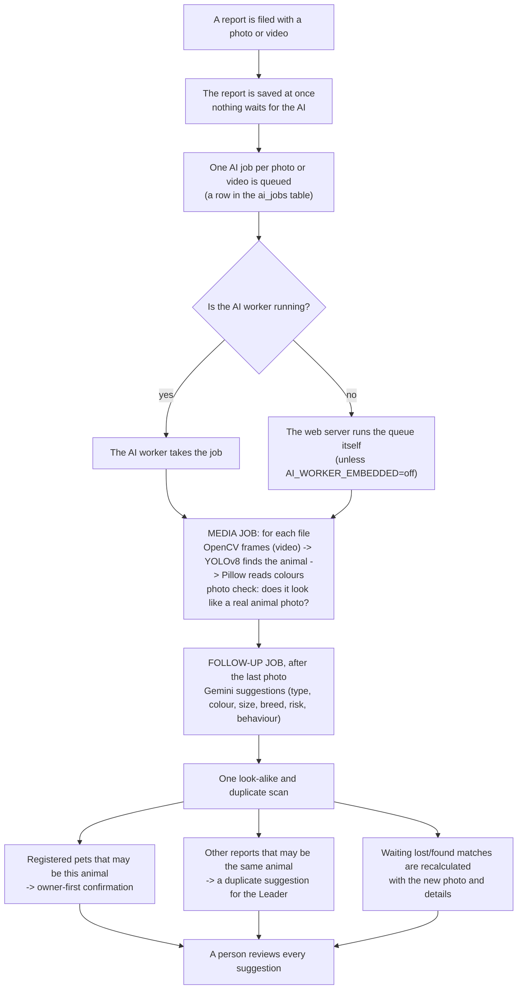

# StraySafe AI: the complete process and every AI feature

Status: **Current** (written 2026-11-24). Built from the existing AI documents ([AI_TECHNOLOGIES.md](../AI_TECHNOLOGIES.md), [AI_COMPONENTS.md](AI_COMPONENTS.md), [MULTI_ATTRIBUTE_MATCHING.md](MULTI_ATTRIBUTE_MATCHING.md), [LOST_FOUND_MATCHING.md](LOST_FOUND_MATCHING.md)) and a re-read of the code: `backend/app/ai_worker.py`, `utils/ai_jobs.py`, `utils/ai_pipeline.py`, `utils/ai_suggestions.py`, `utils/photo_checks.py`, `utils/ai_matching.py`, `utils/match_scoring.py`, `utils/duplicate_detection.py`, `routes/matches.py` and `routes/reports.py`. A point that was not re-checked says **Not re-checked**.

> **Accuracy is not measured.** The AI test set has no photos yet, so StraySafe makes **no accuracy claim**. Every score below is a suggestion for a person to review ([AI_COMPONENTS.md](AI_COMPONENTS.md) section 7).

---

## 1. The one rule

**The AI suggests. A person decides.** It never confirms a match, verifies ownership, links or merges reports, sets the final priority, closes a case or changes a status. For a registered pet, a match also needs the **owner's own confirmation** before the Leader can verify it.

---

## 2. The technologies

| Technology | What it does | Runs where | Needs the internet? |
|---|---|---|---|
| **YOLOv8 nano** (`yolov8n.pt`) | Finds the dog or cat in a photo or video frame and draws a box around it | On the server | No |
| **Pillow** | Crops the photo to that box and reads the animal's dominant fur colours | On the server | No |
| **OpenCV** | Takes up to 8 sample frames from an uploaded video | On the server | No |
| **Google Gemini** (optional) | Reads the report text and photo to describe the animal, suggest a risk, check whether a photo looks real, and compare two photos | Google's cloud | Yes |
| **Rule-based scoring** | Compares two animals or two reports using plain rules (species, breed, colour, markings, distance, time). The free fallback whenever Gemini is off | On the server | No |

Gemini models are tried in order: `gemini-2.5-flash`, `gemini-flash-lite-latest`, `gemini-flash-latest` ("pro" models are deliberately not used). Each call times out after 15 seconds and a whole job after 35 seconds. Anything that fails drops back to the rule-based result.

---

## 3. The complete process, from a photo to a suggestion

**Properties of the process**
- **Filing never waits.** The resident sees "submitted" immediately. The AI works in the background and a failure never blocks a report.
- **Jobs survive restarts.** They are rows in the database. A failed job is retried (with a 30-second back-off, up to its limit). A job left "running" by a worker that died is put back in the queue after 10 minutes.
- **Three job kinds:** `media` (YOLO, colours and photo check for one file), `follow_up` (Gemini suggestions and one look-alike and duplicate scan, 3 seconds after the last photo), and `backfill` (fills in missing suggestions for older reports).
- **The AI worker is a separate program** (`python -m app.ai_worker`), so the heavy models don't slow the web server. It loads YOLOv8 once and sends a heartbeat. If it isn't running, the web server runs the queue itself so AI never silently stops. `AI_WORKER_EMBEDDED=off` turns that fallback off.
- **Each image is downloaded at most once per scan**, and a photo pair's Gemini result is cached.

---

## 4. Each AI feature

### 4.1 Finding the animal in a photo (YOLOv8, Pillow, OpenCV)
- **What it does:** locates the dog or cat and crops the photo to it, so colours and comparisons use the animal and not the background. Detections below **0.35** confidence are ignored.
- **Video:** OpenCV takes up to 8 frames spread through the video; the best frame is chosen, and the number of distinct animals is counted.
- **Colour:** Pillow groups the pixels into coat colours (white, black, brown, tan, gray...). Green foliage and blue sky are ignored.
- **Stored:** the detection confidence (0 to 1) per file and per report, the animal type found, and the dominant colour.
- **If nothing is found:** the whole image is used and the report is unaffected.

### 4.2 Describing the report (Gemini "Copilot")
- **What it reads:** the whole description as a narrative (in English, Tagalog or Taglish, including negations such as "hindi naman nangagat"), the category, and the YOLO findings.
- **What it suggests:** animal type, dominant colour, size, coat pattern, a possible breed, a **risk level** (Low, Medium or High Risk), behaviour flags (chasing, actual bite, attempted bite, injury, aggression), a short explanation, a suggested priority with its reason, and its own **confidence per field**.
- **When Gemini is off or fails:** a local rule-based text reader fills the same fields.
- **Stored on the report** as `ai_*` fields. **Nothing is final**: the Leader's assessment and priority decide.

### 4.3 Checking a photo (Gemini)
- **What it does:** estimates whether the photo is a real animal photo and how likely it is AI-generated: 0.60 or more is "potentially AI-generated", 0.36 to 0.59 "uncertain".
- **When it can't check:** the result says "Authenticity not checked". It never says "authentic" without a check.

### 4.4 Look-alike pets (registered pets that may be the reported animal)
- **When:** automatically after a report's photos are processed.
- **How:** every eligible registered pet of the same species in the subdivision is scored by the **multi-attribute engine** (section 5). Only the best 10 candidates are re-scored with a **Gemini photo comparison** (to limit cost and time), and only when Gemini is on.
- **Suggested only if:** the score is at least 50, the classification is Strong or Potential, and Gemini's photo verdict isn't "NOT A MATCH".
- **Then:** the suggestion is `AI_SUGGESTED`, the owner can be asked, and only the owner's confirmation followed by the Leader's decision verifies it ([PET_REGISTRATION_AND_MATCH_REVIEW.md](PET_REGISTRATION_AND_MATCH_REVIEW.md)). A decision a person already made (confirmed, not a match, unable to verify) is kept; a new scan never overwrites it.

### 4.5 Possible duplicate reports (two reports about the same animal)
- **How:** a weighted comparison of the pair: location, breed, colour, description, date and time (`duplicate_detection.py`). The kind of animal must be compatible.
- **Suggested only if:** the score is at least 65 and the photo verdict isn't "NOT A MATCH" or "LOW CONFIDENCE".
- **Then:** the Leader sees "similar reports detected" on the case and chooses to **link**, **merge**, or say **not a duplicate**. Nothing is merged automatically ([REPORT_RESOLUTION_LINKING_AND_MERGING.md](REPORT_RESOLUTION_LINKING_AND_MERGING.md)).

### 4.6 Lost pet and found animal matches
- **Words only at first:** the two reports' kind of animal, colours, size, markings, collar, distance and timing are compared by `lost_found_matching.py`. Photos are not read automatically.
- **Photos on request:** the Leader can press **Compare photos (AI)** (needs a photo on both reports and Gemini on), which adds the Gemini visual score to the breakdown.
- **Suggested only if** Strong or Potential. The Leader marks it Under review, Not a match, or **Confirm verified match**, which links the two reports ([LOST_FOUND_MATCHING.md](LOST_FOUND_MATCHING.md)).
- **Recalculated** when new photos or details arrive; the earlier result is kept in the match's history.

---

## 5. The matching engine (rules plus optional Gemini)

One engine, `match_scoring.py`, scores both lost/found pairs and registered-pet candidates:

| Attribute | Default weight | Compared |
|---|---:|---|
| Visual similarity | 35 | The stored Gemini photo comparison (only if Gemini is on) |
| Location | 20 | Distance between the two pins, or the same subdivision |
| Breed | 15 | Normalized names (askal is Aspin, Pusang Pinoy is Puspin, "X mix") |
| Coat colour | 15 | Colour families and coat patterns |
| Physical description | 15 | About 30 characteristics read from the text (scars, marks, a white tail tip, a kinked tail...) |

- **Only what could be compared counts.** Missing information is "not compared", never zero. The shown **coverage** says what share of the comparison was possible, and a low coverage reduces the score.
- **Classification:** Strong Possible Match (75 or more, with at least 3 attributes and 50% coverage), Potential Match (55 or more), Low Similarity, or Insufficient Information.
- **Every attribute has one sentence of explanation** built from the comparison, for example "Nearby: approximately 336 m from where the pet was last seen."
- **Weights and thresholds** are settings (`matching_config`), kept in the system settings and changed by the developer, not from a screen. They are starting values, **not calibrated on real cases yet**.
- A match score is **never a probability of ownership**.

---

## 6. What is NOT AI (it is easy to confuse)

These look "smart" but are plain rules, so they behave the same every time:

| Feature | How it works |
|---|---|
| **Automatic priority for injured and dangerous reports** | Fixed rules. An injured animal that cannot move is High and immediate. A dangerous animal that bit, attacked or chased is Urgent ([dangerous_rules.py](../../backend/app/utils/dangerous_rules.py)). Anything the phone sends is ignored |
| **Possible Pet Owners ranking** | A weighted rule score (breed 30, coat 30, description 20, location 15) plus bonuses for a Lost status or a QR tag message ([POSSIBLE_OWNER_VERIFICATION.md](POSSIBLE_OWNER_VERIFICATION.md)). It can include the stored Gemini photo score for a pet the scan already matched |
| **Offense count suggestion** (complaints) | 1 plus the person's earlier counted offenses under the same rule; the Leader confirms ([COMPLAINT_MANAGEMENT.md](COMPLAINT_MANAGEMENT.md)) |
| **Owner leads** (complaints) | A search of residents and pets by name, Block/Lot and colour |
| **Duplicate pet registrations** | Matching names and phone numbers ([pet_duplicates.py](../../backend/app/utils/pet_duplicates.py)) |
| **QR tag signals** | A scan and a message, with no image analysis |

---

## 7. What people see today

| Where | What the AI contributes |
|---|---|
| **Leader: lost and found match review** (`MatchDialogs`) | The full breakdown (overall similarity, classification, coverage, each attribute with its explanation), **Compare photos (AI)**, Recalculate, earlier results, and Under review, Not a match, Confirm |
| **Leader: Possible Pet Owners** on a case | Strong, Potential or Low and Match, Similar, Differs per attribute; the number only in View details, labelled "for ranking only" |
| **Leader: duplicate banner** on a case | "N similar reports detected", with the top match, and the link and merge dialog |
| **Leader: notifications** | "Potential Animal Match Detected", naming the two report references and the similarity, never a resident |
| **Resident: owner's confirmation** | The Confirm or Decline page for a possible match, with the reported animal's photos beside their pet's |
| **Stored but not shown in the current apps** | The AI description fields (type, colour, size, breed, risk, behaviour, suggested priority and reason), the photo authenticity result and the detection confidence. They are saved on the report and returned by the report API; the older portals showed them, and I found no screen in the current Leader or Resident app that does (**Not re-checked in every file**) |

The report API also exposes an `effective_priority` that prefers the AI's suggested priority for older report screens. The **Leader's case priority** comes from the stored priority and the assessment, not from the AI suggestion.

---

## 8. Controls and settings

| Setting | Where | Effect |
|---|---|---|
| **Gemini on or off** | `system_settings` key `gemini_vision_matching`, kept in the system settings and changed by the developer (there is no administrator screen) | Off means no Gemini call anywhere. A fresh install defaults to **on**. If the setting cannot be read, Gemini is treated as **off** (it fails closed). A change takes effect within seconds |
| `GEMINI_API_KEY` | Server `.env` only | Never in client code, tracked files or logs |
| `GEMINI_TIMEOUT_SECONDS` (15), `GEMINI_TOTAL_BUDGET_SECONDS` (35) | `.env` | Time limits per call and per job |
| `AI_WORKER_EMBEDDED` | `.env` | `auto` (the web server runs jobs when no worker is up) or `off` |
| `AI_TORCH_THREADS` (2) | `.env` | CPU threads for YOLOv8 |
| Matching weights and thresholds | `matching_config` (system settings, changed by the developer, audited) | Changes how candidates are scored and classified |

---

## 9. When something fails

| Failure | What happens |
|---|---|
| Gemini is off, unreachable, rate-limited or too slow | The next Gemini model is tried; if all fail, the rule-based result is used. Photo checks say "not checked" |
| YOLOv8 finds no animal | The whole image is used; the report is kept |
| A video can't be read | The video isn't analysed; the report and the video are kept for staff |
| The AI worker is stopped | Jobs wait in the database; the web server runs them itself (unless turned off) |
| A job fails | It is retried, then left failed without affecting the report |

---

## 10. Privacy and safety

- The AI **never** sees who the reporter is. Explanations give distances, not addresses.
- Lost/found matches are visible only to the Leaders of the subdivision. A resident who is not a pet's owner never sees the distance to that owner's home.
- Do not send real identity, medical or payment data to Gemini while the system uses test or mock data (project rule).
- Photos and text sent to Gemini leave the server: it is a third-party service with a free quota.

---

## 11. Known limits and open items

- **No measured accuracy.** The test set has 0 photos, so no precision or recall can be reported ([AI_TODO.md](../../AI_TODO.md)).
- **Look-alike animals** of the same breed and colour are the hardest case for any photo comparison; low light, odd angles and rare breeds are weaker too.
- **Default weights and thresholds** are starting values, not tuned.
- **Registry look-alike suggestions** have no dedicated Leader screen in the current app; they reach the owner's confirmation flow and the match endpoints ([MULTI_ATTRIBUTE_MATCHING.md](MULTI_ATTRIBUTE_MATCHING.md)).
- **The AI description fields are not displayed** in the current Leader app (section 7), so their value is mostly stored for future screens and the older endpoints.
- **Description reader vocabulary** is a fixed list of English characteristics; other words only count as shared wording.
- **Gemini quota** is a free tier, so heavy use can fall back to the rule-based result.

---

## 12. For the defense, in short

> A report's photo is analysed in the background: OpenCV samples video frames, YOLOv8-nano finds and crops the animal, Pillow reads its colours, and Gemini (optional) describes it and checks the photo. A rule engine compares the animal with registered pets and other reports, with Gemini's photo comparison as one weighted attribute. Gemini can be switched off in the system settings and every step falls back to rules without it. The AI only suggests: a Leader decides, and an owner confirms before a pet match is verified. No accuracy is claimed until the test set is measured.

---

## 13. Where to read more

| Topic | Document |
|---|---|
| The four technologies in detail | [AI_TECHNOLOGIES.md](../AI_TECHNOLOGIES.md), [AI_COMPONENTS.md](AI_COMPONENTS.md) |
| The scoring engine | [MULTI_ATTRIBUTE_MATCHING.md](MULTI_ATTRIBUTE_MATCHING.md) |
| Lost and found matches | [LOST_FOUND_MATCHING.md](LOST_FOUND_MATCHING.md) |
| Manual matching without AI | [MANUAL_REPORT_MATCHING.md](MANUAL_REPORT_MATCHING.md) |
| Pet registry and owner confirmation | [PET_REGISTRATION_AND_MATCH_REVIEW.md](PET_REGISTRATION_AND_MATCH_REVIEW.md) |
| The whole report lifecycle | [REPORT_LIFECYCLE_AND_FEATURES.md](REPORT_LIFECYCLE_AND_FEATURES.md) |
