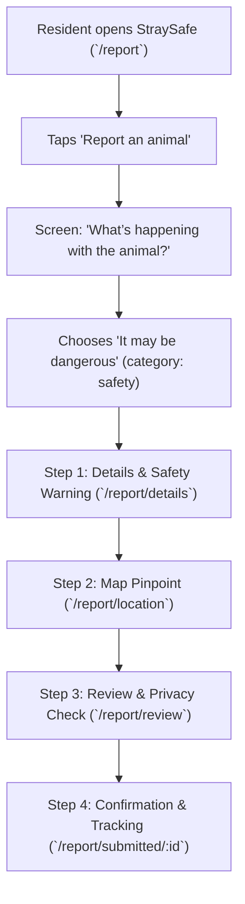
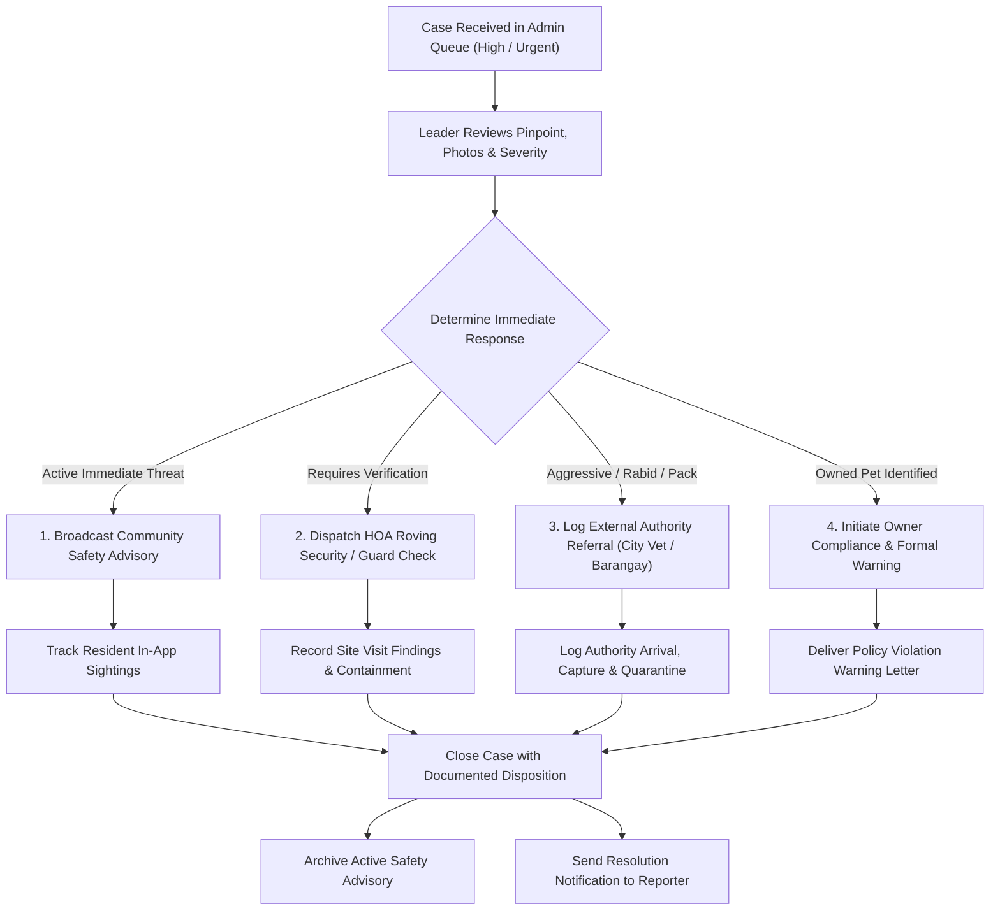

# Dangerous Animal Reporting and Management Workflow

- **Status:** Current (2026-11-17)
- **Applies to:** StraySafe 2.0 Web Application (Subdivision Leader Admin & Resident Web App), Mobile Android APK, and External Referral Pipeline.
- **Related Documents:** [`docs/01-system/MODULE_WORKFLOWS_AND_SPECIFICATIONS.md`](MODULE_WORKFLOWS_AND_SPECIFICATIONS.md), [`docs/01-system/CASE_WORKFLOW_BACKEND.md`](CASE_WORKFLOW_BACKEND.md), [`docs/01-system/BARANGAY_REFERRAL_LOG.md`](BARANGAY_REFERRAL_LOG.md), [`docs/01-system/COMPLAINT_MANAGEMENT.md`](COMPLAINT_MANAGEMENT.md).

---

## 1. Executive Summary & Purpose

The **Dangerous Animal Reporting Workflow** governs how animal threats to resident safety—such as aggressive dogs, suspected rabies cases, hostile roaming packs, and dangerous wildlife—are reported by residents, prioritized by the system, and resolved by the Subdivision Leadership and security staff.

Unlike standard animal complaints (which follow progressive policy enforcement against identified pet owners) or lost pet reports (which publish community sighting notices), a dangerous animal incident is **strictly an operational safety response (Pathway C: Safety, Welfare & External Authority Coordination)**:
1. **Safety First:** The resident is instructed not to engage, touch, or corner the animal.
2. **Immediate Triage:** Reports are auto-tagged with **High** or **Urgent** priority.
3. **Privacy by Default:** The incident report remains private between the resident and administration to prevent community panic and vigilantism.
4. **Action Flexibility:** Subdivision staff can rapidly deploy internal security, broadcast an emergency community safety advisory, or refer directly to external authorities (Barangay, City Veterinary Office, Animal Control).

---

## 2. Threat Classification & Scope

Dangerous animal reports fall under the system category `safety` (internally mapped from `"It may be dangerous"`). The workflow handles four primary operational threat profiles:

| Threat Profile | Description | Primary Subdivision Response |
| :--- | :--- | :--- |
| **Aggressive Stray / Pack** | Unowned dogs or cats displaying hostile behavior (snapping, lunging, cornering pedestrians). | Roving guard perimeter check; City Vet / Animal Control capture referral. |
| **Suspected Rabies** | Animals exhibiting neurological symptoms, excessive drooling, erratic biting, or unprovoked attacks. | Urgent perimeter isolation; emergency City Vet referral; immediate Community Safety Advisory broadcast. |
| **Owned Dangerous Animal** | An aggressive pet belonging to an identified resident roaming without a leash or breaking confinement. | Immediate guard intervention; transition to progressive policy enforcement and formal owner warnings. |
| **Wildlife / Venomous Hazards** | Snakes, monitor lizards, or exotic wildlife encroaching into residential yards or playgrounds. | Guard containment; referral to specialized City Animal Control or Wildlife Rescue authorities. |

---

## 3. Resident Reporting Journey

### 3.1 Step 1: Category Selection (`/report` & `/report/situation`)
- Resident selects **"Report an animal"** (*"I saw an animal that may need attention"*).
- The screen presents the situation prompt: *"What’s happening with the animal?"*
- Resident selects: **"It may be dangerous"** (filed as internal category `safety`).

### 3.2 Step 2: Emergency Warning Banner & Details (`/report/details`)
- **Prominent Amber Safety Banner:**
  > **Stay safe.** Keep your distance and never touch, feed or corner the animal. If someone is in danger right now, contact the guardhouse or local emergency services first.
- **Fields Captured:**
  - **Kind of animal:** Selection chips (`Dog`, `Cat`, `Livestock`, `Wildlife`, `Other`).
  - **What happened? (Description):** Free text capturing the animal's behavior, aggression indicators, physical traits, and immediate danger.
  - **When did you see it?:** Timestamp picker (defaults to current time).
  - **Evidence Photos / Videos (Optional):** Evidence upload. A prompt explicitly notes that photos are optional so residents do not place themselves in harm's way.

### 3.3 Step 3: Location Pinpoint (`/report/location`)
- Interactive Leaflet map allowing the resident to pinpoint the exact observation point.
- Validates the pin against the subdivision geofence.
- Captures text area descriptor (e.g. *"Near Block 4 playground"*, *"Clubhouse rear gate"*).

### 3.4 Step 4: Review & Privacy Protection (`/report/review`)
- Summary card presenting the animal type, description, location, and timestamp.
- **Privacy Guarantee:** The screen displays:
  > *"This report is private. Neighbours will not see it, or who sent it."*
  Dangerous animal reports are **never** automatically converted into public notice board items upon submission.

### 3.5 Step 5: Submission & Real-Time Tracking (`/report/submitted/:id`)
- Generates a permanent tracking reference (e.g., `SS-2026-0023`).
- Resident tracks status updates (`Reported` $\rightarrow$ `Under review` $\rightarrow$ `In progress` $\rightarrow$ `Closed`) in their personal **My reports** tab.

---

## 4. Subdivision Leader & HOA Action Workflow (Pathway C)

Once filed, the case enters the Subdivision Leader Admin dashboard as a **High** or **Urgent** case:

### 4.1 Immediate Security Containment
- Subdivision Leader radios the roving guard team or guardhouse to establish a physical safety perimeter around the reported coordinates.
- Documented in the case activity log as a **Site Inspection / Guard Verification**.

### 4.2 Emergency Community Safety Advisory (Broadcast)
If the animal poses an active threat to passersby, children, or other pets (e.g., aggressive stray dog loose near a playground or suspected rabies):
- The Leader clicks **"Publish Safety Advisory"** directly from the case or Community workspace.
- Creates an official broadcast announcement (`safety_advisory` notice).
- **All residents** in the subdivision immediately receive an in-app alert banner and push notification instructing them to exercise caution or keep pets indoors.

### 4.3 External Authority Referrals (`barangay_referrals`)
When an incident exceeds HOA staff containment capabilities (e.g., catch poles required, rabies quarantine, wildlife capture):
- The Leader opens the **Referrals** pipeline and creates a referral to:
  - **Barangay:** For localized community security, gate control, or resident mediation.
  - **City Veterinary Office / Animal Control:** For capture, animal impoundment, or 10-day rabies observation.
  - **Wildlife Rescue NGO:** For non-domestic or venomous animals.
- Logs contact method, referral date, agency handler, and urgency level.
- **Rule:** Logging an external referral or receiving an agency update keeps the case open in `IN_PROGRESS`; it never prematurely closes the StraySafe case.

### 4.4 Transition to Owner Policy Enforcement (If Owned)
If field inspection or resident statements reveal that the dangerous animal belongs to a subdivision homeowner:
- The case branches into **Owner Warning & Compliance** ([`OWNER_WARNING_RULES.md`](OWNER_WARNING_RULES.md)).
- If an off-leash or vicious animal policy was breached, the Leader records the verified violation, assigns the responsible person, and issues a formal written warning letter.

---

## 5. End-to-End Walkthrough Scenario

### 📍 Incident Background
- **Subdivision:** Selera Homes
- **Resident:** Juan (walking his child home from school along Dama de Noche St.)
- **Subdivision Leader:** Leilah (on duty at the HOA administration office)
- **The Incident:** A large, aggressive stray dog is baring teeth, growling, and lunging at pedestrians near the Block 4 Children's Playground.

---

### Step-by-Step Chronology

#### 1. Resident Report (10:15 AM)
- Juan opens the StraySafe app, taps **"Report an animal"** $\rightarrow$ **"It may be dangerous"**.
- He reads the amber safety caution (*"Stay safe. Keep your distance..."*).
- Juan inputs:
  - **Animal:** Dog (Large, black and brown, no collar).
  - **Description:** *"Growling aggressively at children near the playground swings. It lunged at a bicyclist a few minutes ago. Roaming free."*
  - **When:** 10:15 AM (Just now).
  - **Photo:** Snaps a clear photo from across the street.
- Drops the map pin at **Block 4 Playground, Dama de Noche St.**
- Submits privately; app assigns case reference **`SS-2026-0023`**.

#### 2. Staff Triage & Guard Dispatch (10:17 AM)
- Leilah sees an incoming high-priority alert with an urgent indicator in the Admin dashboard.
- Viewing the pin right at the children's playground, Leilah immediately radios Guard Team 2:
  > *"Guard Team 2, please dispatch to Block 4 Playground immediately. An aggressive stray dog is reported lunging at pedestrians. Secure the perimeter and keep residents clear."*
- Leilah records in case notes: *"Roving guard dispatched for perimeter containment."*

#### 3. Community Safety Alert Broadcast (10:22 AM)
- Because children are frequently in the area after school, Leilah publishes an immediate **Safety Advisory**:
  - **Title:** *Safety Advisory: Aggressive Stray Dog Near Block 4 Playground*
  - **Message:** *An aggressive, unrestrained large dog has been sighted near the children's playground. Security is on-site. Please keep children and pets indoors along Dama de Noche Street until further notice.*
- All Selera Homes residents receive the alert banner on their app dashboard.

#### 4. External Referral & Capture (10:30 AM – 11:10 AM)
- Subdivision security confirms the dog cannot be safely secured with standard guard equipment.
- Leilah opens the case’s **Referrals** tab and logs a referral to **City Veterinary Office / Animal Control**:
  - Contact: Phone call to City Animal Control Desk.
  - Reason: Urgent capture assistance for aggressive stray.
- At 11:05 AM, City Animal Control arrives with catch poles and safely transfers the dog to their transport vehicle for rabies observation.
- Leilah records the agency outcome: *"Dog safely captured by City Animal Control for 10-day quarantine observation."*

#### 5. Case Closure & Resident Notification (11:20 AM)
- Leilah clicks **"Close Case"** in the Admin portal:
  - **Disposition:** *Formally Handed Off to Authority*.
  - **Notes:** *Animal secured by City Vet. Playground area cleared and verified safe.*
- Leilah archives the active Community Advisory so residents know the area is safe.
- Juan receives an automated in-app resolution notification:
  > *"Your report SS-2026-0023 has been resolved: The animal was safely secured by City Animal Control. Thank you for keeping the community safe."*
- Juan’s personal identity remained completely private throughout the entire operation.

---

## 6. Audit Trail & Data Boundaries

1. **Structured Dispositions:** Every closed dangerous animal case must record an official disposition (`Formally Handed Off to Authority`, `Concern Resolved`, `Owner Compliance Verified`, or `Closed Without Resolution`). Undocumented closures are rejected.
2. **Confidentiality:** The complainant's identity, contact information, and internal staff coordination notes are permanently excluded from public feeds, exports, and community notices.
3. **Audit Log:** All status transitions, security notes, referral records, and advisory publications are permanently written to `audit_logs` with timestamps and officer credentials.
