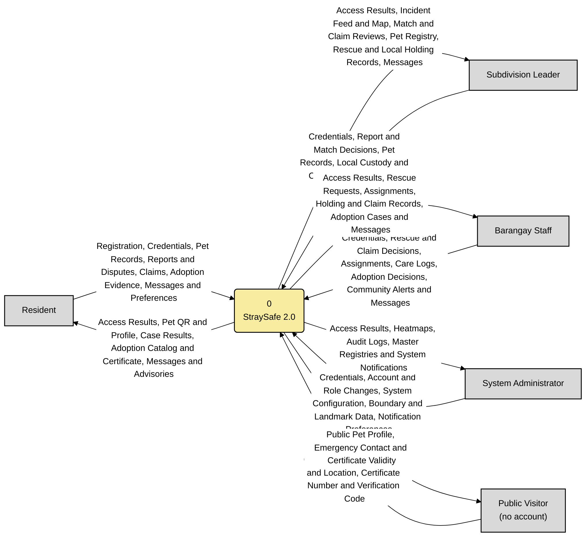
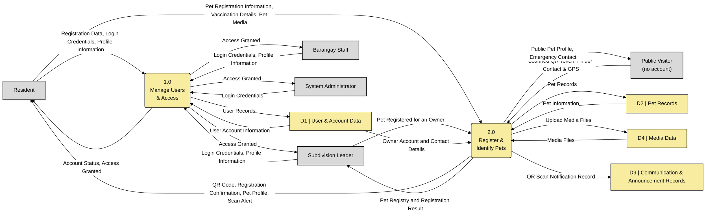
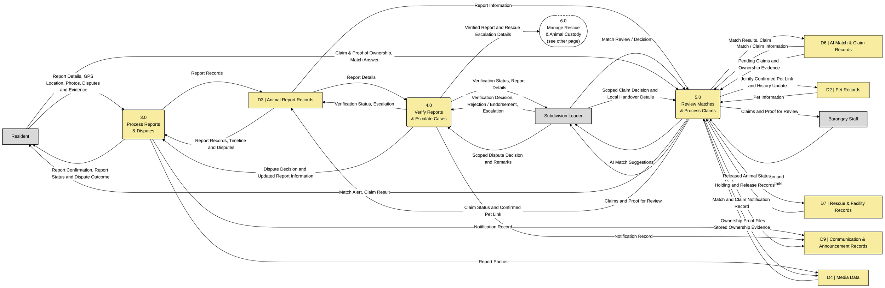
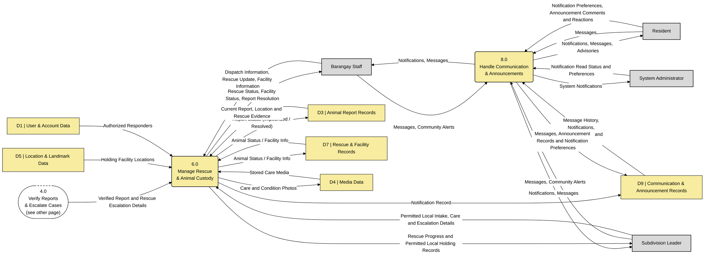
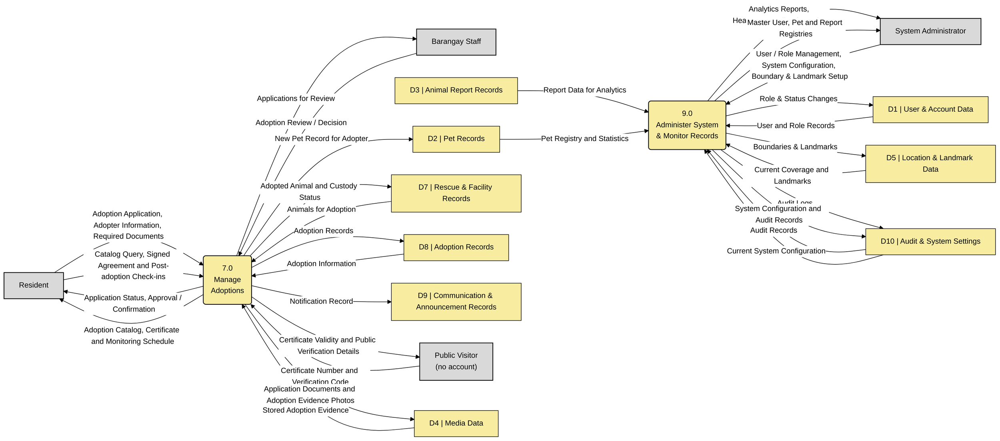

# Corrected DFDs (based on your Level 0 and Level 1)

> [Exact editable DFD symbols](../drawio/README.md) are available in the native `.drawio` files. The Mermaid blocks below are simplified previews with portable labels.

This is the nine-process **logical alternative** to the ten-process system in `../mermaid/`. Process numbers are
retained within this alternative and names use verb phrases. Do not mix its process/store numbers with the main
set. Each diagram has a flow checklist generated from its Mermaid source. See [the review](../04_DFD_REVIEW.md).

The logical boundary includes managed media, AI processing, email and push delivery. These facilities are internal
process details in both proposed sets, together with mapping support. Only human actors are external entities. The four Level 1 pages
are parts of one decomposition. Dashed processes continue on another page.

**Data stores after correction**

| Store | Name | Note |
|---|---|---|
| D1 | User & Account Data | unchanged |
| D2 | Pet Records | unchanged |
| D3 | Animal Report Records | now also holds verification and escalation (as in the database) |
| D4 | Media Data | pet/report media, claim proof, care photos and adoption evidence |
| D5 | Location & Landmark Data | **replaces** "Verification & Escalation Records" (no such separate store exists) |
| D6 | AI Match & Claim Records | unchanged |
| D7 | Rescue & Facility Records | unchanged |
| D8 | Adoption Records | unchanged |
| D9 | Communication & Announcement Records | messages, notifications, preferences and announcement records |
| D10 | Audit & System Settings | includes saved configuration as well as audit records |

**Drawing conventions (Gane–Sarson, use one style throughout):** external entity = rectangle · process = rounded
rectangle with its number on top · data store = open-ended rectangle "D# | Name" · arrow = data flow with a label.
The native draw.io diagrams have a grey ID compartment and yellow name area with the right edge left open. Their processes use a numbered top band, white name band and blank yellow bottom band. Mermaid previews use simplified boxes.

## Level 0 — Context Diagram

StraySafe 2.0 as one process with the five external entities.

**What changed from your version:**
- Administrator arrows **reversed**. Account & Role Management and Boundary & Landmark Setup now go **into** the system; Heatmaps, Audit Logs and Master Registries go **to** the administrator.
- Barangay Staff: "Telemetry" replaced with **Rescue Updates** (the routes record submitted case locations and status updates). "Inventory" replaced with **Holding Facility Records**.
- Subdivision Leader: "AI Diagnostics" renamed **AI Match Suggestions**. Added **Match Reviews** and **Pet Registrations** (leaders review AI matches and register pets for owners). "Disputes" moved to the Resident, who files them.
- Process numbered **0** and named **StraySafe 2.0**. Account/access results, messages, local custody and claim interactions, and public certificate verification are included on both levels.

Raw code: [`mermaid/level0_context.mmd`](mermaid/level0_context.mmd)

**Flow checklist (10 flows)** — redraw every row as one arrow:

| # | From | To | Data flow |
|---|---|---|---|
| 1 | Resident | 0 StraySafe 2.0 | Registration, Credentials, Pet Records, Reports and Disputes, Claims, Adoption Evidence, Messages and Preferences |
| 2 | 0 StraySafe 2.0 | Resident | Access Results, Pet QR and Profile, Case Results, Adoption Catalog and Certificate, Messages and Advisories |
| 3 | Subdivision Leader | 0 StraySafe 2.0 | Credentials, Report and Match Decisions, Pet Records, Local Custody and Claim Data, Community Alerts and Messages |
| 4 | 0 StraySafe 2.0 | Subdivision Leader | Access Results, Incident Feed and Map, Match and Claim Reviews, Pet Registry, Rescue and Local Holding Records, Messages |
| 5 | Barangay Staff | 0 StraySafe 2.0 | Credentials, Rescue and Claim Decisions, Assignments, Care Logs, Adoption Decisions, Community Alerts and Messages |
| 6 | 0 StraySafe 2.0 | Barangay Staff | Access Results, Rescue Requests, Assignments, Holding and Claim Records, Adoption Cases and Messages |
| 7 | System Administrator | 0 StraySafe 2.0 | Credentials, Account and Role Changes, System Configuration, Boundary and Landmark Data, Notification Preferences |
| 8 | 0 StraySafe 2.0 | System Administrator | Access Results, Heatmaps, Audit Logs, Master Registries and System Notifications |
| 9 | Public Visitor (no account) | 0 StraySafe 2.0 | QR Token, Finder Contact and Location, Certificate Number and Verification Code |
| 10 | 0 StraySafe 2.0 | Public Visitor (no account) | Public Pet Profile, Emergency Contact and Certificate Validity |

## Level 1 — Page 1: Processes 1.0 and 2.0

**What changed from your version:**
- 1.0 now **returns** Account Status / Access Granted to each user (before, nothing came back out of 1.0).
- **Public Visitor added** to 2.0 (scan in, public profile out). This fixes the Level 0 balancing error.
- Subdivision Leader → 2.0 "Pet Registered for an Owner" added (leaders register pets for owners without an account).
- Typo fixed: "Pet Registration & Identification".

Raw code: [`mermaid/level1_page1_access_pets.mmd`](mermaid/level1_page1_access_pets.mmd)

**Flow checklist (22 flows)** — redraw every row as one arrow:

| # | From | To | Data flow |
|---|---|---|---|
| 1 | Resident | 1.0 Manage Users & Access | Registration Data, Login Credentials, Profile Information |
| 2 | Subdivision Leader | 1.0 Manage Users & Access | Login Credentials, Profile Information |
| 3 | Barangay Staff | 1.0 Manage Users & Access | Login Credentials, Profile Information |
| 4 | System Administrator | 1.0 Manage Users & Access | Login Credentials |
| 5 | 1.0 Manage Users & Access | Resident | Account Status, Access Granted |
| 6 | 1.0 Manage Users & Access | Subdivision Leader | Access Granted |
| 7 | 1.0 Manage Users & Access | Barangay Staff | Access Granted |
| 8 | 1.0 Manage Users & Access | System Administrator | Access Granted |
| 9 | 1.0 Manage Users & Access | D1 User &amp; Account Data | User Records |
| 10 | D1 User &amp; Account Data | 1.0 Manage Users & Access | User Account Information |
| 11 | Resident | 2.0 Register & Identify Pets | Pet Registration Information, Vaccination Details, Pet Media |
| 12 | Subdivision Leader | 2.0 Register & Identify Pets | Pet Registered for an Owner |
| 13 | 2.0 Register & Identify Pets | Resident | QR Code, Registration Confirmation, Pet Profile, Scan Alert |
| 14 | Public Visitor (no account) | 2.0 Register & Identify Pets | Scanned QR Token, Finder Contact & GPS |
| 15 | 2.0 Register & Identify Pets | Public Visitor (no account) | Public Pet Profile, Emergency Contact |
| 16 | 2.0 Register & Identify Pets | D2 Pet Records | Pet Records |
| 17 | D2 Pet Records | 2.0 Register & Identify Pets | Pet Information |
| 18 | 2.0 Register & Identify Pets | D4 Media Data | Upload Media Files |
| 19 | D4 Media Data | 2.0 Register & Identify Pets | Media Files |
| 20 | 2.0 Register & Identify Pets | Subdivision Leader | Pet Registry and Registration Result |
| 21 | D1 User &amp; Account Data | 2.0 Register & Identify Pets | Owner Account and Contact Details |
| 22 | 2.0 Register & Identify Pets | D9 Communication &amp; Announcement Records | QR Scan Notification Record |

## Level 1 — Page 2: Processes 3.0, 4.0 and 5.0

**What changed from your version:**
- **D5 Verification & Escalation Records removed.** Verification is stored on the report itself (the separate verification table is unused), so 4.0 now reads and updates **D3 Animal Report Records**.
- The floating "Notification Record" label on 4.0 is now a real flow (4.0 → D9).
- **5.0 now has its external entities.** Residents submit claims and answer matches; the Subdivision Leader reviews AI suggestions.
- 3.0 report photos go to **D4 Media Data**, the same store used for pet media.
- Typo fixed: "Escalation".

Raw code: [`mermaid/level1_page2_reports_ai.mmd`](mermaid/level1_page2_reports_ai.mmd)

**Flow checklist (34 flows)** — redraw every row as one arrow:

| # | From | To | Data flow |
|---|---|---|---|
| 1 | Resident | 3.0 Process Reports & Disputes | Report Details, GPS Location, Photos, Disputes and Evidence |
| 2 | 3.0 Process Reports & Disputes | Resident | Report Confirmation, Report Status and Dispute Outcome |
| 3 | 3.0 Process Reports & Disputes | D3 Animal Report Records | Report Records |
| 4 | 3.0 Process Reports & Disputes | D4 Media Data | Report Photos |
| 5 | 3.0 Process Reports & Disputes | D9 Communication &amp; Announcement Records | Notification Record |
| 6 | D3 Animal Report Records | 4.0 Verify Reports & Escalate Cases | Report Details |
| 7 | Subdivision Leader | 4.0 Verify Reports & Escalate Cases | Verification Decision, Rejection / Endorsement, Escalation |
| 8 | 4.0 Verify Reports & Escalate Cases | Subdivision Leader | Verification Status, Report Details |
| 9 | 4.0 Verify Reports & Escalate Cases | D3 Animal Report Records | Verification Status, Escalation |
| 10 | 4.0 Verify Reports & Escalate Cases | D9 Communication &amp; Announcement Records | Notification Record |
| 11 | D3 Animal Report Records | 5.0 Review Matches & Process Claims | Report Information |
| 12 | D2 Pet Records | 5.0 Review Matches & Process Claims | Pet Information |
| 13 | Subdivision Leader | 5.0 Review Matches & Process Claims | Match Review / Decision |
| 14 | 5.0 Review Matches & Process Claims | Subdivision Leader | AI Match Suggestions |
| 15 | Resident | 5.0 Review Matches & Process Claims | Claim & Proof of Ownership, Match Answer |
| 16 | 5.0 Review Matches & Process Claims | Resident | Match Alert, Claim Result |
| 17 | 5.0 Review Matches & Process Claims | D6 AI Match &amp; Claim Records | Match Results, Claim Records |
| 18 | D6 AI Match &amp; Claim Records | 5.0 Review Matches & Process Claims | Match / Claim Information |
| 19 | 5.0 Review Matches & Process Claims | D2 Pet Records | Jointly Confirmed Pet Link and History Update |
| 20 | D3 Animal Report Records | 3.0 Process Reports & Disputes | Report Records, Timeline and Disputes |
| 21 | Subdivision Leader | 4.0 Verify Reports & Escalate Cases | Scoped Dispute Decision and Remarks |
| 22 | 4.0 Verify Reports & Escalate Cases | 6.0 Manage Rescue & Animal Custody (see other page) | Verified Report and Rescue Escalation Details |
| 23 | 4.0 Verify Reports & Escalate Cases | 3.0 Process Reports & Disputes | Dispute Decision and Updated Report Information |
| 24 | D6 AI Match &amp; Claim Records | 5.0 Review Matches & Process Claims | Pending Claims and Ownership Evidence |
| 25 | 5.0 Review Matches & Process Claims | Subdivision Leader | Claims and Proof for Review |
| 26 | Subdivision Leader | 5.0 Review Matches & Process Claims | Scoped Claim Decision and Local Handover Details |
| 27 | 5.0 Review Matches & Process Claims | Barangay Staff | Claims and Proof for Review |
| 28 | Barangay Staff | 5.0 Review Matches & Process Claims | Claim Decision and Handover Details |
| 29 | 5.0 Review Matches & Process Claims | D3 Animal Report Records | Claim Status and Confirmed Pet Link |
| 30 | D7 Rescue &amp; Facility Records | 5.0 Review Matches & Process Claims | Holding and Release Records |
| 31 | 5.0 Review Matches & Process Claims | D7 Rescue &amp; Facility Records | Released Animal Status |
| 32 | 5.0 Review Matches & Process Claims | D9 Communication &amp; Announcement Records | Match and Claim Notification Record |
| 33 | 5.0 Review Matches & Process Claims | D4 Media Data | Ownership Proof Files |
| 34 | D4 Media Data | 5.0 Review Matches & Process Claims | Stored Ownership Evidence |

## Level 1 — Page 3: Processes 6.0 and 8.0

The dashed connector 4.0 shows the forwarded reports coming from page 2.

**What changed from your version:**
- 6.0 now **updates the report** in D3 (impounded / resolved) and reads facility locations from D5.
- 8.0 now also serves **Subdivision Leaders and Barangay Staff** and receives **messages**.
- 8.0 named **Handle Communication & Announcements** and receives **Community Alerts**. This covers the "Alerts" and "Advisories" from Level 0, which had no process before.

Raw code: [`mermaid/level1_page3_rescue_notifications.mmd`](mermaid/level1_page3_rescue_notifications.mmd)

**Flow checklist (25 flows)** — redraw every row as one arrow:

| # | From | To | Data flow |
|---|---|---|---|
| 1 | 4.0 Verify Reports & Escalate Cases (see other page) | 6.0 Manage Rescue & Animal Custody | Verified Report and Rescue Escalation Details |
| 2 | Barangay Staff | 6.0 Manage Rescue & Animal Custody | Dispatch Information, Rescue Update, Facility Information |
| 3 | 6.0 Manage Rescue & Animal Custody | Barangay Staff | Rescue Status, Facility Status, Report Resolution |
| 4 | 6.0 Manage Rescue & Animal Custody | D7 Rescue &amp; Facility Records | Animal Status / Facility Info |
| 5 | D7 Rescue &amp; Facility Records | 6.0 Manage Rescue & Animal Custody | Animal Status / Facility Info |
| 6 | 6.0 Manage Rescue & Animal Custody | D3 Animal Report Records | Report Status (Impounded / Resolved) |
| 7 | D5 Location &amp; Landmark Data | 6.0 Manage Rescue & Animal Custody | Holding Facility Locations |
| 8 | 6.0 Manage Rescue & Animal Custody | D9 Communication &amp; Announcement Records | Notification Record |
| 9 | D9 Communication &amp; Announcement Records | 8.0 Handle Communication & Announcements | Message History, Notifications, Announcements and Preferences |
| 10 | Resident | 8.0 Handle Communication & Announcements | Messages |
| 11 | Subdivision Leader | 8.0 Handle Communication & Announcements | Messages, Community Alerts |
| 12 | Barangay Staff | 8.0 Handle Communication & Announcements | Messages, Community Alerts |
| 13 | 8.0 Handle Communication & Announcements | Resident | Notifications, Messages, Advisories |
| 14 | 8.0 Handle Communication & Announcements | Subdivision Leader | Notifications, Messages |
| 15 | 8.0 Handle Communication & Announcements | Barangay Staff | Notifications, Messages |
| 16 | 8.0 Handle Communication & Announcements | D9 Communication &amp; Announcement Records | Messages, Announcement Records and Notification Preferences |
| 17 | D3 Animal Report Records | 6.0 Manage Rescue & Animal Custody | Current Report, Location and Rescue Evidence |
| 18 | D1 User &amp; Account Data | 6.0 Manage Rescue & Animal Custody | Authorized Responders |
| 19 | Subdivision Leader | 6.0 Manage Rescue & Animal Custody | Permitted Local Intake, Care and Escalation Details |
| 20 | 6.0 Manage Rescue & Animal Custody | Subdivision Leader | Rescue Progress and Permitted Local Holding Records |
| 21 | System Administrator | 8.0 Handle Communication & Announcements | Notification Read Status and Preferences |
| 22 | 8.0 Handle Communication & Announcements | System Administrator | System Notifications |
| 23 | Resident | 8.0 Handle Communication & Announcements | Notification Preferences, Announcement Comments and Reactions |
| 24 | 6.0 Manage Rescue & Animal Custody | D4 Media Data | Care and Condition Photos |
| 25 | D4 Media Data | 6.0 Manage Rescue & Animal Custody | Stored Care Media |

## Level 1 — Page 4: Processes 7.0 and 9.0

**What changed from your version:**
- 7.0 ↔ Barangay Staff now goes **both ways**: applications go to staff, and decisions come back from staff.
- 7.0 reads **Animals for Adoption** from D7 and creates the **adopter's new pet record** in D2.
- 9.0 arrow **reversed**: analytics, heatmaps and audit information go **to** the administrator.
- 9.0 now reads D10 (audit records) and D3 (report data for analytics). It also writes role changes to D1 and boundaries / landmarks to **D5 Location & Landmark Data**, which takes the D5 number freed above.

Raw code: [`mermaid/level1_page4_adoption_admin.mmd`](mermaid/level1_page4_adoption_admin.mmd)

**Flow checklist (29 flows)** — redraw every row as one arrow:

| # | From | To | Data flow |
|---|---|---|---|
| 1 | Resident | 7.0 Manage Adoptions | Adoption Application, Adopter Information, Required Documents |
| 2 | 7.0 Manage Adoptions | Resident | Application Status, Approval / Confirmation |
| 3 | 7.0 Manage Adoptions | Barangay Staff | Applications for Review |
| 4 | Barangay Staff | 7.0 Manage Adoptions | Adoption Review / Decision |
| 5 | D7 Rescue &amp; Facility Records | 7.0 Manage Adoptions | Animals for Adoption |
| 6 | 7.0 Manage Adoptions | D8 Adoption Records | Adoption Records |
| 7 | D8 Adoption Records | 7.0 Manage Adoptions | Adoption Information |
| 8 | 7.0 Manage Adoptions | D2 Pet Records | New Pet Record for Adopter |
| 9 | 7.0 Manage Adoptions | D9 Communication &amp; Announcement Records | Notification Record |
| 10 | System Administrator | 9.0 Administer System & Monitor Records | User / Role Management, System Configuration, Boundary & Landmark Setup |
| 11 | 9.0 Administer System & Monitor Records | System Administrator | Analytics Reports, Heatmaps, Audit Information |
| 12 | 9.0 Administer System & Monitor Records | D1 User &amp; Account Data | Role & Status Changes |
| 13 | 9.0 Administer System & Monitor Records | D5 Location &amp; Landmark Data | Boundaries & Landmarks |
| 14 | D3 Animal Report Records | 9.0 Administer System & Monitor Records | Report Data for Analytics |
| 15 | 9.0 Administer System & Monitor Records | D10 Audit &amp; System Settings | Audit Logs |
| 16 | D10 Audit &amp; System Settings | 9.0 Administer System & Monitor Records | Audit Records |
| 17 | Resident | 7.0 Manage Adoptions | Catalog Query, Signed Agreement and Post-adoption Check-ins |
| 18 | 7.0 Manage Adoptions | Resident | Adoption Catalog, Certificate and Monitoring Schedule |
| 19 | Public Visitor (no account) | 7.0 Manage Adoptions | Certificate Number and Verification Code |
| 20 | 7.0 Manage Adoptions | Public Visitor (no account) | Certificate Validity and Public Verification Details |
| 21 | 7.0 Manage Adoptions | D7 Rescue &amp; Facility Records | Adopted Animal and Custody Status |
| 22 | D1 User &amp; Account Data | 9.0 Administer System & Monitor Records | User and Role Records |
| 23 | D2 Pet Records | 9.0 Administer System & Monitor Records | Pet Registry and Statistics |
| 24 | D5 Location &amp; Landmark Data | 9.0 Administer System & Monitor Records | Current Coverage and Landmarks |
| 25 | D10 Audit &amp; System Settings | 9.0 Administer System & Monitor Records | Current System Configuration |
| 26 | 9.0 Administer System & Monitor Records | D10 Audit &amp; System Settings | System Configuration and Audit Records |
| 27 | 9.0 Administer System & Monitor Records | System Administrator | Master User, Pet and Report Registries |
| 28 | 7.0 Manage Adoptions | D4 Media Data | Application Documents and Adoption Evidence Photos |
| 29 | D4 Media Data | 7.0 Manage Adoptions | Stored Adoption Evidence |
