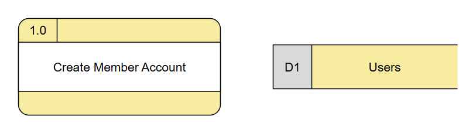
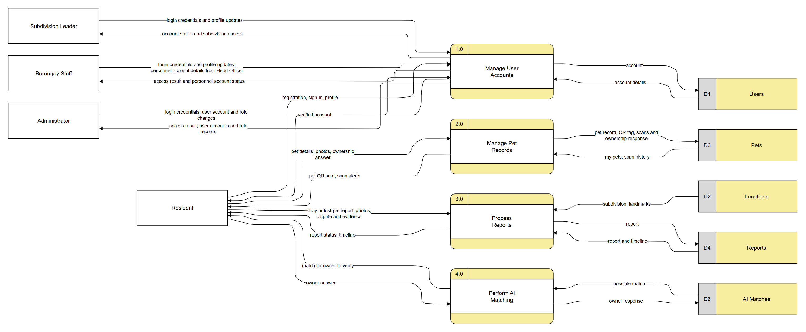

# Editable DFDs with the requested symbols

Open these files directly in diagrams.net/draw.io using **File → Open From → Device**:

- [Resident_Part1.drawio](Resident_Part1.drawio): the diagram shown in the screenshot, with corrected symbols.
- [DFD_editable.drawio](DFD_editable.drawio): all 29 diagrams, with one diagram per page tab.
- [Symbol_Reference.drawio](Symbol_Reference.drawio): an editable example of each requested symbol.

**Process:** rounded yellow outline; process number in the upper-left compartment; process name in the white
middle band; blank yellow bottom band. For example, `1.0` identifies the process, and `Manage User Accounts`
describes the work it performs.

**Data store:** a grey ID compartment on the left, a yellow name compartment on the right, and an open right
edge. For example, `D1` identifies the store, and `Users` names the retained records. The main Resident Part 1
diagram uses D1 Users, D2 Locations, D3 Pets, D4 Reports and D6 AI Matches. These are logical groups of saved
information, not process numbers.

Arrows are native editable connectors attached to the complete process/store group. The compartment shapes and
labels are native editable shapes as well. Double-click a label to edit it; select the group to move the symbol
with its compartments together. Human actors are the only external entities.

The `.mmd` files retain the same graph and data-flow labels using simple portable labels such as `D1 | Users`.
Mermaid previews use simplified boxes. Use the native `.drawio` files for the exact compartment borders and colours.
The earlier HTML-table labels were removed because some Mermaid-to-editable-shapes importers do not preserve them.

Process 1.0 Manage User Accounts includes Resident, Subdivision Leader, Barangay Staff and Administrator in every
complete account-process view, including Resident Part 1. Public Visitor has no account and remains connected
to public QR/certificate processes. Other processes in each role view keep their focus-role interactions.
