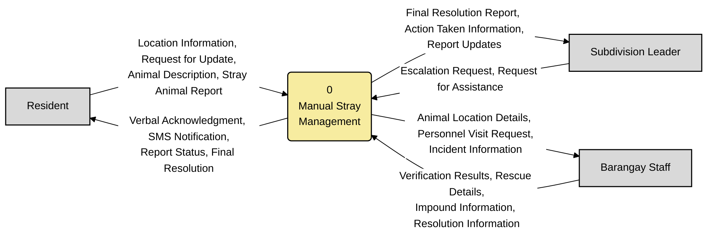
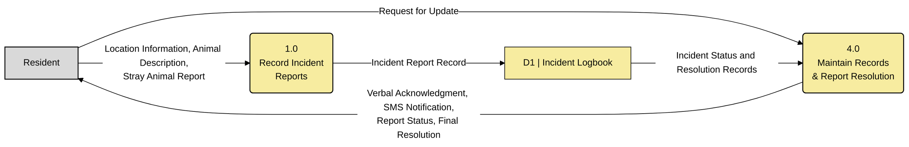

# Existing System DFDs (Figures 2.2–2.5)

> [Exact editable DFD symbols](../drawio/README.md) are available in the native `.drawio` files. The Mermaid blocks below are simplified previews with portable labels.

Code-based versions of the team's existing-system diagrams with the review corrections applied. They match `MANUSCRIPT_DFD_EXISTING.txt`. Each figure has a flow checklist for redrawing. These are partial role views of one manual system, sharing processes 1.0–4.0. Processes are rounded rectangles. Data stores are open-ended rectangles with a grey ID compartment and a yellow name area, matching the supplied notation reference.

## Figure 2.2 Existing System Context Diagram

**Corrections applied:** process numbered 0; "Barangay" renamed Barangay Staff; typos fixed (Escalation, Action Taken).

Raw code: [`mermaid/fig2_2_existing_context.mmd`](mermaid/fig2_2_existing_context.mmd)

**Explanation (manuscript text):**

The resident reports a stray animal by visiting or calling the barangay office, giving the animal's description and location, and later asks for updates. In return, the resident receives a verbal acknowledgment, SMS notifications, the report status and the final resolution.

The subdivision leader sends escalation requests and requests for assistance. The leader receives report updates, information on the actions taken and the final resolution report.

The barangay staff receive the animal's location details, personnel visit requests and incident information. They return verification results, rescue details, impound information and the resolution of each case.

**Flow checklist (6 flows)** — redraw every row as one arrow:

| # | From | To | Data flow |
|---|---|---|---|
| 1 | Resident | 0 Manual Stray Management | Location Information, Request for Update, Animal Description, Stray Animal Report |
| 2 | 0 Manual Stray Management | Resident | Verbal Acknowledgment, SMS Notification, Report Status, Final Resolution |
| 3 | Subdivision Leader | 0 Manual Stray Management | Escalation Request, Request for Assistance |
| 4 | 0 Manual Stray Management | Subdivision Leader | Final Resolution Report, Action Taken Information, Report Updates |
| 5 | Barangay Staff | 0 Manual Stray Management | Verification Results, Rescue Details, Impound Information, Resolution Information |
| 6 | 0 Manual Stray Management | Barangay Staff | Animal Location Details, Personnel Visit Request, Incident Information |

## Figure 2.3 Existing System Level 1 Diagram: Resident Module

**Corrections applied:** "Request for Update" moved from 1.0 to 4.0, which is the process that answers status requests.

Raw code: [`mermaid/fig2_3_existing_resident.mmd`](mermaid/fig2_3_existing_resident.mmd)

**Explanation (manuscript text):**

**Flow checklist (5 flows)** — redraw every row as one arrow:

| # | From | To | Data flow |
|---|---|---|---|
| 1 | Resident | 1.0 Record Incident Reports | Location Information, Animal Description, Stray Animal Report |
| 2 | 1.0 Record Incident Reports | D1 Incident Logbook | Incident Report Record |
| 3 | Resident | 4.0 Maintain Records & Report Resolution | Request for Update |
| 4 | D1 Incident Logbook | 4.0 Maintain Records & Report Resolution | Incident Status and Resolution Records |
| 5 | 4.0 Maintain Records & Report Resolution | Resident | Verbal Acknowledgment, SMS Notification, Report Status, Final Resolution |

## Figure 2.4 Existing System Level 1 Diagram: Subdivision Leader Module

**Corrections applied:** process 4.0 uses the same full name as the other figures (Record Keeping & Resolution).

Raw code: [`mermaid/fig2_4_existing_subdivision_leader.mmd`](mermaid/fig2_4_existing_subdivision_leader.mmd)

```mermaid
---
config:
  theme: base
  htmlLabels: true
  themeVariables:
    background: "#ffffff"
    primaryColor: "#ffffff"
    primaryTextColor: "#000000"
    primaryBorderColor: "#000000"
    lineColor: "#000000"
    textColor: "#000000"
    fontFamily: "Arial, Helvetica, sans-serif"
    fontSize: "15px"
  flowchart:
    curve: basis
    nodeSpacing: 50
    rankSpacing: 80
    useMaxWidth: false
---
flowchart LR
    LDR["Subdivision Leader"]:::ent
    P2("2.0<br/>Coordinate Assistance<br/>& Escalation"):::proc
    P4("4.0<br/>Maintain Records<br/>& Report Resolution"):::proc
    D1["D1 | Incident Logbook"]:::store

    %% Plain-label Mermaid preview. Exact editable DFD symbols: ../../drawio/DFD_editable.drawio
    %% Arrows carry data; dashed processes continue on another page.
    LDR -->|"Escalation Request, Request for Assistance"| P2
    P2 -->|"Escalation and Assistance Request Record"| D1
    D1 -->|"Incident Status and Resolution Records"| P4
    P4 -->|"Report Updates, Action Taken Information, Final Resolution Report"| LDR

    classDef ent fill:#d9d9d9,stroke:#000000,stroke-width:1.5px
    classDef proc fill:#f7eca0,stroke:#000000,stroke-width:1.5px
    classDef store fill:#f7eca0,stroke:#000000,stroke-width:1px
```

**Explanation (manuscript text):**

**Flow checklist (4 flows)** — redraw every row as one arrow:

| # | From | To | Data flow |
|---|---|---|---|
| 1 | Subdivision Leader | 2.0 Coordinate Assistance & Escalation | Escalation Request, Request for Assistance |
| 2 | 2.0 Coordinate Assistance & Escalation | D1 Incident Logbook | Escalation and Assistance Request Record |
| 3 | D1 Incident Logbook | 4.0 Maintain Records & Report Resolution | Incident Status and Resolution Records |
| 4 | 4.0 Maintain Records & Report Resolution | Subdivision Leader | Report Updates, Action Taken Information, Final Resolution Report |

## Figure 2.5 Existing System Level 1 Diagram: Barangay Module

**Corrections applied:** the invalid Brgy Staff → D1 flow is removed; 3.0 now reads the location and incident details from D1 and passes them to the staff with the dispatch instructions; "Brgy Staff" renamed Barangay Staff.

Raw code: [`mermaid/fig2_5_existing_barangay.mmd`](mermaid/fig2_5_existing_barangay.mmd)

```mermaid
---
config:
  theme: base
  htmlLabels: true
  themeVariables:
    background: "#ffffff"
    primaryColor: "#ffffff"
    primaryTextColor: "#000000"
    primaryBorderColor: "#000000"
    lineColor: "#000000"
    textColor: "#000000"
    fontFamily: "Arial, Helvetica, sans-serif"
    fontSize: "15px"
  flowchart:
    curve: basis
    nodeSpacing: 50
    rankSpacing: 80
    useMaxWidth: false
---
flowchart LR
    P2("2.0<br/>Coordinate Assistance<br/>& Escalation"):::proc
    STF["Barangay Staff"]:::ent
    P3("3.0<br/>Record Field<br/>Operations"):::proc
    P4("4.0<br/>Maintain Records<br/>& Report Resolution"):::proc
    D1["D1 | Incident Logbook"]:::store
    D2["D2 | Impound Registry"]:::store

    %% Plain-label Mermaid preview. Exact editable DFD symbols: ../../drawio/DFD_editable.drawio
    %% Arrows carry data; dashed processes continue on another page.
    P2 -->|"Personnel Visit Request"| STF
    D1 -->|"Animal Location Details, Incident Information"| P3
    P3 -->|"Animal Location Details, Incident Information"| STF
    STF -->|"Rescue Details, Verification Results"| P3
    P3 -->|"Verification and Rescue Records"| D1
    STF -->|"Impound Information, Resolution Information"| P4
    P4 -->|"Impound and Resolution Records"| D2
    D1 -->|"Escalation and Assistance Request Records"| P2
    D1 -->|"Incident, Rescue and Resolution Records"| P4
    D2 -->|"Impound and Resolution Records"| P4
    P4 -->|"Resolution and Report Status Records"| D1

    classDef ent fill:#d9d9d9,stroke:#000000,stroke-width:1.5px
    classDef proc fill:#f7eca0,stroke:#000000,stroke-width:1.5px
    classDef store fill:#f7eca0,stroke:#000000,stroke-width:1px
```

**Explanation (manuscript text):**

Process 2.0 reads the recorded assistance request before producing a personnel visit request. Staff submit impound and resolution information to process 4.0. That process records it in D2 and updates the case status in D1, so the resident and subdivision-leader views can retrieve the resolution.

**Flow checklist (11 flows)** — redraw every row as one arrow:

| # | From | To | Data flow |
|---|---|---|---|
| 1 | 2.0 Coordinate Assistance & Escalation | Barangay Staff | Personnel Visit Request |
| 2 | D1 Incident Logbook | 3.0 Record Field Operations | Animal Location Details, Incident Information |
| 3 | 3.0 Record Field Operations | Barangay Staff | Animal Location Details, Incident Information |
| 4 | Barangay Staff | 3.0 Record Field Operations | Rescue Details, Verification Results |
| 5 | 3.0 Record Field Operations | D1 Incident Logbook | Verification and Rescue Records |
| 6 | Barangay Staff | 4.0 Maintain Records & Report Resolution | Impound Information, Resolution Information |
| 7 | 4.0 Maintain Records & Report Resolution | D2 Impound Registry | Impound and Resolution Records |
| 8 | D1 Incident Logbook | 2.0 Coordinate Assistance & Escalation | Escalation and Assistance Request Records |
| 9 | D1 Incident Logbook | 4.0 Maintain Records & Report Resolution | Incident, Rescue and Resolution Records |
| 10 | D2 Impound Registry | 4.0 Maintain Records & Report Resolution | Impound and Resolution Records |
| 11 | 4.0 Maintain Records & Report Resolution | D1 Incident Logbook | Resolution and Report Status Records |
