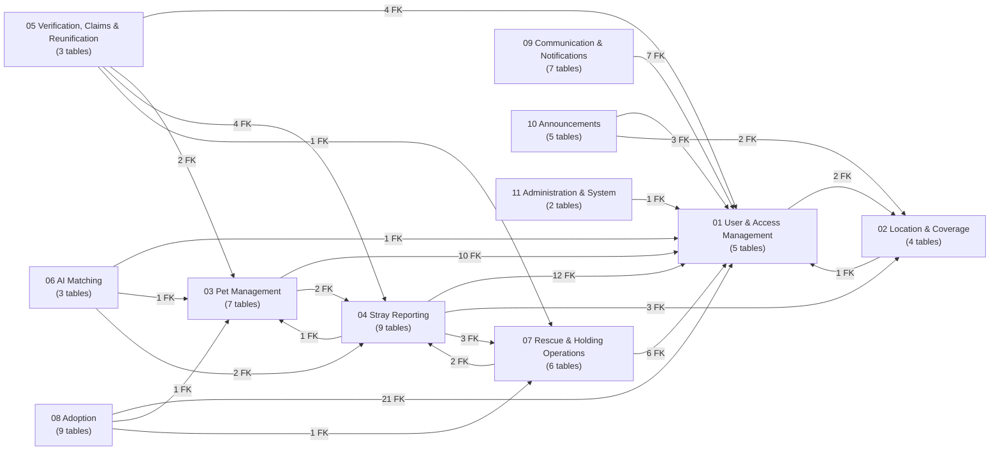

# StraySafe 2.0 — ERD Module Overview (Phase 1 & 2)

> **Status:** Database analysis and proposed module breakdown — **awaiting approval**.
> No ERD diagram code has been generated yet. Module 1 will be produced only after this breakdown is approved.

## 1. How this analysis was done

| Source | What was checked |
|---|---|
| `backend/app/models/*.py` (24 files) | Every SQLAlchemy model, `__tablename__`, column, primary key, `ForeignKey(...)`, `unique=True` and `relationship(...)` |
| `Base.metadata` (loaded from the models) | The definitive list of tables, PKs and FKs as the application defines them |
| Live MySQL database (SQLAlchemy inspector, read-only) | Tables and foreign-key constraints that actually exist in the database, compared with the models |
| `backend/app/routes`, `utils`, `services`, `ai_worker.py` | Whether each table is actually used by the application |

Nothing was modified — no models, migrations, routes or data.

## 2. Summary of the database

| Item | Count |
|---|---|
| Tables defined in the models | **60** |
| Tables in the live database | 61 (the 60 above + `behavior_tags`, which has no model) |
| Declared foreign keys | 147 (146 + `reports.split_from_report_id`, added for multi-animal reports) |
| One-to-one links (unique FK) | 4 — `adoption_certificates.adoption_id`, `endorsement_letters.report_id`, `pet_qr_codes.pet_id`, `user_notification_preferences.user_id` |
| Self-referencing links | 3 — `reports.duplicate_of_report_id`, `comments.parent_comment_id`, `announcement_comments.parent_comment_id` |
| Many-to-many (resolved by an associative table) | `rescue_assignments` (rescues ↔ users), `announcement_reactions` (announcements ↔ users), `pet_claims` (pets ↔ reports), `report_matches` (reports ↔ reports / pets) |
| Lookup (status / category) tables | 8 — `roles`, `positions`, `report_categories`, `report_status`, `rescue_status`, `facility_status`, `letter_status`, `announcement_categories` |

There are no pure join tables (tables made only of two FKs). Every many-to-many is an associative entity with its own attributes (dates, status, notes), so it will be drawn as an entity, which is the correct ERD convention.

## 3. Proposed modules

The modules below follow the actual implementation. Compared with the suggested list, three changes were made:

- **Adoption is its own module.** It has 9 tables.
- **Location & Coverage is separate from User Management.** Barangays, subdivisions and landmarks are used by users, reports, facilities and announcements alike.
- **Announcements are separate from Communication.** They form their own feed: posts, media, comments and reactions.

**All 60 tables are covered, each in exactly one module.**

| # | Module | Tables | Count |
|---|---|---|---|
| 01 | User & Access Management | `roles`, `positions`, `users`, `otp_verifications`, `revoked_tokens` | 5 |
| 02 | Location & Coverage | `barangays`, `subdivisions`, `landmarks`, `coverage_settings` | 4 |
| 03 | Pet Management | `pets`, `pet_vaccinations`, `pet_qr_codes`, `pet_qr_scans`, `pet_history`, `pet_owner_confirmations`, `owner_warnings` | 7 |
| 04 | Stray Reporting | `report_categories`, `report_status`, `reports`, `report_media`, `status_history`, `comments`, `endorsement_letters`, `letter_status`, `report_disputes` | 9 |
| 05 | Verification, Claims & Reunification | `report_verifications`, `pet_claims`, `report_returns` | 3 |
| 06 | AI Matching | `report_matches`, `ai_jobs`, `ai_vision_comparisons` | 3 |
| 07 | Rescue & Holding Operations | `rescue_status`, `rescues`, `rescue_assignments`, `facility_status`, `holding_animals`, `holding_timeline` | 6 |
| 08 | Adoption | `adoptions`, `adoption_verifications`, `adoption_interviews`, `adoption_home_visits`, `adoption_assignments`, `adoption_certificates`, `adoption_monitoring_logs`, `adoption_timeline_logs`, `adoption_ownership_history` | 9 |
| 09 | Communication & Notifications | `chat_threads`, `chat_messages`, `notifications`, `user_notification_preferences`, `push_subscriptions`, `push_deliveries`, `email_logs` | 7 |
| 10 | Announcements | `announcement_categories`, `announcements`, `announcement_media`, `announcement_comments`, `announcement_reactions` | 5 |
| 11 | Administration & System | `audit_logs`, `system_settings` | 2 |
| 12 | Complete System ERD | All 60 tables (relationships only, attributes reduced to keys) | — |
| | **Total** | | **60** |

### Proposed file structure

```text
docs/
└── ERD/
    ├── 00_ERD_MODULE_OVERVIEW.md            (this file)
    ├── 01_USER_ACCESS_MANAGEMENT_ERD.md
    ├── 02_LOCATION_COVERAGE_ERD.md
    ├── 03_PET_MANAGEMENT_ERD.md
    ├── 04_STRAY_REPORTING_ERD.md
    ├── 05_VERIFICATION_CLAIMS_REUNIFICATION_ERD.md
    ├── 06_AI_MATCHING_ERD.md
    ├── 07_RESCUE_HOLDING_OPERATIONS_ERD.md
    ├── 08_ADOPTION_ERD.md
    ├── 09_COMMUNICATION_NOTIFICATIONS_ERD.md
    ├── 10_ANNOUNCEMENTS_ERD.md
    ├── 11_ADMINISTRATION_SYSTEM_ERD.md
    └── 12_COMPLETE_SYSTEM_ERD.md
```

## 4. Module details

**Notation used in these tables:**
- **FK →** marks a declared foreign key; `!` means NOT NULL (mandatory).
- **(U)** marks a unique FK, which means one-to-one.
- **Cross-module references** are entities from other modules that will appear in the diagram as reference boxes (key only).

### 01 — User & Access Management
**Purpose:** Accounts for all roles (Resident, Subdivision Leader, Barangay Staff, Admin), sign-in verification and session revocation.

| Table | PK | Foreign keys |
|---|---|---|
| `roles` | role_id | — (lookup) |
| `positions` | position_id | — (lookup) |
| `users` | user_id | role_id → roles **!**, position_id → positions, barangay_id → barangays, subdivision_id → subdivisions |
| `otp_verifications` | otp_id | user_id → users **!** |
| `revoked_tokens` | id | — (`user_id` stored, no FK) |

**Cross-module references:** `barangays` and `subdivisions` (02).
`users` is referenced by almost every other module; those links are drawn in the other modules.

### 02 — Location & Coverage
**Purpose:** The geographic hierarchy: a barangay has subdivisions, and each has landmarks and holding facilities. Also the map coverage area.

| Table | PK | Foreign keys |
|---|---|---|
| `barangays` | barangay_id | — |
| `subdivisions` | subdivision_id | barangay_id → barangays **!** |
| `landmarks` | landmark_id | barangay_id → barangays **!**, subdivision_id → subdivisions |
| `coverage_settings` | id | subdivision_id → subdivisions, updated_by → users |

`landmarks.is_holding_facility` marks which landmarks are impound or holding facilities. The facility hotline and contact person live here.

**Cross-module references:** `users` (01).

### 03 — Pet Management
**Purpose:** Registered pets, vaccinations, QR tags and scans, the pet's life history, ownership confirmation or transfer, and warnings issued to owners.

| Table | PK | Foreign keys |
|---|---|---|
| `pets` | pet_id | owner_id → users, registered_by_user_id → users |
| `pet_vaccinations` | vaccination_id | pet_id → pets **!** |
| `pet_qr_codes` | qr_id | pet_id → pets **! (U)** |
| `pet_qr_scans` | scan_id | qr_id → pet_qr_codes **!**, pet_id → pets **!**, scanned_by → users, confirmed_by → users |
| `pet_history` | history_id | pet_id → pets **!**, actor_id → users, scan_id → pet_qr_scans |
| `pet_owner_confirmations` | confirmation_id | pet_id → pets **!**, proposed_owner_id → users **!**, previous_owner_id → users, proposed_by → users, report_id → reports |
| `owner_warnings` | warning_id | user_id → users **!**, issued_by → users **!**, pet_id → pets, report_id → reports |

**Cross-module references:** `users` (01), `reports` (04).

### 04 — Stray Reporting
**Purpose:** Citizen and staff reports (stray, lost pet, and so on), media, the status timeline, comments, case merging (duplicates), endorsement letters and owner disputes.

| Table | PK | Foreign keys |
|---|---|---|
| `report_categories` | category_id | — (lookup) |
| `report_status` | status_id | — (lookup) |
| `reports` | report_id | user_id → users **!**, category_id → report_categories **!**, subdivision_id → subdivisions **!**, current_status_id → report_status, duplicate_of_report_id → reports (self), facility_id → landmarks, assigned_leader_id / verified_by_user_id / merged_by / visibility_decided_by / pending_transfer_from_id / pending_transfer_to_id → users |
| `report_media` | media_id | report_id → reports **!**, status_id → report_status, history_id → status_history, holding_log_id → holding_timeline |
| `status_history` | history_id | report_id → reports, report_status_id → report_status, rescue_id → rescues, rescue_status_id → rescue_status, facility_id → landmarks, updated_by → users |
| `comments` | comment_id | report_id → reports **!**, user_id → users **!**, parent_comment_id → comments (self) |
| `endorsement_letters` | letter_id | report_id → reports **! (U)**, leader_id → users **!**, status_id → letter_status |
| `letter_status` | status_id | — (lookup) |
| `report_disputes` | dispute_id | report_id → reports **!**, resident_user_id → users **!**, pet_id → pets, reviewer_id → users |

**Cross-module references:** `users` (01), `subdivisions` and `landmarks` (02), `pets` (03), `rescues`, `rescue_status` and `holding_timeline` (07).

### 05 — Verification, Claims & Reunification
**Purpose:** Report verification by staff, an owner's claim that a reported animal is their pet, and the record of the animal being returned to its owner.

| Table | PK | Foreign keys |
|---|---|---|
| `report_verifications` | verification_id | report_id → reports **!**, verified_by → users, leader_id → users, status_id → report_status |
| `pet_claims` | claim_id | pet_id → pets **!**, report_id → reports **!** |
| `report_returns` | return_id | report_id → reports **!**, pet_id → pets, holding_id → holding_animals, owner_user_id → users, returned_by → users |

`pet_claims` is the associative entity resolving the many-to-many between **pets** and **reports**.

**Cross-module references:** `users` (01), `pets` (03), `reports` and `report_status` (04), `holding_animals` (07).

### 06 — AI Matching
**Purpose:** AI-suggested matches between a sighting and another report or a registered pet (staff and owners confirm; the AI never decides). Also the background AI job queue and the cache of image comparisons.

| Table | PK | Foreign keys |
|---|---|---|
| `report_matches` | match_id | source_report_id → reports **!**, matched_report_id → reports, matched_pet_id → pets, reviewed_by → users |
| `ai_jobs` | job_id | — (`report_id`, `media_id` stored, no FK) |
| `ai_vision_comparisons` | pair_key | — (cache keyed by an image pair, no FK) |

**Cross-module references:** `users` (01), `pets` (03), `reports` and `report_media` (04).

### 07 — Rescue & Holding Operations
**Purpose:** Rescue dispatch for a report, the responders assigned, the animal's intake into a holding facility, and its care timeline there.

| Table | PK | Foreign keys |
|---|---|---|
| `rescue_status` | status_id | — (lookup) |
| `rescues` | rescue_id | report_id → reports **!**, status_id → rescue_status, leader_id → users, staff_id → users |
| `rescue_assignments` | assignment_id | rescue_id → rescues **!**, user_id → users **!** |
| `facility_status` | status_id | — (lookup) |
| `holding_animals` | holding_id | report_id → reports **!**, rescue_id → rescues, facility_status → facility_status **!**, intake_staff_id → users, promoted_by → users |
| `holding_timeline` | log_id | holding_id → holding_animals **!**, logged_by → users |

`rescue_assignments` is the associative entity resolving the many-to-many between **rescues** and **users** (responders).

**Cross-module references:** `users` (01), `reports` (04).

### 08 — Adoption
**Purpose:** Adopting a holding animal: the application, document verification, interview, home visit, staff task assignments, certificate, post-adoption monitoring, timeline and ownership transfer.

| Table | PK | Foreign keys |
|---|---|---|
| `adoptions` | adoption_id | holding_id → holding_animals **!**, applicant_id → users **!**, created_pet_id → pets, reviewed_by / case_owner_id / case_owner_assigned_by / staff_handover_by → users |
| `adoption_verifications` | verification_id | adoption_id → adoptions **!**, verified_by → users |
| `adoption_interviews` | interview_id | adoption_id → adoptions **!**, assignment_id → adoption_assignments, interviewer_id → users, evaluated_by → users |
| `adoption_home_visits` | visit_id | adoption_id → adoptions **!**, assignment_id → adoption_assignments, inspector_id → users, evaluated_by → users |
| `adoption_assignments` | assignment_id | adoption_id → adoptions **!**, assigned_to → users, assigned_by → users, monitoring_log_id → adoption_monitoring_logs |
| `adoption_certificates` | certificate_id | adoption_id → adoptions **! (U)**, issued_by / signatory_id / revoked_by → users |
| `adoption_monitoring_logs` | log_id | adoption_id → adoptions **!**, assignment_id → adoption_assignments, assessed_by → users, reviewed_by → users |
| `adoption_timeline_logs` | timeline_id | adoption_id → adoptions **!**, performed_by → users |
| `adoption_ownership_history` | history_id | adoption_id → adoptions **!**, from_user_id / to_user_id / performed_by → users |

**Cross-module references:** `users` (01), `pets` (03), `holding_animals` (07).

### 09 — Communication & Notifications
**Purpose:** Report chat threads, in-app notifications, notification preferences, web/mobile push delivery and outgoing email log.

| Table | PK | Foreign keys |
|---|---|---|
| `chat_threads` | thread_id | created_by → users **!**, recipient_id → users **!** (`related_id` stored, no FK) |
| `chat_messages` | message_id | thread_id → chat_threads **!**, sender_id → users **!** |
| `notifications` | notification_id | user_id → users **!** (`related_id` stored, no FK) |
| `user_notification_preferences` | preference_id | user_id → users **! (U)** |
| `push_subscriptions` | subscription_id | user_id → users **!** |
| `push_deliveries` | delivery_id | notification_id → notifications **!**, subscription_id → push_subscriptions **!** |
| `email_logs` | email_id | user_id → users |

`push_deliveries` is the associative entity resolving the many-to-many between **notifications** and **push_subscriptions**.

**Cross-module references:** `users` (01).

### 10 — Announcements
**Purpose:** The barangay and subdivision announcement feed, with media, threaded comments and reactions.

| Table | PK | Foreign keys |
|---|---|---|
| `announcement_categories` | category_id | — (lookup) |
| `announcements` | announcement_id | created_by → users **!**, category_id → announcement_categories, barangay_id → barangays, subdivision_id → subdivisions |
| `announcement_media` | media_id | announcement_id → announcements **!** |
| `announcement_comments` | comment_id | announcement_id → announcements **!**, user_id → users **!**, parent_comment_id → announcement_comments (self) |
| `announcement_reactions` | reaction_id | announcement_id → announcements **!**, user_id → users **!** |

`announcement_reactions` is the associative entity resolving the many-to-many between **announcements** and **users**.

**Cross-module references:** `users` (01), `barangays` and `subdivisions` (02).

### 11 — Administration & System
**Purpose:** The audit trail of user actions and system-wide settings.

| Table | PK | Foreign keys |
|---|---|---|
| `audit_logs` | log_id | user_id → users (`target_table` + `target_id` stored, no FK) |
| `system_settings` | id | — in the models (`updated_by` stored); see section 5.2 |

**Cross-module references:** `users` (01).

## 5. Findings to review before the diagrams are drawn

### 5.1 Logical references without a foreign key
These columns hold another table's ID, but **no FK constraint is declared** in the models. To follow the "actual structure only" rule, the proposal is to **leave them out of the relationship lines** and list them as attributes only.

| Column | Points to (by meaning) |
|---|---|
| `pets.merged_into_pet_id` | pets (merged duplicate record) |
| `pet_claims.merged_into_claim_id` | pet_claims |
| `reports.pet_id` | pets (**is an FK in the live DB, not in the model**, see 5.2) |
| `reports.pet_inherited_from_match_id` | report_matches |
| `reports.identity_rechecked_by`, `reports.separate_incident_by` | users |
| `report_matches.covered_by_match_id` | report_matches |
| `report_matches.owner_verification_requested_by` | users |
| `report_disputes.merged_into_report_id` / `contested_pet_id` / `match_id` | reports / pets / report_matches |
| `rescue_assignments.staff_id`, `rescue_assignments.assigned_by` | users |
| `adoptions.certificate_id` | adoption_certificates |
| `ai_jobs.report_id`, `ai_jobs.media_id` | reports, report_media |
| `chat_threads.related_id`, `notifications.related_id`, `email_logs.related_entity_id`, `audit_logs.target_id` | polymorphic (depends on a type column) |
| `revoked_tokens.user_id`, `system_settings.updated_by` | users |

### 5.2 Differences between the models and the live database
| Table | In the models but **not** in the live DB | In the live DB but **not** in the models |
|---|---|---|
| `reports` | — | FK `pet_id → pets` |
| `system_settings` | — | FK `updated_by → users` |
| `adoptions` | FK `staff_handover_by → users` | — |
| `announcements` | FK `barangay_id → barangays` | — |
| `report_verifications` | FK `status_id → report_status`, FK `leader_id → users` | — |
| `rescues` | FK `staff_id → users`, FK `leader_id → users` | — |
| `status_history` | FK `rescue_id → rescues` | — |

The proposal is to treat the **models as the source of truth**, because they are the code the system runs on. The two live-DB-only FKs (`reports.pet_id`, `system_settings.updated_by`) would then not be drawn. Alternatively they can be drawn because they exist in the database (see decision C).

### 5.3 Tables with little or no use
| Table | Finding |
|---|---|
| `behavior_tags` | Exists only in the live database; **no model, no code** → excluded from the ERD |
| `report_verifications` | Model exists but **no route or service uses it** (verification is stored on `reports`) |
| `letter_status` | Only referenced through `endorsement_letters.status_id` |
| `positions` | Used in only one place |
| `ai_vision_comparisons` | Cache table only (no FKs) |

## 6. Decisions needed before Module 1

| # | Decision | Proposed default |
|---|---|---|
| A | Approve the 11 modules + consolidated ERD (adoption, location and announcements as separate modules) | Yes |
| B | Logical references without FKs (5.1): draw them or not? | **Not drawn**; listed as attributes with a note |
| C | Model / live-DB FK differences (5.2): which one to follow? | **Models** are the source of truth; the differences are listed in each module's notes |
| D | Unused tables (`report_verifications`) and DB-only `behavior_tags` | Include `report_verifications`, marked "defined but unused"; exclude `behavior_tags` |
| E | Attributes per entity: `reports` has 77 columns, `pets` 50, `adoptions` 48 | Module diagrams show **PK, all FKs and key business columns**, with the full column list in a table below each diagram; the consolidated ERD shows **keys only** |
| F | Mermaid style | `erDiagram` with crow's-foot cardinality; `PK`, `FK`, `UK` markers; cross-module entities shown with keys only and named in the notes |

Once these are approved, the next step is **Phase 4: Module 01 — User & Access Management**.

## 7. Code-based diagrams

> Generated directly from the SQLAlchemy models (`Base.metadata`), so every table, key and line below exists in the code.
> Only **declared foreign keys** are drawn (decision B/C defaults). Attributes are limited to keys (PK / FK / UK);
> the module ERDs will add the business columns. Types are the SQLAlchemy column types.

### 7.1 Module map
Each arrow means tables in the first module hold foreign keys to tables in the second; the label is how many.



### 7.2 All tables and relationships (keys only)
Cardinality: `||` = mandatory parent (NOT NULL FK), `|o` = optional parent (nullable FK), `o{` = zero or many children, `o|` = zero or one child (unique FK, one-to-one).

```mermaid
erDiagram
    %% ===== 01 User & Access Management =====
    roles {
        integer role_id PK
        string role_name UK
    }
    positions {
        integer position_id PK
        string position_name UK
    }
    users {
        integer user_id PK
        string email UK
        integer role_id FK
        integer position_id FK
        integer subdivision_id FK
        integer barangay_id FK
    }
    otp_verifications {
        integer otp_id PK
        integer user_id FK
    }
    revoked_tokens {
        integer id PK
        string jti UK
    }
    %% ===== 02 Location & Coverage =====
    barangays {
        integer barangay_id PK
        string barangay_name UK
    }
    subdivisions {
        integer subdivision_id PK
        integer barangay_id FK
    }
    landmarks {
        integer landmark_id PK
        integer subdivision_id FK
        integer barangay_id FK
    }
    coverage_settings {
        integer id PK
        integer subdivision_id FK
        integer updated_by FK
    }
    %% ===== 03 Pet Management =====
    pets {
        integer pet_id PK
        integer owner_id FK
        string reference_code UK
        integer registered_by_user_id FK
    }
    pet_vaccinations {
        integer vaccination_id PK
        integer pet_id FK
    }
    pet_qr_codes {
        integer qr_id PK
        integer pet_id FK,UK
        string qr_token UK
    }
    pet_qr_scans {
        integer scan_id PK
        integer qr_id FK
        integer pet_id FK
        integer scanned_by FK
        integer confirmed_by FK
    }
    pet_history {
        integer history_id PK
        integer pet_id FK
        integer scan_id FK
        integer actor_id FK
    }
    pet_owner_confirmations {
        integer confirmation_id PK
        integer pet_id FK
        integer proposed_owner_id FK
        integer proposed_by FK
        integer previous_owner_id FK
        integer report_id FK
    }
    owner_warnings {
        integer warning_id PK
        integer user_id FK
        integer pet_id FK
        integer report_id FK
        integer issued_by FK
    }
    %% ===== 04 Stray Reporting =====
    report_categories {
        integer category_id PK
        string category_name UK
    }
    report_status {
        integer status_id PK
        string status_name UK
    }
    reports {
        integer report_id PK
        integer user_id FK
        integer subdivision_id FK
        integer category_id FK
        integer facility_id FK
        integer visibility_decided_by FK
        integer current_status_id FK
        integer assigned_leader_id FK
        integer verified_by_user_id FK
        integer pending_transfer_to_id FK
        integer pending_transfer_from_id FK
        integer duplicate_of_report_id FK
        integer merged_by FK
    }
    report_media {
        integer media_id PK
        integer report_id FK
        integer history_id FK
        integer status_id FK
        integer holding_log_id FK
    }
    status_history {
        integer history_id PK
        integer report_id FK
        integer rescue_id FK
        integer report_status_id FK
        integer rescue_status_id FK
        integer updated_by FK
        integer facility_id FK
    }
    comments {
        integer comment_id PK
        integer report_id FK
        integer user_id FK
        integer parent_comment_id FK
    }
    endorsement_letters {
        integer letter_id PK
        integer report_id FK,UK
        integer leader_id FK
        integer status_id FK
    }
    letter_status {
        integer status_id PK
        string status_name UK
    }
    report_disputes {
        integer dispute_id PK
        integer report_id FK
        integer resident_user_id FK
        integer pet_id FK
        integer reviewer_id FK
    }
    %% ===== 05 Verification, Claims & Reunification =====
    report_verifications {
        integer verification_id PK
        integer report_id FK
        integer verified_by FK
        integer leader_id FK
        integer status_id FK
    }
    pet_claims {
        integer claim_id PK
        integer report_id FK
        integer pet_id FK
    }
    report_returns {
        integer return_id PK
        integer report_id FK
        integer holding_id FK
        integer pet_id FK
        integer owner_user_id FK
        integer returned_by FK
    }
    %% ===== 06 AI Matching =====
    report_matches {
        integer match_id PK
        integer source_report_id FK
        integer matched_report_id FK
        integer matched_pet_id FK
        integer reviewed_by FK
    }
    ai_jobs {
        integer job_id PK
    }
    ai_vision_comparisons {
        string pair_key PK
    }
    %% ===== 07 Rescue & Holding Operations =====
    rescue_status {
        integer status_id PK
        string status_name UK
    }
    rescues {
        integer rescue_id PK
        integer report_id FK
        integer staff_id FK
        integer status_id FK
        integer leader_id FK
    }
    rescue_assignments {
        integer assignment_id PK
        integer rescue_id FK
        integer user_id FK
    }
    facility_status {
        integer status_id PK
        string status_name UK
    }
    holding_animals {
        integer holding_id PK
        integer report_id FK
        integer rescue_id FK
        integer facility_status FK
        integer promoted_by FK
        integer intake_staff_id FK
    }
    holding_timeline {
        integer log_id PK
        integer holding_id FK
        integer logged_by FK
    }
    %% ===== 08 Adoption =====
    adoptions {
        integer adoption_id PK
        integer holding_id FK
        integer applicant_id FK
        integer reviewed_by FK
        integer staff_handover_by FK
        integer created_pet_id FK
        integer case_owner_id FK
        integer case_owner_assigned_by FK
    }
    adoption_verifications {
        integer verification_id PK
        integer adoption_id FK
        integer verified_by FK
    }
    adoption_interviews {
        integer interview_id PK
        integer adoption_id FK
        integer interviewer_id FK
        integer assignment_id FK
        integer evaluated_by FK
    }
    adoption_home_visits {
        integer visit_id PK
        integer adoption_id FK
        integer inspector_id FK
        integer assignment_id FK
        integer evaluated_by FK
    }
    adoption_assignments {
        integer assignment_id PK
        integer adoption_id FK
        integer monitoring_log_id FK
        integer assigned_to FK
        integer assigned_by FK
    }
    adoption_certificates {
        integer certificate_id PK
        integer adoption_id FK,UK
        string certificate_number UK
        string verification_hash UK
        integer issued_by FK
        integer revoked_by FK
        integer signatory_id FK
    }
    adoption_monitoring_logs {
        integer log_id PK
        integer adoption_id FK
        integer reviewed_by FK
        integer assignment_id FK
        integer assessed_by FK
    }
    adoption_timeline_logs {
        integer timeline_id PK
        integer adoption_id FK
        integer performed_by FK
    }
    adoption_ownership_history {
        integer history_id PK
        integer adoption_id FK
        integer from_user_id FK
        integer to_user_id FK
        integer performed_by FK
    }
    %% ===== 09 Communication & Notifications =====
    chat_threads {
        integer thread_id PK
        integer created_by FK
        integer recipient_id FK
    }
    chat_messages {
        integer message_id PK
        integer thread_id FK
        integer sender_id FK
    }
    notifications {
        integer notification_id PK
        integer user_id FK
    }
    user_notification_preferences {
        integer preference_id PK
        integer user_id FK,UK
    }
    push_subscriptions {
        integer subscription_id PK
        integer user_id FK
        string endpoint_hash UK
    }
    push_deliveries {
        integer delivery_id PK
        integer notification_id FK
        integer subscription_id FK
    }
    email_logs {
        integer email_id PK
        integer user_id FK
        string idempotency_key UK
    }
    %% ===== 10 Announcements =====
    announcement_categories {
        integer category_id PK
        string category_name UK
    }
    announcements {
        integer announcement_id PK
        integer barangay_id FK
        integer subdivision_id FK
        integer created_by FK
        integer category_id FK
    }
    announcement_media {
        integer media_id PK
        integer announcement_id FK
    }
    announcement_comments {
        integer comment_id PK
        integer announcement_id FK
        integer user_id FK
        integer parent_comment_id FK
    }
    announcement_reactions {
        integer reaction_id PK
        integer announcement_id FK
        integer user_id FK
    }
    %% ===== 11 Administration & System =====
    audit_logs {
        integer log_id PK
        integer user_id FK
    }
    system_settings {
        integer id PK
        string setting_key UK
    }
    %% ===== Relationships (declared foreign keys) =====
    barangays |o--o{ users : "barangay_id"
    positions |o--o{ users : "position_id"
    roles ||--o{ users : "role_id"
    subdivisions |o--o{ users : "subdivision_id"
    users ||--o{ otp_verifications : "user_id"
    barangays ||--o{ subdivisions : "barangay_id"
    barangays ||--o{ landmarks : "barangay_id"
    subdivisions |o--o{ landmarks : "subdivision_id"
    subdivisions |o--o{ coverage_settings : "subdivision_id"
    users |o--o{ coverage_settings : "updated_by"
    users |o--o{ pets : "owner_id"
    users |o--o{ pets : "registered_by_user_id"
    pets ||--o{ pet_vaccinations : "pet_id"
    pets ||--o| pet_qr_codes : "pet_id"
    users |o--o{ pet_qr_scans : "confirmed_by"
    pets ||--o{ pet_qr_scans : "pet_id"
    pet_qr_codes ||--o{ pet_qr_scans : "qr_id"
    users |o--o{ pet_qr_scans : "scanned_by"
    users |o--o{ pet_history : "actor_id"
    pets ||--o{ pet_history : "pet_id"
    pet_qr_scans |o--o{ pet_history : "scan_id"
    pets ||--o{ pet_owner_confirmations : "pet_id"
    users |o--o{ pet_owner_confirmations : "previous_owner_id"
    users |o--o{ pet_owner_confirmations : "proposed_by"
    users ||--o{ pet_owner_confirmations : "proposed_owner_id"
    reports |o--o{ pet_owner_confirmations : "report_id"
    users ||--o{ owner_warnings : "issued_by"
    pets |o--o{ owner_warnings : "pet_id"
    reports |o--o{ owner_warnings : "report_id"
    users ||--o{ owner_warnings : "user_id"
    users |o--o{ reports : "assigned_leader_id"
    report_categories ||--o{ reports : "category_id"
    report_status |o--o{ reports : "current_status_id"
    reports |o--o{ reports : "duplicate_of_report_id"
    landmarks |o--o{ reports : "facility_id"
    users |o--o{ reports : "merged_by"
    users |o--o{ reports : "pending_transfer_from_id"
    users |o--o{ reports : "pending_transfer_to_id"
    subdivisions ||--o{ reports : "subdivision_id"
    users ||--o{ reports : "user_id"
    users |o--o{ reports : "verified_by_user_id"
    users |o--o{ reports : "visibility_decided_by"
    status_history |o--o{ report_media : "history_id"
    holding_timeline |o--o{ report_media : "holding_log_id"
    reports ||--o{ report_media : "report_id"
    report_status |o--o{ report_media : "status_id"
    landmarks |o--o{ status_history : "facility_id"
    reports |o--o{ status_history : "report_id"
    report_status |o--o{ status_history : "report_status_id"
    rescues |o--o{ status_history : "rescue_id"
    rescue_status |o--o{ status_history : "rescue_status_id"
    users |o--o{ status_history : "updated_by"
    comments |o--o{ comments : "parent_comment_id"
    reports ||--o{ comments : "report_id"
    users ||--o{ comments : "user_id"
    users ||--o{ endorsement_letters : "leader_id"
    reports ||--o| endorsement_letters : "report_id"
    letter_status |o--o{ endorsement_letters : "status_id"
    pets |o--o{ report_disputes : "pet_id"
    reports ||--o{ report_disputes : "report_id"
    users ||--o{ report_disputes : "resident_user_id"
    users |o--o{ report_disputes : "reviewer_id"
    users |o--o{ report_verifications : "leader_id"
    reports ||--o{ report_verifications : "report_id"
    report_status |o--o{ report_verifications : "status_id"
    users |o--o{ report_verifications : "verified_by"
    pets ||--o{ pet_claims : "pet_id"
    reports ||--o{ pet_claims : "report_id"
    holding_animals |o--o{ report_returns : "holding_id"
    users |o--o{ report_returns : "owner_user_id"
    pets |o--o{ report_returns : "pet_id"
    reports ||--o{ report_returns : "report_id"
    users |o--o{ report_returns : "returned_by"
    pets |o--o{ report_matches : "matched_pet_id"
    reports |o--o{ report_matches : "matched_report_id"
    users |o--o{ report_matches : "reviewed_by"
    reports ||--o{ report_matches : "source_report_id"
    users |o--o{ rescues : "leader_id"
    reports ||--o{ rescues : "report_id"
    users |o--o{ rescues : "staff_id"
    rescue_status |o--o{ rescues : "status_id"
    rescues ||--o{ rescue_assignments : "rescue_id"
    users ||--o{ rescue_assignments : "user_id"
    facility_status ||--o{ holding_animals : "facility_status"
    users |o--o{ holding_animals : "intake_staff_id"
    users |o--o{ holding_animals : "promoted_by"
    reports ||--o{ holding_animals : "report_id"
    rescues |o--o{ holding_animals : "rescue_id"
    holding_animals ||--o{ holding_timeline : "holding_id"
    users |o--o{ holding_timeline : "logged_by"
    users ||--o{ adoptions : "applicant_id"
    users |o--o{ adoptions : "case_owner_assigned_by"
    users |o--o{ adoptions : "case_owner_id"
    pets |o--o{ adoptions : "created_pet_id"
    holding_animals ||--o{ adoptions : "holding_id"
    users |o--o{ adoptions : "reviewed_by"
    users |o--o{ adoptions : "staff_handover_by"
    adoptions ||--o{ adoption_verifications : "adoption_id"
    users |o--o{ adoption_verifications : "verified_by"
    adoptions ||--o{ adoption_interviews : "adoption_id"
    adoption_assignments |o--o{ adoption_interviews : "assignment_id"
    users |o--o{ adoption_interviews : "evaluated_by"
    users |o--o{ adoption_interviews : "interviewer_id"
    adoptions ||--o{ adoption_home_visits : "adoption_id"
    adoption_assignments |o--o{ adoption_home_visits : "assignment_id"
    users |o--o{ adoption_home_visits : "evaluated_by"
    users |o--o{ adoption_home_visits : "inspector_id"
    adoptions ||--o{ adoption_assignments : "adoption_id"
    users |o--o{ adoption_assignments : "assigned_by"
    users |o--o{ adoption_assignments : "assigned_to"
    adoption_monitoring_logs |o--o{ adoption_assignments : "monitoring_log_id"
    adoptions ||--o| adoption_certificates : "adoption_id"
    users |o--o{ adoption_certificates : "issued_by"
    users |o--o{ adoption_certificates : "revoked_by"
    users |o--o{ adoption_certificates : "signatory_id"
    adoptions ||--o{ adoption_monitoring_logs : "adoption_id"
    users |o--o{ adoption_monitoring_logs : "assessed_by"
    adoption_assignments |o--o{ adoption_monitoring_logs : "assignment_id"
    users |o--o{ adoption_monitoring_logs : "reviewed_by"
    adoptions ||--o{ adoption_timeline_logs : "adoption_id"
    users |o--o{ adoption_timeline_logs : "performed_by"
    adoptions ||--o{ adoption_ownership_history : "adoption_id"
    users |o--o{ adoption_ownership_history : "from_user_id"
    users |o--o{ adoption_ownership_history : "performed_by"
    users |o--o{ adoption_ownership_history : "to_user_id"
    users ||--o{ chat_threads : "created_by"
    users ||--o{ chat_threads : "recipient_id"
    users ||--o{ chat_messages : "sender_id"
    chat_threads ||--o{ chat_messages : "thread_id"
    users ||--o{ notifications : "user_id"
    users ||--o| user_notification_preferences : "user_id"
    users ||--o{ push_subscriptions : "user_id"
    notifications ||--o{ push_deliveries : "notification_id"
    push_subscriptions ||--o{ push_deliveries : "subscription_id"
    users |o--o{ email_logs : "user_id"
    barangays |o--o{ announcements : "barangay_id"
    announcement_categories |o--o{ announcements : "category_id"
    users ||--o{ announcements : "created_by"
    subdivisions |o--o{ announcements : "subdivision_id"
    announcements ||--o{ announcement_media : "announcement_id"
    announcements ||--o{ announcement_comments : "announcement_id"
    announcement_comments |o--o{ announcement_comments : "parent_comment_id"
    users ||--o{ announcement_comments : "user_id"
    announcements ||--o{ announcement_reactions : "announcement_id"
    users ||--o{ announcement_reactions : "user_id"
    users |o--o{ audit_logs : "user_id"
```


## 8. Manuscript presentation: sizing and submodules

A single Mermaid ER diagram stays readable on an A4 / Letter page (about 16 × 23 cm printable) up to roughly
**5–6 entities, 60–70 attribute rows and 10–12 relationship lines**. Beyond that, Word scales the SVG down and 16 px text
drops below about 8 pt. Measured from the models:

| Module | Tables | Columns | Widest table | Relationship lines | Verdict |
|---|---|---|---|---|---|
| 01 User & Access | 5 | 41 | `users` (20) | 5 | Fits — keep as one diagram |
| 02 Location & Coverage | 4 | 36 | `landmarks` (16) | 5 | Fits — keep as one diagram |
| **03 Pet Management** | 7 | 127 | `pets` (50) | 20 | **Split → 03A / 03B / 03C (done)** |
| **04 Stray Reporting** | 9 | 139 | `reports` (77) | 32 | **Split into 3** (recommended) |
| 05 Verification, Claims & Reunification | 3 | 44 | `report_returns` (20) | 11 | Fits — keep as one diagram |
| 06 AI Matching | 3 | 41 | `report_matches` (24) | 4 | Fits — keep as one diagram |
| 07 Rescue & Holding | 6 | 48 | `holding_animals` (21) | 13 | Borderline — split into 2 (optional) |
| **08 Adoption** | 9 | 178 | `adoptions` (48) | 35 | **Split into 3** (recommended) |
| 09 Communication & Notifications | 7 | 80 | `email_logs` (18) | 10 | Split into 2 (recommended) |
| 10 Announcements | 5 | 38 | `announcements` (16) | 10 | Fits — keep as one diagram |
| 11 Administration & System | 2 | 19 | `audit_logs` (12) | 1 | Fits — keep as one diagram |

### Recommended submodules (not yet generated)

| Module | Submodule | Tables defined in full |
|---|---|---|
| 04 | 04A Reports & Classification | `reports`, `report_categories`, `report_status` |
| 04 | 04B Report Timeline, Media & Comments | `status_history`, `report_media`, `comments` |
| 04 | 04C Endorsements & Disputes | `endorsement_letters`, `letter_status`, `report_disputes` |
| 07 | 07A Rescue Dispatch | `rescues`, `rescue_status`, `rescue_assignments` |
| 07 | 07B Holding Facility | `holding_animals`, `facility_status`, `holding_timeline` |
| 08 | 08A Application & Verification | `adoptions`, `adoption_verifications`, `adoption_timeline_logs` |
| 08 | 08B Staff Assignments & Evaluation | `adoption_assignments`, `adoption_interviews`, `adoption_home_visits`, `adoption_monitoring_logs` |
| 08 | 08C Certificate & Ownership Transfer | `adoption_certificates`, `adoption_ownership_history` |
| 09 | 09A Chat & Email | `chat_threads`, `chat_messages`, `email_logs` |
| 09 | 09B Notifications & Push Delivery | `notifications`, `user_notification_preferences`, `push_subscriptions`, `push_deliveries` |

### Presentation rules used for every diagram
1. **Each table is defined in full once.** Other diagrams show it as a **reference entity** with only its key (e.g. `users { int user_id PK }`).
2. **No attribute comments inside boxes.** ON DELETE rules, value sets and notes are in the tables under each diagram,
   which keeps boxes narrow.
3. **Very wide tables** (`pets`, `reports`, `adoptions`) show keys and main business columns in the diagram; the
   complete column list is a table in the same file.
4. **Shared style** in a front-matter block: white background, black lines and text, Arial 16 px, `useMaxWidth: false`
   (natural size, so the SVG is not shrunk), left-to-right layout.
5. **Complete system ERD** stays as a separate keys-only reference (section 7.2; later `12_COMPLETE_SYSTEM_ERD.md`). With
   60 tables it is meant for a **landscape A3 appendix page** or a digital appendix, not the body of the manuscript.

### Exporting for Word
In Mermaid Live Editor, paste a `.mmd` file and use **Actions → SVG** (or PNG at 2–3× scale). In Word, use
**Insert → Pictures** and size the diagram to the page width; text should print at about 9–11 pt. Modules 01 and 02
were made before these rules. They can be regenerated in the same style (no comments in boxes) for a consistent look.

## 9. Usage audit — which tables and columns the system actually uses

Read-only check of all 60 tables. For each table: does any backend code create a record (`ClassName(...)` or a raw
`INSERT`), how many rows the live database holds, and which columns are never referenced in the backend or frontend
outside the model file. Nothing was changed by the audit.

### 9.1 Tables never written by the application

| Table | Live rows | Finding | How the ERD shows it |
|---|---|---|---|
| `pet_vaccinations` | 0 | **Not used.** No screen or API creates records; vaccination is stored on `pets` (`is_vaccinated`, `vaccination_date`, `vaccine_expiry`, `vaccine_card_url`) | Kept, labelled *defined but not used* (03A) |
| `report_verifications` | 0 | **Not used.** No code reads or writes it; verification is stored on `reports` (`verified_by_user_id`, …) | Kept, labelled *defined but not used* (05) |
| `roles`, `subdivisions`, `report_categories`, `announcement_categories` | 4 / 1 / 6 / 6 | **Reference data**, loaded once at setup and read by the app | Normal entities (lookup) |
| `rescue_status`, `letter_status` | 6 / 3 | **Reference data** used only through foreign-key IDs (`rescues.status_id`, `status_history.rescue_status_id`, `endorsement_letters.status_id`); no code queries the table itself | Normal lookup entities |
| `report_status`, `facility_status` | 18 / 8 | Reference data seeded by `main.py` at start-up | Normal lookup entities |
| `behavior_tags` | — | In the live database only; **no model and no code** | Excluded from the ERD |

Tables with 0 live rows that **are** written by the code (`announcements` and its media, comments and reactions;
`comments`; `report_disputes`; `pet_owner_confirmations`) are working features with no data yet, not unused tables.

### 9.2 Columns never used (no reference outside the model)

| Column | Finding |
|---|---|
| `pet_vaccinations.vaccine_name`, `administered_date`, `expiry_date`, `clinic_name`, `veterinarian` | Part of the unused `pet_vaccinations` table |
| `report_verifications.is_valid` | Part of the unused `report_verifications` table |
| `announcements.cover_image` | Never set or shown (announcement images use `announcement_media`) |
| `announcements.allow_comments` | Never checked; comments are always allowed |
| `adoption_certificates.revoked_by` | Never set (certificate revocation records no revoker) |

This list is a **lower bound**. A column whose name also appears in another table (e.g. `notes`, `status`) is
counted as used. Columns are only flagged when the name appears nowhere in the code.

### 9.3 Decision for the manuscript
Everything above **stays in the ERD exactly as implemented**, with unused tables and columns labelled in their module
files, so the ERD matches the database. Dropping unused tables or columns would be a database change. It is left for
after the defence.

### 9.4 Code fix made from this audit
The admin dashboard's *vaccinated pets* / *compliance rate* was counted from `pet_vaccinations` (always 0). It now counts
`pets.is_vaccinated` (`backend/app/routes/admin.py`), the same source the Pet Records pages use (live: 8 of 20 pets).

## 10. Line styles used in the module diagrams

| Line | Meaning | Used for |
|---|---|---|
| Solid (`--`) | Foreign key declared in the model (and normally enforced in the database) | All relationships, by default |
| Dashed (`..`), labelled *no FK* | The column always holds another table's key, but no foreign key is declared | Only `ai_jobs.report_id → reports` (Module 06), so the AI queue is not read as an unrelated table |
| No line | Stand-alone supporting table | `ai_vision_comparisons` (AI cache), `revoked_tokens` (sign-out deny-list) |

Other ID-only references (section 5.1) stay as attributes without lines, to keep the diagrams compact. They are
listed in each module's notes.
