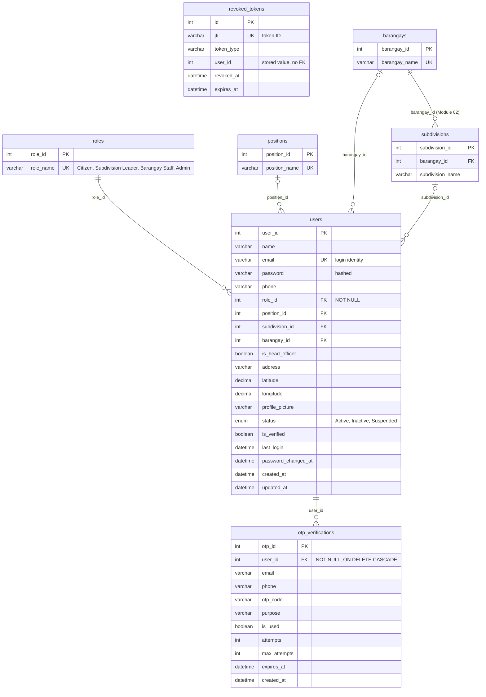

# Module 01 — User & Access Management ERD

> **Source of truth:** `backend/app/models/user.py`, `otp.py`, `revoked_token.py` (SQLAlchemy models).
> Every table, column, key and relationship below exists in these files. Nothing was added or assumed.

## 1. Module purpose

This module stores **who can use StraySafe 2.0 and what they are allowed to do**. Every person who signs in is one row in
`users`, whatever their role. The user's **role** decides which part of the system they see and which actions they may
take (see section 5). The user's **position** is their title within the barangay or subdivision.

The module also supports the sign-in security of the system:

- **One-time passwords (OTP).** They verify a resident's email when they register, using `otp_verifications`.
- **Revoked tokens.** When a user signs out, or a token is invalidated, it is rejected even before it expires, using
  `revoked_tokens`.

`users` is the most referenced table in the database. **67 foreign keys in 38 tables** point to `users.user_id`, for
example the reporter of a report, the owner of a pet and the staff member who completed a handover. Those links are
drawn in the module that owns each table.

## 2. Entities in this module

| Entity                | Type         | Description                                                                                        |
| --------------------- | ------------ | -------------------------------------------------------------------------------------------------- |
| `roles`             | Lookup       | The four access roles: 1 Citizen, 2 Subdivision Leader, 3 Barangay Staff, 4 Admin                  |
| `positions`         | Lookup       | Official titles, e.g. President, Secretary, Barangay Captain, Tanod, Field Rescuer, Animal Rescuer |
| `users`             | Core         | Every account (residents, subdivision leaders, barangay staff, administrators)                     |
| `otp_verifications` | Transaction  | One-time codes sent to verify a user's email, with expiry and attempt limits                       |
| `revoked_tokens`    | Security log | Sign-in tokens (JWT) that were revoked before their expiry date                                    |

**Referenced from Module 02 — Location & Coverage** (key columns only):

| Entity           | Why it appears here                                                                  |
| ---------------- | ------------------------------------------------------------------------------------ |
| `barangays`    | A staff account belongs to a barangay (`users.barangay_id`)                        |
| `subdivisions` | A resident or subdivision leader belongs to a subdivision (`users.subdivision_id`) |

## 3. Entity Relationship Diagram

**Reading the cardinality symbols:**

- **Parent side:** `||` means exactly one (the FK is NOT NULL). `|o` means zero or one (the FK is nullable).
- **Child side:** `o{` means zero or many.

## 4. Relationships and cardinalities

| #  | Relationship                       | Cardinality                      | FK (child column)                                               | Explanation                                                                                                                         |
| -- | ---------------------------------- | -------------------------------- | --------------------------------------------------------------- | ----------------------------------------------------------------------------------------------------------------------------------- |
| R1 | `roles` → `users`             | **One-to-many**, mandatory | `users.role_id` (NOT NULL)                                    | Every user has exactly one role. A role can be held by zero or many users.                                                          |
| R2 | `positions` → `users`         | **One-to-many**, optional  | `users.position_id` (nullable)                                | A user may have one position (mainly staff and leaders). A position can be held by zero or many users. Residents usually have none. |
| R3 | `barangays` → `users`         | **One-to-many**, optional  | `users.barangay_id` (nullable)                                | A barangay staff account belongs to one barangay. A barangay has zero or many user accounts.                                        |
| R4 | `subdivisions` → `users`      | **One-to-many**, optional  | `users.subdivision_id` (nullable)                             | A resident or subdivision leader belongs to one subdivision. A subdivision has zero or many users.                                  |
| R5 | `users` → `otp_verifications` | **One-to-many**, mandatory | `otp_verifications.user_id` (NOT NULL, `ON DELETE CASCADE`) | A user can receive zero or many OTP codes over time. Each code belongs to exactly one user and is deleted with that user.           |
| R6 | `barangays` → `subdivisions`  | **One-to-many**, mandatory | `subdivisions.barangay_id` (NOT NULL)                         | Shown for context only; it belongs to Module 02. Every subdivision is inside exactly one barangay.                                  |

### Entities without a relationship line

- **`revoked_tokens`** stores the `user_id` of the token's owner, but it is a **plain integer with no foreign-key
  constraint**. The table works as a stand-alone deny-list, checked by the token's unique `jti` at every request
  (`app/utils/auth.py`). It is therefore drawn **without** a relationship line, as decided in the overview (decision B).

### Constraints worth noting

- `users.email` is **unique**, so one account per email address.
- `roles.role_name` and `positions.position_name` are **unique** lookup values.
- `revoked_tokens.jti` is **unique**, so a token is revoked once.
- Passwords are stored **hashed** in `users.password`; `password_changed_at` lets older tokens be rejected after a
  password change.

## 5. How the roles are used

| `role_id` | `role_name`      | Where it applies                                                                        |
| ----------- | ------------------ | --------------------------------------------------------------------------------------- |
| 1           | Citizen            | Residents: report strays, register pets, claim pets, apply for adoption                 |
| 2           | Subdivision Leader | Manages reports, pets and handovers in their own subdivision (`users.subdivision_id`) |
| 3           | Barangay Staff     | Barangay-wide operations: rescue, holding facility, adoption (`users.barangay_id`)    |
| 4           | Admin              | System administration and settings                                                      |

*(Values read from the live `roles` table.)*

## 6. Related modules

| Module                                  | Link to this module                                                                                                                                  |
| --------------------------------------- | ---------------------------------------------------------------------------------------------------------------------------------------------------- |
| 02 Location & Coverage                  | `users.barangay_id` and `users.subdivision_id` point to `barangays` and `subdivisions`; `coverage_settings.updated_by` points to `users` |
| 03 Pet Management                       | `pets.owner_id`, `pets.registered_by_user_id`, QR scans, pet history, ownership confirmations and owner warnings point to `users`              |
| 04 Stray Reporting                      | `reports.user_id` (reporter), assigned leader, verifier, merger, transfers, comments, disputes and endorsement letters                             |
| 05 Verification, Claims & Reunification | Report verifications and `report_returns` (owner and staff who returned the animal)                                                                |
| 06 AI Matching                          | `report_matches.reviewed_by`                                                                                                                       |
| 07 Rescue & Holding Operations          | Rescue leader and staff, responders (`rescue_assignments`), intake staff and holding timeline                                                      |
| 08 Adoption                             | Applicant, reviewers, case owner, interviewers, inspectors, certificate signatory and ownership transfers                                            |
| 09 Communication & Notifications        | Chat participants, notifications, preferences, push subscriptions and email logs                                                                     |
| 10 Announcements                        | Announcement author, comments and reactions                                                                                                          |
| 11 Administration & System              | `audit_logs.user_id` (who did the action)                                                                                                          |
