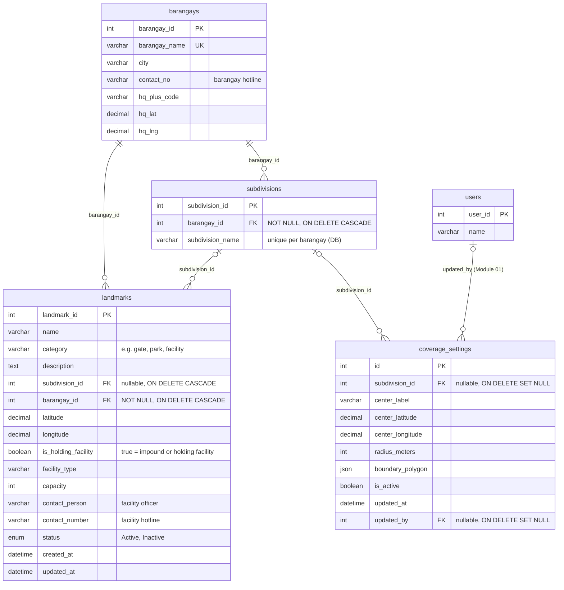

# Module 02 — Location & Coverage ERD

> **Source of truth:** `backend/app/models/user.py` (`Barangay`, `Subdivision`), `landmark.py`, `coverage.py`.
> Each relationship was also checked against the live MySQL foreign-key constraints. Nothing was added or assumed.

## 1. Module purpose

This module stores **where StraySafe 2.0 operates**. Locations form a hierarchy:

- A **barangay** is the top level. It holds the barangay hotline and headquarters location.
- **Subdivisions** sit inside a barangay. Each one is a community with its own Subdivision Leader.
- **Landmarks** are named places on the map, inside a barangay and usually inside a subdivision: gates, parks and
  **holding facilities**. A landmark with `is_holding_facility = true` is an impound or holding facility. Its
  `contact_person` and `contact_number` are the facility officer and hotline shown in the adoption catalog.
- **Coverage settings** define the service area on the map: a centre point, a radius and an optional boundary polygon.

Other modules use these tables to place things:
- A report belongs to a subdivision and may name a facility.
- A status-history entry may record the facility the animal was taken to.
- An announcement may be addressed to a barangay or a subdivision.

## 2. Entities in this module

| Entity | Type | Description |
|---|---|---|
| `barangays` | Core | The barangay (top of the location hierarchy), its hotline and HQ coordinates |
| `subdivisions` | Core | A subdivision (community) inside a barangay |
| `landmarks` | Core | Named map places: gates, parks and holding / impound facilities (with capacity, officer and hotline) |
| `coverage_settings` | Configuration | The map service area: centre, radius and boundary polygon, optionally per subdivision |

**Referenced from Module 01 — User & Access Management** (key columns only):

| Entity | Why it appears here |
|---|---|
| `users` | `coverage_settings.updated_by` records who last changed the coverage area |

*Live data at the time of writing: 1 barangay, 1 subdivision, 4 landmarks (2 holding facilities, 1 gate, 1 park) and
1 active coverage setting.*

## 3. Entity Relationship Diagram

> The same code without Markdown fences, ready for Mermaid Live Editor:
> [`mermaid/02_location_coverage.mmd`](mermaid/02_location_coverage.mmd)

**Reading the cardinality symbols:**
- **Parent side:** `||` means exactly one (the FK is NOT NULL). `|o` means zero or one (the FK is nullable).
- **Child side:** `o{` means zero or many.

## 4. Relationships and cardinalities

| # | Relationship | Cardinality | FK (child column) | Explanation |
|---|---|---|---|---|
| R1 | `barangays` → `subdivisions` | **One-to-many**, mandatory | `subdivisions.barangay_id` (NOT NULL, ON DELETE CASCADE) | Every subdivision is inside exactly one barangay. A barangay has zero or many subdivisions. Deleting a barangay deletes its subdivisions. |
| R2 | `barangays` → `landmarks` | **One-to-many**, mandatory | `landmarks.barangay_id` (NOT NULL, ON DELETE CASCADE) | Every landmark (including every holding facility) belongs to exactly one barangay. A barangay has zero or many landmarks. |
| R3 | `subdivisions` → `landmarks` | **One-to-many**, optional | `landmarks.subdivision_id` (nullable, ON DELETE CASCADE) | A landmark may be inside one subdivision. A barangay-level facility outside any subdivision has none (1 of the 4 live landmarks). A subdivision has zero or many landmarks. |
| R4 | `subdivisions` → `coverage_settings` | **One-to-many**, optional | `coverage_settings.subdivision_id` (nullable, ON DELETE SET NULL) | A coverage area may be tied to one subdivision. A subdivision can have zero or many coverage settings. |
| R5 | `users` → `coverage_settings` | **One-to-many**, optional | `coverage_settings.updated_by` (nullable, ON DELETE SET NULL) | Records which user last changed the coverage area. Shown for context; `users` belongs to Module 01. |

### Review: models vs. live database

| Relationship | Model | Live database | Verdict |
|---|---|---|---|
| `subdivisions.barangay_id → barangays` | FK, NOT NULL (no ON DELETE in model) | FK, NOT NULL, **ON DELETE CASCADE** | ✔ Correct: one-to-many, mandatory |
| `landmarks.barangay_id → barangays` | FK, NOT NULL, ON DELETE CASCADE | Same | ✔ Correct |
| `landmarks.subdivision_id → subdivisions` | FK, nullable, ON DELETE CASCADE | Same | ✔ Correct |
| `coverage_settings.subdivision_id → subdivisions` | FK, nullable, ON DELETE SET NULL | Same | ✔ Correct |
| `coverage_settings.updated_by → users` | FK, nullable, ON DELETE SET NULL | Same | ✔ Correct |

**Differences found (documentation only; nothing was changed):**
1. **`subdivisions.boundary_polygon` (JSON)** exists in the **live database only**. The `Subdivision` model does not
   declare it, so the application never reads or writes it through the ORM. It is **left out of the diagram**
   (overview decision C: the models are the source of truth). The boundary the system uses is
   `coverage_settings.boundary_polygon`, which is in the model.
2. **Unique key (`barangay_id`, `subdivision_name`)** on `subdivisions` exists in the live database, not in the model. It
   means subdivision names are unique **within** a barangay. This is noted on the column, not drawn as a key, because
   Mermaid's `UK` marker cannot express a two-column unique key.
3. The `ON DELETE CASCADE` on `subdivisions.barangay_id` is in the live database but not written in the model.
4. No missing foreign keys and no incorrect cardinalities were found in Module 02.

### Constraints worth noting
- `barangays.barangay_name` is **unique**.
- `landmarks.status` is an enum (`Active`, `Inactive`); `landmarks.category` is free text with default `general`.
- `landmarks.latitude` / `longitude` are **required**: every landmark has a map position.
- `coverage_settings` defaults to the Selera Homes centre point (14.801042, 121.003648) with a 1,000 m radius.

## 5. Tables in other modules that reference this module

These links are drawn in the module that owns each table:

| Referencing column | → | Cardinality | Module |
|---|---|---|---|
| `users.barangay_id` | `barangays` | optional, one-to-many | 01 User & Access Management |
| `users.subdivision_id` | `subdivisions` | optional, one-to-many | 01 User & Access Management |
| `reports.subdivision_id` | `subdivisions` | **mandatory**, one-to-many | 04 Stray Reporting |
| `reports.facility_id` | `landmarks` | optional, one-to-many (ON DELETE SET NULL) | 04 Stray Reporting |
| `status_history.facility_id` | `landmarks` | optional, one-to-many (ON DELETE SET NULL) | 04 Stray Reporting |
| `announcements.barangay_id` | `barangays` | optional, one-to-many (ON DELETE SET NULL) | 10 Announcements |
| `announcements.subdivision_id` | `subdivisions` | optional, one-to-many (ON DELETE SET NULL) | 10 Announcements |

**Note on holding facilities.** `holding_animals` (Module 07) has **no foreign key** to `landmarks`. Which facility an
animal is held in is recorded on its report (`reports.facility_id`) and in the status history
(`status_history.facility_id`). This is why the facility link appears in Module 04 and not in Module 07.

## 6. Related modules

| Module | Link to this module |
|---|---|
| 01 User & Access Management | Users belong to a barangay or subdivision; a user updates the coverage settings |
| 04 Stray Reporting | Reports belong to a subdivision and may name a facility; status history records facility moves |
| 07 Rescue & Holding Operations | Holding facilities are `landmarks` with `is_holding_facility = true` (linked through the report, see note above) |
| 08 Adoption | The adoption catalog shows the facility's `contact_person` and `contact_number` (read through the report) |
| 10 Announcements | Announcements can target a barangay or a subdivision |
