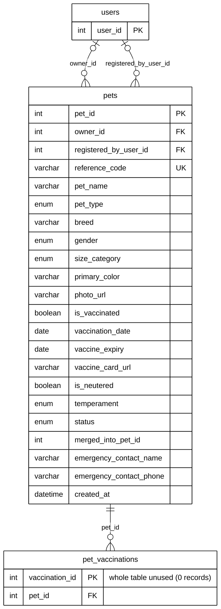

# Module 03A — Pet Registry & Health Records

> Part of **Module 03 — Pet Management** ([index](03_PET_MANAGEMENT_ERD.md)). Source of truth: the SQLAlchemy models,
> checked against the live MySQL schema (identical for this module). Documentation only — no database or code was changed.

## 1. Purpose

The registered pet and its vaccination records. A pet either belongs to a resident account (`owner_id`) or is held for an owner without an account, whose name and phone are stored on the pet (`emergency_contact_name`, `emergency_contact_phone`). `registered_by_user_id` records who registered it (the resident or a leader).

## 2. Entities

| Entity | Description |
|---|---|
| `pets` | The pet record: identity, photos, **vaccination**, health, behaviour, status and ownership (50 columns; 22 shown, all listed in section 5) |
| `pet_vaccinations` | **Defined but not used.** Meant for a per-dose vaccination history; no screen or API creates records (0 rows) |

**Reference entities** (defined in full elsewhere; shown here with only the key the relationships need):

| Reference entity | Defined in | Key shown |
|---|---|---|
| `users` | Module 01 | `user_id` |

## 3. Entity Relationship Diagram

> Raw code for Mermaid Live Editor / SVG export: [`mermaid/03a_pet_registry_health.mmd`](mermaid/03a_pet_registry_health.mmd).
> The front-matter block sets the manuscript style (white background, black lines, Arial 16 px, natural size).

`||` exactly one (NOT NULL FK) · `|o` zero or one (nullable FK) · `o{` zero or many · `o|` zero or one (unique FK)

## 4. Relationships and cardinalities

| # | Relationship | Cardinality | FK (child column) | ON DELETE |
|---|---|---|---|---|
| R1 | `users` → `pets` | **One-to-many**, optional | `pets.owner_id` — the owner's account; NULL = owner has no account | SET NULL |
| R2 | `users` → `pets` | **One-to-many**, optional | `pets.registered_by_user_id` — who registered the pet | SET NULL |
| R3 | `pets` → `pet_vaccinations` | **One-to-many**, mandatory | `pet_vaccinations.pet_id` — a pet has zero or many vaccination records | CASCADE |

### Where vaccination is recorded

Vaccination is stored **on the pet record**, and this is what every screen uses (pet registration, My Pets, claims,
handover): `pets.is_vaccinated`, `pets.vaccination_date`, `pets.vaccine_expiry` and `pets.vaccine_card_url` (photo of the
vaccine card). The vaccination compliance figures on Pet Records and the admin dashboard are counted from
`pets.is_vaccinated`.

### `pet_vaccinations` — defined but not used

| Check | Result |
|---|---|
| Records created by the system | **None.** No route, service or screen inserts into this table |
| Live rows | 0 |
| Where it is referenced | Pet Records merge moves a duplicate's rows to the kept pet (`routes/pets.py`) |
| Columns `vaccine_name`, `administered_date`, `expiry_date`, `clinic_name`, `veterinarian` | Not read or written anywhere outside the model |

The table and its relationship to `pets` exist in the model and the database, so they stay in the ERD for accuracy.
It is reserved for a **per-dose vaccination history** in a future version. It is not removed now; any removal would be
a database change, done after the defence if at all.

`users` and `pets` are linked twice (owner, registrant). Both are one-to-many; this is not a many-to-many.

**Not drawn:** `pets.merged_into_pet_id` holds the `pet_id` of the record a duplicate was merged into. It has **no
foreign key** in the model or the database, so it is not drawn as a self-relationship (overview decision B).

## 5. Complete column list — `pets`

| Column | Type | Null | Key |
|---|---|---|---|
| `pet_id` | Integer | NOT NULL | PK |
| `owner_id` | Integer | NULL | FK → `users` |
| `pet_name` | String(100) | NOT NULL |  |
| `reference_code` | String(16) | NULL | UK |
| `pet_type` | Enum (Dog, Cat) | NOT NULL |  |
| `breed` | String(100) | NULL |  |
| `color_markings` | String(255) | NULL |  |
| `gender` | Enum (Male, Female, Unknown) | NULL |  |
| `birth_date` | Date | NULL |  |
| `estimated_age` | String(50) | NULL |  |
| `weight` | Numeric | NULL |  |
| `size_category` | Enum (Small, Medium, Large) | NULL |  |
| `photo_url` | String(255) | NULL |  |
| `photo_front_url` | String(255) | NULL |  |
| `photo_left_url` | String(255) | NULL |  |
| `photo_right_url` | String(255) | NULL |  |
| `health_condition` | Text | NULL |  |
| `is_vaccinated` | Boolean | NOT NULL |  |
| `vaccination_date` | Date | NULL |  |
| `vaccine_expiry` | Date | NULL |  |
| `is_neutered` | Boolean | NOT NULL |  |
| `vaccine_card_url` | String(255) | NULL |  |
| `temperament` | Enum (Friendly, Aggressive, Anxious, Scared, Protective) | NULL |  |
| `has_bite_history` | Boolean | NOT NULL | Verified: counted only from verified incident reports, never edited directly |
| `bite_incident_count` | Integer | NOT NULL | Verified (as above) |
| `chase_behavior` | Boolean | NOT NULL | Verified (as above) |
| `chase_incident_count` | Integer | NOT NULL | Verified (as above) |
| `declared_bite_history` | Boolean | NOT NULL | Declared by the owner or registering officer; a resident can add it, only staff can remove it |
| `declared_chase_behavior` | Boolean | NOT NULL | Declared (as above) |
| `notes` | Text | NULL |  |
| `status` | Enum (Active, Lost, Found, Rescued, Deceased, Archived, Inactive) | NULL |  |
| `merged_into_pet_id` | Integer | NULL |  |
| `ai_detection_confidence` | Numeric | NULL |  |
| `is_verified` | Boolean | NOT NULL |  |
| `last_seen_lat` | Numeric | NULL |  |
| `last_seen_lng` | Numeric | NULL |  |
| `last_seen_at` | DateTime | NULL |  |
| `emergency_contact_name` | String(100) | NULL |  |
| `emergency_contact_phone` | String(20) | NULL |  |
| `primary_color` | String(100) | NULL |  |
| `secondary_color` | String(100) | NULL |  |
| `tertiary_color` | String(100) | NULL |  |
| `distinctive_markings` | Text | NULL |  |
| `registered_address` | String(255) | NULL |  |
| `registered_latitude` | Numeric | NULL |  |
| `registered_longitude` | Numeric | NULL |  |
| `registered_by_user_id` | Integer | NULL | FK → `users` |
| `registered_by_name` | String(100) | NULL |  |
| `photo_check_status` | String(30) | NULL |  |
| `photo_check_details` | Text | NULL |  |
| `created_at` | DateTime | NOT NULL |  |
| `updated_at` | DateTime | NOT NULL |  |

## 6. Complete column list — `pet_vaccinations`

The diagram shows only this table's keys because the table is **not used** by the system (no records are created; see above). Its full definition, as it exists in the model and the database, is:

| Column | Type | Null | Key |
|---|---|---|---|
| `vaccination_id` | Integer | NOT NULL | PK |
| `pet_id` | Integer | NOT NULL | FK → `pets` |
| `vaccine_name` | String(100) | NOT NULL |  |
| `administered_date` | Date | NOT NULL |  |
| `expiry_date` | Date | NULL |  |
| `clinic_name` | String(100) | NULL |  |
| `veterinarian` | String(100) | NULL |  |
| `notes` | Text | NULL |  |
| `created_at` | DateTime | NOT NULL |  |
