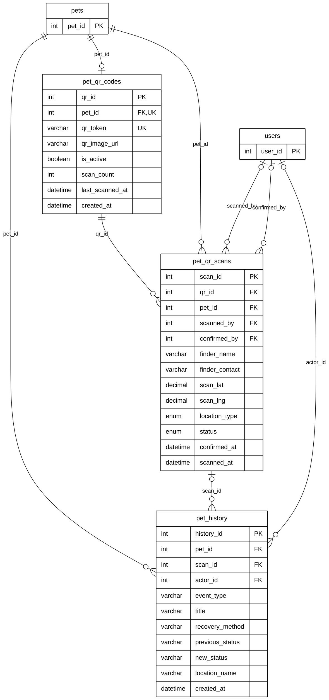

# Module 03B — QR Tags & Pet History

> Part of **Module 03 — Pet Management** ([index](03_PET_MANAGEMENT_ERD.md)). Source of truth: the SQLAlchemy models,
> checked against the live MySQL schema (identical for this module). Documentation only — no database or code was changed.

## 1. Purpose

Each pet can have one QR tag. When a finder scans it, a scan record is created with the location and the finder's contact, and staff confirm or reject it. `pet_history` is the pet's life timeline (sighting matched, returned to owner, QR scanned, records merged, …); an event may come from a QR scan.

## 2. Entities

| Entity | Description |
|---|---|
| `pet_qr_codes` | The pet's QR tag (one per pet): token, image, active flag, scan counter |
| `pet_qr_scans` | One scan of a tag: finder, location, review status (13 of 20 columns shown; all in section 5) |
| `pet_history` | One event in the pet's timeline (11 of 16 columns shown; all in section 5) |

**Reference entities** (defined in full elsewhere; shown here with only the key the relationships need):

| Reference entity | Defined in | Key shown |
|---|---|---|
| `pets` | Module 03A | `pet_id` |
| `users` | Module 01 | `user_id` |

## 3. Entity Relationship Diagram

> Raw code for Mermaid Live Editor / SVG export: [`mermaid/03b_qr_tags_pet_history.mmd`](mermaid/03b_qr_tags_pet_history.mmd).
> The front-matter block sets the manuscript style (white background, black lines, Arial 16 px, natural size).

`||` exactly one (NOT NULL FK) · `|o` zero or one (nullable FK) · `o{` zero or many · `o|` zero or one (unique FK)

## 4. Relationships and cardinalities

| # | Relationship | Cardinality | FK (child column) | ON DELETE |
|---|---|---|---|---|
| R1 | `pets` → `pet_qr_codes` | **One-to-one** (mandatory) | `pet_qr_codes.pet_id` — one tag per pet (unique) | CASCADE |
| R2 | `pet_qr_codes` → `pet_qr_scans` | **One-to-many**, mandatory | `pet_qr_scans.qr_id` — a tag is scanned zero or many times | CASCADE |
| R3 | `pets` → `pet_qr_scans` | **One-to-many**, mandatory | `pet_qr_scans.pet_id` — the scanned pet, stored directly | CASCADE |
| R4 | `pets` → `pet_history` | **One-to-many**, mandatory | `pet_history.pet_id` — a pet has zero or many history events | CASCADE |
| R5 | `pet_qr_scans` → `pet_history` | **One-to-many**, optional | `pet_history.scan_id` — an event may come from one scan | SET NULL |
| R6 | `users` → `pet_qr_scans` | **One-to-many**, optional | `pet_qr_scans.scanned_by` — a signed-in finder (else finder_name / finder_contact) | SET NULL |
| R7 | `users` → `pet_qr_scans` | **One-to-many**, optional | `pet_qr_scans.confirmed_by` — the staff member who reviewed the scan | SET NULL |
| R8 | `users` → `pet_history` | **One-to-many**, optional | `pet_history.actor_id` — who caused the event | SET NULL |

**One-to-one:** `pet_qr_codes.pet_id` is unique, so a pet has at most one QR tag and each tag belongs to exactly one
pet. `qr_token` is also unique.

## 5. Complete column lists

### `pet_qr_scans`

| Column | Type | Null | Key |
|---|---|---|---|
| `scan_id` | Integer | NOT NULL | PK |
| `qr_id` | Integer | NOT NULL | FK → `pet_qr_codes` |
| `pet_id` | Integer | NOT NULL | FK → `pets` |
| `scanned_by` | Integer | NULL | FK → `users` |
| `finder_name` | String(100) | NULL |  |
| `finder_contact` | String(20) | NULL |  |
| `scan_lat` | Numeric | NULL |  |
| `scan_lng` | Numeric | NULL |  |
| `street_address` | String(255) | NULL |  |
| `barangay` | String(100) | NULL |  |
| `city` | String(100) | NULL |  |
| `landmark` | String(255) | NULL |  |
| `location_type` | Enum (Found Location, Barangay Hall, Temporary Shelter) | NULL |  |
| `notes` | String(255) | NULL |  |
| `status` | Enum (PENDING, CONFIRMED, REJECTED, EXPIRED) | NOT NULL |  |
| `confirmed_at` | DateTime | NULL |  |
| `confirmed_by` | Integer | NULL | FK → `users` |
| `rejection_reason` | String(255) | NULL |  |
| `pet_status_at_scan` | String(50) | NULL |  |
| `scanned_at` | DateTime | NOT NULL |  |

### `pet_history`

| Column | Type | Null | Key |
|---|---|---|---|
| `history_id` | Integer | NOT NULL | PK |
| `pet_id` | Integer | NOT NULL | FK → `pets` |
| `event_type` | String(100) | NOT NULL |  |
| `title` | String(150) | NOT NULL |  |
| `description` | Text | NULL |  |
| `recovery_method` | String(50) | NULL |  |
| `scan_id` | Integer | NULL | FK → `pet_qr_scans` |
| `actor_id` | Integer | NULL | FK → `users` |
| `actor_name` | String(100) | NULL |  |
| `actor_role` | String(50) | NULL |  |
| `previous_status` | String(50) | NULL |  |
| `new_status` | String(50) | NULL |  |
| `location_name` | String(255) | NULL |  |
| `latitude` | Numeric | NULL |  |
| `longitude` | Numeric | NULL |  |
| `created_at` | DateTime | NOT NULL |  |
