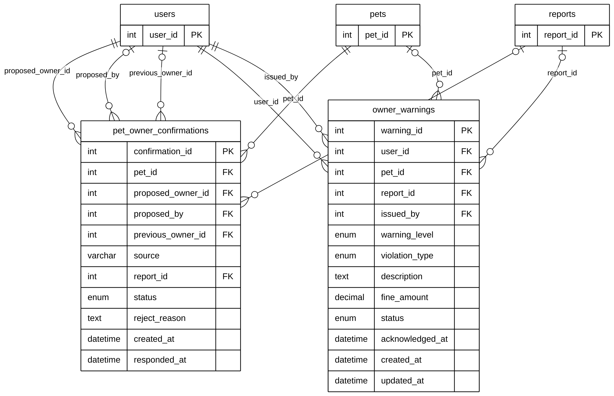

# Module 03C — Ownership Transfer & Owner Compliance

> Part of **Module 03 — Pet Management** ([index](03_PET_MANAGEMENT_ERD.md)). Source of truth: the SQLAlchemy models,
> checked against the live MySQL schema (identical for this module). Documentation only — no database or code was changed.

## 1. Purpose

`pet_owner_confirmations` records a proposed change of owner that the proposed owner must accept (staff assignment, a pet returned to its owner, or a resident's "this is my pet" claim). `owner_warnings` records a violation notice issued to an owner, optionally for a pet and a report, with an optional fine.

## 2. Entities

| Entity | Description |
|---|---|
| `pet_owner_confirmations` | A proposed owner change: who proposes, who must accept, previous owner, source, status |
| `owner_warnings` | A violation notice to an owner: type, description, fine, status |

**Reference entities** (defined in full elsewhere; shown here with only the key the relationships need):

| Reference entity | Defined in | Key shown |
|---|---|---|
| `pets` | Module 03A | `pet_id` |
| `users` | Module 01 | `user_id` |
| `reports` | Module 04 | `report_id` |

## 3. Entity Relationship Diagram

> Raw code for Mermaid Live Editor / SVG export: [`mermaid/03c_ownership_compliance.mmd`](mermaid/03c_ownership_compliance.mmd).
> The front-matter block sets the manuscript style (white background, black lines, Arial 16 px, natural size).

`||` exactly one (NOT NULL FK) · `|o` zero or one (nullable FK) · `o{` zero or many · `o|` zero or one (unique FK)

## 4. Relationships and cardinalities

| # | Relationship | Cardinality | FK (child column) | ON DELETE |
|---|---|---|---|---|
| R1 | `pets` → `pet_owner_confirmations` | **One-to-many**, mandatory | `pet_owner_confirmations.pet_id` — the pet changing owner | CASCADE |
| R2 | `users` → `pet_owner_confirmations` | **One-to-many**, mandatory | `pet_owner_confirmations.proposed_owner_id` — the user who must accept | CASCADE |
| R3 | `users` → `pet_owner_confirmations` | **One-to-many**, optional | `pet_owner_confirmations.proposed_by` — the staff member who proposed it | SET NULL |
| R4 | `users` → `pet_owner_confirmations` | **One-to-many**, optional | `pet_owner_confirmations.previous_owner_id` — the owner before the change | SET NULL |
| R5 | `reports` → `pet_owner_confirmations` | **One-to-many**, optional | `pet_owner_confirmations.report_id` — the report that led to the change | SET NULL |
| R6 | `users` → `owner_warnings` | **One-to-many**, mandatory | `owner_warnings.user_id` — the owner who receives the warning | CASCADE |
| R7 | `users` → `owner_warnings` | **One-to-many**, mandatory | `owner_warnings.issued_by` — the staff member who issued it | CASCADE |
| R8 | `pets` → `owner_warnings` | **One-to-many**, optional | `owner_warnings.pet_id` — the pet concerned | SET NULL |
| R9 | `reports` → `owner_warnings` | **One-to-many**, optional | `owner_warnings.report_id` — the report the violation came from | SET NULL |

**Value sets:** `pet_owner_confirmations.source` is free text written by the code as `assign`, `returned_to_owner`
or `resident_claim`; `status` is `Pending`, `Accepted`, `Rejected` or `Cancelled`. `owner_warnings.violation_type` is
`Free-Roaming Unleashed`, `Nuisance / Aggressive Behavior`, `Overdue Vaccination`, `Repeated Impoundment Retrieval` or
`Other`; `status` is `Pending`, `Acknowledged`, `Appealed` or `Resolved`.

**Delete behaviour:** deleting a user deletes the confirmations proposed **to** them and the warnings issued **to or by**
them (CASCADE); deleting a pet deletes its confirmations but keeps its warnings with `pet_id` set to NULL.
