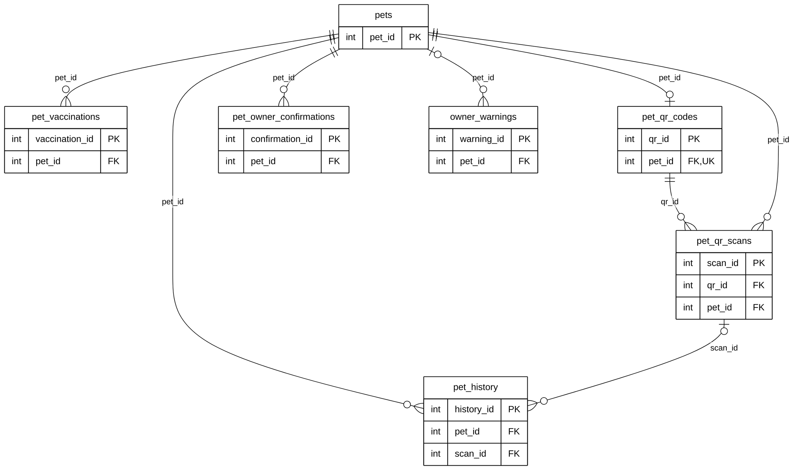

# Module 03 — Pet Management (index)

> **Source of truth:** `backend/app/models/pet.py`, `pet_qr.py`, `pet_history.py`, `pet_owner_confirmation.py`,
> `warning.py`. Models and the live MySQL schema **match exactly** for all 7 tables. Documentation only.

## 1. Module purpose

Registered pets and everything that happens to a pet over its life: the pet record and vaccinations, ownership (an
account owner, or an owner without an account stored on the pet), QR tags and scans, the life history, ownership
changes that the new owner accepts, and warnings issued to owners.

## 2. Why this module is split

As one diagram, Module 03 has **7 tables, 127 columns and 20 relationship lines** (10 of them to `users`). Exported to an
A4 / Letter page it shrinks until the text is unreadable. It is therefore presented as **three submodules**. Each
table is defined in full **once**; other submodules show it as a key-only reference entity. No table, column, key or
cardinality was changed or dropped.

| Submodule | Tables defined in full | Reference entities | Relationship lines |
|---|---|---|---|
| [03A — Pet Registry & Health Records](03A_PET_REGISTRY_HEALTH_ERD.md) | `pets`, `pet_vaccinations` | `users` | 3 |
| [03B — QR Tags & Pet History](03B_QR_TAGS_PET_HISTORY_ERD.md) | `pet_qr_codes`, `pet_qr_scans`, `pet_history` | `pets`, `users` | 8 |
| [03C — Ownership Transfer & Owner Compliance](03C_OWNERSHIP_COMPLIANCE_ERD.md) | `pet_owner_confirmations`, `owner_warnings` | `pets`, `users`, `reports` | 9 |
| **Total** | **7 tables** | | **20** (same as before) |

## 3. Module map (keys only)

How the three submodules connect through `pets`. Only primary keys and the foreign keys between Module 03 tables are
shown; links to `users` and `reports` are in the submodule diagrams.
Raw code: [`mermaid/03_pet_management.mmd`](mermaid/03_pet_management.mmd).

## 4. Tables in other modules that reference this module

| Referencing column | → | Cardinality | Module |
|---|---|---|---|
| `pet_claims.pet_id` | `pets` | mandatory, one-to-many (CASCADE) | 05 Verification, Claims & Reunification |
| `report_returns.pet_id` | `pets` | optional, one-to-many (SET NULL) | 05 Verification, Claims & Reunification |
| `report_matches.matched_pet_id` | `pets` | optional, one-to-many (SET NULL) | 06 AI Matching |
| `report_disputes.pet_id` | `pets` | optional, one-to-many (SET NULL) | 04 Stray Reporting |
| `adoptions.created_pet_id` | `pets` | optional, one-to-many (SET NULL) | 08 Adoption |

**Note on `reports.pet_id`:** a foreign key `reports.pet_id → pets` exists in the live database, but the `Report`
model declares `pet_id` without one. Following overview decision C it is documented in Module 04 and not drawn.

## 5. Related modules

| Module | Link |
|---|---|
| 01 User & Access Management | Owners, registrants, QR finders and reviewers, history actors, ownership parties, warning recipients and issuers |
| 04 Stray Reporting | Ownership confirmations and warnings may come from a report |
| 05 Verification, Claims & Reunification | Owners claim a reported animal as their pet; returns record which pet went home |
| 06 AI Matching | AI suggests a registered pet as a match for a sighting |
| 08 Adoption | An adopted animal becomes a new pet record |
