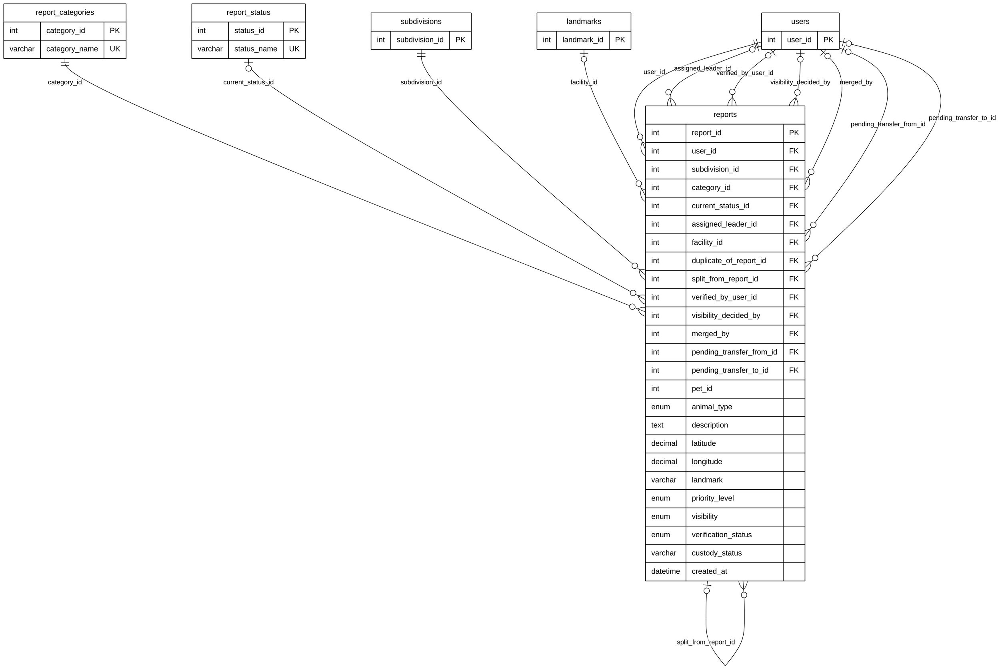

# Module 04A — Reports & Classification

> Part of **Module 04 — Stray Reporting** ([index](04_STRAY_REPORTING_ERD.md)). Source of truth: the SQLAlchemy models, checked against the live MySQL schema.
> Documentation only — no database or code was changed.

## 1. Purpose

The report itself, filed by a resident or by staff: what animal, where (subdivision, map point, landmark), which category (injured, aggressive, rabies risk, roaming, rescue needed, lost pet) and its current status. A report is claimed by a Subdivision Leader (`assigned_leader_id`), may be verified, may have its public visibility decided, may be transferred between leaders, and may be **merged into another report** of the same animal (`duplicate_of_report_id`, a self-relationship). The AI's suggestions about the photo and behaviour are stored on the report as `ai_*` columns.

## 2. Entities

| Entity | Description |
|---|---|
| `reports` | The stray / lost-pet report (77 columns; 24 shown, all listed in section 5) |
| `report_categories` | Lookup: Injured, Aggressive, Rabies Risk, Roaming, Rescue Needed, Lost Pet |
| `report_status` | Lookup: 18 statuses from Reported to Incident Resolved (listed in section 6) |

**Reference entities** (defined in full elsewhere; shown here with only the key the relationships need):

| Reference entity | Defined in | Key shown |
|---|---|---|
| `users` | Module 01 | `user_id` |
| `subdivisions` | Module 02 | `subdivision_id` |
| `landmarks` | Module 02 | `landmark_id` |

## 3. Entity Relationship Diagram

> Raw code for Mermaid Live Editor / SVG export: [`mermaid/04a_reports_classification.mmd`](mermaid/04a_reports_classification.mmd).
> The front-matter block sets the manuscript style (white background, black lines, Arial 16 px, natural size).

`||` exactly one (NOT NULL FK) · `|o` zero or one (nullable FK) · `o{` zero or many · `o|` zero or one (unique FK)

## 4. Relationships and cardinalities

| # | Relationship | Cardinality | FK (child column) | ON DELETE |
|---|---|---|---|---|
| R1 | `report_categories` → `reports` | **One-to-many**, mandatory | `reports.category_id` — the report's category | no action |
| R2 | `report_status` → `reports` | **One-to-many**, optional | `reports.current_status_id` — the current status | no action |
| R3 | `reports` → `reports` | **One-to-many**, optional | `reports.duplicate_of_report_id` — the report this one was merged into (self-relationship) | SET NULL |
| R4 | `reports` → `reports` | **One-to-many**, optional | `reports.split_from_report_id` — the group report this animal record was split from (self-relationship) | SET NULL |
| R5 | `subdivisions` → `reports` | **One-to-many**, mandatory | `reports.subdivision_id` — where the report belongs | no action |
| R6 | `landmarks` → `reports` | **One-to-many**, optional | `reports.facility_id` — the holding facility the animal was taken to | SET NULL |
| R7 | `users` → `reports` | **One-to-many**, mandatory | `reports.user_id` — the reporter | CASCADE |
| R8 | `users` → `reports` | **One-to-many**, optional | `reports.assigned_leader_id` — the leader who claimed the report | SET NULL |
| R9 | `users` → `reports` | **One-to-many**, optional | `reports.verified_by_user_id` — who verified it | SET NULL |
| R10 | `users` → `reports` | **One-to-many**, optional | `reports.visibility_decided_by` — who made it public or private | SET NULL |
| R11 | `users` → `reports` | **One-to-many**, optional | `reports.merged_by` — who merged it into another report | SET NULL |
| R12 | `users` → `reports` | **One-to-many**, optional | `reports.pending_transfer_from_id` — leader handing the report over | SET NULL |
| R13 | `users` → `reports` | **One-to-many**, optional | `reports.pending_transfer_to_id` — leader receiving the report | SET NULL |

**Self-relationships:**
- `reports.duplicate_of_report_id → reports` links a duplicate sighting to the case it was merged into. One case report
  can have zero or many merged duplicates; a report is merged into at most one.
- `reports.split_from_report_id → reports` links a **per-animal record** to the multi-animal **group report** it was split
  from (MULTI_ANIMAL_REPORT_PLAN.md). One group report has zero or many animal records; an animal record belongs to at
  most one group. Each animal record then has its own holding record, matches, claims and adoption.

**Seven links to `users`:** each is a separate one-to-many role (reporter, leader, verifier, visibility decider,
merger, transfer from, transfer to); none of them makes `users` and `reports` many-to-many.

### Not drawn: references without a foreign key in the model

| Column | Refers to (by meaning) | Note |
|---|---|---|
| `reports.pet_id` | `pets` | The live database **has** an FK here (ON DELETE SET NULL); the model does not declare it. Not drawn (overview decision C) |
| `reports.pet_inherited_from_match_id` | `report_matches` | Plain integer |
| `reports.identity_rechecked_by`, `reports.separate_incident_by` | `users` | Plain integers |

### Model vs. live database

| Item | Model | Live database |
|---|---|---|
| `reports.pet_id → pets` | no FK | FK, ON DELETE SET NULL |
| `reports.current_status_id → report_status` | FK, no ON DELETE | FK, ON DELETE SET NULL |
| `report_categories.description` | not in the model | column exists (category descriptions) |

The relationships and cardinalities drawn are the same either way.

## 5. Complete column list — `reports`

| Column | Type | Null | Key |
|---|---|---|---|
| `report_id` | Integer | NOT NULL | PK |
| `user_id` | Integer | NOT NULL | FK → `users` |
| `subdivision_id` | Integer | NOT NULL | FK → `subdivisions` |
| `category_id` | Integer | NOT NULL | FK → `report_categories` |
| `pet_id` | Integer | NULL |  |
| `pet_inherited_from_match_id` | Integer | NULL |  |
| `identity_rechecked_by` | Integer | NULL |  |
| `identity_rechecked_at` | DateTime | NULL |  |
| `identity_recheck_note` | Text | NULL |  |
| `separate_incident_reason` | Text | NULL |  |
| `separate_incident_by` | Integer | NULL |  |
| `separate_incident_at` | DateTime | NULL |  |
| `animal_type` | Enum (Dog, Cat, Unknown) | NULL |  |
| `animal_breed` | String(100) | NULL |  |
| `animal_color` | String(255) | NULL |  |
| `estimated_size` | Enum (Small, Medium, Large) | NULL |  |
| `description` | Text | NULL |  |
| `condition` | Text | NULL |  |
| `custody_status` | String(50) | NULL |  |
| `latitude` | Numeric | NOT NULL |  |
| `longitude` | Numeric | NOT NULL |  |
| `initial_latitude` | Numeric | NULL |  |
| `initial_longitude` | Numeric | NULL |  |
| `initial_landmark` | String(255) | NULL |  |
| `facility_id` | Integer | NULL | FK → `landmarks` |
| `animal_count` | Integer | NOT NULL |  |
| `landmark` | String(255) | NULL |  |
| `priority_level` | Enum (Low, Medium, High) | NULL |  |
| `visibility` | Enum (Public, Private, Pending Review) | NULL |  |
| `visibility_decided_by` | Integer | NULL | FK → `users` |
| `visibility_decided_at` | DateTime | NULL |  |
| `visibility_reason` | Text | NULL |  |
| `is_possible_owned` | Boolean | NOT NULL |  |
| `ai_animal_type` | String(50) | NULL |  |
| `ai_dominant_color` | String(100) | NULL |  |
| `ai_coat_pattern` | String(50) | NULL |  |
| `ai_estimated_size` | String(50) | NULL |  |
| `ai_possible_breed` | String(100) | NULL |  |
| `ai_suggested_risk_level` | String(50) | NULL |  |
| `ai_suggested_priority` | String(50) | NULL |  |
| `ai_suggested_priority_reason` | Text | NULL |  |
| `ai_behavior_chasing` | Boolean | NOT NULL |  |
| `ai_behavior_actual_bite` | Boolean | NOT NULL |  |
| `ai_behavior_attempted_bite` | Boolean | NOT NULL |  |
| `ai_behavior_injury` | Boolean | NOT NULL |  |
| `ai_behavior_aggressive` | Boolean | NOT NULL |  |
| `ai_behavior_explanation` | Text | NULL |  |
| `ai_photo_likelihood` | Numeric | NULL |  |
| `ai_detection_confidence` | Numeric | NULL |  |
| `ai_description_confidence` | JSON | NULL |  |
| `ai_photo_status` | String(100) | NULL |  |
| `ai_photo_recommendation` | Text | NULL |  |
| `ai_photo_details` | Text | NULL |  |
| `current_status_id` | Integer | NULL | FK → `report_status` |
| `assigned_leader_id` | Integer | NULL | FK → `users` |
| `claimed_at` | DateTime | NULL |  |
| `unassigned_notified` | Boolean | NOT NULL |  |
| `verification_status` | Enum (unverified, verified_true, false_alarm, disputed) | NULL |  |
| `false_alarm_reason` | String(100) | NULL |  |
| `verification_notes` | Text | NULL |  |
| `verified_by_user_id` | Integer | NULL | FK → `users` |
| `verified_at` | DateTime | NULL |  |
| `verified_actual_bite` | Boolean | NULL |  |
| `verified_chasing` | Boolean | NULL |  |
| `verified_attempted_bite` | Boolean | NULL |  |
| `verified_injury` | Boolean | NULL |  |
| `verified_aggressive` | Boolean | NULL |  |
| `behavior_finding` | String(100) | NULL |  |
| `pending_transfer_to_id` | Integer | NULL | FK → `users` |
| `pending_transfer_from_id` | Integer | NULL | FK → `users` |
| `pending_transfer_notes` | Text | NULL |  |
| `pending_transfer_created_at` | DateTime | NULL |  |
| `duplicate_of_report_id` | Integer | NULL | FK → `reports` |
| `split_from_report_id` | Integer | NULL | FK → `reports` |
| `merged_at` | DateTime | NULL |  |
| `merged_by` | Integer | NULL | FK → `users` |
| `merge_notes` | Text | NULL |  |
| `created_at` | DateTime | NOT NULL |  |

## 6. Lookup values (live database)

| `report_categories` | | `report_status` | | | |
|---|---|---|---|---|---|
| 1 Injured | | 1 Reported | 7 Under Observation | 13 Approved | |
| 2 Aggressive | | 2 Verified | 8 Impounded | 14 False Alarm / Dismissed | |
| 3 Rabies Risk | | 3 Rejected | 9 Claimed by Owner | 15 Disputed | |
| 4 Roaming | | 4 Escalated to Barangay | 10 Released | 16 Under Investigation | |
| 5 Rescue Needed | | 5 Rescue In Progress | 11 Incident Resolved | 17 Animal Cannot Be Found | |
| 6 Lost Pet | | 6 Picked Up | 12 Deceased | 18 Merged — Duplicate | |
