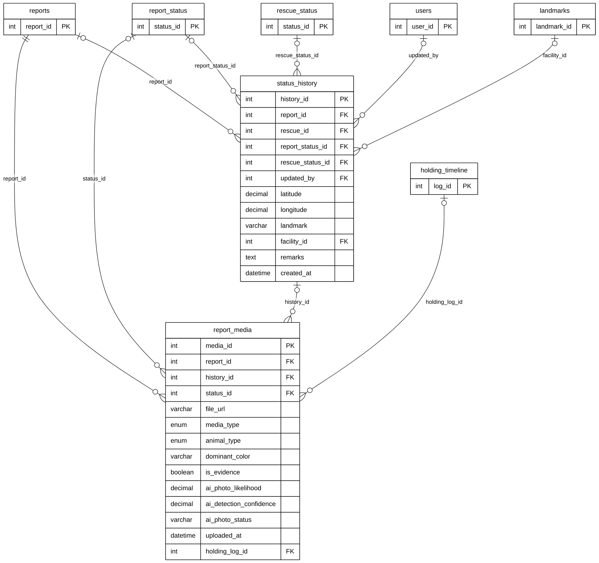

# Module 04B — Report Timeline & Media

> Part of **Module 04 — Stray Reporting** ([index](04_STRAY_REPORTING_ERD.md)). Source of truth: the SQLAlchemy models, checked against the live MySQL schema.
> Documentation only — no database or code was changed.

## 1. Purpose

Everything that happens to a report over time. `status_history` is the timeline: each entry records a status change (report status, and rescue status when a rescue is running), who made it, where, and the facility if the animal was moved. `report_media` holds the photos, videos and documents, either from the original report or attached to a specific timeline entry or holding-facility log.

## 2. Entities

| Entity | Description |
|---|---|
| `status_history` | One timeline entry: status change, actor, location / facility, remarks |
| `report_media` | One photo, video or document of a report, optionally tied to a timeline entry or holding log |

**Reference entities** (defined in full elsewhere; shown here with only the key the relationships need):

| Reference entity | Defined in | Key shown |
|---|---|---|
| `reports` | Module 04A | `report_id` |
| `report_status` | Module 04A | `status_id` |
| `users` | Module 01 | `user_id` |
| `landmarks` | Module 02 | `landmark_id` |
| `rescue_status` | Module 07 | `status_id` |
| `holding_timeline` | Module 07 | `log_id` |

## 3. Entity Relationship Diagram

> Raw code for Mermaid Live Editor / SVG export: [`mermaid/04b_report_timeline_media.mmd`](mermaid/04b_report_timeline_media.mmd).
> The front-matter block sets the manuscript style (white background, black lines, Arial 16 px, natural size).

`||` exactly one (NOT NULL FK) · `|o` zero or one (nullable FK) · `o{` zero or many · `o|` zero or one (unique FK)

## 4. Relationships and cardinalities

| # | Relationship | Cardinality | FK (child column) | ON DELETE |
|---|---|---|---|---|
| R1 | `reports` → `status_history` | **One-to-many**, optional | `status_history.report_id` — the report the entry belongs to | CASCADE |
| R2 | `report_status` → `status_history` | **One-to-many**, optional | `status_history.report_status_id` — the report status set | no action |
| R3 | `rescue_status` → `status_history` | **One-to-many**, optional | `status_history.rescue_status_id` — the rescue status set | no action |
| R4 | `users` → `status_history` | **One-to-many**, optional | `status_history.updated_by` — who made the change | SET NULL |
| R5 | `landmarks` → `status_history` | **One-to-many**, optional | `status_history.facility_id` — facility the animal was taken to | SET NULL |
| R6 | `reports` → `report_media` | **One-to-many**, mandatory | `report_media.report_id` — the report the file belongs to | CASCADE |
| R7 | `report_status` → `report_media` | **One-to-many**, optional | `report_media.status_id` — the status the file was uploaded at | SET NULL |
| R8 | `status_history` → `report_media` | **One-to-many**, optional | `report_media.history_id` — the timeline entry the file is evidence for | SET NULL |
| R9 | `holding_timeline` → `report_media` | **One-to-many**, optional | `report_media.holding_log_id` — the holding-facility log the file belongs to | SET NULL |

### Not drawn: `status_history.rescue_id`

The model declares `status_history.rescue_id → rescues` (ON DELETE CASCADE), but the **live database has no foreign-key
constraint** on this column. Because the model is the source of truth (overview decision C), the relationship
`rescues → status_history` is real in the application. It is drawn in **Module 07 — Rescue & Holding Operations**,
where `rescues` is defined, and listed here only for completeness.

### Delete behaviour
Deleting a report deletes its timeline and media (CASCADE). Deleting a timeline entry, status, facility or holding log
keeps the media and sets the link to NULL.
