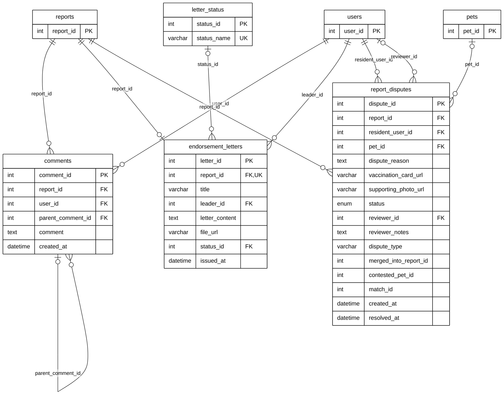

# Module 04C — Comments, Endorsements & Disputes

> Part of **Module 04 — Stray Reporting** ([index](04_STRAY_REPORTING_ERD.md)). Source of truth: the SQLAlchemy models, checked against the live MySQL schema.
> Documentation only — no database or code was changed.

## 1. Purpose

Interaction around a report. **Comments** are threaded discussion on a report (a reply points to its parent comment). An **endorsement letter** is the Subdivision Leader's letter that endorses a report to the barangay (one letter per report), with its own status (Draft, Sent to Barangay, Approved). A **dispute** is a resident contesting a report, for example that the reported animal is their vaccinated pet, with supporting files and a staff decision.

## 2. Entities

| Entity | Description |
|---|---|
| `comments` | A comment on a report; replies point to their parent comment |
| `endorsement_letters` | The leader's endorsement of a report to the barangay (one per report) |
| `letter_status` | Lookup: Draft, Sent to Barangay, Approved |
| `report_disputes` | A resident's dispute of a report, with evidence and the reviewer's decision |

**Reference entities** (defined in full elsewhere; shown here with only the key the relationships need):

| Reference entity | Defined in | Key shown |
|---|---|---|
| `reports` | Module 04A | `report_id` |
| `users` | Module 01 | `user_id` |
| `pets` | Module 03A | `pet_id` |

## 3. Entity Relationship Diagram

> Raw code for Mermaid Live Editor / SVG export: [`mermaid/04c_comments_endorsements_disputes.mmd`](mermaid/04c_comments_endorsements_disputes.mmd).
> The front-matter block sets the manuscript style (white background, black lines, Arial 16 px, natural size).

`||` exactly one (NOT NULL FK) · `|o` zero or one (nullable FK) · `o{` zero or many · `o|` zero or one (unique FK)

## 4. Relationships and cardinalities

| # | Relationship | Cardinality | FK (child column) | ON DELETE |
|---|---|---|---|---|
| R1 | `reports` → `comments` | **One-to-many**, mandatory | `comments.report_id` — the report commented on | CASCADE |
| R2 | `users` → `comments` | **One-to-many**, mandatory | `comments.user_id` — the author | CASCADE |
| R3 | `comments` → `comments` | **One-to-many**, optional | `comments.parent_comment_id` — the comment being replied to (self-relationship) | CASCADE |
| R4 | `reports` → `endorsement_letters` | **One-to-one**, mandatory | `endorsement_letters.report_id` — one letter per report (unique) | CASCADE |
| R5 | `users` → `endorsement_letters` | **One-to-many**, mandatory | `endorsement_letters.leader_id` — the leader who wrote it | CASCADE |
| R6 | `letter_status` → `endorsement_letters` | **One-to-many**, optional | `endorsement_letters.status_id` — the letter's status | no action |
| R7 | `reports` → `report_disputes` | **One-to-many**, mandatory | `report_disputes.report_id` — the disputed report | CASCADE |
| R8 | `users` → `report_disputes` | **One-to-many**, mandatory | `report_disputes.resident_user_id` — the resident who disputes | CASCADE |
| R9 | `users` → `report_disputes` | **One-to-many**, optional | `report_disputes.reviewer_id` — the staff member who decided | SET NULL |
| R10 | `pets` → `report_disputes` | **One-to-many**, optional | `report_disputes.pet_id` — the pet the resident says it is | SET NULL |

**One-to-one:** `endorsement_letters.report_id` is unique, so a report has at most one endorsement letter.

**Self-relationship:** `comments.parent_comment_id → comments` makes threaded replies.

### Not drawn: references without a foreign key
`report_disputes.merged_into_report_id` (→ reports), `contested_pet_id` (→ pets) and `match_id` (→ report_matches) are
plain integers with no FK in the model or the database.

### Model vs. live database
| Item | Model | Live database |
|---|---|---|
| `endorsement_letters.leader_id → users` | FK, ON DELETE CASCADE | FK, no ON DELETE action |
| `endorsement_letters.pdf_url`, `remarks`, `created_at`, `updated_at` | not in the model | columns exist; the application never reads or writes them |

### Usage note
`comments` and `report_disputes` have 0 live rows; both are written by the code (`routes/reports.py`), so they are working
features without data yet. `letter_status` is only used through `endorsement_letters.status_id`.
