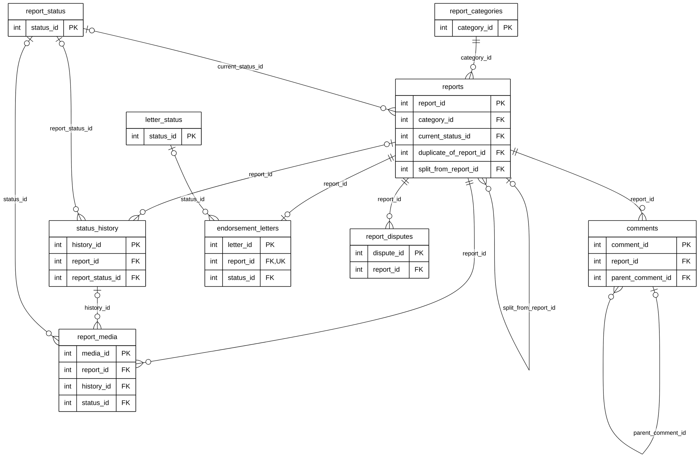

# Module 04 — Stray Reporting (index)

> **Source of truth:** `backend/app/models/report.py` (report, media, timeline, comment and letter classes) and
> `report_dispute.py`, checked against the live MySQL schema. Documentation only.

## 1. Module purpose

Reports of stray, aggressive, injured or lost animals, and everything attached to them: classification and status,
the leader who handles the report, verification and public visibility, merging duplicate sightings into one case,
the status timeline with its photos and videos, comments, the leader's endorsement letter to the barangay, and
residents' disputes.

## 2. Why this module is split

As one diagram, Module 04 has **9 tables, 140 columns and 33 relationship lines**. `reports` alone has 77 columns and
13 foreign keys, 7 of them to `users`. It is presented as **three submodules**. Each table is defined in full once;
the others show it as a key-only reference.

| Submodule | Tables defined in full | Reference entities | Lines |
|---|---|---|---|
| [04A — Reports & Classification](04A_REPORTS_CLASSIFICATION_ERD.md) | `reports`, `report_categories`, `report_status` | `users`, `subdivisions`, `landmarks` | 13 |
| [04B — Report Timeline & Media](04B_REPORT_TIMELINE_MEDIA_ERD.md) | `status_history`, `report_media` | `reports`, `report_status`, `users`, `landmarks`, `rescue_status`, `holding_timeline` | 9 |
| [04C — Comments, Endorsements & Disputes](04C_COMMENTS_ENDORSEMENTS_DISPUTES_ERD.md) | `comments`, `endorsement_letters`, `letter_status`, `report_disputes` | `reports`, `users`, `pets` | 10 |
| **Total** | **9 tables** | | **32** + `rescues → status_history` drawn in Module 07 = **33** |

## 3. Module map (keys only)

How the 9 tables connect to each other. Links to other modules are in the submodule diagrams.
Raw code: [`mermaid/04_stray_reporting.mmd`](mermaid/04_stray_reporting.mmd).

## 4. Differences between the models and the live database (documentation only)

| Item | Model | Live database | Drawn? |
|---|---|---|---|
| `reports.pet_id → pets` | no FK | FK, ON DELETE SET NULL | No (decision C) |
| `reports.current_status_id → report_status` | FK | FK + ON DELETE SET NULL | Yes |
| `status_history.rescue_id → rescues` | FK, ON DELETE CASCADE | **no FK** | Yes, in Module 07 |
| `endorsement_letters.leader_id → users` | FK, ON DELETE CASCADE | FK, no ON DELETE | Yes |
| `report_categories.description` | — | column exists | Not shown |
| `endorsement_letters.pdf_url`, `remarks`, `created_at`, `updated_at` | — | columns exist, unused by the app | Not shown |

## 5. Tables in other modules that reference this module

| Referencing column | → | Module |
|---|---|---|
| `pet_owner_confirmations.report_id`, `owner_warnings.report_id` | `reports` | 03C |
| `report_verifications.report_id`, `pet_claims.report_id`, `report_returns.report_id`, `report_verifications.status_id` | `reports`, `report_status` | 05 |
| `report_matches.source_report_id`, `report_matches.matched_report_id` | `reports` | 06 |
| `rescues.report_id`, `holding_animals.report_id` | `reports` | 07 |
