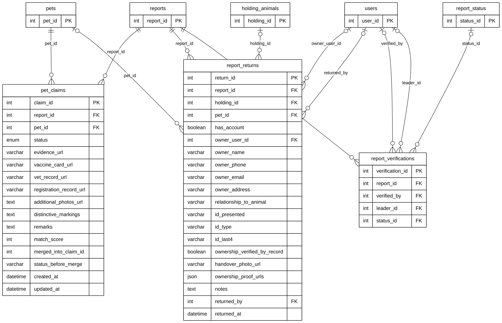

# Module 05 — Verification, Claims & Reunification

> Source of truth: the SQLAlchemy models, checked against the live MySQL schema.
> Documentation only — no database or code was changed.

## 1. Purpose

How a reported animal goes home. A pet owner **claims** that a reported animal is their registered pet (`pet_claims`), uploading proof such as a vaccine card, vet record or extra photos. Staff review the claim (approve, request evidence, reject). When the animal is physically handed over, a **return record** (`report_returns`) is written: who received it, the ID they presented, the handover photo and proof, and which staff member returned it, including from a holding facility. `report_verifications` was designed to log report verifications but is **not used** (verification is stored on `reports`).

## 2. Entities

| Entity                   | Description                                                                                                                                                |
| ------------------------ | ---------------------------------------------------------------------------------------------------------------------------------------------------------- |
| `pet_claims`           | An owner's claim that a reported animal is their pet: proof files, status, match score. Associative entity between `pets` and `reports` (many-to-many) |
| `report_returns`       | The handover of an animal to its owner: owner details (with or without an account), ID presented, handover photo, ownership proof, staff who returned it   |
| `report_verifications` | **Defined but not used** — no code reads or writes it (0 rows). Keys only in the diagram; full columns in section 5                                 |

**Reference entities** (defined in full elsewhere; shown here with only the key the relationships need):

| Reference entity    | Defined in | Key shown      |
| ------------------- | ---------- | -------------- |
| `reports`         | Module 04A | `report_id`  |
| `report_status`   | Module 04A | `status_id`  |
| `pets`            | Module 03A | `pet_id`     |
| `users`           | Module 01  | `user_id`    |
| `holding_animals` | Module 07  | `holding_id` |

## 3. Entity Relationship Diagram

> Raw code for Mermaid Live Editor / SVG export: [`mermaid/05_verification_claims_reunification.mmd`](mermaid/05_verification_claims_reunification.mmd).
> The front-matter block sets the manuscript style (white background, black lines, Arial 16 px, natural size).

`||` exactly one (NOT NULL FK) · `|o` zero or one (nullable FK) · `o{` zero or many · `o|` zero or one (unique FK)

## 4. Relationships and cardinalities

| #   | Relationship                                  | Cardinality                      | FK (child column)                                                                         | ON DELETE |
| --- | --------------------------------------------- | -------------------------------- | ----------------------------------------------------------------------------------------- | --------- |
| R1  | `pets` → `pet_claims`                    | **One-to-many**, mandatory | `pet_claims.pet_id` — the pet being claimed                                            | CASCADE   |
| R2  | `reports` → `pet_claims`                 | **One-to-many**, mandatory | `pet_claims.report_id` — the report of the found animal                                | CASCADE   |
| R3  | `reports` → `report_returns`             | **One-to-many**, mandatory | `report_returns.report_id` — the report that is closed by the return                   | CASCADE   |
| R4  | `pets` → `report_returns`                | **One-to-many**, optional  | `report_returns.pet_id` — the pet that went home                                       | SET NULL  |
| R5  | `holding_animals` → `report_returns`     | **One-to-many**, optional  | `report_returns.holding_id` — the holding record the animal left                       | SET NULL  |
| R6  | `users` → `report_returns`               | **One-to-many**, optional  | `report_returns.owner_user_id` — the owner's account (NULL = owner without an account) | SET NULL  |
| R7  | `users` → `report_returns`               | **One-to-many**, optional  | `report_returns.returned_by` — the staff member who handed it over                     | SET NULL  |
| R8  | `reports` → `report_verifications`       | **One-to-many**, mandatory | `report_verifications.report_id` — the verified report                                 | CASCADE   |
| R9  | `users` → `report_verifications`         | **One-to-many**, optional  | `report_verifications.verified_by` — who verified                                      | CASCADE   |
| R10 | `users` → `report_verifications`         | **One-to-many**, optional  | `report_verifications.leader_id` — the leader involved                                 | CASCADE   |
| R11 | `report_status` → `report_verifications` | **One-to-many**, optional  | `report_verifications.status_id` — status set by the verification                      | no action |

### Many-to-many: pets ↔ reports through `pet_claims`

A pet can be claimed on many reports (it can get lost more than once), and one report can receive claims for several
pets (different owners each think it is theirs). `pet_claims` resolves this many-to-many relationship and carries its
own data (proof files, status, match score), so it is drawn as an **associative entity**, not a plain link.

**Who is the claimant?** `pet_claims` has no user column. The claimant is the owner of the claimed pet
(`pets.owner_id`, Module 03A), so the claim reaches the owner through `pets`.

**Owners without an account:** `report_returns.has_account = false` and `owner_user_id` is NULL. The owner's name, phone,
email and address are stored on the return itself (`owner_name`, `owner_phone`, …).

### `report_verifications` — defined but not used

No route or service reads or writes this table (0 rows). A report's verification is stored on `reports` itself
(`verification_status`, `verified_by_user_id`, `verified_at`, `verification_notes`; Module 04A). The table stays in the ERD
because it exists in the model and the database; the diagram shows only its keys.

### Not drawn: reference without a foreign key

`pet_claims.merged_into_claim_id` holds the claim a duplicate claim was merged into. It is a plain integer (no FK), so
it is not drawn as a self-relationship.

### Model vs. live database

| Item                                                | Model                 | Live database   |
| --------------------------------------------------- | --------------------- | --------------- |
| `report_verifications.leader_id → users`         | FK, ON DELETE CASCADE | **no FK** |
| `report_verifications.status_id → report_status` | FK                    | **no FK** |

Both are drawn because the model declares them (overview decision C); the table is unused either way.

### Value sets and live data

`pet_claims.status`: Potential Owner Match, Possible Match Found, Pending Review, Approved, Rejected, Evidence Requested,
Handover Complete, Pet Received, Merged. Live: 23 claims (20 Handover Complete, 2 Approved, 1 Merged) and 20 returns.

## 5. Complete column lists

### `pet_claims`

| Column                      | Type                                                                                                                                                | Null     | Key               |
| --------------------------- | --------------------------------------------------------------------------------------------------------------------------------------------------- | -------- | ----------------- |
| `claim_id`                | Integer                                                                                                                                             | NOT NULL | PK                |
| `report_id`               | Integer                                                                                                                                             | NOT NULL | FK → `reports` |
| `pet_id`                  | Integer                                                                                                                                             | NOT NULL | FK → `pets`    |
| `status`                  | Enum (Potential Owner Match, Possible Match Found, Pending Review, Approved, Rejected, Evidence Requested, Handover Complete, Pet Received, Merged) | NOT NULL |                   |
| `evidence_url`            | String(255)                                                                                                                                         | NULL     |                   |
| `vaccine_card_url`        | String(255)                                                                                                                                         | NULL     |                   |
| `vet_record_url`          | String(255)                                                                                                                                         | NULL     |                   |
| `registration_record_url` | String(255)                                                                                                                                         | NULL     |                   |
| `additional_photos_url`   | Text                                                                                                                                                | NULL     |                   |
| `distinctive_markings`    | Text                                                                                                                                                | NULL     |                   |
| `remarks`                 | Text                                                                                                                                                | NULL     |                   |
| `match_score`             | Integer                                                                                                                                             | NULL     |                   |
| `merged_into_claim_id`    | Integer                                                                                                                                             | NULL     |                   |
| `status_before_merge`     | String(30)                                                                                                                                          | NULL     |                   |
| `created_at`              | DateTime                                                                                                                                            | NOT NULL |                   |
| `updated_at`              | DateTime                                                                                                                                            | NOT NULL |                   |

### `report_returns`

| Column                           | Type        | Null     | Key                       |
| -------------------------------- | ----------- | -------- | ------------------------- |
| `return_id`                    | Integer     | NOT NULL | PK                        |
| `report_id`                    | Integer     | NOT NULL | FK → `reports`         |
| `holding_id`                   | Integer     | NULL     | FK → `holding_animals` |
| `pet_id`                       | Integer     | NULL     | FK → `pets`            |
| `has_account`                  | Boolean     | NOT NULL |                           |
| `owner_user_id`                | Integer     | NULL     | FK → `users`           |
| `owner_name`                   | String(150) | NOT NULL |                           |
| `owner_phone`                  | String(30)  | NULL     |                           |
| `owner_email`                  | String(120) | NULL     |                           |
| `owner_address`                | String(255) | NULL     |                           |
| `relationship_to_animal`       | String(60)  | NULL     |                           |
| `id_presented`                 | String(120) | NULL     |                           |
| `id_type`                      | String(60)  | NULL     |                           |
| `id_last4`                     | String(4)   | NULL     |                           |
| `ownership_verified_by_record` | Boolean     | NOT NULL |                           |
| `handover_photo_url`           | String(255) | NULL     |                           |
| `ownership_proof_urls`         | JSON        | NULL     |                           |
| `notes`                        | Text        | NULL     |                           |
| `returned_by`                  | Integer     | NULL     | FK → `users`           |
| `returned_at`                  | DateTime    | NOT NULL |                           |

### `report_verifications` (not used)

| Column              | Type     | Null     | Key                     |
| ------------------- | -------- | -------- | ----------------------- |
| `verification_id` | Integer  | NOT NULL | PK                      |
| `report_id`       | Integer  | NOT NULL | FK → `reports`       |
| `verified_by`     | Integer  | NULL     | FK → `users`         |
| `leader_id`       | Integer  | NULL     | FK → `users`         |
| `is_valid`        | Boolean  | NULL     |                         |
| `status_id`       | Integer  | NULL     | FK → `report_status` |
| `remarks`         | Text     | NULL     |                         |
| `verified_at`     | DateTime | NULL     |                         |

## 6. Related modules

| Module                         | Link                                                                                                     |
| ------------------------------ | -------------------------------------------------------------------------------------------------------- |
| 01 User & Access Management    | Owner account and returning staff on `report_returns`; verifier and leader on `report_verifications` |
| 03 Pet Management              | The claimed pet and the pet that went home; the claimant is the pet's owner                              |
| 04 Stray Reporting             | The report being claimed, returned or verified; the report status                                        |
| 07 Rescue & Holding Operations | `report_returns.holding_id`: the animal left a holding facility                                        |
