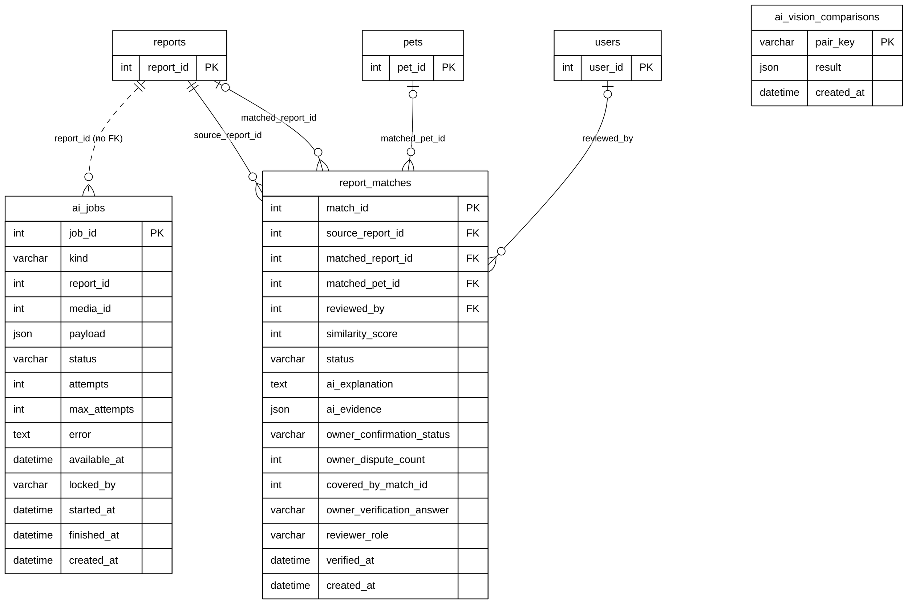

# Module 06 — AI Matching

> Source of truth: the SQLAlchemy models, checked against the live MySQL schema.
> Documentation only — no database or code was changed.

## 1. Purpose

The AI side of StraySafe 2.0. When a sighting is reported, the background AI worker (`ai_jobs`) analyses its photos and compares them with other reports and with registered pets. Each candidate it finds is stored as a **suggested match** (`report_matches`) with a similarity score and the AI's explanation. **The AI only suggests:** a Subdivision Leader or staff member reviews every suggestion, and the pet owner confirms or rejects it before anything is linked. Photo-pair comparisons from Gemini Vision are cached (`ai_vision_comparisons`) so the same pair is never sent twice.

## 2. Entities

| Entity | Description |
|---|---|
| `report_matches` | One AI-suggested match: a sighting (source report) vs. another report **or** a registered pet, with score, AI explanation and evidence, staff review and the owner's answer (24 columns; 16 shown, all in section 5) |
| `ai_jobs` | The background AI work queue: one job per photo (`media`) or follow-up scan of a report; status, attempts, worker lock |
| `ai_vision_comparisons` | Cache of Gemini Vision photo-pair comparisons, keyed by a hash of both photos and descriptions |

**Reference entities** (defined in full elsewhere; shown here with only the key the relationships need):

| Reference entity | Defined in | Key shown |
|---|---|---|
| `reports` | Module 04A | `report_id` |
| `pets` | Module 03A | `pet_id` |
| `users` | Module 01 | `user_id` |

## 3. Entity Relationship Diagram

> Raw code for Mermaid Live Editor / SVG export: [`mermaid/06_ai_matching.mmd`](mermaid/06_ai_matching.mmd).
> The front-matter block sets the manuscript style (white background, black lines, Arial 16 px, natural size).

`||` exactly one (NOT NULL FK) · `|o` zero or one (nullable FK) · `o{` zero or many · `o|` zero or one (unique FK)

## 4. Relationships and cardinalities

| # | Relationship | Cardinality | FK (child column) | ON DELETE |
|---|---|---|---|---|
| R1 | `reports` → `report_matches` | **One-to-many**, mandatory | `report_matches.source_report_id` — the sighting the AI searched for | CASCADE |
| R2 | `reports` → `report_matches` | **One-to-many**, optional | `report_matches.matched_report_id` — a matching report (case to merge into) | CASCADE |
| R3 | `pets` → `report_matches` | **One-to-many**, optional | `report_matches.matched_pet_id` — a matching registered pet | SET NULL |
| R4 | `users` → `report_matches` | **One-to-many**, optional | `report_matches.reviewed_by` — the staff member who reviewed the suggestion | SET NULL |

### Legend

| Line | Meaning |
|---|---|
| Solid line | Foreign key enforced in the model and the database |
| **Dashed line** | Reference by ID only: the column always holds the other table's key, but **no foreign key** is declared |
| No line | Stand-alone supporting table with no reference to another table |

> **Caption for the manuscript:** *`ai_jobs` (the AI processing queue) and `ai_vision_comparisons` (the AI result cache)
> are supporting tables of the AI matching process. They reference other data by ID or by photo hash rather than
> through foreign keys.*

### `report_matches` as an associative entity

A sighting can have many candidate matches, and a report or pet can be suggested for many sightings, so
`report_matches` resolves a **many-to-many** relationship. It links:
- a **report to another report**, a self-many-to-many of `reports`, used to merge duplicate sightings into one case;
  or
- a **report to a registered pet**, to find the owner.

Exactly one of `matched_report_id` / `matched_pet_id` is normally filled. Both are optional foreign keys.

**Two links to `reports`:** `source_report_id` (mandatory) and `matched_report_id` (optional) are separate one-to-many
relationships to the same table.

### AI decision boundary (for the defence)
`similarity_score`, `ai_explanation` and `ai_evidence` are the AI's suggestion. The decision is recorded separately by
people:
- staff review: `reviewed_by`, `reviewer_role`, `verified_at`, `verification_notes`;
- the owner's answer: `owner_confirmation_status`, `owner_verification_answer`, `owner_dispute_count`.

`status` moves from `AI_SUGGESTED` to `CONFIRMED_MATCH` or `NOT_A_MATCH` only through those actions. Live data: 59
matches, of which 15 AI_SUGGESTED, 26 CONFIRMED_MATCH, 3 NOT_A_MATCH, 5 COVERED_BY_CASE and 10 SUPERSEDED_BY_CASE.

### Supporting tables (both actively used)
- **`ai_jobs` — dashed line to `reports`.** Every job belongs to one report (`report_id` is NOT NULL), and a report
  has zero or many jobs. The column is **not a foreign key** in the model or the database, so the link is drawn
  **dashed** and labelled *no FK*. This is the one exception to overview decision B, made so the queue is not mistaken for
  an unrelated table.
  - `media_id` refers to `report_media` the same way. It is not drawn, to keep the diagram small.
  - Jobs are created when a photo is uploaded (`media`) and after a report is submitted or updated (`follow_up`;
    `backfill` also exists in the code). The AI worker then processes them in the background. Live: 90 jobs (39 media,
    51 follow_up), all done; no job points to a missing report or media file.
- **`ai_vision_comparisons` — no line.** A cache of Gemini Vision answers keyed by `pair_key`, a SHA-256 hash of the
  two photo URLs and descriptions (`utils/ai_matching.py`). It holds no report, pet or media ID, so it has **no
  relationship even by meaning**. Before calling Gemini, matching looks the pair up here and reuses a saved answer, so
  the same photo pair is never sent twice and one answer serves every report that compares those photos. Live: 307
  cached comparisons.

**Design note (for questions):** keeping the queue free of foreign keys is a common choice for background job tables,
but a FK `ai_jobs.report_id → reports` (ON DELETE CASCADE) would be stricter. Without it, a job queued for a report that
is then deleted fails and stops after its retry limit. This is a possible post-defence improvement and needs a
database change.

### Not drawn: references without a foreign key
`report_matches.covered_by_match_id` (→ report_matches) and `report_matches.owner_verification_requested_by` (→ users)
are plain integers.

### Model vs. live database
No differences: same columns, foreign keys and ON DELETE rules for all three tables.

## 5. Complete column lists

### `report_matches`

| Column | Type | Null | Key |
|---|---|---|---|
| `match_id` | Integer | NOT NULL | PK |
| `source_report_id` | Integer | NOT NULL | FK → `reports` |
| `matched_report_id` | Integer | NULL | FK → `reports` |
| `matched_pet_id` | Integer | NULL | FK → `pets` |
| `similarity_score` | Integer | NOT NULL |  |
| `status` | String(50) | NOT NULL |  |
| `ai_explanation` | Text | NULL |  |
| `ai_evidence` | JSON | NULL |  |
| `owner_confirmation_status` | String(50) | NOT NULL |  |
| `owner_notes` | Text | NULL |  |
| `owner_dispute_count` | Integer | NOT NULL |  |
| `covered_by_match_id` | Integer | NULL |  |
| `owner_verification_requested_at` | DateTime | NULL |  |
| `owner_verification_requested_by` | Integer | NULL |  |
| `owner_verification_note` | Text | NULL |  |
| `owner_verification_answer` | String(10) | NULL |  |
| `owner_verification_answer_note` | Text | NULL |  |
| `owner_verification_answered_at` | DateTime | NULL |  |
| `reviewed_by` | Integer | NULL | FK → `users` |
| `reviewer_role` | String(50) | NULL |  |
| `verification_notes` | Text | NULL |  |
| `verified_at` | DateTime | NULL |  |
| `created_at` | DateTime | NOT NULL |  |
| `updated_at` | DateTime | NOT NULL |  |

### `ai_jobs`

| Column | Type | Null | Key |
|---|---|---|---|
| `job_id` | Integer | NOT NULL | PK |
| `kind` | String(20) | NOT NULL |  |
| `report_id` | Integer | NOT NULL |  |
| `media_id` | Integer | NULL |  |
| `payload` | JSON | NULL |  |
| `status` | String(20) | NOT NULL |  |
| `attempts` | Integer | NOT NULL |  |
| `max_attempts` | Integer | NOT NULL |  |
| `error` | Text | NULL |  |
| `available_at` | DateTime | NOT NULL |  |
| `locked_by` | String(64) | NULL |  |
| `started_at` | DateTime | NULL |  |
| `finished_at` | DateTime | NULL |  |
| `created_at` | DateTime | NOT NULL |  |

## 6. Related modules

| Module | Link |
|---|---|
| 01 User & Access Management | The staff member who reviewed a match |
| 03 Pet Management | A registered pet suggested as the match; confirmed matches add `SIGHTING_MATCH_CONFIRMED` to `pet_history` |
| 04 Stray Reporting | The sighting and the matching report; merged duplicates set `reports.duplicate_of_report_id` |
| 11 Administration & System | The AI worker heartbeat and AI settings are stored in `system_settings` |

