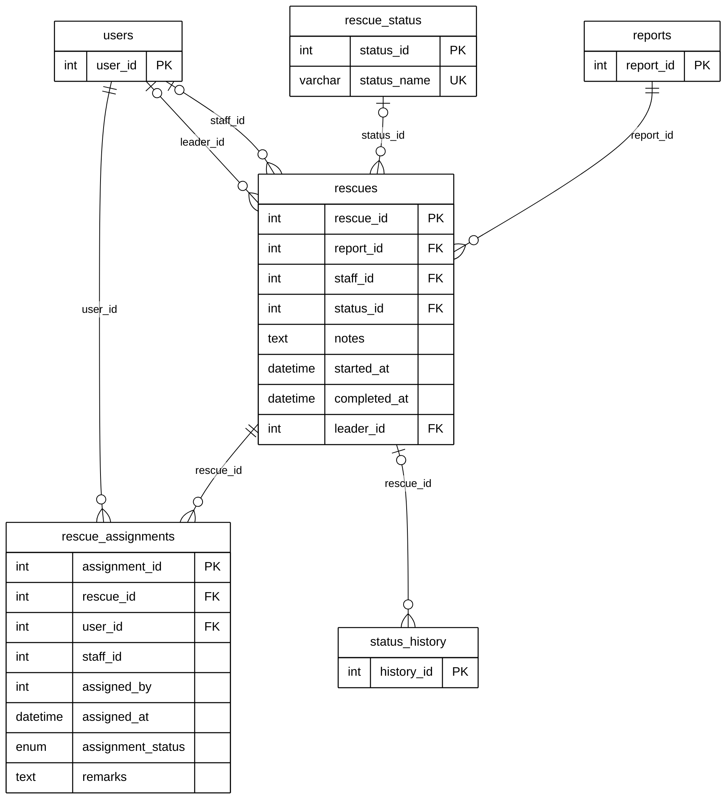

# Module 07A — Rescue Dispatch

> Part of **Module 07 — Rescue & Holding Operations** ([index](07_RESCUE_HOLDING_OPERATIONS_ERD.md)). Source of truth: the SQLAlchemy models, checked against the live MySQL schema.
> Documentation only — no database or code was changed.

## 1. Purpose

When a report needs the animal picked up, the barangay creates a **rescue** for it and assigns responders. Each responder assignment has its own progress (Assigned, In Transit, On Site, Completed, Cancelled). The rescue moves through rescue statuses (Pending Assignment through Animal Secured or Failed / Cancelled), and every change is written to the report's status timeline (`status_history`, Module 04B).

## 2. Entities

| Entity | Description |
|---|---|
| `rescues` | One rescue operation for a report: status, responsible staff and leader, start and completion |
| `rescue_status` | Lookup: Pending Assignment, Rescuer Assigned, En Route, On Site, Animal Secured, Failed / Cancelled |
| `rescue_assignments` | One responder assigned to a rescue, with their own progress. Associative entity between `rescues` and `users` (many-to-many) |

**Reference entities** (defined in full elsewhere; shown here with only the key the relationships need):

| Reference entity | Defined in | Key shown |
|---|---|---|
| `reports` | Module 04A | `report_id` |
| `users` | Module 01 | `user_id` |
| `status_history` | Module 04B | `history_id` |

## 3. Entity Relationship Diagram

> Raw code for Mermaid Live Editor / SVG export: [`mermaid/07a_rescue_dispatch.mmd`](mermaid/07a_rescue_dispatch.mmd).
> The front-matter block sets the manuscript style (white background, black lines, Arial 16 px, natural size).

`||` exactly one (NOT NULL FK) · `|o` zero or one (nullable FK) · `o{` zero or many · `o|` zero or one (unique FK)

## 4. Relationships and cardinalities

| # | Relationship | Cardinality | FK (child column) | ON DELETE |
|---|---|---|---|---|
| R1 | `reports` → `rescues` | **One-to-many**, mandatory | `rescues.report_id` — the report being rescued | CASCADE |
| R2 | `rescue_status` → `rescues` | **One-to-many**, optional | `rescues.status_id` — the rescue's current status | no action |
| R3 | `users` → `rescues` | **One-to-many**, optional | `rescues.staff_id` — the barangay staff member in charge | SET NULL |
| R4 | `users` → `rescues` | **One-to-many**, optional | `rescues.leader_id` — the Subdivision Leader involved | SET NULL |
| R5 | `rescues` → `rescue_assignments` | **One-to-many**, mandatory | `rescue_assignments.rescue_id` — the rescue the responder is assigned to | CASCADE |
| R6 | `users` → `rescue_assignments` | **One-to-many**, mandatory | `rescue_assignments.user_id` — the responder | CASCADE |
| R7 | `rescues` → `status_history` | **One-to-many**, optional | `status_history.rescue_id` — timeline entries written during the rescue | CASCADE |

### Many-to-many: rescues ↔ users through `rescue_assignments`
A rescue can have several responders, and a responder takes part in many rescues. `rescue_assignments` resolves this
and has its own data (assignment status, time, remarks), so it is drawn as an **associative entity**.

### `rescues → status_history` (moved here from Module 04B)
The model declares `status_history.rescue_id → rescues` (ON DELETE CASCADE). It is drawn here, where `rescues` is
defined. **The live database has no FK constraint on this column** (see the model-vs-database table below).
`status_history.rescue_status_id → rescue_status` is drawn in 04B.

### Not drawn: references without a foreign key
- `rescue_assignments.staff_id` (→ users): in all 24 live rows it equals `user_id`, so it is a duplicate of the
  responder.
- `rescue_assignments.assigned_by` (→ users).

Both are plain integers.

### Model vs. live database
| Item | Model | Live database |
|---|---|---|
| `rescues.staff_id → users` | FK, ON DELETE SET NULL | **no FK** |
| `rescues.leader_id → users` | FK, ON DELETE SET NULL | **no FK** |
| `status_history.rescue_id → rescues` | FK, ON DELETE CASCADE | **no FK** |
| `rescues.created_at`, `scheduled_at`, `assigned_team` | not in the model | columns exist; the application never reads or writes them |

The three FKs are drawn because the model declares them (overview decision C).

## 5. Lookup values (live)
`rescue_status`: 1 Pending Assignment · 2 Rescuer Assigned · 3 En Route · 4 On Site · 5 Animal Secured · 6 Failed / Cancelled
