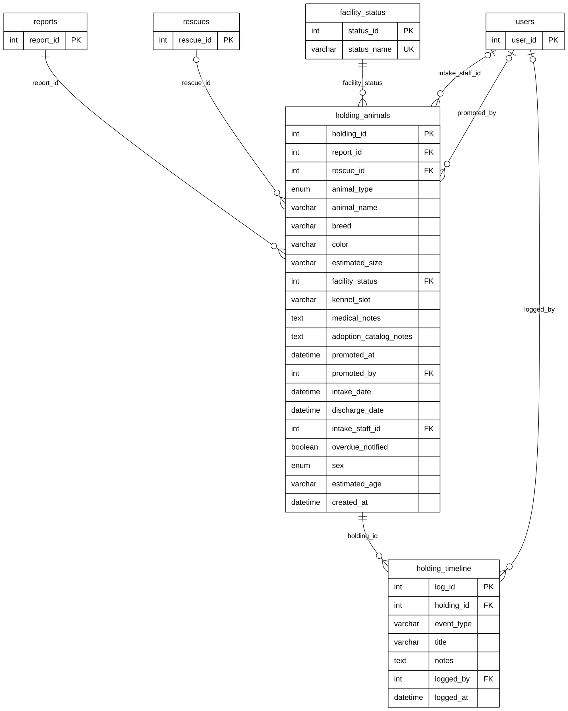

# Module 07B — Holding Facility

> Part of **Module 07 — Rescue & Holding Operations** ([index](07_RESCUE_HOLDING_OPERATIONS_ERD.md)). Source of truth: the SQLAlchemy models, checked against the live MySQL schema.
> Documentation only — no database or code was changed.

## 1. Purpose

After pickup, the animal is taken into a **holding facility** (impound). `holding_animals` is its intake record: what animal, kennel slot, medical notes, intake and discharge dates, and its facility status (Need Treatment, Healthy, Claimed by Owner, Deceased, Transferred to Shelter, For Adoption, Adopted / Released, Impounded). Promoting an animal to *For Adoption* records who promoted it; it then appears in the adoption catalog (Module 08). `holding_timeline` is the animal's care log while it is held.

## 2. Entities

| Entity | Description |
|---|---|
| `holding_animals` | The animal's intake record in the holding facility (21 columns, all shown) |
| `facility_status` | Lookup: the animal's status in the facility (8 values, section 5) |
| `holding_timeline` | One care-log entry: event, title, notes, who logged it |

**Reference entities** (defined in full elsewhere; shown here with only the key the relationships need):

| Reference entity | Defined in | Key shown |
|---|---|---|
| `reports` | Module 04A | `report_id` |
| `rescues` | Module 07A | `rescue_id` |
| `users` | Module 01 | `user_id` |

## 3. Entity Relationship Diagram

> Raw code for Mermaid Live Editor / SVG export: [`mermaid/07b_holding_facility.mmd`](mermaid/07b_holding_facility.mmd).
> The front-matter block sets the manuscript style (white background, black lines, Arial 16 px, natural size).

`||` exactly one (NOT NULL FK) · `|o` zero or one (nullable FK) · `o{` zero or many · `o|` zero or one (unique FK)

## 4. Relationships and cardinalities

| # | Relationship | Cardinality | FK (child column) | ON DELETE |
|---|---|---|---|---|
| R1 | `reports` → `holding_animals` | **One-to-many**, mandatory | `holding_animals.report_id` — the report the animal came from | CASCADE |
| R2 | `rescues` → `holding_animals` | **One-to-many**, optional | `holding_animals.rescue_id` — the rescue that brought it in | SET NULL |
| R3 | `facility_status` → `holding_animals` | **One-to-many**, mandatory | `holding_animals.facility_status` — its status in the facility | no action |
| R4 | `users` → `holding_animals` | **One-to-many**, optional | `holding_animals.intake_staff_id` — who took it in | SET NULL |
| R5 | `users` → `holding_animals` | **One-to-many**, optional | `holding_animals.promoted_by` — who promoted it for adoption | SET NULL |
| R6 | `holding_animals` → `holding_timeline` | **One-to-many**, mandatory | `holding_timeline.holding_id` — its care log | CASCADE |
| R7 | `users` → `holding_timeline` | **One-to-many**, optional | `holding_timeline.logged_by` — who wrote the entry | SET NULL |

### One holding record per report (database constraint)
The live database has a **UNIQUE** key on `holding_animals.report_id`, so a report can have **at most one** holding
record; in the database this is a one-to-one relationship. The model does not declare the column unique, so the diagram
follows the model (overview decision C) and draws one-to-many. In practice the system creates one holding record per
report.

### Which facility?
`holding_animals` has **no** foreign key to `landmarks`. The facility an animal is held in is recorded on its report
(`reports.facility_id`, Module 04A) and on timeline entries (`status_history.facility_id`, Module 04B).

### Photos of the care log
Photos attached to a care-log entry are stored in `report_media.holding_log_id → holding_timeline` (drawn in Module 04B).

### Model vs. live database
| Item | Model | Live database |
|---|---|---|
| `holding_animals.report_id` | FK, not unique | FK + **UNIQUE** |

All other columns and foreign keys match.

## 5. Lookup values (live)
`facility_status`: 1 Need Treatment · 2 Healthy · 3 Claimed by Owner · 4 Deceased · 5 Transferred to Shelter ·
6 For Adoption · 7 Adopted/Released · 8 Impounded
