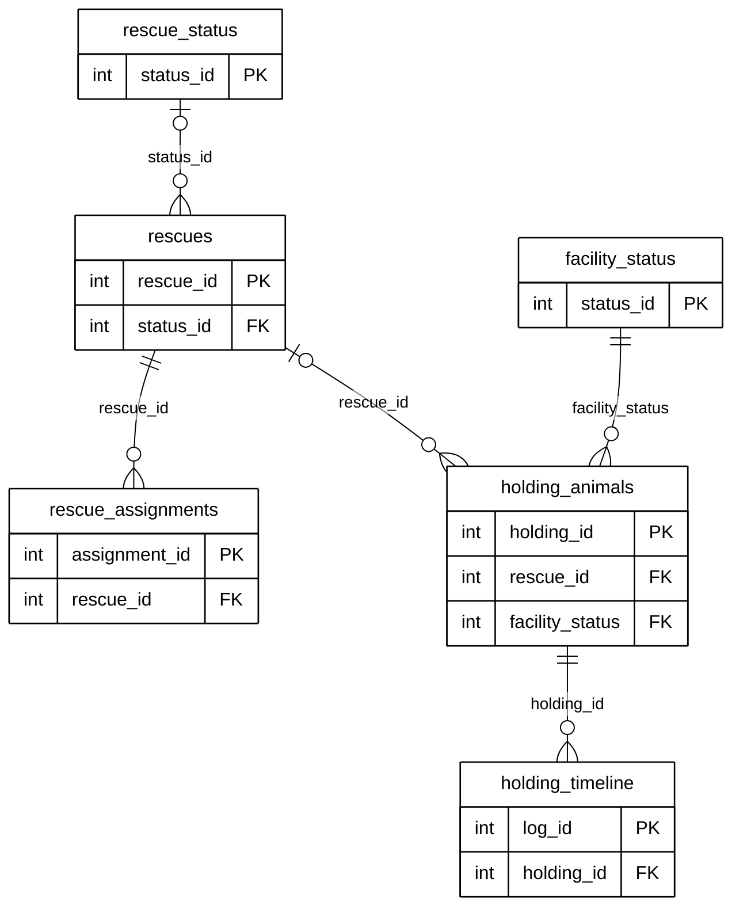

# Module 07 — Rescue & Holding Operations (index)

> **Source of truth:** `backend/app/models/report.py` (`Rescue`, `RescueStatus`, `RescueAssignment`, `FacilityStatus`,
> `HoldingAnimal`, `HoldingTimeline`), checked against the live MySQL schema. Documentation only.

## 1. Module purpose
The barangay's field and facility work: dispatching a rescue for a report, assigning responders and tracking their
progress, taking the animal into a holding facility, and logging its care until it is claimed, adopted, released,
transferred or dies.

## 2. Why this module is split
As one diagram, Module 07 has 6 tables, 48 columns and 13 relationship lines, plus `rescues → status_history` carried
over from Module 04. That is borderline for one page. It is presented as two submodules that follow the animal's path:
dispatch first, then holding.

| Submodule | Tables defined in full | Reference entities | Lines |
|---|---|---|---|
| [07A — Rescue Dispatch](07A_RESCUE_DISPATCH_ERD.md) | `rescues`, `rescue_status`, `rescue_assignments` | `reports`, `users`, `status_history` | 7 |
| [07B — Holding Facility](07B_HOLDING_FACILITY_ERD.md) | `holding_animals`, `facility_status`, `holding_timeline` | `reports`, `rescues`, `users` | 7 |
| **Total** | **6 tables** | | **14** (13 module FKs + `status_history.rescue_id`) |

## 3. Module map (keys only)
Raw code: [`mermaid/07_rescue_holding_operations.mmd`](mermaid/07_rescue_holding_operations.mmd).

## 4. Differences between the models and the live database (documentation only)
| Item | Model | Live database | Drawn as |
|---|---|---|---|
| `rescues.staff_id → users`, `rescues.leader_id → users` | FK | no FK | FK (model) |
| `status_history.rescue_id → rescues` | FK | no FK | FK (model), in 07A |
| `holding_animals.report_id` | FK | FK + UNIQUE (one per report) | one-to-many (model), noted in 07B |
| `rescues.created_at`, `scheduled_at`, `assigned_team` | — | unused columns | not shown |

## 5. Tables in other modules that reference this module
| Referencing column | → | Module |
|---|---|---|
| `status_history.rescue_status_id` | `rescue_status` | 04B |
| `report_media.holding_log_id` | `holding_timeline` | 04B |
| `report_returns.holding_id` | `holding_animals` | 05 (animal returned to its owner from the facility) |
| `adoptions.holding_id` | `holding_animals` | 08 (animal adopted from the facility) |
