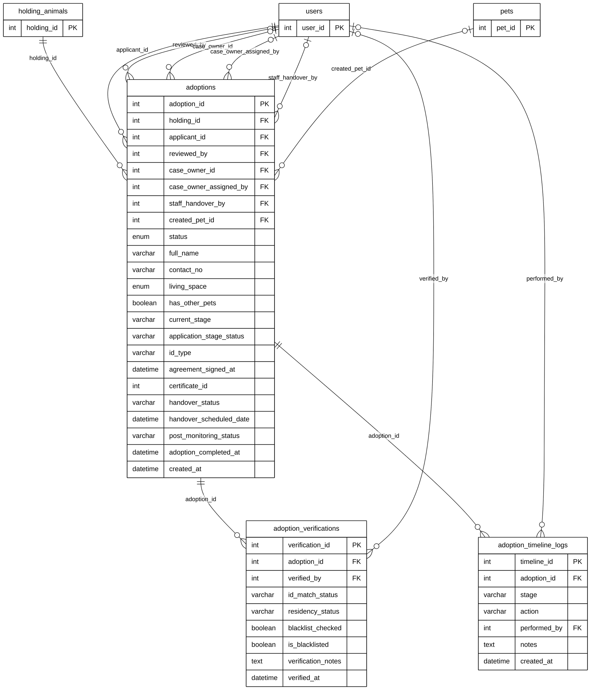

# Module 08A — Application & Verification

> Part of **Module 08 — Adoption** ([index](08_ADOPTION_ERD.md)). Source of truth: the SQLAlchemy models, checked against the live MySQL schema.
> Documentation only — no database or code was changed.

## 1. Purpose

A resident applies to adopt an animal that the holding facility promoted to *For Adoption*. The application (`adoptions`) records the applicant's details and ID, and moves through stages in `current_stage` (Application, Review, Interview, Home_Visit, Approval, Handover, Certificate, Monitoring, Successful_Adoption). One barangay staff member owns the case (`case_owner_id`). Staff verify the applicant's ID, residency and blacklist status (`adoption_verifications`). Every action is written to the adoption timeline (`adoption_timeline_logs`). When the animal is handed over, a new pet record is created for the adopter (`created_pet_id`).

## 2. Entities

| Entity | Description |
|---|---|
| `adoptions` | The adoption application and case: applicant, stage, review, handover, monitoring status (48 columns; 23 shown, all in section 5) |
| `adoption_verifications` | Staff check of the applicant: ID match, residency, blacklist |
| `adoption_timeline_logs` | One action in the adoption's history: stage, action, who, notes |

**Reference entities** (defined in full elsewhere; shown here with only the key the relationships need):

| Reference entity | Defined in | Key shown |
|---|---|---|
| `holding_animals` | Module 07B | `holding_id` |
| `users` | Module 01 | `user_id` |
| `pets` | Module 03A | `pet_id` |

## 3. Entity Relationship Diagram

> Raw code for Mermaid Live Editor / SVG export: [`mermaid/08a_application_verification.mmd`](mermaid/08a_application_verification.mmd).
> The front-matter block sets the manuscript style (white background, black lines, Arial 16 px, natural size).

`||` exactly one (NOT NULL FK) · `|o` zero or one (nullable FK) · `o{` zero or many · `o|` zero or one (unique FK)

## 4. Relationships and cardinalities

| # | Relationship | Cardinality | FK (child column) | ON DELETE |
|---|---|---|---|---|
| R1 | `holding_animals` → `adoptions` | **One-to-many**, mandatory | `adoptions.holding_id` — the animal being adopted | CASCADE |
| R2 | `users` → `adoptions` | **One-to-many**, mandatory | `adoptions.applicant_id` — the resident applying | CASCADE |
| R3 | `users` → `adoptions` | **One-to-many**, optional | `adoptions.reviewed_by` — who approved or rejected | SET NULL |
| R4 | `users` → `adoptions` | **One-to-many**, optional | `adoptions.case_owner_id` — the staff member owning the case | SET NULL |
| R5 | `users` → `adoptions` | **One-to-many**, optional | `adoptions.case_owner_assigned_by` — who assigned the case owner | SET NULL |
| R6 | `users` → `adoptions` | **One-to-many**, optional | `adoptions.staff_handover_by` — who handed the animal over | SET NULL |
| R7 | `pets` → `adoptions` | **One-to-many**, optional | `adoptions.created_pet_id` — the pet record created for the adopter | SET NULL |
| R8 | `adoptions` → `adoption_verifications` | **One-to-many**, mandatory | `adoption_verifications.adoption_id` — verifications of the applicant | CASCADE |
| R9 | `users` → `adoption_verifications` | **One-to-many**, optional | `adoption_verifications.verified_by` — who verified | SET NULL |
| R10 | `adoptions` → `adoption_timeline_logs` | **One-to-many**, mandatory | `adoption_timeline_logs.adoption_id` — the adoption's history | CASCADE |
| R11 | `users` → `adoption_timeline_logs` | **One-to-many**, optional | `adoption_timeline_logs.performed_by` — who performed the action | SET NULL |

**One animal, many applications:** `holding_animals → adoptions` is one-to-many. Several residents can apply for the
same animal; only one application is approved and handed over.

**Five links to `users`** on `adoptions` are separate roles (applicant, reviewer, case owner, case-owner assigner,
handover staff). They do not make the relationship many-to-many.

### Not drawn: reference without a foreign key
`adoptions.certificate_id` (→ adoption_certificates) is a plain integer. The real link runs the other way:
`adoption_certificates.adoption_id` (unique), drawn in 08D.

### Model vs. live database
| Item | Model | Live database |
|---|---|---|
| `adoptions.staff_handover_by → users` | FK, ON DELETE SET NULL | **no FK** (drawn, model is the source of truth) |
| `manual_applicant_name`, `manual_applicant_email`, `manual_applicant_phone`, `manual_applicant_address`, `manual_id_type_number`, `is_manual_walkin`, `handover_evidence_url` | not in the model | columns exist (walk-in applicants); **not used** by the application |

Live data: 4 applications (3 Approved, 1 Rejected).

## 5. Complete column list — `adoptions`

| Column | Type | Null | Key |
|---|---|---|---|
| `adoption_id` | Integer | NOT NULL | PK |
| `holding_id` | Integer | NOT NULL | FK → `holding_animals` |
| `applicant_id` | Integer | NOT NULL | FK → `users` |
| `status` | Enum (Pending, Approved, Rejected, Cancelled) | NOT NULL |  |
| `full_name` | String(150) | NOT NULL |  |
| `address` | Text | NOT NULL |  |
| `contact_no` | String(20) | NOT NULL |  |
| `has_other_pets` | Boolean | NOT NULL |  |
| `living_space` | Enum (House with yard, Apartment, Condo, Other) | NOT NULL |  |
| `reason` | Text | NOT NULL |  |
| `reviewed_by` | Integer | NULL | FK → `users` |
| `reviewer_role` | Enum (Barangay Head Officer, Barangay Staff, Admin) | NULL |  |
| `review_notes` | Text | NULL |  |
| `reviewed_at` | DateTime | NULL |  |
| `created_at` | DateTime | NOT NULL |  |
| `updated_at` | DateTime | NOT NULL |  |
| `id_type` | String(100) | NULL |  |
| `id_number` | String(255) | NULL |  |
| `id_photo_url` | String(255) | NULL |  |
| `is_handed_over` | Boolean | NOT NULL |  |
| `handover_date` | DateTime | NULL |  |
| `staff_handed_over` | Boolean | NOT NULL |  |
| `staff_handover_date` | DateTime | NULL |  |
| `staff_handover_by` | Integer | NULL | FK → `users` |
| `created_pet_id` | Integer | NULL | FK → `pets` |
| `cancellation_reason` | Text | NULL |  |
| `cancelled_at` | DateTime | NULL |  |
| `current_stage` | String(50) | NOT NULL |  |
| `application_stage_status` | String(50) | NOT NULL |  |
| `agreement_signed_at` | DateTime | NULL |  |
| `agreement_signature_url` | String(500) | NULL |  |
| `certificate_id` | Integer | NULL |  |
| `is_certificate_sent` | Boolean | NOT NULL |  |
| `certificate_sent_at` | DateTime | NULL |  |
| `handover_location` | String(255) | NULL |  |
| `handover_scheduled_date` | DateTime | NULL |  |
| `handover_scheduled_time` | String(50) | NULL |  |
| `handover_assigned_staff` | String(100) | NULL |  |
| `handover_notes` | Text | NULL |  |
| `handover_status` | String(50) | NULL |  |
| `resident_handover_confirmed` | Boolean | NOT NULL |  |
| `resident_handover_confirmed_at` | DateTime | NULL |  |
| `case_owner_id` | Integer | NULL | FK → `users` |
| `case_owner_assigned_at` | DateTime | NULL |  |
| `case_owner_assigned_by` | Integer | NULL | FK → `users` |
| `handover_photo_url` | String(500) | NULL |  |
| `post_monitoring_status` | String(50) | NOT NULL |  |
| `adoption_completed_at` | DateTime | NULL |  |
