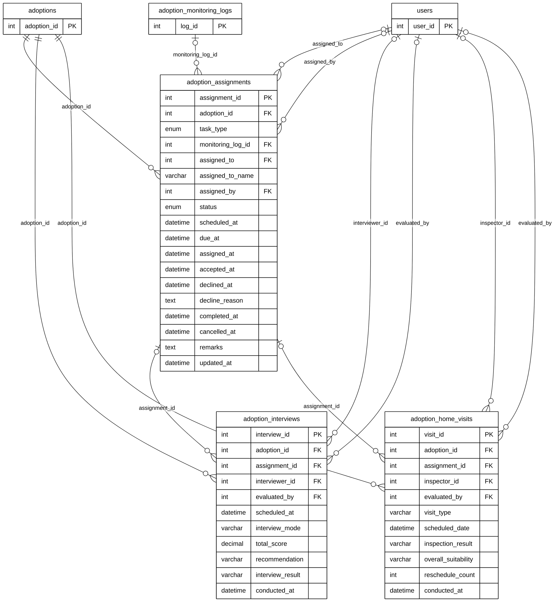

# Module 08B — Staff Assignments & Screening

> Part of **Module 08 — Adoption** ([index](08_ADOPTION_ERD.md)). Source of truth: the SQLAlchemy models, checked against the live MySQL schema.
> Documentation only — no database or code was changed.

## 1. Purpose

The barangay assigns adoption tasks to staff (`adoption_assignments`: verification, interview, home visit, handover or monitoring). The assignee accepts or declines and completes the task. Screening produces an **interview** (scores on care knowledge, financial readiness and environment; recommendation) and a **home visit** (safety checklist, GPS, photos, suitability). Each screening record can point to the assignment it was done for.

## 2. Entities

| Entity | Description |
|---|---|
| `adoption_assignments` | A task assigned to a staff member for an adoption: type, status, schedule, accept / decline (18 columns, all shown) |
| `adoption_interviews` | The applicant interview: mode, scores, recommendation, result (19 columns; 11 shown, all in section 5) |
| `adoption_home_visits` | The home inspection: checklist, GPS, photos, suitability, reschedules (28 columns; 11 shown, all in section 5) |

**Reference entities** (defined in full elsewhere; shown here with only the key the relationships need):

| Reference entity | Defined in | Key shown |
|---|---|---|
| `adoptions` | Module 08A | `adoption_id` |
| `users` | Module 01 | `user_id` |
| `adoption_monitoring_logs` | Module 08C | `log_id` |

## 3. Entity Relationship Diagram

> Raw code for Mermaid Live Editor / SVG export: [`mermaid/08b_assignments_screening.mmd`](mermaid/08b_assignments_screening.mmd).
> The front-matter block sets the manuscript style (white background, black lines, Arial 16 px, natural size).

`||` exactly one (NOT NULL FK) · `|o` zero or one (nullable FK) · `o{` zero or many · `o|` zero or one (unique FK)

## 4. Relationships and cardinalities

| # | Relationship | Cardinality | FK (child column) | ON DELETE |
|---|---|---|---|---|
| R1 | `adoptions` → `adoption_assignments` | **One-to-many**, mandatory | `adoption_assignments.adoption_id` — the adoption the task is for | CASCADE |
| R2 | `users` → `adoption_assignments` | **One-to-many**, optional | `adoption_assignments.assigned_to` — the staff member doing the task | SET NULL |
| R3 | `users` → `adoption_assignments` | **One-to-many**, optional | `adoption_assignments.assigned_by` — who assigned it | SET NULL |
| R4 | `adoption_monitoring_logs` → `adoption_assignments` | **One-to-many**, optional | `adoption_assignments.monitoring_log_id` — the monitoring check a Monitoring task is for | SET NULL |
| R5 | `adoptions` → `adoption_interviews` | **One-to-many**, mandatory | `adoption_interviews.adoption_id` — the adoption interviewed for | CASCADE |
| R6 | `adoption_assignments` → `adoption_interviews` | **One-to-many**, optional | `adoption_interviews.assignment_id` — the Interview task | SET NULL |
| R7 | `users` → `adoption_interviews` | **One-to-many**, optional | `adoption_interviews.interviewer_id` — the interviewer | SET NULL |
| R8 | `users` → `adoption_interviews` | **One-to-many**, optional | `adoption_interviews.evaluated_by` — who evaluated the result | SET NULL |
| R9 | `adoptions` → `adoption_home_visits` | **One-to-many**, mandatory | `adoption_home_visits.adoption_id` — the adoption visited for | CASCADE |
| R10 | `adoption_assignments` → `adoption_home_visits` | **One-to-many**, optional | `adoption_home_visits.assignment_id` — the Home Visit task | SET NULL |
| R11 | `users` → `adoption_home_visits` | **One-to-many**, optional | `adoption_home_visits.inspector_id` — the inspector | SET NULL |
| R12 | `users` → `adoption_home_visits` | **One-to-many**, optional | `adoption_home_visits.evaluated_by` — who evaluated the result | SET NULL |

**Assignments link both ways with monitoring.** `adoption_assignments.monitoring_log_id → adoption_monitoring_logs`
(this submodule) and `adoption_monitoring_logs.assignment_id → adoption_assignments` (08C) are two separate optional
one-to-many relationships. A Monitoring task points to the check it is for, and a check records the task that
produced it.

`adoption_assignments.task_type`: Verification, Interview, Home_Visit, Handover, Monitoring, Other.

## 5. Complete column lists

### `adoption_interviews`

| Column | Type | Null | Key |
|---|---|---|---|
| `interview_id` | Integer | NOT NULL | PK |
| `adoption_id` | Integer | NOT NULL | FK → `adoptions` |
| `interviewer_id` | Integer | NULL | FK → `users` |
| `scheduled_at` | DateTime | NULL |  |
| `interview_mode` | String(50) | NOT NULL |  |
| `meeting_link` | String(500) | NULL |  |
| `score_care_knowledge` | Integer | NULL |  |
| `score_financial_readiness` | Integer | NULL |  |
| `score_environment_suitability` | Integer | NULL |  |
| `total_score` | Numeric | NULL |  |
| `recommendation` | String(50) | NOT NULL |  |
| `interview_notes` | Text | NULL |  |
| `conducted_at` | DateTime | NULL |  |
| `assignment_id` | Integer | NULL | FK → `adoption_assignments` |
| `evaluated_by` | Integer | NULL | FK → `users` |
| `interview_result` | String(50) | NULL |  |
| `questions_discussed` | Text | NULL |  |
| `applicant_responses` | Text | NULL |  |
| `additional_observations` | Text | NULL |  |

### `adoption_home_visits`

| Column | Type | Null | Key |
|---|---|---|---|
| `visit_id` | Integer | NOT NULL | PK |
| `adoption_id` | Integer | NOT NULL | FK → `adoptions` |
| `inspector_id` | Integer | NULL | FK → `users` |
| `visit_type` | String(50) | NOT NULL |  |
| `scheduled_date` | DateTime | NULL |  |
| `is_fencing_secure` | Boolean | NOT NULL |  |
| `is_shelter_adequate` | Boolean | NOT NULL |  |
| `hazard_free` | Boolean | NOT NULL |  |
| `checklist_notes` | Text | NULL |  |
| `gps_latitude` | Numeric | NULL |  |
| `gps_longitude` | Numeric | NULL |  |
| `visit_photos` | JSON | NULL |  |
| `inspection_result` | String(50) | NOT NULL |  |
| `conducted_at` | DateTime | NULL |  |
| `assignment_id` | Integer | NULL | FK → `adoption_assignments` |
| `evaluated_by` | Integer | NULL | FK → `users` |
| `reschedule_count` | Integer | NOT NULL |  |
| `last_rescheduled_at` | DateTime | NULL |  |
| `reschedule_reason` | Text | NULL |  |
| `residence_condition` | String(100) | NULL |  |
| `available_living_space` | String(100) | NULL |  |
| `environment_safety` | String(100) | NULL |  |
| `cleanliness_sanitation` | String(100) | NULL |  |
| `presence_of_hazards` | String(255) | NULL |  |
| `existing_pets` | String(255) | NULL |  |
| `overall_suitability` | String(50) | NULL |  |
| `recommendations` | Text | NULL |  |
| `additional_observations` | Text | NULL |  |
