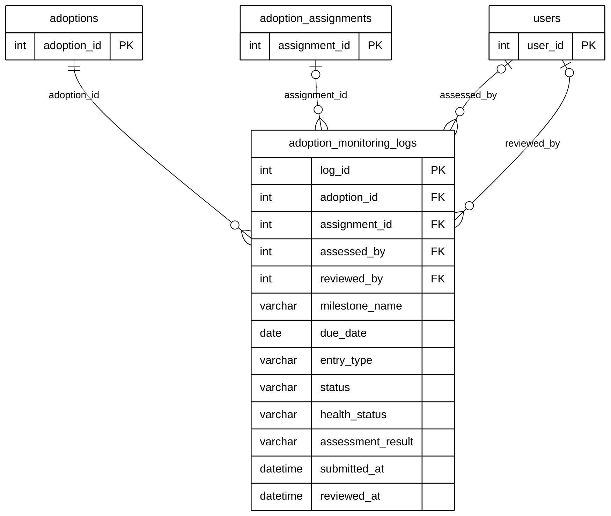

# Module 08C — Post-Adoption Monitoring

> Part of **Module 08 — Adoption** ([index](08_ADOPTION_ERD.md)). Source of truth: the SQLAlchemy models, checked against the live MySQL schema.
> Documentation only — no database or code was changed.

## 1. Purpose

After handover the adopter is monitored for a period. Each **monitoring log** is a milestone check-in: the adopter submits photos, a vet record and notes, or a staff member assesses the animal on site (condition, living conditions, food and water, shelter, vaccination). A staff member reviews each entry.

## 2. Entities

| Entity | Description |
|---|---|
| `adoption_monitoring_logs` | One monitoring milestone: adopter submission or staff assessment, and its review (25 columns; 13 shown, all in section 5) |

**Reference entities** (defined in full elsewhere; shown here with only the key the relationships need):

| Reference entity | Defined in | Key shown |
|---|---|---|
| `adoptions` | Module 08A | `adoption_id` |
| `adoption_assignments` | Module 08B | `assignment_id` |
| `users` | Module 01 | `user_id` |

## 3. Entity Relationship Diagram

> Raw code for Mermaid Live Editor / SVG export: [`mermaid/08c_post_adoption_monitoring.mmd`](mermaid/08c_post_adoption_monitoring.mmd).
> The front-matter block sets the manuscript style (white background, black lines, Arial 16 px, natural size).

`||` exactly one (NOT NULL FK) · `|o` zero or one (nullable FK) · `o{` zero or many · `o|` zero or one (unique FK)

## 4. Relationships and cardinalities

| # | Relationship | Cardinality | FK (child column) | ON DELETE |
|---|---|---|---|---|
| R1 | `adoptions` → `adoption_monitoring_logs` | **One-to-many**, mandatory | `adoption_monitoring_logs.adoption_id` — the adoption being monitored | CASCADE |
| R2 | `adoption_assignments` → `adoption_monitoring_logs` | **One-to-many**, optional | `adoption_monitoring_logs.assignment_id` — the Monitoring task that produced the entry | SET NULL |
| R3 | `users` → `adoption_monitoring_logs` | **One-to-many**, optional | `adoption_monitoring_logs.assessed_by` — staff who assessed on site | SET NULL |
| R4 | `users` → `adoption_monitoring_logs` | **One-to-many**, optional | `adoption_monitoring_logs.reviewed_by` — staff who reviewed the entry | SET NULL |

See 08B for the reverse link `adoption_assignments.monitoring_log_id → adoption_monitoring_logs`.

## 5. Complete column list — `adoption_monitoring_logs`

| Column | Type | Null | Key |
|---|---|---|---|
| `log_id` | Integer | NOT NULL | PK |
| `adoption_id` | Integer | NOT NULL | FK → `adoptions` |
| `milestone_name` | String(50) | NOT NULL |  |
| `due_date` | Date | NOT NULL |  |
| `submitted_at` | DateTime | NULL |  |
| `status` | String(50) | NOT NULL |  |
| `health_status` | String(100) | NULL |  |
| `photos` | JSON | NULL |  |
| `vet_record_url` | String(500) | NULL |  |
| `adopter_notes` | Text | NULL |  |
| `reviewed_by` | Integer | NULL | FK → `users` |
| `review_notes` | Text | NULL |  |
| `reviewed_at` | DateTime | NULL |  |
| `entry_type` | String(30) | NOT NULL |  |
| `assignment_id` | Integer | NULL | FK → `adoption_assignments` |
| `assessed_by` | Integer | NULL | FK → `users` |
| `assessed_at` | DateTime | NULL |  |
| `assessment_result` | String(50) | NULL |  |
| `animal_condition` | String(100) | NULL |  |
| `living_condition` | String(100) | NULL |  |
| `food_and_water` | String(100) | NULL |  |
| `shelter_condition` | String(100) | NULL |  |
| `vaccination_status` | String(100) | NULL |  |
| `assessment_notes` | Text | NULL |  |
| `assessment_photos` | JSON | NULL |  |
