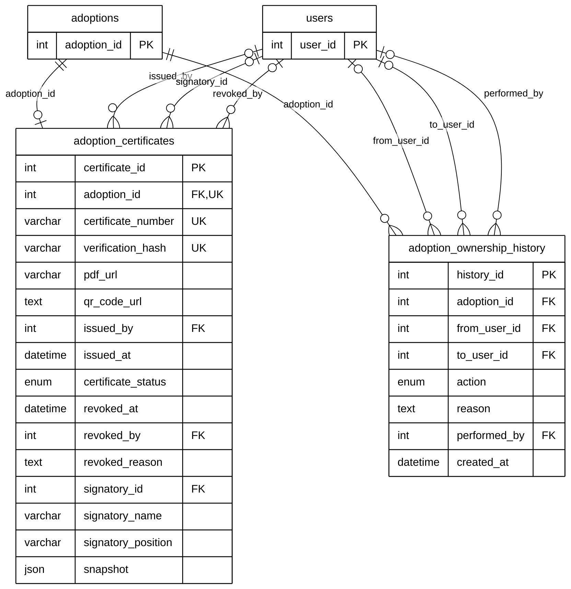

# Module 08D — Certificate & Case Ownership

> Part of **Module 08 — Adoption** ([index](08_ADOPTION_ERD.md)). Source of truth: the SQLAlchemy models, checked against the live MySQL schema.
> Documentation only — no database or code was changed.

## 1. Purpose

A completed adoption receives one **adoption certificate**: a numbered PDF with a QR code and a verification hash that anyone can check, signed by an official, and revocable. `adoption_ownership_history` records how the **staff case owner** of an adoption changed: claimed, auto-claimed on approval, transferred, taken over or released.

## 2. Entities

| Entity | Description |
|---|---|
| `adoption_certificates` | The adoption certificate: number, verification hash, PDF, QR, signatory, status (one per adoption) |
| `adoption_ownership_history` | One change of the staff member who owns the adoption case |

**Reference entities** (defined in full elsewhere; shown here with only the key the relationships need):

| Reference entity | Defined in | Key shown |
|---|---|---|
| `adoptions` | Module 08A | `adoption_id` |
| `users` | Module 01 | `user_id` |

## 3. Entity Relationship Diagram

> Raw code for Mermaid Live Editor / SVG export: [`mermaid/08d_certificate_case_ownership.mmd`](mermaid/08d_certificate_case_ownership.mmd).
> The front-matter block sets the manuscript style (white background, black lines, Arial 16 px, natural size).

`||` exactly one (NOT NULL FK) · `|o` zero or one (nullable FK) · `o{` zero or many · `o|` zero or one (unique FK)

## 4. Relationships and cardinalities

| # | Relationship | Cardinality | FK (child column) | ON DELETE |
|---|---|---|---|---|
| R1 | `adoptions` → `adoption_certificates` | **One-to-one**, mandatory | `adoption_certificates.adoption_id` — one certificate per adoption (unique) | CASCADE |
| R2 | `users` → `adoption_certificates` | **One-to-many**, optional | `adoption_certificates.issued_by` — who issued it | SET NULL |
| R3 | `users` → `adoption_certificates` | **One-to-many**, optional | `adoption_certificates.signatory_id` — the official who signed | SET NULL |
| R4 | `users` → `adoption_certificates` | **One-to-many**, optional | `adoption_certificates.revoked_by` — who revoked it | SET NULL |
| R5 | `adoptions` → `adoption_ownership_history` | **One-to-many**, mandatory | `adoption_ownership_history.adoption_id` — the adoption case | CASCADE |
| R6 | `users` → `adoption_ownership_history` | **One-to-many**, optional | `adoption_ownership_history.from_user_id` — previous case owner | SET NULL |
| R7 | `users` → `adoption_ownership_history` | **One-to-many**, optional | `adoption_ownership_history.to_user_id` — new case owner | SET NULL |
| R8 | `users` → `adoption_ownership_history` | **One-to-many**, optional | `adoption_ownership_history.performed_by` — who made the change | SET NULL |

**One-to-one:** `adoption_certificates.adoption_id` is unique, so an adoption has at most one certificate.
`certificate_number` and `verification_hash` are also unique (public verification).

**Case ownership, not pet ownership:** `adoption_ownership_history` tracks which **staff member** handles the adoption
case. The adopter becomes the pet's owner through `adoptions.created_pet_id → pets` (08A).

**Unused column:** `adoption_certificates.revoked_by` is never set by the application (usage audit, overview §9.2).
The relationship exists in the model and the database, so it stays in the diagram.

`adoption_ownership_history.action`: Claimed, Auto_Claimed_On_Approval, Transferred, Takeover, Released, Auto_Released.
