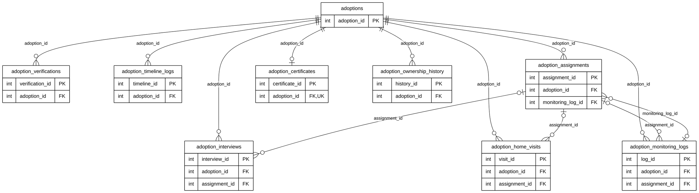

# Module 08 — Adoption (index)

> **Source of truth:** `backend/app/models/report.py` (the nine `Adoption*` classes), checked against the live MySQL
> schema. Documentation only.

## 1. Module purpose

Adopting an animal from the holding facility, end to end:

- the application and its stages;
- applicant verification;
- staff task assignments, the interview and the home visit;
- approval and handover, which creates a new pet record for the adopter;
- the adoption certificate;
- post-adoption monitoring;
- the history of which staff member owns the case.

## 2. Why this module is split into four

As one diagram, Module 08 has **9 tables, 178 columns and 35 relationship lines** (25 of them to `users`). It is the
largest module, and three of its tables have 25–48 columns. It is presented as **four submodules**, one per adoption
phase.

| Submodule                                                                       | Tables defined in full                                                      | Reference entities                                     | Lines                                  |
| ------------------------------------------------------------------------------- | --------------------------------------------------------------------------- | ------------------------------------------------------ | -------------------------------------- |
| [08A — Application &amp; Verification](08A_APPLICATION_VERIFICATION_ERD.md)     | `adoptions`, `adoption_verifications`, `adoption_timeline_logs`       | `holding_animals`, `users`, `pets`               | 11                                     |
| [08B — Staff Assignments &amp; Screening](08B_ASSIGNMENTS_SCREENING_ERD.md)     | `adoption_assignments`, `adoption_interviews`, `adoption_home_visits` | `adoptions`, `users`, `adoption_monitoring_logs` | 12                                     |
| [08C — Post-Adoption Monitoring](08C_POST_ADOPTION_MONITORING_ERD.md)           | `adoption_monitoring_logs`                                                | `adoptions`, `adoption_assignments`, `users`     | 4                                      |
| [08D — Certificate &amp; Case Ownership](08D_CERTIFICATE_CASE_OWNERSHIP_ERD.md) | `adoption_certificates`, `adoption_ownership_history`                   | `adoptions`, `users`                               | 8                                      |
| **Total**                                                                 | **9 tables**                                                          |                                                        | **35** (all of the module's FKs) |

## 3. Module map (keys only)

How the nine tables connect. All of them hang off `adoptions`; the assignment ↔ monitoring pair links both ways.
Raw code: [`mermaid/08_adoption.mmd`](mermaid/08_adoption.mmd).

## 4. Differences between the models and the live database (documentation only)

| Item                                                                                                                                    | Model | Live database | Drawn as   |
| --------------------------------------------------------------------------------------------------------------------------------------- | ----- | ------------- | ---------- |
| `adoptions.staff_handover_by → users`                                                                                                | FK    | no FK         | FK (model) |
| 7 walk-in columns on `adoptions` (`manual_applicant_*`, `manual_id_type_number`, `is_manual_walkin`, `handover_evidence_url`) | —    | exist, unused | not shown  |

## 5. Links to other modules

| Link                                                                                                                       | Module |
| -------------------------------------------------------------------------------------------------------------------------- | ------ |
| `adoptions.holding_id → holding_animals`: the animal comes from the holding facility (facility status *For Adoption*) | 07B    |
| `adoptions.created_pet_id → pets`: the adopted animal becomes the adopter's registered pet                              | 03A    |
| Applicant, reviewers, case owners, staff, signatories                                                                      | 01     |
