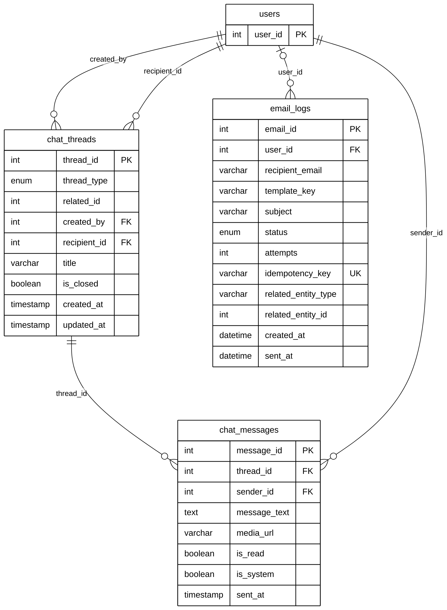

# Module 09A — Chat & Email

> Part of **Module 09 — Communication & Notifications** ([index](09_COMMUNICATION_NOTIFICATIONS_ERD.md)). Source of truth: the SQLAlchemy models, checked against the live MySQL schema.
> Documentation only — no database or code was changed.

## 1. Purpose

Two-person **chat threads** about a report, a pet claim, an adoption or a direct conversation. Each thread has a creator and a recipient, and holds messages, including system messages. Outgoing **emails** (verification codes, status updates, reminders) are queued and logged in `email_logs`, with retries and an idempotency key so the same email is never sent twice.

## 2. Entities

| Entity | Description |
|---|---|
| `chat_threads` | A conversation between two users, about a report, pet claim, adoption or direct |
| `chat_messages` | One message in a thread: text, optional media, read flag, system flag |
| `email_logs` | One outgoing email: template, recipient, status, retries (18 columns; 12 shown, all in section 5) |

**Reference entities** (defined in full elsewhere; shown here with only the key the relationships need):

| Reference entity | Defined in | Key shown |
|---|---|---|
| `users` | Module 01 | `user_id` |

## 3. Entity Relationship Diagram

> Raw code for Mermaid Live Editor / SVG export: [`mermaid/09a_chat_email.mmd`](mermaid/09a_chat_email.mmd).
> The front-matter block sets the manuscript style (white background, black lines, Arial 16 px, natural size).

`||` exactly one (NOT NULL FK) · `|o` zero or one (nullable FK) · `o{` zero or many · `o|` zero or one (unique FK)

## 4. Relationships and cardinalities

| # | Relationship | Cardinality | FK (child column) | ON DELETE |
|---|---|---|---|---|
| R1 | `users` → `chat_threads` | **One-to-many**, mandatory | `chat_threads.created_by` — who started the thread | CASCADE |
| R2 | `users` → `chat_threads` | **One-to-many**, mandatory | `chat_threads.recipient_id` — the other participant | CASCADE |
| R3 | `chat_threads` → `chat_messages` | **One-to-many**, mandatory | `chat_messages.thread_id` — the thread the message is in | CASCADE |
| R4 | `users` → `chat_messages` | **One-to-many**, mandatory | `chat_messages.sender_id` — who sent it | CASCADE |
| R5 | `users` → `email_logs` | **One-to-many**, optional | `email_logs.user_id` — the user the email is for (NULL for non-users) | SET NULL |

**Two participants per thread:** `created_by` and `recipient_id` are two separate one-to-many links to `users`. A
user takes part in many threads, and each thread has exactly two participants.

### Not drawn: polymorphic references
- `chat_threads.related_id` holds the ID of the report, pet claim or adoption the thread is about. Which table it refers
  to depends on `thread_type` (`Report`, `Pet_Claim`, `Adoption`, `Direct`), so it **cannot be a foreign key**.
- `email_logs.related_entity_type` + `related_entity_id` work the same way.

Both are documented as attributes, not lines.

**Value sets and live data:**
- `email_logs.status`: Pending, Sent, Failed, Simulated, Expired.
- Live: 39 threads (23 Report, 16 Direct), 70 messages, 187 emails (134 Sent, 46 Failed, 7 Expired).

### Model vs. live database
No differences for these three tables.

## 5. Complete column list — `email_logs`

| Column | Type | Null | Key |
|---|---|---|---|
| `email_id` | Integer | NOT NULL | PK |
| `user_id` | Integer | NULL | FK → `users` |
| `recipient_email` | String(255) | NOT NULL |  |
| `template_key` | String(100) | NOT NULL |  |
| `subject` | String(255) | NOT NULL |  |
| `status` | Enum (Pending, Sent, Failed, Simulated, Expired) | NOT NULL |  |
| `attempts` | Integer | NOT NULL |  |
| `max_attempts` | Integer | NOT NULL |  |
| `error_message` | Text | NULL |  |
| `idempotency_key` | String(120) | NULL | UK |
| `related_entity_type` | String(50) | NULL |  |
| `related_entity_id` | Integer | NULL |  |
| `text_body` | Text | NULL |  |
| `html_body` | Text | NULL |  |
| `next_attempt_at` | DateTime | NULL |  |
| `last_attempt_at` | DateTime | NULL |  |
| `created_at` | DateTime | NOT NULL |  |
| `sent_at` | DateTime | NULL |  |
