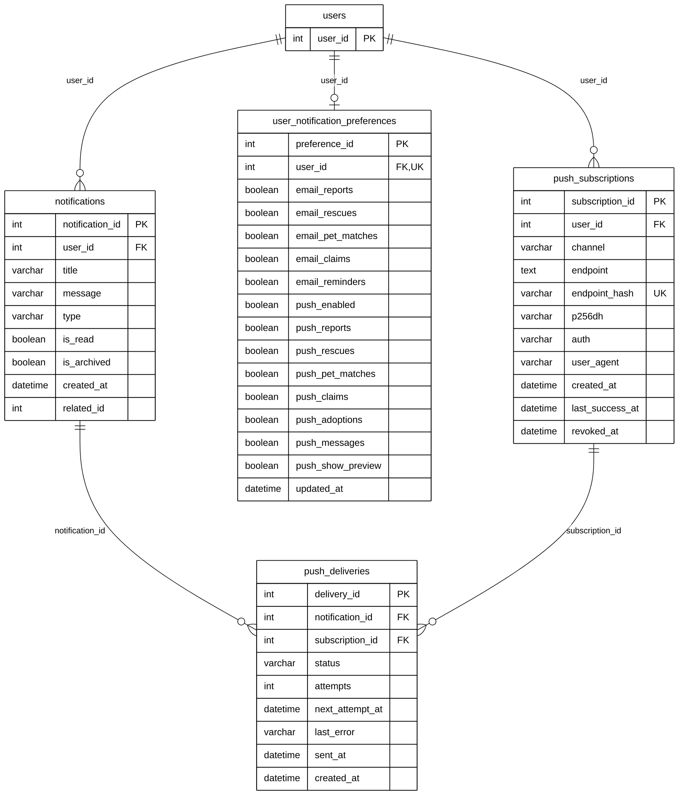

# Module 09B — Notifications & Push Delivery

> Part of **Module 09 — Communication & Notifications** ([index](09_COMMUNICATION_NOTIFICATIONS_ERD.md)). Source of truth: the SQLAlchemy models, checked against the live MySQL schema.
> Documentation only — no database or code was changed.

## 1. Purpose

In-app **notifications** for each user (with read and archived flags). Each user has one set of **notification preferences** (which events to receive by email and by push). A user's devices and browsers register **push subscriptions**. Every push of a notification to a device is tracked as a **push delivery**, with status and retries.

## 2. Entities

| Entity | Description |
|---|---|
| `notifications` | One in-app notification for a user: title, message, type, read / archived |
| `user_notification_preferences` | The user's email and push settings per event type (one row per user) |
| `push_subscriptions` | One device / browser registered for push (Web Push endpoint and keys) |
| `push_deliveries` | One push of one notification to one subscription: status, attempts, error. Associative entity between `notifications` and `push_subscriptions` (many-to-many) |

**Reference entities** (defined in full elsewhere; shown here with only the key the relationships need):

| Reference entity | Defined in | Key shown |
|---|---|---|
| `users` | Module 01 | `user_id` |

## 3. Entity Relationship Diagram

> Raw code for Mermaid Live Editor / SVG export: [`mermaid/09b_notifications_push.mmd`](mermaid/09b_notifications_push.mmd).
> The front-matter block sets the manuscript style (white background, black lines, Arial 16 px, natural size).

`||` exactly one (NOT NULL FK) · `|o` zero or one (nullable FK) · `o{` zero or many · `o|` zero or one (unique FK)

## 4. Relationships and cardinalities

| # | Relationship | Cardinality | FK (child column) | ON DELETE |
|---|---|---|---|---|
| R1 | `users` → `notifications` | **One-to-many**, mandatory | `notifications.user_id` — the user notified | no action |
| R2 | `users` → `user_notification_preferences` | **One-to-one**, mandatory | `user_notification_preferences.user_id` — one preferences row per user (unique) | CASCADE |
| R3 | `users` → `push_subscriptions` | **One-to-many**, mandatory | `push_subscriptions.user_id` — the user's registered devices | CASCADE |
| R4 | `notifications` → `push_deliveries` | **One-to-many**, mandatory | `push_deliveries.notification_id` — the notification pushed | CASCADE |
| R5 | `push_subscriptions` → `push_deliveries` | **One-to-many**, mandatory | `push_deliveries.subscription_id` — the device it was pushed to | CASCADE |

### Many-to-many: notifications ↔ push_subscriptions through `push_deliveries`
One notification is pushed to all of the user's devices, and a device receives many notifications.
`push_deliveries` resolves this. Its composite unique key (`notification_id`, `subscription_id`) means a notification
is delivered **at most once** to each device.

**One-to-one:** `user_notification_preferences.user_id` is unique, so a user has at most one preferences row.

### Not drawn: polymorphic reference
`notifications.related_id` points to the report, claim, adoption or pet the notification is about. Which table it
refers to depends on `type`, so it is not a foreign key.

### Model vs. live database
| Item | Model | Live database |
|---|---|---|
| `notifications.user_id → users` | FK, no ON DELETE | FK, **ON DELETE CASCADE** |

Cardinality is the same.

Live: 803 notifications, 4 preference rows, 21 push subscriptions (all `webpush`), 40 push deliveries.

## 5. Complete column list — `user_notification_preferences`

| Column | Type | Null | Key |
|---|---|---|---|
| `preference_id` | Integer | NOT NULL | PK |
| `user_id` | Integer | NOT NULL | FK → `users`, UK |
| `email_reports` | Boolean | NOT NULL |  |
| `email_rescues` | Boolean | NOT NULL |  |
| `email_pet_matches` | Boolean | NOT NULL |  |
| `email_claims` | Boolean | NOT NULL |  |
| `email_reminders` | Boolean | NOT NULL |  |
| `push_enabled` | Boolean | NOT NULL |  |
| `push_reports` | Boolean | NOT NULL |  |
| `push_rescues` | Boolean | NOT NULL |  |
| `push_pet_matches` | Boolean | NOT NULL |  |
| `push_claims` | Boolean | NOT NULL |  |
| `push_adoptions` | Boolean | NOT NULL |  |
| `push_messages` | Boolean | NOT NULL |  |
| `push_show_preview` | Boolean | NOT NULL |  |
| `updated_at` | DateTime | NOT NULL |  |
