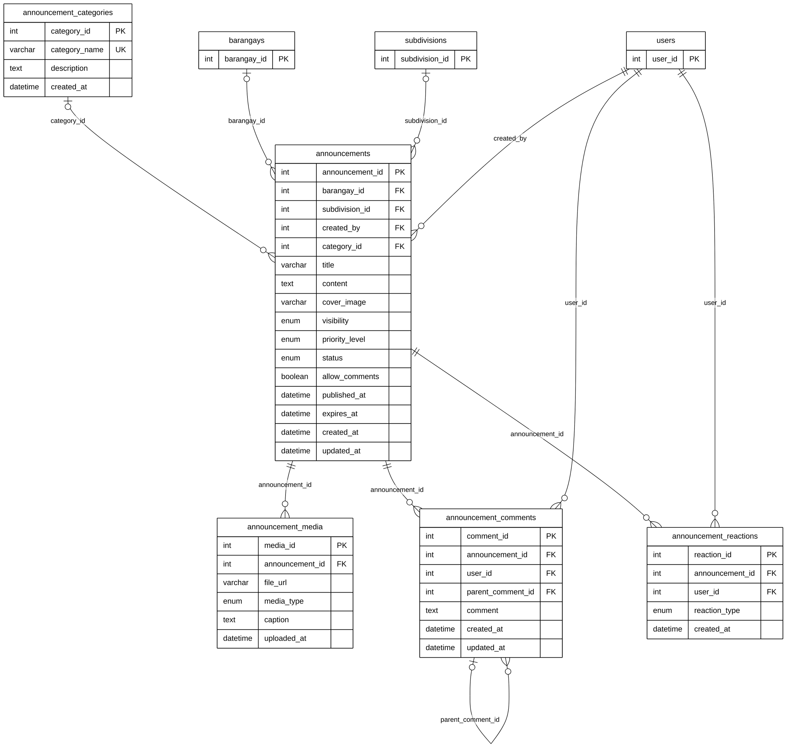

# Module 10 — Announcements

> Source of truth: the SQLAlchemy models, checked against the live MySQL schema.
> Documentation only — no database or code was changed.

## 1. Purpose

Community alerts and advisories posted by barangay staff and Subdivision Leaders (Community Alerts / Hazard Alert pages), shown on residents' home feed. An announcement has a category (Emergency Alert, Rabies Alert, Lost and Found, …), an audience (public, one barangay or one subdivision), a priority and a publish / expiry window. It can carry photos, videos or documents, and residents can comment (threaded replies) and react.

## 2. Entities

| Entity | Description |
|---|---|
| `announcement_categories` | Lookup: Emergency Alert, General Advisory, Community Event, Lost and Found, Rabies Alert, Rescue Operation |
| `announcements` | One announcement: title, content, audience, priority, status, publish and expiry dates |
| `announcement_media` | A photo, video or document attached to an announcement |
| `announcement_comments` | A comment on an announcement; replies point to their parent comment |
| `announcement_reactions` | A user's reaction (Like, Heart, Care). Associative entity between `announcements` and `users` (many-to-many) |

**Reference entities** (defined in full elsewhere; shown here with only the key the relationships need):

| Reference entity | Defined in | Key shown |
|---|---|---|
| `users` | Module 01 | `user_id` |
| `barangays` | Module 02 | `barangay_id` |
| `subdivisions` | Module 02 | `subdivision_id` |

## 3. Entity Relationship Diagram

> Raw code for Mermaid Live Editor / SVG export: [`mermaid/10_announcements.mmd`](mermaid/10_announcements.mmd).
> The front-matter block sets the manuscript style (white background, black lines, Arial 16 px, natural size).

`||` exactly one (NOT NULL FK) · `|o` zero or one (nullable FK) · `o{` zero or many · `o|` zero or one (unique FK)

## 4. Relationships and cardinalities

| # | Relationship | Cardinality | FK (child column) | ON DELETE |
|---|---|---|---|---|
| R1 | `announcement_categories` → `announcements` | **One-to-many**, optional | `announcements.category_id` — the category | SET NULL |
| R2 | `barangays` → `announcements` | **One-to-many**, optional | `announcements.barangay_id` — barangay audience | SET NULL |
| R3 | `subdivisions` → `announcements` | **One-to-many**, optional | `announcements.subdivision_id` — subdivision audience | SET NULL |
| R4 | `users` → `announcements` | **One-to-many**, mandatory | `announcements.created_by` — the author | CASCADE |
| R5 | `announcements` → `announcement_media` | **One-to-many**, mandatory | `announcement_media.announcement_id` — attached files | CASCADE |
| R6 | `announcements` → `announcement_comments` | **One-to-many**, mandatory | `announcement_comments.announcement_id` — comments on it | CASCADE |
| R7 | `users` → `announcement_comments` | **One-to-many**, mandatory | `announcement_comments.user_id` — the commenter | CASCADE |
| R8 | `announcement_comments` → `announcement_comments` | **One-to-many**, optional | `announcement_comments.parent_comment_id` — the comment replied to (self-relationship) | CASCADE |
| R9 | `announcements` → `announcement_reactions` | **One-to-many**, mandatory | `announcement_reactions.announcement_id` — reactions to it | CASCADE |
| R10 | `users` → `announcement_reactions` | **One-to-many**, mandatory | `announcement_reactions.user_id` — who reacted | CASCADE |

### Many-to-many: announcements ↔ users through `announcement_reactions`
Many users react to an announcement, and a user reacts to many announcements. `announcement_reactions` resolves this
and stores the reaction type. In the live database a composite **UNIQUE (`announcement_id`, `user_id`)** allows one
reaction per user per announcement; the model does not declare it.

**Self-relationship:** `announcement_comments.parent_comment_id → announcement_comments` makes threaded replies.

**Audience:** `barangay_id` and `subdivision_id` are both optional. Together with `visibility` (Public, Subdivision Only,
Barangay Only) they decide who sees the announcement.

### Unused columns (usage audit, overview §9.2)
- `announcements.cover_image`: never set. Images use `announcement_media`.
- `announcements.allow_comments`: never checked; comments are always allowed.

Both stay in the diagram because they exist in the model and the database.

### Model vs. live database
| Item | Model | Live database |
|---|---|---|
| `announcements.barangay_id → barangays` | FK, ON DELETE SET NULL | **no FK** (drawn, model is the source of truth) |
| `announcement_reactions` (`announcement_id`, `user_id`) | no unique key | **UNIQUE** |
| `announcement_media.created_at` | not in the model | column exists, unused |

### Live data
6 categories. **0 announcements, media, comments and reactions.** The feature is built and reachable (Community
Alerts, Hazard Alert and the resident home feed call `/announcements`), but no announcement has been posted yet.

## 5. Complete column list — `announcements`

| Column | Type | Null | Key |
|---|---|---|---|
| `announcement_id` | Integer | NOT NULL | PK |
| `barangay_id` | Integer | NULL | FK → `barangays` |
| `subdivision_id` | Integer | NULL | FK → `subdivisions` |
| `created_by` | Integer | NOT NULL | FK → `users` |
| `category_id` | Integer | NULL | FK → `announcement_categories` |
| `title` | String(255) | NOT NULL |  |
| `content` | Text | NOT NULL |  |
| `cover_image` | String(255) | NULL |  |
| `visibility` | Enum (Public, Subdivision Only, Barangay Only) | NULL |  |
| `priority_level` | Enum (Low, Normal, High, Emergency) | NULL |  |
| `status` | Enum (Draft, Published, Archived) | NULL |  |
| `allow_comments` | Boolean | NULL |  |
| `published_at` | DateTime | NULL |  |
| `expires_at` | DateTime | NULL |  |
| `created_at` | DateTime | NULL |  |
| `updated_at` | DateTime | NULL |  |

## 6. Related modules

| Module | Link |
|---|---|
| 01 User & Access Management | Author, commenters and reacting users |
| 02 Location & Coverage | Barangay or subdivision audience |

