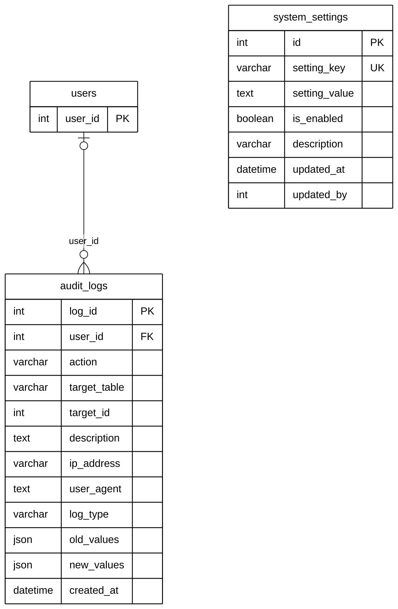

# Module 11 — Administration & System

> Source of truth: the SQLAlchemy models, checked against the live MySQL schema.
> Documentation only — no database or code was changed.

## 1. Purpose

System-wide records for administration. `audit_logs` is the audit trail: who did what, to which record, from which IP and device, with the values before and after. Entries are typed as `operation`, `security` or `enforcement`. `system_settings` holds key / value switches and counters that the administrator or the system itself manages, such as turning Gemini Vision matching on or off, the AI worker's heartbeat, and the pet reference-code sequence.

## 2. Entities

| Entity | Description |
|---|---|
| `audit_logs` | One audited action: actor, action, target table and ID, description, IP, user agent, old / new values |
| `system_settings` | One system setting: unique key, value, enabled flag, who and when it was last updated |

**Reference entities** (defined in full elsewhere; shown here with only the key the relationships need):

| Reference entity | Defined in | Key shown |
|---|---|---|
| `users` | Module 01 | `user_id` |

## 3. Entity Relationship Diagram

> Raw code for Mermaid Live Editor / SVG export: [`mermaid/11_administration_system.mmd`](mermaid/11_administration_system.mmd).
> The front-matter block sets the manuscript style (white background, black lines, Arial 16 px, natural size).

`||` exactly one (NOT NULL FK) · `|o` zero or one (nullable FK) · `o{` zero or many · `o|` zero or one (unique FK)

## 4. Relationships and cardinalities

| # | Relationship | Cardinality | FK (child column) | ON DELETE |
|---|---|---|---|---|
| R1 | `users` → `audit_logs` | **One-to-many**, optional | `audit_logs.user_id` — who performed the action (NULL for system actions) | SET NULL |

### Why `audit_logs` has only one line
`audit_logs` records actions on **any** table. It stores `target_table` + `target_id` (for example `pets` / 16) instead
of one foreign key per table. Because this reference is **polymorphic** (it points to different tables), it cannot be a
foreign key and is shown as attributes. Its only foreign key is the actor, `user_id → users` (ON DELETE SET NULL, so the
log entry survives if the user is deleted).

**Audit log as a record of decisions.** Besides the activity trail, some workflow decisions are stored as typed audit
entries instead of in new tables (no schema change), for example:
- pet-record merge requests, the owner's answers and reminders;
- "not the same pet" dismissals;
- leader reviews of merged sightings.

They are read back by their `action` value. Live: 1,009 entries (579 operation, 429 security, 1 enforcement).

### `system_settings` — no line in the diagram
- `updated_by` holds the ID of the user who last changed a setting. The **live database has a foreign key** here
  (`updated_by → users`, ON DELETE SET NULL), but the **model declares none**. Following overview decision C (the
  models are the source of truth), it is **not drawn**, the same treatment as `reports.pet_id` in Module 04A.
- The table is a stand-alone key / value store. Live keys: `gemini_vision_matching` (AI matching switch),
  `ai_worker_heartbeat` (AI worker health, Module 06) and `pet_reference_seq` (next pet reference code, Module 03A).

### Model vs. live database
| Item | Model | Live database |
|---|---|---|
| `system_settings.updated_by → users` | plain integer | **FK**, ON DELETE SET NULL |

All other columns and foreign keys match.

## 5. Related modules

| Module | Link |
|---|---|
| 01 User & Access Management | The actor of every audit entry; admin users change settings |
| All modules | `audit_logs.target_table` / `target_id` can point to a record in any table |
| 03 Pet Management | `pet_reference_seq` numbers new pets; merge requests and dismissals are audit entries |
| 06 AI Matching | `gemini_vision_matching` switch and the `ai_worker_heartbeat` |

