# Module 12 — Complete System ERD

> **Source of truth:** all SQLAlchemy models (`Base.metadata`). Generated, not hand-drawn: every table, key and line
> below is read from the models. Documentation only.

## 1. Purpose

The database-wide reference: all **60 tables** and all **147 declared foreign keys** in one diagram, grouped by module,
plus the one dashed reference (`ai_jobs.report_id`). Use it to show how the modules connect. For reading individual
tables, use the module and submodule diagrams (01–11), which show the business columns.

> **For the manuscript:** this diagram is too large for an A4 / Letter body page. Place it on a **landscape A3 page** in
> the appendix, or as a digital appendix (SVG). In the body, use the module map in
> [00_ERD_MODULE_OVERVIEW.md §7.1](00_ERD_MODULE_OVERVIEW.md) to show how the modules relate.

## 2. Coverage check

The 147 relationship lines here were compared with the 11 module diagrams:

| Check | Result |
|---|---|
| Foreign keys declared in the models | 147 |
| Drawn across the module diagrams (01–11) | 147 — none missing, none extra |
| Drawn in this complete ERD | 147 solid + 1 dashed |
| Drawn in more than one module | 1, by design: `barangays → subdivisions` is repeated in Module 01 for context |

| Module | Tables | Foreign keys (from its tables) |
|---|---|---|
| 01 User & Access Management | 5 | 5 |
| 02 Location & Coverage | 4 | 5 |
| 03 Pet Management | 7 | 20 |
| 04 Stray Reporting | 9 | 33 |
| 05 Verification, Claims & Reunification | 3 | 11 |
| 06 AI Matching | 3 | 4 |
| 07 Rescue & Holding Operations | 6 | 13 |
| 08 Adoption | 9 | 35 |
| 09 Communication & Notifications | 7 | 10 |
| 10 Announcements | 5 | 10 |
| 11 Administration & System | 2 | 1 |
| **Total** | **60** | **147** |

## 3. Two versions

| Version | Shows | Best for | File |
|---|---|---|---|
| **A. Keys** | Every table with its PK, FK and UK columns | Appendix reference (A3) | [`mermaid/12_complete_system_keys.mmd`](mermaid/12_complete_system_keys.mmd) |
| **B. Compact** | Table names and relationship lines only | Presentation slide / overview poster | [`mermaid/12_complete_system_compact.mmd`](mermaid/12_complete_system_compact.mmd) |

Both use the same manuscript style (white background, black lines, Arial 16 px, natural size).

## 4. Version A — keys

```mermaid
---
config:
  theme: base
  themeVariables:
    background: "#ffffff"
    primaryColor: "#ffffff"
    primaryTextColor: "#000000"
    primaryBorderColor: "#000000"
    lineColor: "#000000"
    textColor: "#000000"
    secondaryColor: "#ffffff"
    tertiaryColor: "#ffffff"
    attributeBackgroundColorOdd: "#ffffff"
    attributeBackgroundColorEven: "#f2f2f2"
    fontFamily: "Arial, Helvetica, sans-serif"
    fontSize: "16px"
  er:
    layoutDirection: LR
    entityPadding: 12
    minEntityWidth: 120
    fontSize: 16
    useMaxWidth: false
---
erDiagram
    %% ===== 01 User & Access Management =====
    roles {
        int role_id PK
        varchar role_name UK
    }
    positions {
        int position_id PK
        varchar position_name UK
    }
    users {
        int user_id PK
        varchar email UK
        int role_id FK
        int position_id FK
        int subdivision_id FK
        int barangay_id FK
    }
    otp_verifications {
        int otp_id PK
        int user_id FK
    }
    revoked_tokens {
        int id PK
        varchar jti UK
    }
    %% ===== 02 Location & Coverage =====
    barangays {
        int barangay_id PK
        varchar barangay_name UK
    }
    subdivisions {
        int subdivision_id PK
        int barangay_id FK
    }
    landmarks {
        int landmark_id PK
        int subdivision_id FK
        int barangay_id FK
    }
    coverage_settings {
        int id PK
        int subdivision_id FK
        int updated_by FK
    }
    %% ===== 03 Pet Management =====
    pets {
        int pet_id PK
        int owner_id FK
        varchar reference_code UK
        int registered_by_user_id FK
    }
    pet_vaccinations {
        int vaccination_id PK
        int pet_id FK
    }
    pet_qr_codes {
        int qr_id PK
        int pet_id FK,UK
        varchar qr_token UK
    }
    pet_qr_scans {
        int scan_id PK
        int qr_id FK
        int pet_id FK
        int scanned_by FK
        int confirmed_by FK
    }
    pet_history {
        int history_id PK
        int pet_id FK
        int scan_id FK
        int actor_id FK
    }
    pet_owner_confirmations {
        int confirmation_id PK
        int pet_id FK
        int proposed_owner_id FK
        int proposed_by FK
        int previous_owner_id FK
        int report_id FK
    }
    owner_warnings {
        int warning_id PK
        int user_id FK
        int pet_id FK
        int report_id FK
        int issued_by FK
    }
    %% ===== 04 Stray Reporting =====
    report_categories {
        int category_id PK
        varchar category_name UK
    }
    report_status {
        int status_id PK
        varchar status_name UK
    }
    reports {
        int report_id PK
        int user_id FK
        int subdivision_id FK
        int category_id FK
        int facility_id FK
        int visibility_decided_by FK
        int current_status_id FK
        int assigned_leader_id FK
        int verified_by_user_id FK
        int pending_transfer_to_id FK
        int pending_transfer_from_id FK
        int duplicate_of_report_id FK
        int split_from_report_id FK
        int merged_by FK
    }
    report_media {
        int media_id PK
        int report_id FK
        int history_id FK
        int status_id FK
        int holding_log_id FK
    }
    status_history {
        int history_id PK
        int report_id FK
        int rescue_id FK
        int report_status_id FK
        int rescue_status_id FK
        int updated_by FK
        int facility_id FK
    }
    comments {
        int comment_id PK
        int report_id FK
        int user_id FK
        int parent_comment_id FK
    }
    endorsement_letters {
        int letter_id PK
        int report_id FK,UK
        int leader_id FK
        int status_id FK
    }
    letter_status {
        int status_id PK
        varchar status_name UK
    }
    report_disputes {
        int dispute_id PK
        int report_id FK
        int resident_user_id FK
        int pet_id FK
        int reviewer_id FK
    }
    %% ===== 05 Verification, Claims & Reunification =====
    report_verifications {
        int verification_id PK
        int report_id FK
        int verified_by FK
        int leader_id FK
        int status_id FK
    }
    pet_claims {
        int claim_id PK
        int report_id FK
        int pet_id FK
    }
    report_returns {
        int return_id PK
        int report_id FK
        int holding_id FK
        int pet_id FK
        int owner_user_id FK
        int returned_by FK
    }
    %% ===== 06 AI Matching =====
    report_matches {
        int match_id PK
        int source_report_id FK
        int matched_report_id FK
        int matched_pet_id FK
        int reviewed_by FK
    }
    ai_jobs {
        int job_id PK
    }
    ai_vision_comparisons {
        varchar pair_key PK
    }
    %% ===== 07 Rescue & Holding Operations =====
    rescue_status {
        int status_id PK
        varchar status_name UK
    }
    rescues {
        int rescue_id PK
        int report_id FK
        int staff_id FK
        int status_id FK
        int leader_id FK
    }
    rescue_assignments {
        int assignment_id PK
        int rescue_id FK
        int user_id FK
    }
    facility_status {
        int status_id PK
        varchar status_name UK
    }
    holding_animals {
        int holding_id PK
        int report_id FK
        int rescue_id FK
        int facility_status FK
        int promoted_by FK
        int intake_staff_id FK
    }
    holding_timeline {
        int log_id PK
        int holding_id FK
        int logged_by FK
    }
    %% ===== 08 Adoption =====
    adoptions {
        int adoption_id PK
        int holding_id FK
        int applicant_id FK
        int reviewed_by FK
        int staff_handover_by FK
        int created_pet_id FK
        int case_owner_id FK
        int case_owner_assigned_by FK
    }
    adoption_verifications {
        int verification_id PK
        int adoption_id FK
        int verified_by FK
    }
    adoption_interviews {
        int interview_id PK
        int adoption_id FK
        int interviewer_id FK
        int assignment_id FK
        int evaluated_by FK
    }
    adoption_home_visits {
        int visit_id PK
        int adoption_id FK
        int inspector_id FK
        int assignment_id FK
        int evaluated_by FK
    }
    adoption_assignments {
        int assignment_id PK
        int adoption_id FK
        int monitoring_log_id FK
        int assigned_to FK
        int assigned_by FK
    }
    adoption_certificates {
        int certificate_id PK
        int adoption_id FK,UK
        varchar certificate_number UK
        varchar verification_hash UK
        int issued_by FK
        int revoked_by FK
        int signatory_id FK
    }
    adoption_monitoring_logs {
        int log_id PK
        int adoption_id FK
        int reviewed_by FK
        int assignment_id FK
        int assessed_by FK
    }
    adoption_timeline_logs {
        int timeline_id PK
        int adoption_id FK
        int performed_by FK
    }
    adoption_ownership_history {
        int history_id PK
        int adoption_id FK
        int from_user_id FK
        int to_user_id FK
        int performed_by FK
    }
    %% ===== 09 Communication & Notifications =====
    chat_threads {
        int thread_id PK
        int created_by FK
        int recipient_id FK
    }
    chat_messages {
        int message_id PK
        int thread_id FK
        int sender_id FK
    }
    notifications {
        int notification_id PK
        int user_id FK
    }
    user_notification_preferences {
        int preference_id PK
        int user_id FK,UK
    }
    push_subscriptions {
        int subscription_id PK
        int user_id FK
        varchar endpoint_hash UK
    }
    push_deliveries {
        int delivery_id PK
        int notification_id FK
        int subscription_id FK
    }
    email_logs {
        int email_id PK
        int user_id FK
        varchar idempotency_key UK
    }
    %% ===== 10 Announcements =====
    announcement_categories {
        int category_id PK
        varchar category_name UK
    }
    announcements {
        int announcement_id PK
        int barangay_id FK
        int subdivision_id FK
        int created_by FK
        int category_id FK
    }
    announcement_media {
        int media_id PK
        int announcement_id FK
    }
    announcement_comments {
        int comment_id PK
        int announcement_id FK
        int user_id FK
        int parent_comment_id FK
    }
    announcement_reactions {
        int reaction_id PK
        int announcement_id FK
        int user_id FK
    }
    %% ===== 11 Administration & System =====
    audit_logs {
        int log_id PK
        int user_id FK
    }
    system_settings {
        int id PK
        varchar setting_key UK
    }
    %% --- 01 User & Access Management ---
    roles ||--o{ users : "role_id"
    positions |o--o{ users : "position_id"
    subdivisions |o--o{ users : "subdivision_id"
    barangays |o--o{ users : "barangay_id"
    users ||--o{ otp_verifications : "user_id"
    %% --- 02 Location & Coverage ---
    barangays ||--o{ subdivisions : "barangay_id"
    subdivisions |o--o{ landmarks : "subdivision_id"
    barangays ||--o{ landmarks : "barangay_id"
    subdivisions |o--o{ coverage_settings : "subdivision_id"
    users |o--o{ coverage_settings : "updated_by"
    %% --- 03 Pet Management ---
    users |o--o{ pets : "owner_id"
    users |o--o{ pets : "registered_by_user_id"
    pets ||--o{ pet_vaccinations : "pet_id"
    pets ||--o| pet_qr_codes : "pet_id"
    pet_qr_codes ||--o{ pet_qr_scans : "qr_id"
    pets ||--o{ pet_qr_scans : "pet_id"
    users |o--o{ pet_qr_scans : "scanned_by"
    users |o--o{ pet_qr_scans : "confirmed_by"
    pets ||--o{ pet_history : "pet_id"
    pet_qr_scans |o--o{ pet_history : "scan_id"
    users |o--o{ pet_history : "actor_id"
    pets ||--o{ pet_owner_confirmations : "pet_id"
    users ||--o{ pet_owner_confirmations : "proposed_owner_id"
    users |o--o{ pet_owner_confirmations : "proposed_by"
    users |o--o{ pet_owner_confirmations : "previous_owner_id"
    reports |o--o{ pet_owner_confirmations : "report_id"
    users ||--o{ owner_warnings : "user_id"
    pets |o--o{ owner_warnings : "pet_id"
    reports |o--o{ owner_warnings : "report_id"
    users ||--o{ owner_warnings : "issued_by"
    %% --- 04 Stray Reporting ---
    users ||--o{ reports : "user_id"
    subdivisions ||--o{ reports : "subdivision_id"
    report_categories ||--o{ reports : "category_id"
    landmarks |o--o{ reports : "facility_id"
    users |o--o{ reports : "visibility_decided_by"
    report_status |o--o{ reports : "current_status_id"
    users |o--o{ reports : "assigned_leader_id"
    users |o--o{ reports : "verified_by_user_id"
    users |o--o{ reports : "pending_transfer_to_id"
    users |o--o{ reports : "pending_transfer_from_id"
    reports |o--o{ reports : "duplicate_of_report_id"
    reports |o--o{ reports : "split_from_report_id"
    users |o--o{ reports : "merged_by"
    reports ||--o{ report_media : "report_id"
    status_history |o--o{ report_media : "history_id"
    report_status |o--o{ report_media : "status_id"
    holding_timeline |o--o{ report_media : "holding_log_id"
    reports |o--o{ status_history : "report_id"
    rescues |o--o{ status_history : "rescue_id"
    report_status |o--o{ status_history : "report_status_id"
    rescue_status |o--o{ status_history : "rescue_status_id"
    users |o--o{ status_history : "updated_by"
    landmarks |o--o{ status_history : "facility_id"
    reports ||--o{ comments : "report_id"
    users ||--o{ comments : "user_id"
    comments |o--o{ comments : "parent_comment_id"
    reports ||--o| endorsement_letters : "report_id"
    users ||--o{ endorsement_letters : "leader_id"
    letter_status |o--o{ endorsement_letters : "status_id"
    reports ||--o{ report_disputes : "report_id"
    users ||--o{ report_disputes : "resident_user_id"
    pets |o--o{ report_disputes : "pet_id"
    users |o--o{ report_disputes : "reviewer_id"
    %% --- 05 Verification, Claims & Reunification ---
    reports ||--o{ report_verifications : "report_id"
    users |o--o{ report_verifications : "verified_by"
    users |o--o{ report_verifications : "leader_id"
    report_status |o--o{ report_verifications : "status_id"
    reports ||--o{ pet_claims : "report_id"
    pets ||--o{ pet_claims : "pet_id"
    reports ||--o{ report_returns : "report_id"
    holding_animals |o--o{ report_returns : "holding_id"
    pets |o--o{ report_returns : "pet_id"
    users |o--o{ report_returns : "owner_user_id"
    users |o--o{ report_returns : "returned_by"
    %% --- 06 AI Matching ---
    reports ||--o{ report_matches : "source_report_id"
    reports |o--o{ report_matches : "matched_report_id"
    pets |o--o{ report_matches : "matched_pet_id"
    users |o--o{ report_matches : "reviewed_by"
    %% --- 07 Rescue & Holding Operations ---
    reports ||--o{ rescues : "report_id"
    users |o--o{ rescues : "staff_id"
    rescue_status |o--o{ rescues : "status_id"
    users |o--o{ rescues : "leader_id"
    rescues ||--o{ rescue_assignments : "rescue_id"
    users ||--o{ rescue_assignments : "user_id"
    reports ||--o{ holding_animals : "report_id"
    rescues |o--o{ holding_animals : "rescue_id"
    facility_status ||--o{ holding_animals : "facility_status"
    users |o--o{ holding_animals : "promoted_by"
    users |o--o{ holding_animals : "intake_staff_id"
    holding_animals ||--o{ holding_timeline : "holding_id"
    users |o--o{ holding_timeline : "logged_by"
    %% --- 08 Adoption ---
    holding_animals ||--o{ adoptions : "holding_id"
    users ||--o{ adoptions : "applicant_id"
    users |o--o{ adoptions : "reviewed_by"
    users |o--o{ adoptions : "staff_handover_by"
    pets |o--o{ adoptions : "created_pet_id"
    users |o--o{ adoptions : "case_owner_id"
    users |o--o{ adoptions : "case_owner_assigned_by"
    adoptions ||--o{ adoption_verifications : "adoption_id"
    users |o--o{ adoption_verifications : "verified_by"
    adoptions ||--o{ adoption_interviews : "adoption_id"
    users |o--o{ adoption_interviews : "interviewer_id"
    adoption_assignments |o--o{ adoption_interviews : "assignment_id"
    users |o--o{ adoption_interviews : "evaluated_by"
    adoptions ||--o{ adoption_home_visits : "adoption_id"
    users |o--o{ adoption_home_visits : "inspector_id"
    adoption_assignments |o--o{ adoption_home_visits : "assignment_id"
    users |o--o{ adoption_home_visits : "evaluated_by"
    adoptions ||--o{ adoption_assignments : "adoption_id"
    adoption_monitoring_logs |o--o{ adoption_assignments : "monitoring_log_id"
    users |o--o{ adoption_assignments : "assigned_to"
    users |o--o{ adoption_assignments : "assigned_by"
    adoptions ||--o| adoption_certificates : "adoption_id"
    users |o--o{ adoption_certificates : "issued_by"
    users |o--o{ adoption_certificates : "revoked_by"
    users |o--o{ adoption_certificates : "signatory_id"
    adoptions ||--o{ adoption_monitoring_logs : "adoption_id"
    users |o--o{ adoption_monitoring_logs : "reviewed_by"
    adoption_assignments |o--o{ adoption_monitoring_logs : "assignment_id"
    users |o--o{ adoption_monitoring_logs : "assessed_by"
    adoptions ||--o{ adoption_timeline_logs : "adoption_id"
    users |o--o{ adoption_timeline_logs : "performed_by"
    adoptions ||--o{ adoption_ownership_history : "adoption_id"
    users |o--o{ adoption_ownership_history : "from_user_id"
    users |o--o{ adoption_ownership_history : "to_user_id"
    users |o--o{ adoption_ownership_history : "performed_by"
    %% --- 09 Communication & Notifications ---
    users ||--o{ chat_threads : "created_by"
    users ||--o{ chat_threads : "recipient_id"
    chat_threads ||--o{ chat_messages : "thread_id"
    users ||--o{ chat_messages : "sender_id"
    users ||--o{ notifications : "user_id"
    users ||--o| user_notification_preferences : "user_id"
    users ||--o{ push_subscriptions : "user_id"
    notifications ||--o{ push_deliveries : "notification_id"
    push_subscriptions ||--o{ push_deliveries : "subscription_id"
    users |o--o{ email_logs : "user_id"
    %% --- 10 Announcements ---
    barangays |o--o{ announcements : "barangay_id"
    subdivisions |o--o{ announcements : "subdivision_id"
    users ||--o{ announcements : "created_by"
    announcement_categories |o--o{ announcements : "category_id"
    announcements ||--o{ announcement_media : "announcement_id"
    announcements ||--o{ announcement_comments : "announcement_id"
    users ||--o{ announcement_comments : "user_id"
    announcement_comments |o--o{ announcement_comments : "parent_comment_id"
    announcements ||--o{ announcement_reactions : "announcement_id"
    users ||--o{ announcement_reactions : "user_id"
    %% --- 11 Administration & System ---
    users |o--o{ audit_logs : "user_id"
    %% --- dashed: reference by ID only (Module 06) ---
    reports ||..o{ ai_jobs : "report_id (no FK)"
```

## 5. Version B — compact

Tables that take part in a relationship appear through their lines. The three stand-alone tables (`revoked_tokens`,
`ai_vision_comparisons`, `system_settings`) are declared with their primary key so they still appear.

```mermaid
---
config:
  theme: base
  themeVariables:
    background: "#ffffff"
    primaryColor: "#ffffff"
    primaryTextColor: "#000000"
    primaryBorderColor: "#000000"
    lineColor: "#000000"
    textColor: "#000000"
    secondaryColor: "#ffffff"
    tertiaryColor: "#ffffff"
    attributeBackgroundColorOdd: "#ffffff"
    attributeBackgroundColorEven: "#f2f2f2"
    fontFamily: "Arial, Helvetica, sans-serif"
    fontSize: "16px"
  er:
    layoutDirection: LR
    entityPadding: 12
    minEntityWidth: 120
    fontSize: 16
    useMaxWidth: false
---
erDiagram
    %% ===== 01 User & Access Management =====
    revoked_tokens {
        int id PK
    }
    %% ===== 02 Location & Coverage =====
    %% ===== 03 Pet Management =====
    %% ===== 04 Stray Reporting =====
    %% ===== 05 Verification, Claims & Reunification =====
    %% ===== 06 AI Matching =====
    ai_vision_comparisons {
        varchar pair_key PK
    }
    %% ===== 07 Rescue & Holding Operations =====
    %% ===== 08 Adoption =====
    %% ===== 09 Communication & Notifications =====
    %% ===== 10 Announcements =====
    %% ===== 11 Administration & System =====
    system_settings {
        int id PK
    }
    %% --- 01 User & Access Management ---
    roles ||--o{ users : "role_id"
    positions |o--o{ users : "position_id"
    subdivisions |o--o{ users : "subdivision_id"
    barangays |o--o{ users : "barangay_id"
    users ||--o{ otp_verifications : "user_id"
    %% --- 02 Location & Coverage ---
    barangays ||--o{ subdivisions : "barangay_id"
    subdivisions |o--o{ landmarks : "subdivision_id"
    barangays ||--o{ landmarks : "barangay_id"
    subdivisions |o--o{ coverage_settings : "subdivision_id"
    users |o--o{ coverage_settings : "updated_by"
    %% --- 03 Pet Management ---
    users |o--o{ pets : "owner_id"
    users |o--o{ pets : "registered_by_user_id"
    pets ||--o{ pet_vaccinations : "pet_id"
    pets ||--o| pet_qr_codes : "pet_id"
    pet_qr_codes ||--o{ pet_qr_scans : "qr_id"
    pets ||--o{ pet_qr_scans : "pet_id"
    users |o--o{ pet_qr_scans : "scanned_by"
    users |o--o{ pet_qr_scans : "confirmed_by"
    pets ||--o{ pet_history : "pet_id"
    pet_qr_scans |o--o{ pet_history : "scan_id"
    users |o--o{ pet_history : "actor_id"
    pets ||--o{ pet_owner_confirmations : "pet_id"
    users ||--o{ pet_owner_confirmations : "proposed_owner_id"
    users |o--o{ pet_owner_confirmations : "proposed_by"
    users |o--o{ pet_owner_confirmations : "previous_owner_id"
    reports |o--o{ pet_owner_confirmations : "report_id"
    users ||--o{ owner_warnings : "user_id"
    pets |o--o{ owner_warnings : "pet_id"
    reports |o--o{ owner_warnings : "report_id"
    users ||--o{ owner_warnings : "issued_by"
    %% --- 04 Stray Reporting ---
    users ||--o{ reports : "user_id"
    subdivisions ||--o{ reports : "subdivision_id"
    report_categories ||--o{ reports : "category_id"
    landmarks |o--o{ reports : "facility_id"
    users |o--o{ reports : "visibility_decided_by"
    report_status |o--o{ reports : "current_status_id"
    users |o--o{ reports : "assigned_leader_id"
    users |o--o{ reports : "verified_by_user_id"
    users |o--o{ reports : "pending_transfer_to_id"
    users |o--o{ reports : "pending_transfer_from_id"
    reports |o--o{ reports : "duplicate_of_report_id"
    reports |o--o{ reports : "split_from_report_id"
    users |o--o{ reports : "merged_by"
    reports ||--o{ report_media : "report_id"
    status_history |o--o{ report_media : "history_id"
    report_status |o--o{ report_media : "status_id"
    holding_timeline |o--o{ report_media : "holding_log_id"
    reports |o--o{ status_history : "report_id"
    rescues |o--o{ status_history : "rescue_id"
    report_status |o--o{ status_history : "report_status_id"
    rescue_status |o--o{ status_history : "rescue_status_id"
    users |o--o{ status_history : "updated_by"
    landmarks |o--o{ status_history : "facility_id"
    reports ||--o{ comments : "report_id"
    users ||--o{ comments : "user_id"
    comments |o--o{ comments : "parent_comment_id"
    reports ||--o| endorsement_letters : "report_id"
    users ||--o{ endorsement_letters : "leader_id"
    letter_status |o--o{ endorsement_letters : "status_id"
    reports ||--o{ report_disputes : "report_id"
    users ||--o{ report_disputes : "resident_user_id"
    pets |o--o{ report_disputes : "pet_id"
    users |o--o{ report_disputes : "reviewer_id"
    %% --- 05 Verification, Claims & Reunification ---
    reports ||--o{ report_verifications : "report_id"
    users |o--o{ report_verifications : "verified_by"
    users |o--o{ report_verifications : "leader_id"
    report_status |o--o{ report_verifications : "status_id"
    reports ||--o{ pet_claims : "report_id"
    pets ||--o{ pet_claims : "pet_id"
    reports ||--o{ report_returns : "report_id"
    holding_animals |o--o{ report_returns : "holding_id"
    pets |o--o{ report_returns : "pet_id"
    users |o--o{ report_returns : "owner_user_id"
    users |o--o{ report_returns : "returned_by"
    %% --- 06 AI Matching ---
    reports ||--o{ report_matches : "source_report_id"
    reports |o--o{ report_matches : "matched_report_id"
    pets |o--o{ report_matches : "matched_pet_id"
    users |o--o{ report_matches : "reviewed_by"
    %% --- 07 Rescue & Holding Operations ---
    reports ||--o{ rescues : "report_id"
    users |o--o{ rescues : "staff_id"
    rescue_status |o--o{ rescues : "status_id"
    users |o--o{ rescues : "leader_id"
    rescues ||--o{ rescue_assignments : "rescue_id"
    users ||--o{ rescue_assignments : "user_id"
    reports ||--o{ holding_animals : "report_id"
    rescues |o--o{ holding_animals : "rescue_id"
    facility_status ||--o{ holding_animals : "facility_status"
    users |o--o{ holding_animals : "promoted_by"
    users |o--o{ holding_animals : "intake_staff_id"
    holding_animals ||--o{ holding_timeline : "holding_id"
    users |o--o{ holding_timeline : "logged_by"
    %% --- 08 Adoption ---
    holding_animals ||--o{ adoptions : "holding_id"
    users ||--o{ adoptions : "applicant_id"
    users |o--o{ adoptions : "reviewed_by"
    users |o--o{ adoptions : "staff_handover_by"
    pets |o--o{ adoptions : "created_pet_id"
    users |o--o{ adoptions : "case_owner_id"
    users |o--o{ adoptions : "case_owner_assigned_by"
    adoptions ||--o{ adoption_verifications : "adoption_id"
    users |o--o{ adoption_verifications : "verified_by"
    adoptions ||--o{ adoption_interviews : "adoption_id"
    users |o--o{ adoption_interviews : "interviewer_id"
    adoption_assignments |o--o{ adoption_interviews : "assignment_id"
    users |o--o{ adoption_interviews : "evaluated_by"
    adoptions ||--o{ adoption_home_visits : "adoption_id"
    users |o--o{ adoption_home_visits : "inspector_id"
    adoption_assignments |o--o{ adoption_home_visits : "assignment_id"
    users |o--o{ adoption_home_visits : "evaluated_by"
    adoptions ||--o{ adoption_assignments : "adoption_id"
    adoption_monitoring_logs |o--o{ adoption_assignments : "monitoring_log_id"
    users |o--o{ adoption_assignments : "assigned_to"
    users |o--o{ adoption_assignments : "assigned_by"
    adoptions ||--o| adoption_certificates : "adoption_id"
    users |o--o{ adoption_certificates : "issued_by"
    users |o--o{ adoption_certificates : "revoked_by"
    users |o--o{ adoption_certificates : "signatory_id"
    adoptions ||--o{ adoption_monitoring_logs : "adoption_id"
    users |o--o{ adoption_monitoring_logs : "reviewed_by"
    adoption_assignments |o--o{ adoption_monitoring_logs : "assignment_id"
    users |o--o{ adoption_monitoring_logs : "assessed_by"
    adoptions ||--o{ adoption_timeline_logs : "adoption_id"
    users |o--o{ adoption_timeline_logs : "performed_by"
    adoptions ||--o{ adoption_ownership_history : "adoption_id"
    users |o--o{ adoption_ownership_history : "from_user_id"
    users |o--o{ adoption_ownership_history : "to_user_id"
    users |o--o{ adoption_ownership_history : "performed_by"
    %% --- 09 Communication & Notifications ---
    users ||--o{ chat_threads : "created_by"
    users ||--o{ chat_threads : "recipient_id"
    chat_threads ||--o{ chat_messages : "thread_id"
    users ||--o{ chat_messages : "sender_id"
    users ||--o{ notifications : "user_id"
    users ||--o| user_notification_preferences : "user_id"
    users ||--o{ push_subscriptions : "user_id"
    notifications ||--o{ push_deliveries : "notification_id"
    push_subscriptions ||--o{ push_deliveries : "subscription_id"
    users |o--o{ email_logs : "user_id"
    %% --- 10 Announcements ---
    barangays |o--o{ announcements : "barangay_id"
    subdivisions |o--o{ announcements : "subdivision_id"
    users ||--o{ announcements : "created_by"
    announcement_categories |o--o{ announcements : "category_id"
    announcements ||--o{ announcement_media : "announcement_id"
    announcements ||--o{ announcement_comments : "announcement_id"
    users ||--o{ announcement_comments : "user_id"
    announcement_comments |o--o{ announcement_comments : "parent_comment_id"
    announcements ||--o{ announcement_reactions : "announcement_id"
    users ||--o{ announcement_reactions : "user_id"
    %% --- 11 Administration & System ---
    users |o--o{ audit_logs : "user_id"
    %% --- dashed: reference by ID only (Module 06) ---
    reports ||..o{ ai_jobs : "report_id (no FK)"
```



## 6. Conventions (same as the module diagrams)

| Notation | Meaning |
|---|---|
| `||` / `|o` on the parent side | Mandatory (NOT NULL FK) / optional (nullable FK) |
| `o{` / `o|` on the child side | Zero or many / zero or one (unique FK, one-to-one) |
| Solid line | Foreign key declared in the model |
| Dashed line | Reference by ID only, no FK (`ai_jobs.report_id` only) |
| No line | Stand-alone table: `revoked_tokens`, `ai_vision_comparisons`, `system_settings` |

**Not drawn** (see the module notes): ID-only references (e.g. `pets.merged_into_pet_id`), polymorphic references
(`audit_logs.target_id`, `notifications.related_id`, `chat_threads.related_id`, `email_logs.related_entity_id`), and FKs
that exist only in the live database (`reports.pet_id`, `system_settings.updated_by`).
