# StraySafe 2.0 Entity Relationship Diagrams (ERD), divided by module

Status: **Current** (written 2026-11-24 from the SQLAlchemy models in `backend/app/models/`; 77 tables read from the live model metadata).

The full database is too large for one readable diagram, so it is split into **12 smaller ERDs** (10 modules, with modules 8 and 9 each drawn in two parts). Each one shows the tables of a single module. Tables that belong to another module appear only as a small box (`users`, `reports`, `pets`, `subdivisions`) so you can see how the modules connect without redrawing everything.

## How to read these diagrams

- `||--o{` means "one to many" (one parent row, many child rows).
- `||--o|` means "one to zero-or-one".
- `PK` primary key, `FK` foreign key. Only the important columns are listed; the full column list is in the model files.
- A few columns hold an id without a database foreign key (for example `report_matches.owner_verification_requested_by`). They are listed as plain columns.

## Index

| # | Module | Tables |
|---|---|---|
| 1 | Users, roles and subdivisions | `roles`, `positions`, `subdivisions`, `users`, `coverage_settings`, `landmarks`, `system_settings` |
| 2 | Resident registration | `resident_applications`, `resident_import_batches`, `resident_import_rows`, `official_resident_records`, `resident_invitations`, `otp_verifications`, `revoked_tokens` |
| 3 | Pets and QR tags | `pets`, `pet_history`, `pet_tags`, `pet_tag_scans`, `qr_collar_requests`, `pet_owner_confirmations` |
| 4 | Reports (the case) | `report_categories`, `report_status`, `reports`, `status_history`, `report_media`, `case_links`, `case_concerns`, `report_returns`, `report_disputes` |
| 5 | Lost pet and sightings | `lost_pet_alerts`, `lost_pet_sightings`, `lost_pet_coordinations`, `lost_pet_coordination_messages`, `ownership_claims` |
| 6 | Matching | `lost_found_matches`, `report_matches`, `manual_match_decisions`, `pet_match_confirmation_requests`, `leader_identity_verifications` |
| 7 | Case work: referrals, follow-ups, alerts | `referrals`, `referral_updates`, `case_followups`, `case_contact_logs`, `case_alerts`, `case_alert_sends` |
| 8A | Complaints, enforcement and warning letters | `complaint_respondents`, `complaint_findings`, `complaint_offenses`, `enforcement_steps`, `enforcement_step_events`, `owner_warnings`, `warning_letter_templates`, `warning_letter_template_versions`, `generated_warning_letters` |
| 8B | Owner follow-up (observation period) | `owner_followups`, `followup_contact_logs`, `followup_repeated_incidents`, `owner_observation_updates`, `owner_observation_update_photos` |
| 9A | Case messaging and chat | `case_message_threads`, `case_message_members`, `case_messages`, `chat_threads`, `chat_messages` |
| 9B | Notices and notifications | `announcement_categories`, `announcements`, `announcement_media`, `notifications`, `user_notification_preferences`, `push_subscriptions`, `push_deliveries`, `email_logs` |
| 10 | AI and audit | `ai_jobs`, `ai_vision_comparisons`, `case_ai_insights`, `analytics_ai_summaries`, `audit_logs` |

---

## ERD 1. Users, roles and subdivisions

The base of the system. Every other module points to `users` and `subdivisions`.

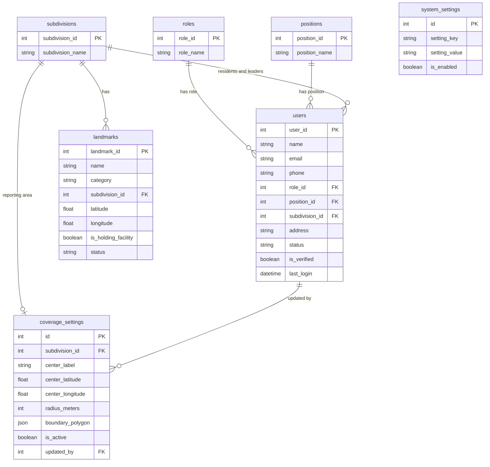

`system_settings` stands alone: it stores per-subdivision switches such as `case_settings:1` (report categories on or off, policy references) as key and value, so it has no foreign key.

---

## ERD 2. Resident registration

How a resident gets an account: from the Leader's official list, or by self-registration that the Leader approves.

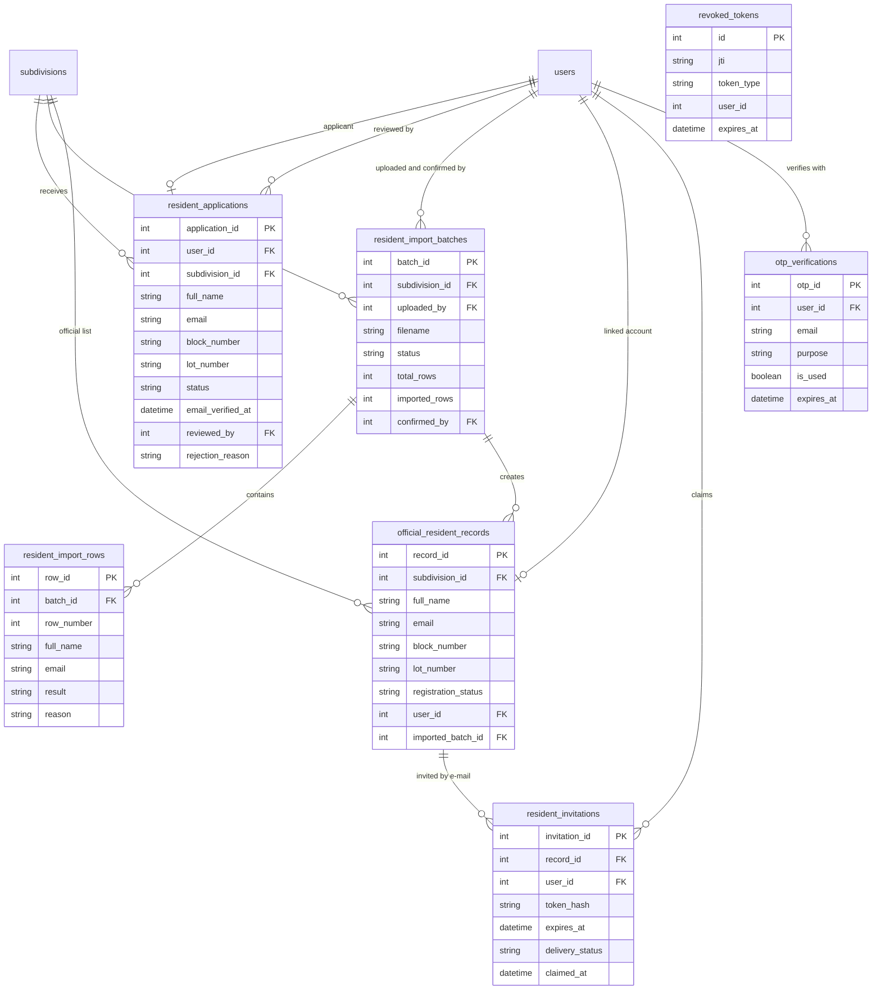

`revoked_tokens` stores signed-out login tokens and has no foreign key.

---

## ERD 3. Pets and QR tags

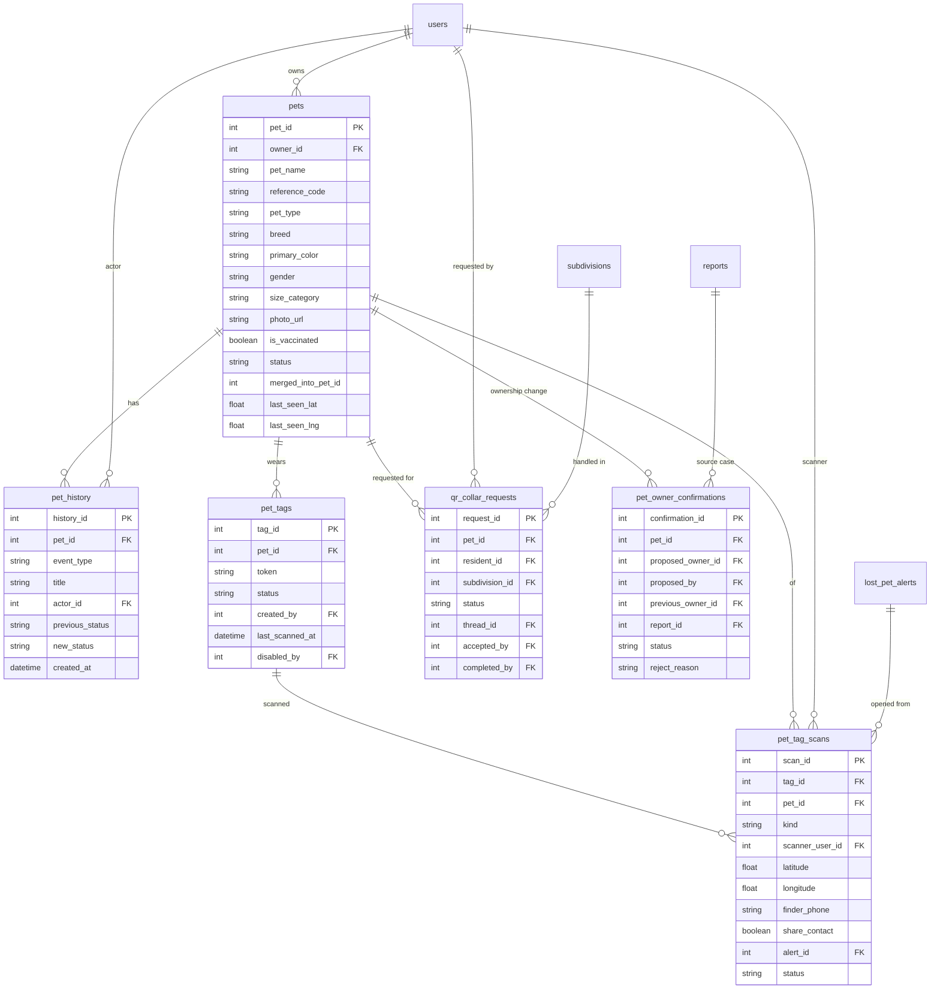

The public tag page uses `pet_tags.token` only. It never shows the owner (see [REPORT_LIFECYCLE_AND_FEATURES.md](REPORT_LIFECYCLE_AND_FEATURES.md)).

---

## ERD 4. Reports (the case)

`reports` is the center of the system. Every module in ERDs 5 to 9 hangs off it. A report **is** the case; there is no separate case table.

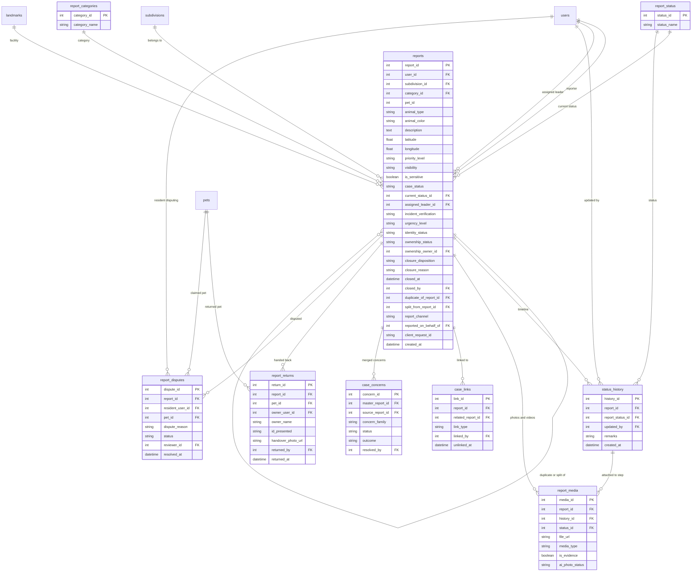

The four statuses (`reported`, `under_review`, `in_progress`, `closed`) are stored on `reports.case_status`. The six categories live in `report_categories`.

---

## ERD 5. Lost pet and sightings

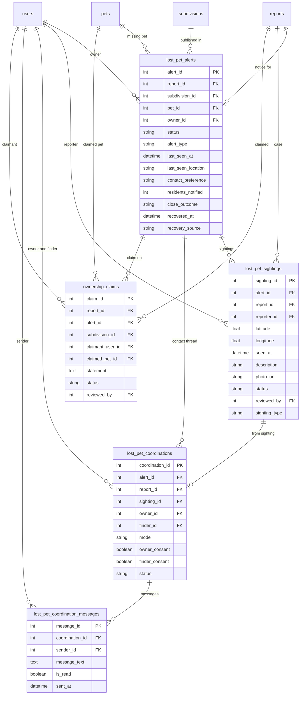

---

## ERD 6. Matching (lost, found and look-alike pets)

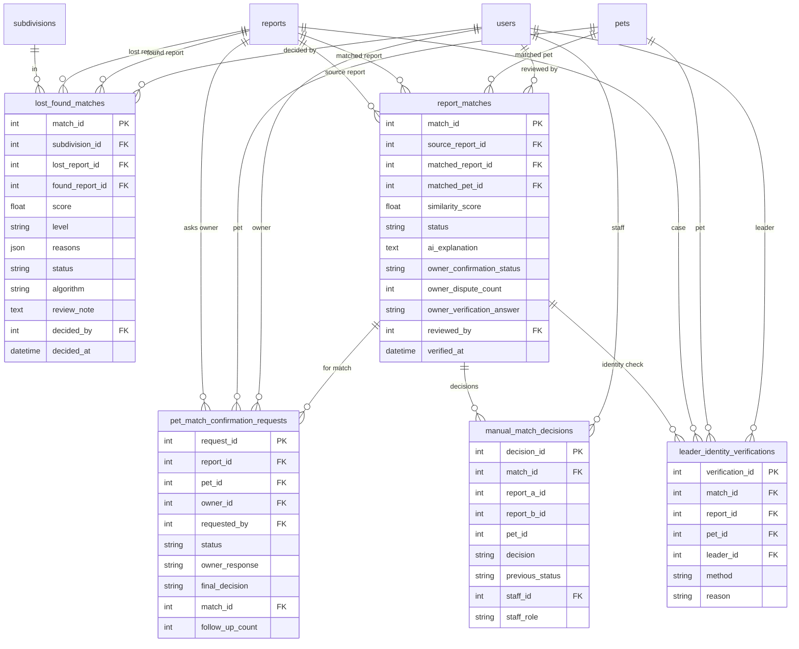

`lost_found_matches` pairs a Lost Pet report with a Found report. `report_matches` pairs a report with a registered pet that looks like it. Both only suggest; the Leader decides.

---

## ERD 7. Case work: referrals, follow-ups and alerts

**`referrals`** is the Leader's record of handing a case to an outside party.

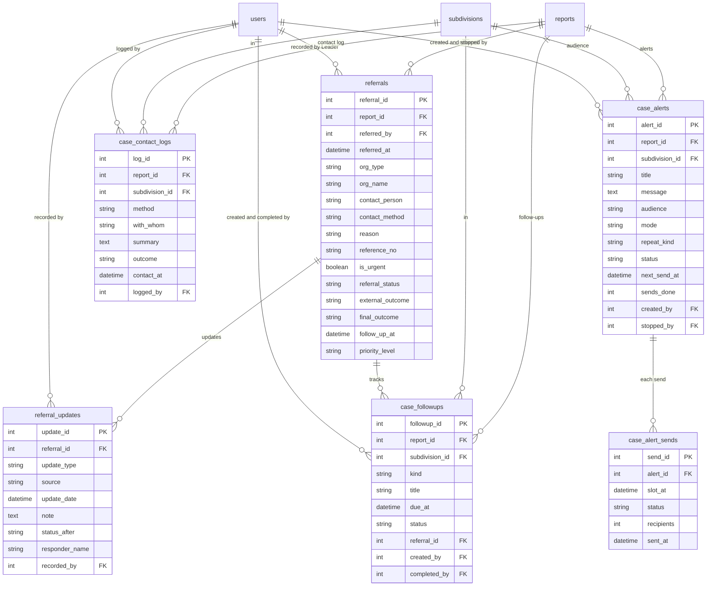

> [!TIP]
> The `referrals.org_type` and `org_name` columns hold *who* the case was handed to (for example a veterinarian or animal control). The Leader makes the contact outside the system and only records it here.

---

## ERD 8A. Complaints, enforcement and warning letters

How a Nuisance complaint turns into a respondent, counted offenses, enforcement steps and warning letters.

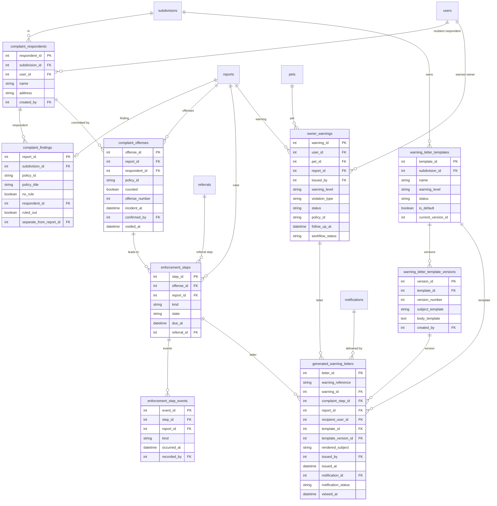

---

## ERD 8B. Owner follow-up (observation period)

After a warning or a pet report, the Leader sets an observation period. The owner sends updates and the Leader reviews them.

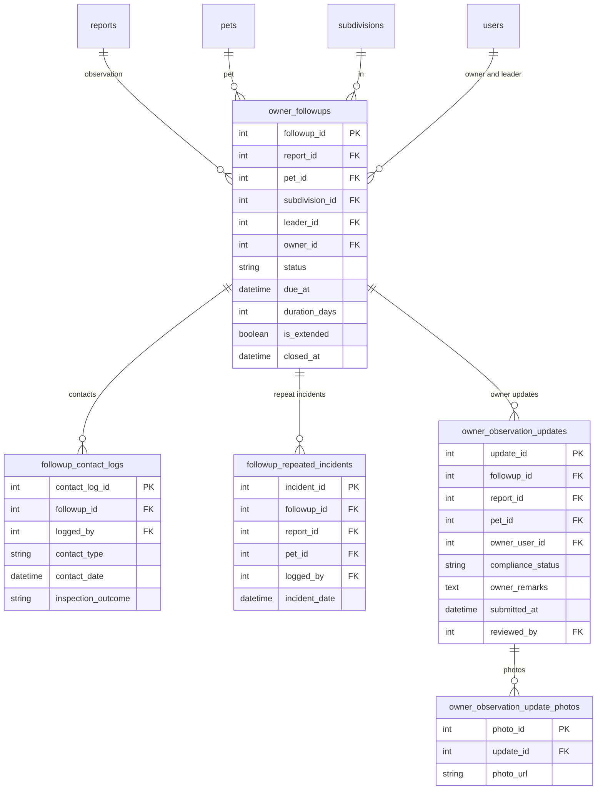

---

## ERD 9A. Case messaging and chat

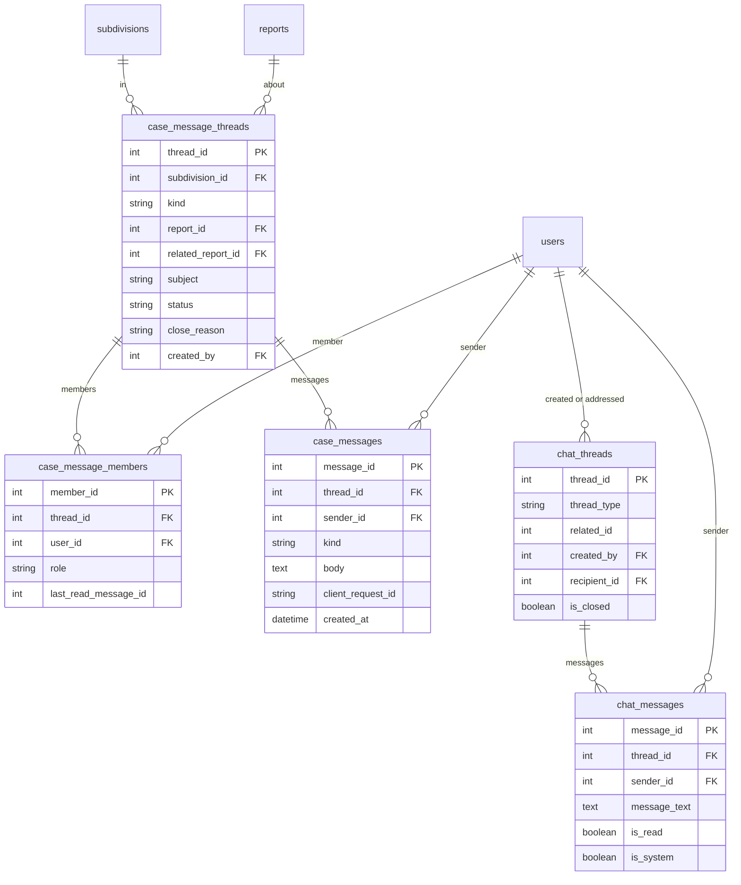

Two messaging tables exist. `case_message_*` is the current case messaging (Resident and Leader about a case). `chat_*` is the older general chat. Both are still in the code.

---

## ERD 9B. Notices and notifications

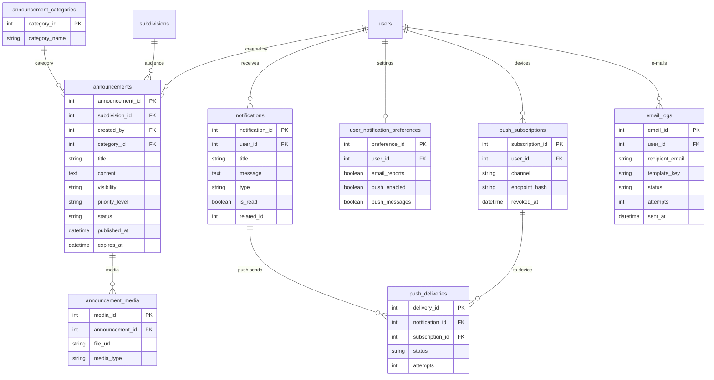

---

## ERD 10. AI and audit

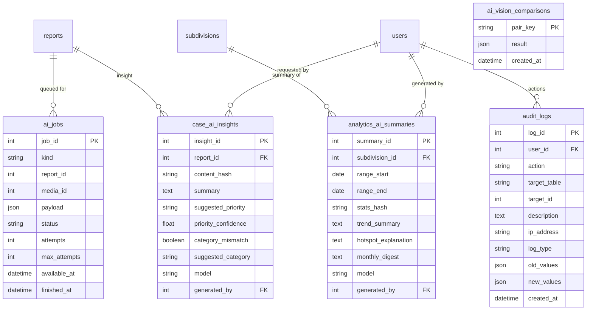

`ai_jobs.report_id` and `ai_vision_comparisons.pair_key` are plain values with no database foreign key. AI results only suggest; a Leader decides ([AI_COMPONENTS.md](AI_COMPONENTS.md)).

---

## How the modules connect (overview)

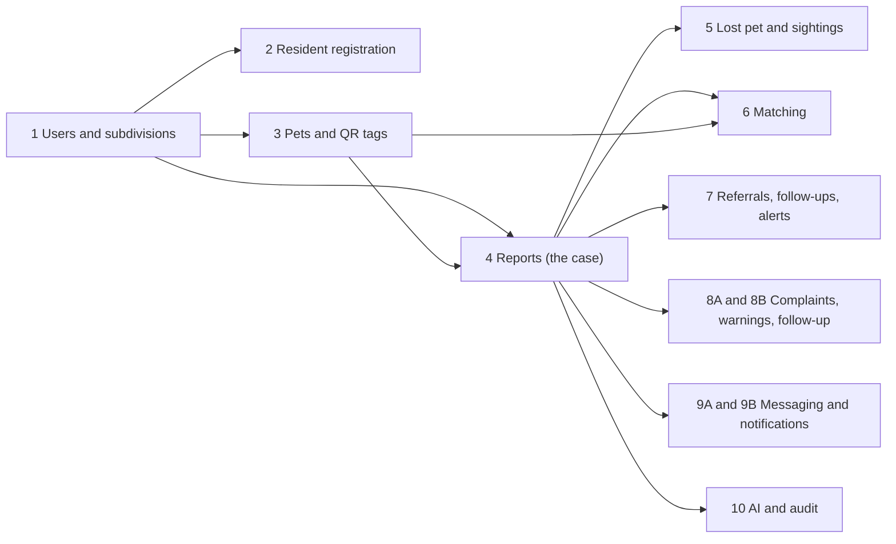

## Notes for the capstone paper

- Present **ERD 4** as the main figure, then the others as module figures. A reader can follow the whole system from `reports` outward.
- Each diagram is kept small so the text stays readable when printed. Export the images at a large size or in landscape.
- The diagrams show the key columns only; the full column lists are in the model files.
- If you only have room for a few figures, use ERDs 1, 3, 4, 5 and 7.
- Use `referrals` and `referral_updates` in the paper. The diagrams show a simplified model of the database.
