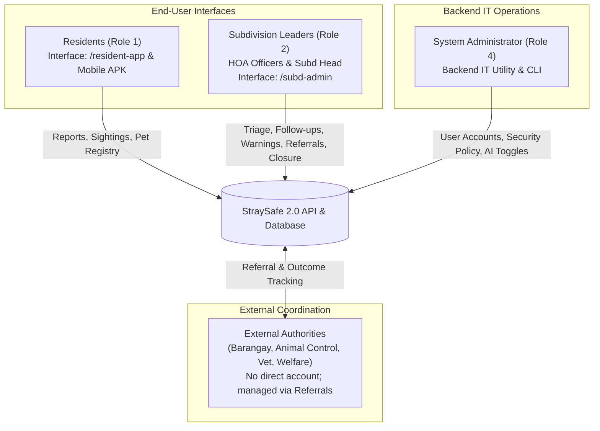
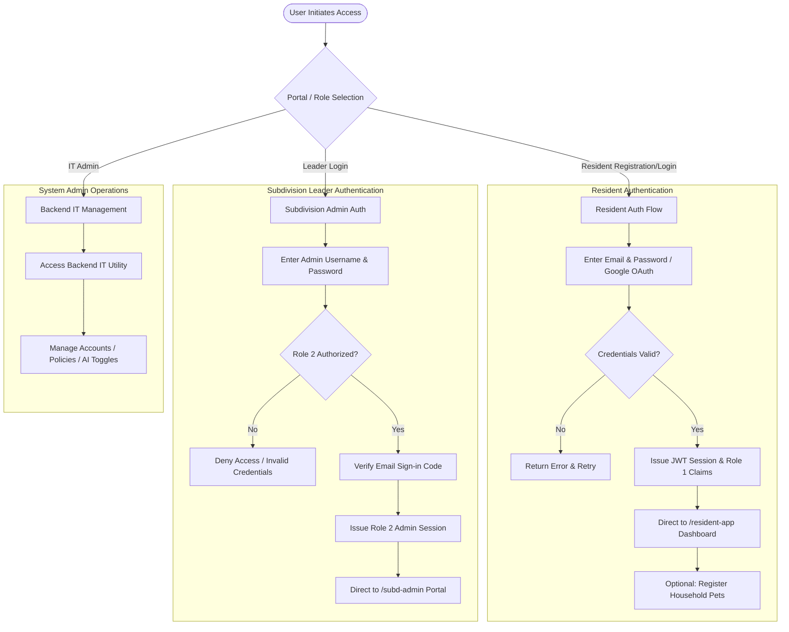
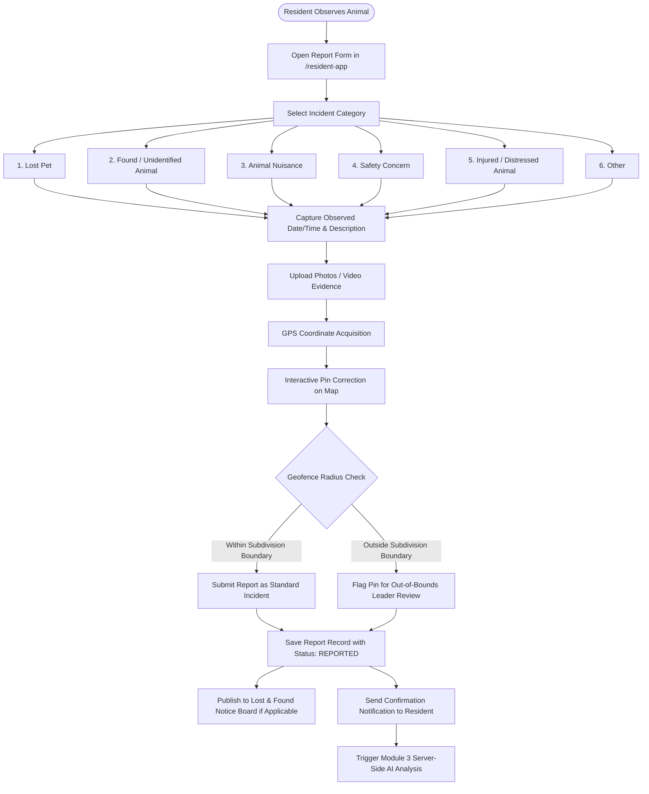
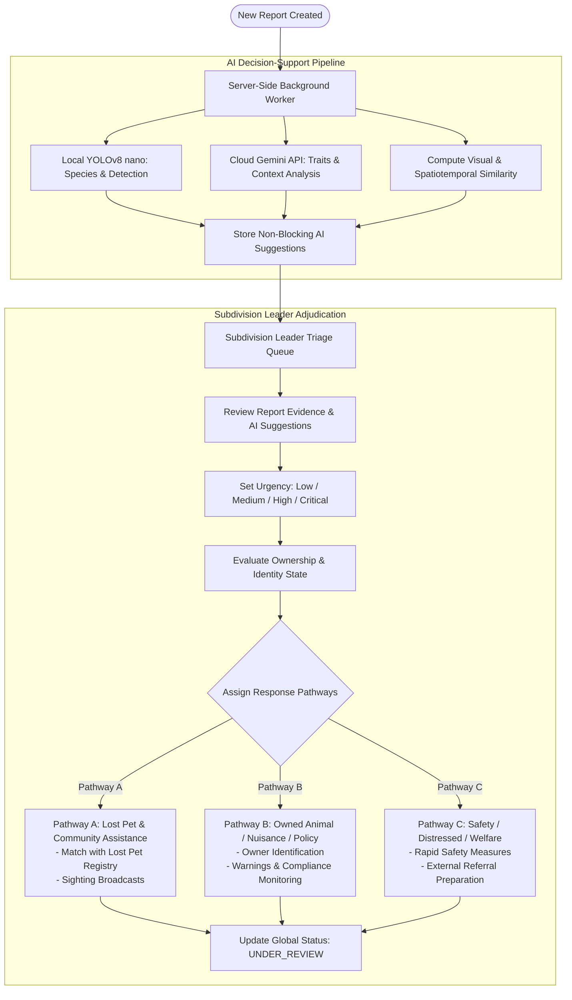
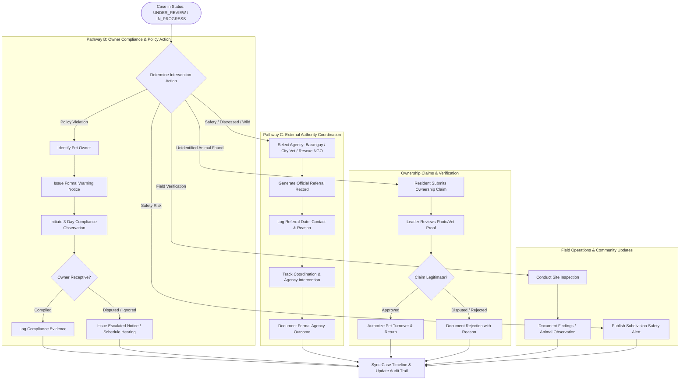
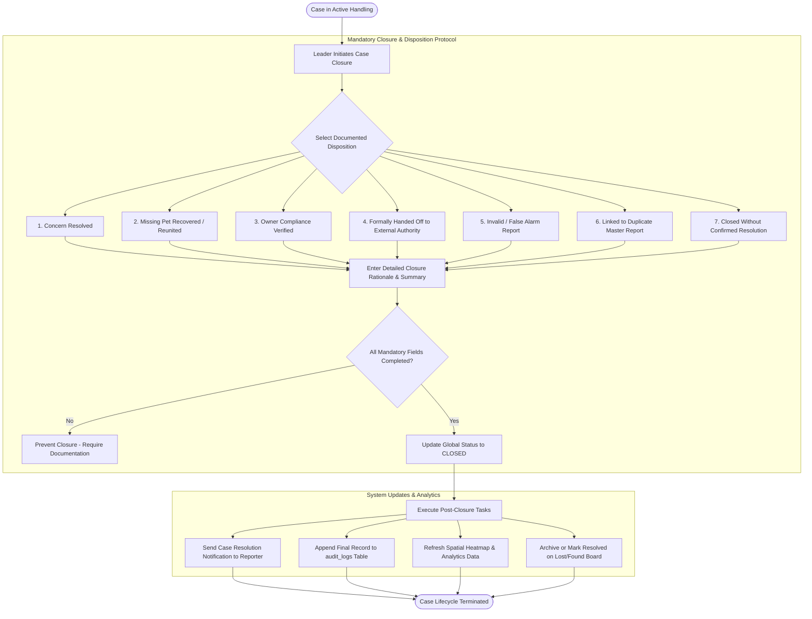
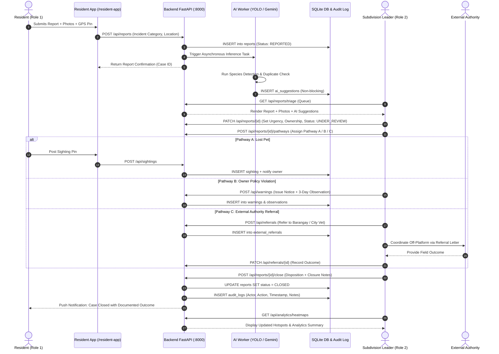

# STRAYSAFE: Smart Stray Animal Reporting and Rescue System
## System Modules, Functionalities, and Operational Workflows

> **Document Status:** Current  
> **System Scope:** StraySafe 2.0 (Subdivision-Centric Architecture)  
> **Target Audience:** System Administrators, Subdivision Leaders (HOA Officers / Subdivision Head), Residents, and Development Team

---

## 1. System Access Roles & Architectural Boundaries

StraySafe 2.0 partitions system access across four dedicated participant roles:

### Detailed Role Definitions

| Role | Interface / Endpoint | Responsibilities & Boundaries |
| :--- | :--- | :--- |
| **Residents (Role 1)** | Web: `/resident-app` Mobile: Android APK | • Submit animal concern reports across 6 distinct categories. • Pin and adjust observation coordinates with map-based controls. • Post and manage lost pet and found animal community notices. • Submit map-pinned sightings on open stray cases or lost pets. • Maintain optional personal pet profiles. • Track real-time status of submitted reports with private internal notes hidden. |
| **Subdivision Leaders (Role 2)** *(Subdivision Head & HOA Officers)* | Web: `/` or `/subd-admin` | • Primary operational case managers for community incidents. • Assess incoming reports, urgency, occurrence, and ownership status. • Review server-side AI decision-support suggestions (species, traits, duplicates). • Classify triage into Pathways A (Lost Pet), B (Owned/Nuisance), and C (Safety/Welfare). • Issue and monitor policy warnings and compliance observation periods. • Log external authority referrals (Barangay, Animal Control, Vets). • Adjudicate ownership claims, schedule site visits, and publish community alerts. • Close cases with mandatory documented disposition and review audit analytics/heatmaps. |
| **System Administrator (Role 4)** | Backend IT Utility | • Non-end-user administrative utility. • Account lifecycle provisioning (create, activate, suspend, reset). • Enforce password complexity and authentication parameters. • Global geofence boundary configuration (center GPS coordinates and radius). • Manage AI model toggles (local YOLOv8 nano / cloud Gemini API) and operational feature switches. |
| **External Authorities** | Non-Account Participants | • External entities including Barangay responders, city/municipal veterinary offices, animal welfare NGOs, and wildlife authorities. • Do not hold system logins; communications, coordination, handoffs, and final resolution outcomes are logged on their behalf by Subdivision Leaders. |

---

## 2. Module 1: Unified Authentication and User Management Module

### 2.1 Submodules & Functional Capabilities

| Submodule | Authorized Role(s) | Functionalities |
| :--- | :--- | :--- |
| **Role-Based Registration & Login** | Residents | Self-registration via email verification or Google OAuth. Auto-assigns Role 1 and routes to `/resident-app`. Supports secure session handling with JWTs. |
| **Admin Portal Authentication** | Subdivision Leaders | Secure login into `/subd-admin` using credentials issued by the System Administrator, backed by emailed verification codes and role authorization checks. |
| **Password Policy Enforcement** | All Users | Enforces 12–128 character complexity: uppercase letter, lowercase letter, numeric digit, and special character. |
| **User Account Management** | System Administrator (Role 4) | Administrative utility to provision, update, lock, or deactivate accounts across all roles; reset credentials; and audit access logs. |
| **Profile and Settings** | Residents & Subdivision Leaders | Update contact information, validate Philippine phone numbers (`+63` or `09...`), update house/lot address, and configure notification channels (in-app, push, email). |
| **Optional Pet Registry** | Residents | Residents can register household pets with descriptive attributes (breed, markings, collar, photos, microchip). Used as reference data for matching lost/found cases (not a barrier to reporting). |
| **Security & AI Settings** | System Administrator (Role 4) | Set session timeout thresholds, configure geofence radius limits, and enable/disable server-side AI assistance features without disrupting core workflows. |

### 2.2 Module 1 Operational Workflow

---

## 3. Module 2: Incident Reporting and Pin Correction Module

### 3.1 Submodules & Functional Capabilities

| Submodule | Authorized Role(s) | Functionalities |
| :--- | :--- | :--- |
| **Animal Concern Reporting** | Residents | Submit reports across six standard categories: Lost Pet, Found/Unidentified Animal, Animal Nuisance, Safety Concern, Injured/Distressed Animal, Other. Captures species, descriptive tags, observed date/time, and photo/video evidence. |
| **Geolocation & Pin Correction** | Residents & Subdivision Leaders | Auto-captures device GPS coordinates; provides an interactive map for manual drag-and-drop pin correction. Identifies observation location separately from submission timestamp. Evaluates pin against subdivision boundary and flags out-of-bounds pins for leader review. |
| **Report Tracking & Updates** | Residents | Provides transparent lifecycle tracking (`REPORTED` &rarr; `UNDER_REVIEW` &rarr; `IN_PROGRESS` &rarr; `CLOSED`). Residents can post additional details, photos, or sightings. Internal leader notes remain strictly private. |
| **Lost & Found Notices** | Residents & Subdivision Leaders | Real-time community board publishing lost pet broadcasts and found animal alerts with immediate neighbor visibility. Leaders retain moderation and edit controls. |
| **Sightings & Recovery Confirmation** | Residents & Pet Owners | Allows any resident to pin sightings on active cases or lost pet notices. Differentiates firsthand vs. secondhand observations. Pet owners can confirm recovery and resolve notices. |

### 3.2 Module 2 Operational Workflow

---

## 4. Module 3: Multi-Pathway Triage and AI Decision Support Module

### 4.1 Submodules & Functional Capabilities

| Submodule | Authorized Role(s) | Functionalities |
| :--- | :--- | :--- |
| **Automated Report Checks** | System / Subdivision Leaders | Server-side image inference via local YOLOv8 nano and cloud Gemini API. Detects animal species (dog, cat), traits (fur color, collar), checks photo authenticity, and identifies visual similarity with existing records. All AI outputs serve as non-blocking suggestions. |
| **Incident Assessment & Urgency** | Subdivision Leaders | Subdivision Leaders review incoming reports and set priority levels (Low, Medium, High, Critical). Separately adjudicates incident occurrence, animal identity, and ownership status (`Unknown`, `Claimed`, `Under Review`, `Confirmed`, `Disputed`, `Unconfirmed`). |
| **Response Pathway Triage** | Subdivision Leaders | Categorizes incidents into one or more non-exclusive operational pathways: • **Pathway A:** Lost Pet and Community Assistance. • **Pathway B:** Owned Animal, Nuisance, or Subdivision Policy Concern. • **Pathway C:** Safety, Distressed Animal, Welfare, or External Coordination. |
| **Related Reports & Matching** | Subdivision Leaders | Compares location proximity, timestamps, and physical traits across open cases, sightings, and pet registry entries. Allows leaders to link related records without destroying original evidence. |
| **Urgent Safety Handling** | Residents & Subdivision Leaders | High-priority fast-track for severe aggressive animal reports or bite incidents. Bypasses mandatory photo requirements, displays immediate non-approach safety guidance to residents, and flags cases for rapid administrative intervention. |

### 4.2 Module 3 Operational Workflow

---

## 5. Module 4: Case Intervention and Referral Tracking Module

### 5.1 Submodules & Functional Capabilities

| Submodule | Authorized Role(s) | Functionalities |
| :--- | :--- | :--- |
| **Case Actions & Coordination** | Subdivision Leaders | Centralized case management workspace. Subdivision Head / HOA Officers log administrative actions, notes, resident interviews, and coordinated tasks. |
| **Warning & Compliance Monitoring** | Subdivision Leaders | Formal enforcement tracking for pet policy violations (e.g., roaming without leash, repetitive barking, waste non-compliance). Logs warning notices (1st/2nd/Final), compliance observation windows, owner responses/appeals, and resolution findings. |
| **External Referral Log** | Subdivision Leaders | Structured log for external authorities (Barangay, City Vet, Animal Control, Rescue NGOs). Tracks agency name, contact details, date referred, stated reason, agreed action, referral status, and documented outcome. |
| **Ownership Claims** | Residents & Subdivision Leaders | Residents can assert ownership on unidentified or captured animals by submitting proof (photos, veterinary cards, unique markings). Leaders review, approve, dispute, or deny claims with complete audit history. |
| **Inspection & Site Visit Records** | Subdivision Leaders / Personnel | Record on-site investigation reports, personnel dispatched, interview summaries, and field findings (including "Animal Not Found" without premature case closure). |
| **Community Alerts & Advisories** | Subdivision Leaders & Residents | Broadcast urgent safety advisories or sighting bulletins to residents via in-app push and dashboard banners. Delivers direct status updates to reporting residents. |

### 5.2 Module 4 Operational Workflow

---

## 6. Module 5: Case Closure and Audit Trail Analytics Module

### 6.1 Submodules & Functional Capabilities

| Submodule | Authorized Role(s) | Functionalities |
| :--- | :--- | :--- |
| **Case Status Lifecycle** | Subdivision Leaders & Residents | Manages four overarching global statuses: `REPORTED` &rarr; `UNDER_REVIEW` &rarr; `IN_PROGRESS` &rarr; `CLOSED`. Orthogonal to ownership, warning, or referral states. |
| **Case Disposition & Closure** | Subdivision Leaders | Requires a mandatory structured disposition upon closing a case: Concern Resolved, Missing Pet Recovered, Owner Compliance Verified, Invalid/Duplicate Report, Formally Handed Off to Authority, or Closed Without Resolution. Disallows undocumented closures. |
| **Role-Based Dashboard** | Residents & Subdivision Leaders | Tailored views: Residents see my reports, pet registry, lost/found feed, and status alerts; Leaders see triage queue, active cases, observation countdowns, referral pipelines, and notifications. |
| **Incident Heatmap & Analytics** | Subdivision Leaders | Interactive Leaflet heatmap displaying spatial clustering of incidents, recurrent stray hotspots, high-density nuisance areas, and safety risks to inform HOA security planning. |
| **Permanent Audit Trail** | Subdivision Leaders / System | Append-only database audit log (`audit_logs`) recording user actions, timestamps, field mutations, and administrative rationale. Retains distinction between raw resident claims, AI hints, and official findings. |

### 6.2 Module 5 Operational Workflow

---

## 7. Complete End-to-End System Integration Flow

The diagram below demonstrates how an incident moves from initial resident submission through triage, multi-pathway intervention, and verified closure:

---

## 8. Summary of Database Entities & Statuses

### Global Case Statuses
1. **`REPORTED`**: Initial state upon resident submission.
2. **`UNDER_REVIEW`**: Subdivision Leader acknowledged, assessing incident, AI suggestions, and urgency.
3. **`IN_PROGRESS`**: Active interventions underway (investigation, observation window, external referral, or sighting pinging).
4. **`CLOSED`**: Formally resolved with mandatory documented disposition.

### Response Pathways
- **Pathway A**: Lost Pet and Community Assistance.
- **Pathway B**: Owned Animal, Nuisance, or Policy Concern.
- **Pathway C**: Safety, Welfare, or External Coordination.

### Core Database Tables Involved
- `users`: Role-based authentication (`role_id: 1, 2, 4`), credentials, contact information.
- `reports`: Core incident data, categories, geofence status, timestamps, global lifecycle status.
- `report_media`: Associated photos and videos uploaded by reporting residents or leaders.
- `sightings`: Map-pinned observations connected to stray cases or lost pet notices.
- `pets`: Registered household pets linked to resident profiles.
- `lost_found_matches`: Cross-matching table between active reports, notices, and registered pets.
- `owner_warnings`: Violation notices, severity, observation timelines, and compliance evidence.
- `external_referrals`: Detailed logs of coordination with Barangay, City Vet, or rescue organizations.
- `ownership_claims`: Proof and adjudication records for disputed or claimed animals.
- `audit_logs`: Immutable, append-only system journal of all administrative modifications.

