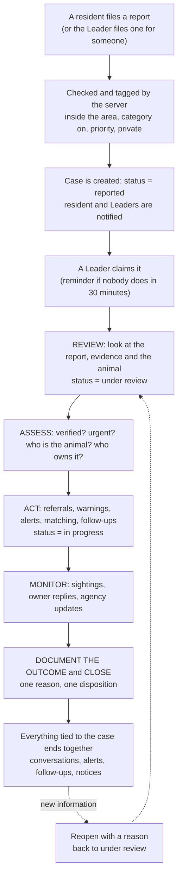

# How a report lives in StraySafe, from filing to closing, and how each feature works

Status: **Current** (written 2026-11-22 from the existing system documents and a re-read of the filing code in `backend/app/routes/reports.py`, `backend/app/utils/dangerous_rules.py`, `backend/app/tasks/unassigned_checker.py` and the Leader and Resident route files). Where a statement rests on a source document only, the document is linked. Where I did not check a point in code, it says **Not re-checked**.

This is the one-page map. The detailed rules stay in their own documents, which are linked from every section.

---

## 1. The whole thing in one picture

Only **four statuses** exist for every kind of report: `reported`, `under_review`, `in_progress`, `closed`. Warnings, referrals, follow-ups, ownership claims and recovery are **details kept on the case**, never extra statuses ([CASE_WORKFLOW_BACKEND.md](CASE_WORKFLOW_BACKEND.md)).

Three rules hold everywhere:

1. **The system suggests, a person decides.** AI scores, matches, offense counts and priorities are suggestions or automatic safety defaults. Ownership, a match, a verification and a closure are always a Leader's recorded decision.
2. **A registered pet is never proof of ownership.** Registering is owner-declared. Ownership is confirmed only by the Leader, with a named resident and evidence other than the registration.
3. **Privacy by default.** Every report starts private. Neighbours see an allow-list of the animal's looks and a rounded area, never the reporter, the owner, the exact pin or any internal work.

---

## 2. Who does what

| Person | What they do |
|---|---|
| **Resident** (Resident app, web or Android) | Files reports, tracks them under My reports, messages the administration, answers ownership and claim questions, registers pets, sees Community notices, reports sightings |
| **Subdivision Leader** (Leader app, `/subd-admin`) | The only person who works cases: claims, reviews, assesses, refers, warns, matches, publishes notices and alerts, closes. Sees their own subdivision only |
| **Administrator** | Reserved for a future implementation. In the code: system-wide access, accounts, settings and audit logs. No Admin account is needed for current development |
| **Barangay** | **Not a StraySafe user.** The Leader contacts the Barangay outside the system and *records* that contact as a referral |
| **Visitor** | Sees only welcome, sign-in and sign-up screens. A scanned pet QR tag opens a public page that shows the pet but never the owner |

Details: [overview.md](overview.md).

---

## 3. How a report starts

### 3.1 Getting an account first
A resident cannot simply sign up and start reporting: the Leader controls who gets in. A resident gets an account in one of two ways, side by side ([RESIDENT_RECORD_REGISTRATION.md](RESIDENT_RECORD_REGISTRATION.md)):

- **From the official list:** the Leader uploads the subdivision's resident list; every valid row becomes a locked account and the resident gets a single-use e-mail link (24 hours) to choose a password.
- **Self-registration:** a resident registers, the Leader confirms they live in the subdivision (**Residents > Applications**), and only then can they sign in.

### 3.2 The three ways a resident can file
From **Report** in the Resident app:

| Resident chooses | Files as | Form and what it asks |
|---|---|---|
| **Lost pet** (needs a registered pet; "Register your pet first to report it missing") | `lost_pet` | The pet, when and where it was last seen, a pin |
| **Animal complaint** | `nuisance` | What the animal did, when, a pin, optionally whose animal and what it looked like |
| **Report an animal**, then *"What's happening with the animal?"* | `found_animal` ("It looks lost or has no owner nearby"), `injured` ("It is hurt or needs help"), or `safety` ("It may be dangerous") | Kind of animal, what happened, when, photos or video (optional), a pin. The injured form asks the animal's condition and whether it can move. The dangerous form shows *"Stay safe. Keep your distance..."* and asks what it did and whether it is still dangerous |

The sixth concern, **Other animal concern** (`other`), is filed by the Leader, not offered to residents.

Every form ends with **Review and submit**, which says the report is private, then a **confirmation with a reference** (for example `SS-2026-0023`) that the resident follows under **My reports**.

### 3.3 The Leader can file too
**Cases > New report** records a concern the Leader saw themselves (`self`) or one a person told them about by phone call, walk-in, message or other. The case then reads "Reported by Subdivision Leader" or "Reported by Kyla · via call". A resident can be picked by typing their name; if the person has no account, the name and number are typed. A Lost Pet report is not filed here, because it is about the owner's own registered pet.

### 3.4 What the server does in the same instant (before the resident sees "submitted")
All in `create_report` ([reports.py](../../backend/app/routes/reports.py)):

1. **Area check:** the pin must be inside the reporting coverage area, or the report is refused ("outside the current reporting coverage area").
2. **Category check:** a category the subdivision turned off is refused.
3. **Everything starts Private.** Nobody chooses visibility when filing, staff included. An *Animal Nuisance* report is also marked **sensitive**, which means it can never be made public.
4. **Automatic safety priority** (the server decides; a priority sent by the phone is ignored):
   - *Injured:* "cannot move" becomes **High priority, immediate urgency** automatically. Otherwise a resident's report is Medium.
   - *Dangerous* ([dangerous_rules.py](../../backend/app/utils/dangerous_rules.py)): an actual or attempted bite, chasing or attacking people, or suspected rabies with active signs becomes **Urgent**; aggressive, repeated threatening, dangerous roaming or attacking other animals becomes **High**; "previously aggressive but calm now" becomes normal.
5. **Duplicate protection:** a retried submit (same retry key, or the same report within 15 seconds) returns the first report instead of creating a second.
6. **Lost Pet only:** in the same transaction the pet is marked **Lost** and the **Community notice is published at once**, with nothing for the Leader to approve ([LOST_PET_LIFECYCLE.md](LOST_PET_LIFECYCLE.md)). If any part fails, none of it is saved.
7. **After saving:**
   - lost and found reports are compared with each other in both directions and a possible match is queued for the Leader ([LOST_FOUND_MATCHING.md](LOST_FOUND_MATCHING.md));
   - an AI job is queued (animal present, photo checks, colour and breed, look-alike pets, duplicate sightings). It never blocks the submit and only suggests ([AI_COMPONENTS.md](AI_COMPONENTS.md));
   - the resident gets "your report was received"; the Leaders get a new-report notice, or an **urgent injured** or **dangerous animal** notice for those two kinds.

### 3.5 Waiting for a Leader to take it
A new report is **unassigned**. A Leader presses **Claim** (`POST /reports/{id}/claim`, with a concurrency check so two Leaders cannot both claim it). If nobody does within the threshold (30 minutes in the code; **Not re-checked** whether it is changed in Settings), a one-time reminder goes to the subdivision's Leaders ([unassigned_checker.py](../../backend/app/tasks/unassigned_checker.py)). Once a case is claimed, **only that officer** (or the Administrator) updates it; an unassigned case can be worked by any Leader of the subdivision.

---

## 4. The five stages of work

The Leader app opens each report on the page that fits its kind, but the stages are the same.

| Stage | What happens | Status afterwards |
|---|---|---|
| **1. Receive** | The case appears on the **Dashboard** ("Needs your attention", ordered: urgent safety, requests for help, an unreferred Barangay contact, overdue follow-ups) and in **Cases** | `reported` |
| **2. Review** | The Leader opens the case, reads the report, photos and map pin, and records the first assessment or action | `under_review` |
| **3. Assess** | *Assessment* tab: was the incident verified, is it urgent, **who is the animal** (unidentified, possible match, identified), and **who owns it** (unknown, claimed, under review, confirmed, disputed, unconfirmed) | `under_review` |
| **4. Act and monitor** | Referrals, warnings, alerts, matching, follow-ups, messages, sightings (sections 5 and 6) | `in_progress` |
| **5. Document the outcome and close** | One closing reason and disposition (section 7) | `closed` |

**Status moves forward on its own** when work is recorded: an assessment, a follow-up or a contact lifts the case to at least *under review*; a referral or warning lifts it to at least *in progress*. It never moves back by itself, and nothing moves into or out of *closed* except the Close and Reopen actions.

### The case page
For a normal case (`injured`, `safety`, `other`) the tabs are **Overview**, **Assessment**, **Actions & follow-ups**, **Referrals** and **History**. Missing pet and found animal cases use a **monitored case page** with the sightings, notice and alerts on one screen. Animal complaints use the **Complaint page** with its findings and enforcement steps. An urgent case shows one red banner above the tabs.

---

## 5. How each feature works

### 5.1 Assessment (Overview, Assessment tabs)
- Records four things, only what is sent changes: incident verification (not reviewed, verified, partial, unverified, invalid), evidence sufficiency, urgency, animal identity, and ownership.
- **Ownership can be `confirmed` only with a named resident and at least one piece of evidence besides the pet registration** (photos with the person, matching markings, CCTV, a firsthand observation, earlier documented contact, an owner statement, a vet record). The owner is chosen by typing their name.
- Injured and dangerous cases also record their own **welfare outcome** or **dangerous-incident outcome** before closing.

### 5.2 Referrals to outside organisations (Referrals tab)
- The Leader *records* a referral to the Barangay, animal control, a vet, an animal-welfare group, wildlife rescue or another body. StraySafe does not send anything to them and does not run rescue or custody.
- The organisations come from **Settings > External coordination**; each is one tap ("Refer to Barangay"). A referral can be written down before anyone is contacted (**Not contacted yet**), and then becomes a task on the Dashboard until a contact attempt is recorded.
- Each referral has its own status (sent, acknowledged, in progress, completed, declined, no response). **A referral, even a completed one, never closes the case.**
- Details: [BARANGAY_REFERRAL_LOG.md](BARANGAY_REFERRAL_LOG.md).

### 5.3 Follow-ups and contact logs (Actions & follow-ups)
- A **follow-up** is a thing to do or check by a date, inside the limits the subdivision set (default 7 days, 0 to 90). It can be done, cancelled with a reason, or recorded as already done.
- A **contact log** records who was contacted, how, and what came of it. A denial of ownership is recorded as a *dispute*; it does not close the case.

### 5.4 Messages (Resident app and Leader **Messages**)
- Residents and the administration write in conversations: about one of the resident's own reports (`direct`), or general (`general`). The Leader sees the resident's report thumbnail beside each conversation.
- **A conversation tied to a report closes by itself, in the same transaction, when the case is resolved or closed.** It stays readable and no new messages can be sent. General conversations are not closed by a case ([RESIDENT_MESSAGING.md](RESIDENT_MESSAGING.md)).

### 5.5 Lost pets: notice, sightings, recovery
- **Notice:** published automatically when the owner files; neighbours see the pet and a rounded last-seen area, never the owner or exact pin.
- **Neighbours** can answer *"I saw this pet"* (a sighting, which tells the owner) or *"I may have this pet safely with me"* (a possible recovery, which opens a conversation). Direct messaging between owner and neighbour opens only if **both** agree; either side can ask the Leader to mediate, and the Leader then sees both contacts.
- **Recovery has exactly two paths:** the owner presses *"My pet is home"*, or the Leader records that the owner confirmed by phone or in person. A Leader cannot declare a recovery alone, and a sighting, a Barangay update or a generic close never means "recovered".
- Details: [LOST_PET_LIFECYCLE.md](LOST_PET_LIFECYCLE.md), [LOST_PET_SIGHTING_PING.md](LOST_PET_SIGHTING_PING.md).

### 5.6 Found animals: notice, claims, linking
- The Leader (or a request from the resident, reviewed by the Leader) publishes a **Community notice** with the animal's looks and a rounded area. The finder's own words and the distinguishing marks that prove ownership stay private.
- A resident of the subdivision can make an **ownership claim** on a published notice (not the person who reported it, one claim each). The Leader reviews it. **A claim, accepted or not, never establishes ownership**; the Leader still records the decision with evidence.
- A lost and a found report that look like the same animal are suggested to the Leader, who confirms the link. Closing either closes both ([LOST_FOUND_MATCHING.md](LOST_FOUND_MATCHING.md)).

### 5.7 Possible Pet Owners and the pet registry (on found-animal and similar cases)
- For a found animal the system lists registered pets of the same kind in the subdivision and **ranks** them (breed, colour and coat, description, location; plus a bonus when the owner marked the pet Lost or someone scanned its QR tag). The cards show Strong, Potential or Low and Match, Similar, Differs, not percentages; the number appears only in View details.
- The Leader **contacts the owner** through a conversation with a one-tap Confirm or Decline. The Leader may verify ownership only **after the owner says Yes**. Silence is not a yes. A "Mark as unable to contact" ends the wait.
- Details: [POSSIBLE_OWNER_VERIFICATION.md](POSSIBLE_OWNER_VERIFICATION.md), [PET_REGISTRATION_AND_MATCH_REVIEW.md](PET_REGISTRATION_AND_MATCH_REVIEW.md), [MULTI_ATTRIBUTE_MATCHING.md](MULTI_ATTRIBUTE_MATCHING.md).

### 5.8 Pet QR tags
- A registered, owned pet gets a printable tag whose QR holds a link, not the pet id. Anyone who scans it opens a public page that shows the pet (never the owner) and can send a "found it" message, optionally sharing a phone number only with consent.
- The owner is notified; for a pet with an active lost notice, a neighbour's scan leads into the sighting flows, and the messages are listed on the Leader's case. The in-app scanner (camera or upload) opens the same page.
- Plan and rules: [PET_QR_TAGS_PLAN_2026-11-17.md](../06-future-proposals/PET_QR_TAGS_PLAN_2026-11-17.md).

### 5.9 Animal complaints and progressive enforcement
- The complaint stays an ordinary case. The Leader records three findings: **did it happen** (verified), **which confirmed subdivision rule** it broke, and **who is responsible** (confirmed with evidence).
- An **offense counts** only when all three hold. StraySafe suggests the number (1 + earlier counted offenses of the same person under the same rule); the Leader confirms. A complaint within 6 hours and 150 m of an earlier one is offered as "same occurrence" and closed as a duplicate, so it counts once.
- **Steps follow the policy:** 1st offense, a warning letter; 2nd, a second letter and a summons to the subdivision office; 3rd, a fine (amount from the confirmed rule) and a Barangay meeting. A 4th offense has no defined step.
- Letters are drafts until issued, never name the complainant, and printing is never delivering. StraySafe records that a fine was paid; it takes no payments.
- Details: [COMPLAINT_MANAGEMENT.md](COMPLAINT_MANAGEMENT.md), [OWNER_WARNING_RULES.md](OWNER_WARNING_RULES.md), [OWNER_FOLLOWUP_RULES.md](OWNER_FOLLOWUP_RULES.md).

### 5.10 Warnings and owner observation
- An **owner warning** is refused unless: the case is open; it is a nuisance or safety concern; the owner was **confirmed** with evidence; the incident was verified; and a **confirmed subdivision policy** covers it. No confirmed policy means no warnings can be issued.
- The **observation period** after a warning is the policy's own length; nothing is assumed. A manual observation uses the default (3 days) with **one** reasoned extension. An expired observation never closes the case by itself; it asks the Leader to review.

### 5.11 Injured and dangerous animals
- **Injured:** an animal that cannot move is urgent automatically. The Leader's actions are the vet or Barangay referral and follow-ups; the welfare outcome is recorded before closing.
- **Dangerous** ([DANGEROUS_ANIMAL_PROCESS.md](DANGEROUS_ANIMAL_PROCESS.md)): the report stays private. The Leader can check the place with security, **publish a Safety Advisory** (every resident is alerted), refer to the Barangay, city vet or animal control, or start owner enforcement if the animal is owned. A referral keeps the case in progress; it never closes it.

### 5.12 Community notices and alerts
- **Community notice** (a post residents browse) and **notification alert** (a push and in-app notification the Leader schedules: now, later, or repeating until the animal is home) are two separate things. An alert never creates or edits a notice ([LOST_FOUND_ALERTS.md](LOST_FOUND_ALERTS.md)).
- Only a Leader publishes a safety advisory or a found-animal notice.

### 5.13 Linking and merging duplicates
- **Link** two cases about the same animal: both stay open with their own work, and closing either closes the other. It can be undone with a reason.
- **Merge** true duplicates of one event: the current case stays the primary, the other becomes *Merged - Duplicate* and is archived under Related Reports. It can be unmerged.
- Details: [REPORT_RESOLUTION_LINKING_AND_MERGING.md](REPORT_RESOLUTION_LINKING_AND_MERGING.md).

### 5.14 History, audit and privacy
- **History tab:** every significant update, with who and when. Original reports and decisions are never rewritten. The reporter-facing timeline gets neutral lines only; the reasons and detail go to the staff history and the audit log ([ACTIVITY_TIMELINE_RULES.md](ACTIVITY_TIMELINE_RULES.md)).
- **Privacy:** other residents get an allow-list of fields, never a redacted copy. Phone numbers, e-mails and house numbers are refused in public text and masked when older text is shown.

### 5.15 Dashboard and Analytics
- **Dashboard:** "what needs me today", a count line, the attention list, missing and found animals listed apart, and recent cases.
- **Analytics (Leader):** reports received and closed per week, outcomes, categories, referral activity and case locations, with a Chart or Table view. A closed case is not assumed resolved. Known gaps are listed in section 9.

### 5.16 Settings that shape the process
Per subdivision, in one JSON row in `system_settings`: which categories are on, the confirmed **policies** (rules, references, observation days, fine, counting window), follow-up bounds, notice publication mode, the **external coordination** organisations, and the office contact ([CASE_WORKFLOW_BACKEND.md](CASE_WORKFLOW_BACKEND.md)).

---

## 6. What the system does by itself versus what a person decides

| The system does by itself | A person always decides |
|---|---|
| Checks the area and category, starts every report Private | Whether anything is made public, and what a notice says |
| Sets the first priority for injured (cannot move) and dangerous reports | Verification, urgency and the final priority |
| Publishes a Lost Pet notice when its owner files | Publishing a found-animal notice or a safety advisory |
| Suggests lost-found matches, possible owners and AI look-alikes | Linking, merging, naming the animal, verifying ownership |
| Suggests the offense number | Confirming it, the rule and the responsible person |
| Reminds when a report is unclaimed, or a follow-up or observation is due | Claiming, following up, extending an observation (once, with a reason) |
| Closes conversations, alerts, follow-ups and linked cases when a case closes | The closing reason and disposition |

---

## 7. How a report ends

### 7.1 The closing action
A Leader presses **Close** and gives **one disposition and a reason (5 or more characters)**. Nothing is ever assumed to be a resolution.

| Disposition | Group | Counts as | The server requires |
|---|---|---|---|
| Concern resolved through intervention | resolved | resolved | nothing |
| Owner compliance verified | resolved | resolved | a complied observation or a resolved warning |
| Missing pet recovered | resolved | resolved | a Lost Pet case, and only through the owner-confirmation path |
| Handed off, no remaining subdivision action | unresolved | not resolved | at least one referral with contact recorded |
| No further sightings, monitoring ended | unresolved | not resolved | nothing |
| Closed without confirmed resolution | unresolved | not resolved | nothing |
| Report determined invalid | invalid | invalid | nothing |
| Duplicate of another report | invalid | invalid | an active link to the primary |
| Withdrawn by the reporter | invalid | invalid | set only by the resident's own withdrawal |

Injured and dangerous cases also need their **welfare outcome** or **dangerous-incident outcome**, and a dangerous case with an ongoing threat cannot be closed as resolved.

### 7.2 How each kind ends

| Kind | Usual ending |
|---|---|
| **Lost pet** | *Missing pet recovered*, through the owner's "My pet is home" or the Leader recording the owner's phone or in-person confirmation. Otherwise: no further sightings, handed off, unresolved, withdrawn by the owner |
| **Found animal** | Reunited with the owner (resolved), handed to an outside agency after contact is recorded, or sightings stop |
| **Animal complaint** | Enforcement steps finished and the Leader closes the complaint; or closed as a duplicate of the same occurrence |
| **Dangerous animal** | The dangerous-incident outcome recorded, then closed (resolved, handed off, or unresolved); the Safety Advisory is archived |
| **Injured animal** | The welfare outcome recorded (treated, returned, referred) and then closed |
| **Other** | The standard flow, any eligible disposition |

### 7.3 What happens in the same transaction when a case closes
- Pending **follow-ups** end (unless the Leader chooses to leave them), and a post-closure check can be scheduled.
- Every open **conversation** about the report closes (readable, no new messages).
- Active **notification alerts** stop; a **Community notice** closes with its reason (*recovered*, *withdrawn*, *merged*, or *not found*), and the pet returns to **Active** in the registry.
- A **linked** report closes too, and its conversations and notices with it.
- **Referrals, warnings and claims are not changed.** They are the case's history.
- The reporter's timeline gets a **neutral line** (the label, never the reason); the reason goes to the audit log. The reporter is notified.

### 7.4 Reopening
Any Leader of the subdivision (or the Administrator) can **reopen** a case with a reason. It returns to *under review*, the closure is cleared, `reopened_count` goes up, and the audit log keeps the closure that was undone. Earlier referrals and warnings stay.

---

## 8. Retired and out of scope

These existed earlier and are **not** part of the current system: Barangay staff accounts and portals (the Barangay is contacted outside StraySafe), rescue dispatch, the holding place and custody, the adoption pipeline, claiming fees, and the old pet-claim handling. Fines are recorded, never collected.

---

## 9. Known gaps

- **Dashboard queues:** ownership claims, possible-owner replies, QR collar requests and QR "found" messages are not yet on the Dashboard attention list; the attention list watches only Barangay referrals, not other organisations (found in a Dashboard and Analytics review on 2026-11-23).
- **Waiting on an owner:** a possible-owner request has no reminder or timer; it can sit on "Awaiting Owner Response" until someone notices.
- **Possible-owner location:** residents' profiles have no home pin, so the distance part of the ranking is usually a flat default. Only a street or block named in the report adds information.
- **Manual matching** has no screen in the Leader app; its endpoints exist.
- **Database:** one-time migrations in `backend/migrations/` are applied by hand; see [DATABASE_FILES_AND_MIGRATIONS.md](../05-operations/database/DATABASE_FILES_AND_MIGRATIONS.md).
- A full authorization review of every endpoint has not been done ([overview.md](overview.md)).

---

## 10. Where to read more

| Topic | Document |
|---|---|
| Statuses, rules, endpoints | [CASE_WORKFLOW_BACKEND.md](CASE_WORKFLOW_BACKEND.md) |
| Closing, linking, merging | [REPORT_RESOLUTION_LINKING_AND_MERGING.md](REPORT_RESOLUTION_LINKING_AND_MERGING.md) |
| Lost pets | [LOST_PET_LIFECYCLE.md](LOST_PET_LIFECYCLE.md), [LOST_FOUND_MATCHING.md](LOST_FOUND_MATCHING.md), [LOST_FOUND_ALERTS.md](LOST_FOUND_ALERTS.md) |
| Complaints and enforcement | [COMPLAINT_MANAGEMENT.md](COMPLAINT_MANAGEMENT.md), [OWNER_WARNING_RULES.md](OWNER_WARNING_RULES.md), [OWNER_FOLLOWUP_RULES.md](OWNER_FOLLOWUP_RULES.md) |
| Dangerous animals | [DANGEROUS_ANIMAL_PROCESS.md](DANGEROUS_ANIMAL_PROCESS.md) |
| Owners and matching | [POSSIBLE_OWNER_VERIFICATION.md](POSSIBLE_OWNER_VERIFICATION.md), [MULTI_ATTRIBUTE_MATCHING.md](MULTI_ATTRIBUTE_MATCHING.md), [MANUAL_REPORT_MATCHING.md](MANUAL_REPORT_MATCHING.md) |
| Messaging | [RESIDENT_MESSAGING.md](RESIDENT_MESSAGING.md) |
| Accounts | [RESIDENT_RECORD_REGISTRATION.md](RESIDENT_RECORD_REGISTRATION.md) |
| Everything else | [overview.md](overview.md), [MODULE_WORKFLOWS_AND_SPECIFICATIONS.md](MODULE_WORKFLOWS_AND_SPECIFICATIONS.md) |
