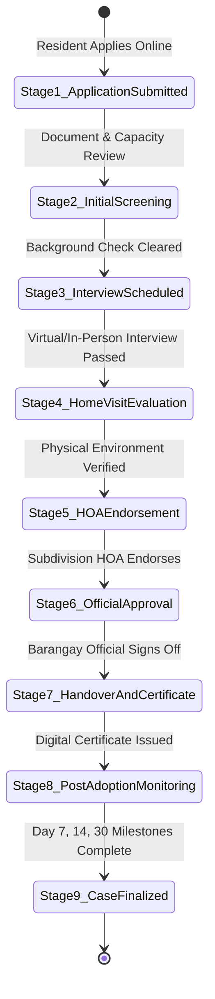

# StraySafe 2.0: Master System Presentation Flow & Functional Specification
**The Complete Multi-Tier Community Stray Animal Management & Digital Welfare Ecosystem**

---

## 📋 Presentation Overview & Document Scope

| Attribute | Specification |
|---|---|
| **System Name** | **StraySafe 2.0** |
| **Document Purpose** | Comprehensive Presentation Script, Exhaustive Functional Specification, and Panel Defense Playbook |
| **Target Audience** | Academic Thesis Evaluation Panel, Barangay Councils, Subdivision HOAs, City Veterinarian Offices |
| **Scope Covered** | **100% of all functions, pages, modules, user roles, AI pipelines, and backend algorithms** |
| **Architecture** | 4-Tier Role-Based Access Control (RBAC) + Public Guest Tier |
| **Tech Stack** | React 19 + TypeScript, Tailwind CSS, FastAPI, SQLAlchemy 2.0, MySQL 8.0, YOLOv8n, Google Gemini AI, Leaflet / OSRM, Cloudinary, Web Push |

---

## 🗺️ Master Functional Architecture Matrix

```mermaid
graph TD
    subgraph PUBLIC["Public Guest Access (No Login)"]
        P1["Landing Page & Awareness"]
        P2["Scan-to-Reunite Pet QR (/pet/scan/:token)"]
        P3["Public Adoption Catalog (/adopt)"]
        P4["Animal Journey Map (/adopt/journey/:id)"]
        P5["Digital Certificate Verifier (/verify/certificate/:number)"]
    end

    subgraph RESIDENT["Citizen / Resident Portal (Role 1)"]
        R1["Community Feed & Alerts"]
        R2["AI Stray Reporting Wizard with Geofence"]
        R3["Smart Pet Registry with Auto-Advancing Age"]
        R4["Digital QR Tag Management & Scan Logs"]
        R5["AI Lost/Found Match Review"]
        R6["Pet Custody Claims & Dispute Filing"]
        R7["Online Adoption Application & Tracking"]
    end

    subgraph SUBD["Subdivision Leader Portal (Role 2)"]
        S1["Local Incident Dashboard & Live Map"]
        S2["Community Triage & AI Verification"]
        S3["Duplicate Detection & Case Merging"]
        S4["Private-to-Public Sighting Publisher"]
        S5["Temporary Holding Facility Intake & Care"]
        S6["Responsible Pet Ownership Warnings"]
        S7["Adoption Application HOA Endorsements"]
        S8["Community Hazard & Aggression Alerts"]
    end

    subgraph BRGY["Barangay Animal Welfare Portal (Role 3)"]
        B1["Municipal Command Center & Live Heatmap"]
        B2["Rescue Mission Dispatch & OSRM Routing"]
        B3["Municipal Holding Impound & Vet Logs"]
        B4["End-to-End 9-Stage Adoption Lifecycle"]
        B5["Digital Certificate Generation"]
        B6["Adoption Task & Field Visit Calendar"]
        B7["Anti-Rabies Drive Community Alerts"]
        B8["Staff Personnel Invitation & Onboarding"]
    end

    subgraph ADMIN["System Administrator Portal (Role 4)"]
        A1["Executive Business Intelligence Analytics"]
        A2["Empirical Resolution Velocity & AI Audit Rates"]
        A3["Universal User Management & RBAC"]
        A4["Spatial Clustering Heatmap"]
        A5["Comprehensive Enterprise Audit Trail"]
        A6["Geofence Coordinates & System Controls"]
    end

    PUBLIC --> RESIDENT
    RESIDENT --> SUBD
    SUBD --> BRGY
    BRGY --> ADMIN
```



---

## ⏱️ Recommended Presentation Agenda (20 – 25 Minutes)

```
00:00 – 03:00 │ ACT 1: Executive Briefing, Problem Statement & Governance Framework
03:00 – 08:30 │ ACT 2: Citizen Experience — Pet Registry, Smart Age, QR Recovery & AI Reporting
08:30 – 12:30 │ ACT 3: Subdivision Leader Triage — Live Map, Duplicate Merge, Holding & Warnings
12:30 – 17:30 │ ACT 4: Barangay Operations — Rescue Routing, Holding Shelter & 9-Stage Adoption
17:30 – 20:30 │ ACT 5: System Administration — Business Analytics, AI Audit Rates & Security Logs
20:30 – 25:00 │ ACT 6: Architectural Rigor, Data Privacy Act (RA 10173) & Master Defense Q&A
```

---

## 📚 Exhaustive Functional Breakdown by Portal

---

## 🌐 PORTAL 1: Public / Unauthenticated Tier (No Login Required)

*Designed for maximum community accessibility, allowing any smartphone user to assist lost animals without barriers.*

### 1.1 Public Landing Page (`/`)
- **Community Hero & Mission Statement:** Introduces the municipal animal welfare initiative.
- **Dynamic Quick Statistics:** Live counter of registered pets, reunited animals, and successful adoptions.
- **Portals Navigator:** Fast access links for Citizen Sign-In, Subdivision Leader Login, Barangay Personnel Portal, and Public Adoption Catalog.

### 1.2 "Scan-to-Reunite" Pet QR Code Page (`/pet/scan/:token`)
- **Zero-Barrier Identification:** Anyone who scans a StraySafe physical pet tag (collar QR) is taken directly to this mobile-optimized page without downloading an app or registering.
- **Protected Emergency Profile:** Shows the pet's photo, name, breed, sex, rabies vaccination badge, and the owner's emergency contact number (while redacting the owner's residential address for safety).
- **One-Tap Location Sighting (`/pet/scan/:token/success`):** With a single tap, the finder can send their current GPS coordinates and an optional message (*"Found resting near Central Park Gate 2"*) directly to the owner via in-app and Web Push alerts.

### 1.3 Public Stray Animal Adoption Catalog (`/adopt`)
- **Filterable Pet Gallery:** Citizens can browse animals currently sheltered at the Barangay or Subdivision facilities ready for adoption.
- **Rich Attribute Filtering:** Filter by Species (*Dog/Cat*), Gender (*Male/Female*), Size (*Small, Medium, Large*), and Age Category (*Puppy/Kitten, Young, Adult, Senior*).
- **Animal Background Story:** Highlights rescue dates, personality traits, health conditions, and vaccination status.

### 1.4 Animal Journey & Rehabilitation Map (`/adopt/journey/:id`)
- **Visual Welfare Timeline:** Displays the complete journey of a rescued animal from initial rescue sighting, medical treatment, quarantine, and shelter life, building emotional connection with prospective adopters.
- **Interactive Rescue Coordinate Pin:** Visualizes where the animal was rescued within the community.

### 1.5 Digital Adoption Certificate Public Authenticator (`/verify/certificate/:number`)
- **Anti-Fraud Ownership Check:** Anyone (police, animal welfare inspectors, veterinarians, or barangay tanods) can enter or scan an adoption certificate serial number.
- **Cryptographic Verification:** Validates the official adoption date, adopter name, pet microchip/id, approving official name, and official Barangay seal.

---

## 👤 PORTAL 2: Citizen / Resident Experience (Role ID = 1)

*Empowers pet owners and vigilant residents with AI tools, automated pet aging, lost pet matching, and structured adoption.*

### 2.1 Resident Authentication & Session Security
- **Dual Authentication Modes:** Email OTP passwordless login and Google OAuth integration.
- **Password Security Policy:** Strong 12–128 character policy with bcrypt salt hashing.
- **Auto-Inactivity Manager:** Client-side inactivity timer that protects citizen accounts if left open on shared computers.

### 2.2 Community Feed & Incident Alerts (`/resident-home`)
- **Live Community Stream:** Chronological feed of public sightings, lost pet alerts, and official Barangay announcements.
- **Incident Status Filters:** Quick filters for *Lost Pets*, *Found Strays*, *Community Sightings*, and *Resolved Cases*.
- **Interactive Map Toggle:** Switch between card feed and spatial map view of nearby sightings.

### 2.3 Smart Pet Registration & Profile Management (`/resident/pets`)
- **Multi-Angle Photographic Identification:**
  - Primary identification avatar.
  - Optional multi-angle views: **Front View**, **Left Side View**, and **Right Side View** to document unique coat patches.
- **AI Photo Authenticity Guard (`usePetPhotoGuard`):**
  - Verifies that uploaded files are real animal photographs, rejecting synthetic or non-animal imagery.
  - **Multi-Animal Crop Guard:** If the camera captures multiple animals, the system requires the resident to crop and isolate the specific pet being registered to maintain 1:1 biometric integrity.
- **Standardized Coat Pattern Dropdown with Plain-English Descriptions:**
  - Dropdown presets tailored for dogs and cats:
    - *Solid / Plain* (Single color all over)
    - *Bicolor / Patched* (Two distinct colors, white chest/belly with dark body)
    - *Tuxedo* (Dark body with white chest, belly, and paws like a suit)
    - *Tricolor / Calico* (Three distinct colors)
    - *Brindle (Tiger Stripes)* (Subtle dark stripes over brown/tan coat)
    - *Tabby (Striped / Swirled)* (Classic swirls or "M" forehead marking)
    - *Socks / Booties* (White markings on paws/legs)
    - *Mask / Dark Muzzle* (Dark fur covering muzzle and eyes)
    - *Points / Colorpoint* (Darker face, ears, paws, and tail)
    - *Blaze / Chest Star* (White vertical stripe between eyes or star on chest)
    - *Spotted / Flecked*, *Saddle / Blanket*, *Merle / Dappled*, and *Other*.
  - **Interactive Helper Preview:** Displays a helper card explaining the selected pattern.
  - **Specific Markings Input:** Freeform field for unique marks (*"White star on chest, scar on left ear"*).
- **Smart Dual-Mode Age Selector & Dynamic Auto-Advancing Age Engine:**
  - **Mode A: Approximate Age (Default):**
    - Quick pick buttons: *Puppy/Kitten (<6 mos)*, *Young (1 yr)*, *Adult (3 yrs)*, *Senior (7 yrs)*.
    - Dual dropdowns for **Years (0–20)** and **Months (0–11)**.
    - System calculates and saves an approximate birth date.
  - **Mode B: Exact Birthday:** Date picker for owners who know their pet's exact date of birth.
  - **Dynamic Auto-Advancing Display:** Pet records automatically calculate and advance their age as months and years go by (`calculateAge(pet.birth_date, pet.estimated_age)`) without requiring background cron updates.
- **Health & Veterinary Records:**
  - Anti-rabies vaccination status, vaccination date, and expiry calculation.
  - Spay / Neuter (Kapon) status tracking.
  - Medical condition notes and Cloudinary-hosted vaccination card image upload.
- **Behavioral Profiling:** Temperament (*Friendly, Timid, Playful, Aggressive*), bite history tracking, and chase behavior flags.

### 2.4 Digital Pet ID Card & QR Tag Generation (`/resident/pet/:petId/qr`)
- **Printable / Digital QR Badge:** Generates high-resolution printable QR code cards formatted for collar tags or wallet cards.
- **Dynamic Token Assignment:** Cryptographic token tied to the pet's permanent database reference code (`P-00001`).
- **Scan History Audit Log (`/resident/pet/:petId/scan-history`):** Complete timeline of every time the pet's tag was scanned, including timestamps and finder GPS locations.

### 2.5 Advanced Stray Reporting Wizard (`/resident/report/new`)
- **Multi-Category Incident Triage:** File reports for *Lost Pet*, *Found Stray Animal*, *General Sighting*, or *Aggressive / Rabies Hazard Animal*.
- **Geofenced Leaflet Map with Landmark Snapping:**
  - Coordinate selection restricted to the authorized pilot municipality boundary.
  - Snapping algorithm snaps pins to known community landmarks within 60 meters.
  - Automatic subdivision jurisdiction detection based on GPS coordinates.
- **Integrated AI Photo Triage (YOLOv8n + Google Gemini):**
  - Instant species detection (*Dog vs Cat*).
  - Breed suggestion with confidence rating (*e.g. Aspin, Shih Tzu, Puspin, Persian*).
  - Dominant color extraction (*Primary, Secondary, and Tertiary colors*).
  - Inferred coat pattern and physical size estimation.
  - Suggested incident priority level based on photo injury/aggression visual cues.
- **Privacy-by-Design Default:** Every submitted report starts as **Private**, protecting the resident's identity until HOA leaders review it.

### 2.6 Incident Tracking & Progression Timeline (`/resident/reports/:id`)
- **Status Progression Stepper:** Real-time visual tracking from *Submitted → Verified → Responders Dispatched → Rescued / Secured → Closed / Reunited*.
- **Direct Sighting Comments:** Add supplementary sightings, photos, or neighborhood updates.
- **Dispute Filing Mechanism:** If an animal in a report is mistakenly identified, residents can file a formal dispute with photographic proof.

### 2.7 AI Potential Match Review (`/resident/reports/:reportId/match-review`)
- **Automated Lost-and-Found Cross-Referencing:** Backend AI continuously compares lost pet records against incoming found and sighted stray reports.
- **Multi-Attribute Similarity Scoring:** Computes composite match percentages based on species match, breed similarity, color harmony, coat pattern, and geographic distance.
- **Side-by-Side Verification Screen:** Resident can compare photos, confirm a match, or reject false positives.

### 2.8 Pet Ownership Claims & Recovery Dashboard (`/resident/pet/:petId/claims-dashboard`)
- **Proof-of-Ownership Submissions:** Submit adoption papers, old photos, or veterinary receipts to claim a pet sheltered at a holding facility.
- **Claim Status Tracking:** Follows claim review by HOA leaders and Barangay animal welfare officers.

### 2.9 Online Adoption Application & Lifecycle Tracking
- **Adoption Application Wizard (`/adopt/apply/:id`):** Multi-step questionnaire capturing housing suitability, landlord permission, yard enclosure, other household pets, and family consensus.
- **Resident Adoption Dashboard (`/adopt/applications`):** Tracks the application as it moves through the 9-stage adoption lifecycle.
- **Post-Adoption Milestone Check-in Interface:** Submit Day 7, Day 14, and Day 30 health photos and updates directly to the Barangay monitoring team.

### 2.10 Resident Settings & Web Push Notifications (`/resident/settings`)
- **Granular Web Push Toggles:** Toggle push notifications for *Lost Pet Alerts*, *Community Sighting Updates*, *Warning Notifications*, and *Adoption Status Changes*.
- **Password Updates:** Secure password modification with current password verification.

---

## 🏘️ PORTAL 3: Subdivision Leader Portal (Role ID = 2 - Community Level)

*Acts as the primary community triage point, filtering false reports, maintaining neighborhood holding, and enforcing responsible ownership.*

### 3.1 Subdivision Command Center Dashboard (`/subd/dashboard`)
- **Localized Key Performance Indicators:** Live metrics for *Active Reports in Subdivision*, *Pets Sheltered in Holding*, *Pending Validations*, and *Local Pet Registrations*.
- **Jurisdictional Incident Map:** Leaflet map centered strictly on the subdivision's geofenced boundary, showing incident pins categorized by priority.

### 3.2 Incident Verification & Community Triage (`/subd/reports` & `/subd/reports/:id`)
- **AI Recommendation Audit:** Leader reviews the AI's suggested species, breed, colors, and priority, with full authority to modify fields.
- **Duplicate Detection & Case Merging Flow:**
  - System flags reports filed at similar times and locations with matching animal visuals.
  - Leader can merge duplicate sightings into a single master incident, preserving all citizen photos and timestamps in a unified audit log.
- **Privacy-First Visibility Toggle:**
  - Leader reviews the private report and chooses whether to publish it as a **Public Community Sighting**.
  - When published, resident personal phone numbers and private addresses are stripped to comply with RA 10173.
- **Incident Escalation:** One-tap escalation to the central Barangay Animal Welfare Office if the animal is aggressive, injured, or requires specialized rescue equipment.

### 3.3 Subdivision Temporary Holding Facility Manager (`/subd/holding-facility`)
- **Capacity Monitoring:** Real-time progress bar of occupied cages/kennels vs total facility limit.
- **Animal Intake Logging:** Record intake photos, temporary cage numbers, estimated age, and initial condition.
- **Daily Feeding & Care Logbook:** Digital log of feedings, behavior observations, and medications administered.
- **Transfer to Barangay Workflow:** Generate a digital transfer handover manifest when transferring an animal to the central Barangay shelter.

### 3.4 Community Master Pet Registry (`/subd/pet-records`)
- **Subdivision Pet Database:** Searchable and filterable table of all pets registered within the subdivision.
- **Staff-Assisted Pet Registration (`AddPetModal`):**
  - Allows leaders to register pets for elderly residents or residents without smartphones.
  - Full parity with citizen registration: includes coat pattern presets dropdown, smart dual-mode age selector, and multi-angle photo uploads.
  - **Offline Owner Mode:** Records non-app owner names, phone numbers, and lot numbers on the pet record.
- **Deceased & Archived Pet Records (`/subd/removed-pets`):** Maintain historical records of pets that have passed away or moved to another jurisdiction.

### 3.5 Responsible Pet Ownership Warning Issuance
- **Direct Citation Dispatch:** Issue formal warnings to residents whose pets repeatedly roam unleashed, cause neighborhood disturbances, or lack mandatory rabies vaccinations.
- **Warning Status Tracking:** Track whether the citizen has viewed and acknowledged the warning in their portal.

### 3.6 Subdivision Adoption Endorsement Arch (`/subd/endorsements`)
- **Local Background Screening:** Subdivision leaders verify if an applicant from their neighborhood is a responsible resident before endorsing the adoption application to the Barangay.

### 3.7 Neighborhood Hazard Broadcast (`/subd/hazard-alert`)
- **Emergency Alert Dispatch:** Instantly broadcast a high-visibility hazard warning (via in-app banner and Web Push) to all subdivision residents regarding an aggressive stray or suspected rabies case.

### 3.8 Communications & Messaging Hub (`/subd/messages`)
- **Direct Citizen Messaging:** Chat directly with residents who filed reports to request additional sighting details.
- **Barangay Liaison Channel:** Direct communication bridge with Barangay animal welfare dispatchers.

### 3.9 Subdivision Analytics (`/subd/analytics`)
- **Local Incident Metrics:** Charts showing stray reports over time, resolution rates, and holding facility turnaround times for HOA board reports.

---

## 🏛️ PORTAL 4: Barangay Animal Welfare Operations (Role ID = 3 - LGU Level)

*Central operations hub for municipal animal control, professional rescue dispatch, impound healthcare, and the 9-stage adoption lifecycle.*

### 4.1 Municipal Command Center Dashboard (`/brgy/dashboard`)
- **Comprehensive LGU Metrics:** Real-time counters for *Total Active Rescues*, *Occupied Impound Capacity*, *Pending Adoption Applications*, and *Vaccination Drive Numbers*.
- **Live Operations Activity Feed:** Live ticker of incoming reports, citizen QR scans, and field responder updates.

### 4.2 Geospatial Hotspot Heatmap
- **Kernel Density Spatial Clustering:** Visualizes high-density clusters of stray sightings and aggressive encounters across all subdivisions to deploy animal control patrols efficiently.

### 4.3 Rescue Dispatch & Turn-by-Turn Routing (`/brgy/rescue-requests` & `/brgy/reports/:id`)
- **Field Assignment Workflow:** Assign specific rescue teams and officers to open incidents.
- **OSRM Turn-by-Turn Routing Control:** Integrated Open Source Routing Machine computes optimal driving routes from the Barangay Hall directly to the sighting pin with live distance and travel time estimates.
- **On-Scene Incident Resolution:** Responders log outcome (*Secured in Vehicle, Returned to Owner on Site, False Alarm, Animal Fled*).

### 4.4 Central Municipal Holding Facility & Healthcare (`/brgy/holding-facility`)
- **Intake & Quarantine Logging:** Log animals arriving from field rescues or subdivision holding transfers.
- **Veterinary Examination & Medical Cards:**
  - Record veterinary evaluations, weight changes, body condition score (1–9).
  - Administer and log anti-rabies vaccines, deworming, and medical treatments.
  - Record rabies quarantine monitoring periods (14-day observation for bite incidents).
- **Disposition Tracking:** Record disposition status (*In Holding, Under Medical Care, Up for Adoption, Reunited with Owner, Humanely Euthanized*).

### 4.5 The 9-Stage Adoption Lifecycle Engine (`/brgy/adoptions`)
*A legally compliant adoption pipeline ensuring thorough vetting, accountability, and post-placement welfare.*



- **Stage 1 — Application Submitted:** Initial intake of citizen adoption application.
- **Stage 2 — Initial Screening:** Verification of valid government ID, household capability, and landlord permissions.
- **Stage 3 — Interview Scheduling:** Conduct structured applicant interview (teleconference or in-person).
- **Stage 4 — Home Visit Evaluation:** On-site inspection of yard fencing, shelter conditions, and hazard prevention.
- **Stage 5 — HOA Endorsement:** Verification with the applicant's Subdivision Leader.
- **Stage 6 — Official Approval:** Final endorsement by the Barangay Animal Welfare Officer.
- **Stage 7 — Formal Handover & Digital Certificate Generation:**
  - Physical animal handover.
  - Automatically generates an official **Digital Adoption Certificate** with a unique cryptographic serial number.
  - Ownership in the database is officially transferred to the adopter's account.
- **Stage 8 — Post-Adoption Milestone Monitoring (Day 7, 14, 30):**
  - Adopter submits photos and health updates at mandatory 7-day, 14-day, and 30-day intervals.
  - Barangay officers inspect submissions and log welfare approval.
- **Stage 9 — Case Finalized:** Successful completion of probation; animal is permanently registered to the adopter.

### 4.6 Adoption Task Calendar (`/brgy/adoption-tasks`)
- **Field Work Scheduler:** Calendar view of scheduled home visits, adoption interviews, and overdue post-adoption check-ins assigned to staff.

### 4.7 Barangay Community Alerts & Anti-Rabies Campaigns (`/brgy/community-alerts`)
- **Official Broadcast Tool:** Publish announcements for free anti-rabies vaccination drives, spay/neuter outreach, and lost animal bulletins sent to all verified residents.

### 4.8 Personnel Management & Invitation Onboarding (`/brgy/personnel`)
- **Email Invitation System:** Admins/officers invite new staff members via email containing a secure setup code (no manual password distribution).
- **Roster & Active Status Control:** Manage active/inactive field personnel and emergency dispatch contacts.

### 4.9 Custody Dispute Adjudication (`/brgy/pet-claims`)
- **Formal Custody Resolution:** Adjudicate conflicting ownership claims for reclaimed pets, evaluating submitted evidence and issuing final custody resolutions.

---

## ⚙️ PORTAL 5: System Administration & Governance (Role ID = 4)

*Executive command, empirical business intelligence, user security, and audit governance.*

### 5.1 Universal Executive Dashboard (`/admin/dashboard`)
- **Cross-Jurisdiction Overview:** Aggregated statistics spanning all subdivisions, staff members, residents, and active rescue cases.
- **System Health Monitor:** Database connection status, AI worker status, and Cloudinary storage health.

### 5.2 Enterprise Business Intelligence & Analytics Engine (`/admin/analytics`)
*Built to provide empirical, audit-proof data for municipal budget justification and policy decisions.*

- **Granular Timeline Aggregations:**
  - Interactive charts toggleable between **Daily**, **Weekly**, and **Monthly** intervals.
  - **Equal-Period Comparisons:** Compare current period metrics against previous identical timeframes (*e.g., this month vs last month*).
  - **Zero-Filled Continuous Timelines:** Robust math ensuring days or weeks with zero incidents are represented accurately without skewing trends.
- **Empirical Resolution Velocity & Durations:**
  - Measures true operational duration from initial citizen report to rescue and disposition.
  - Identifies operational bottlenecks in specific subdivisions.
- **Human-in-the-Loop AI Audit & Review Rate:**
  - Explicitly tracks how often human officers accept, modify, or override AI suggestions (breed, priority, species).
  - Validates human oversight over autonomous algorithms.
- **Shelter & Holding Capacity Utilization Curves:**
  - Tracks kennel occupancy rates across all facilities over time.
- **Multi-Dimensional Query Filtering:** Filter metrics simultaneously by Species (*All, Dogs, Cats*), Status (*Active, Rescued, Closed*), Subdivision jurisdiction, and Custom Date Ranges.

### 5.3 Universal User Management & RBAC Controller (`/admin/users`)
- **Role Assignment & Tier Control:** Assign and modify user roles between Citizen (1), Subdivision Leader (2), Barangay Staff (3), and Administrator (4).
- **Account Moderation:** Lock, suspend, or reactivate accounts; view registration dates and login histories.

### 5.4 High-Density Spatial Clustering Heatmap (`/admin/heatmap`)
- **Municipal Heatmap Visualization:** High-performance Leaflet canvas rendering stray animal sighting densities, repeat aggressive animal encounters, and rabies quarantine zones.

### 5.5 Enterprise Audit Trail & Security Filtering (`/admin/logs`)
- **Immutable State Logging:** Every role change, pet profile modification, photo override, adoption handover, and system login attempt is permanently logged.
- **Database-Level Performance Filtering:** Filter logs by category (*Security, Authentication, Adoption, Custody, Report*) with database-indexed query execution.
- **Export Capabilities:** Export audit records for official LGU governance compliance.

### 5.6 Global Settings & Geofence Coordinates (`/admin/account-settings`)
- **Geofence Boundary Configuration:** Edit the polygon coordinates defining the active service area.
- **AI Feature Toggles:** Global kill-switch to enable or disable AI photo matching or auto-triage if API limits or offline conditions require manual mode.

---

## 🤖 PORTAL 6: AI & Backend Automation Services

*The under-the-hood machine learning and algorithmic pipelines powering StraySafe 2.0.*

### 6.1 YOLOv8n Object Detection Pipeline
- **Edge-Optimized Neural Network:** Runs lightweight YOLOv8 Nano (`yolov8n.pt`) on incoming uploads.
- **Animal Presence & Bounding Box Extraction:** Rapidly verifies the presence of canines or felines and isolates coordinates for secondary inspection.

### 6.2 Google Gemini Vision Multi-Attribute Analysis
- **Context-Aware Semantic Extraction:** Analyzes high-resolution images to suggest:
  - *Species* (Dog / Cat)
  - *Possible Breed* (Standardized against international and local Philippine breeds like Aspin / Puspin)
  - *Color Palette* (Primary, Secondary, Tertiary)
  - *Coat Pattern* (Mapped directly into StraySafe's 14 coat presets)
  - *Estimated Size* (Small <10kg, Medium 10-25kg, Large >25kg)
  - *Incident Severity & Priority Level* (Low, Medium, High, Critical) with documented reasoning.

### 6.3 Photo Authenticity Guard & Synthetic Media Detection
- **Anti-Fraud Filter:** Evaluates image textures, noise distribution, and synthetic generation markers to reject AI-generated images, stuffed toys, or internet stock photos.

### 6.4 Multi-Animal Frame Detection & Crop Isolator
- **1:1 Animal Guarantee:** Detects if multiple pets are present in a single frame. Instead of failing blindly, triggers an interactive canvas cropper allowing the user to select the specific animal being registered.

### 6.5 Multi-Attribute Cosine & Heuristic Pet Matching Engine
- **Lost & Found Automated Cross-Matching:** Computes weighted multi-attribute similarity vectors:
  $$\text{Match Score} = w_1 S_{\text{species}} + w_2 S_{\text{breed}} + w_3 S_{\text{colors}} + w_4 S_{\text{pattern}} + w_5 S_{\text{distance}}$$
- Automatically alerts owners when a found stray closely matches their lost pet record.

### 6.6 Smart Age Continuous Auto-Advancing Engine
- **Dynamic Age Resolution:** Stores an exact or approximate `birth_date`. All interfaces compute age on-the-fly relative to current system time, ensuring pet records age realistically over years with zero database write updates.

### 6.7 Web Push Notification Infrastructure
- **VAPID-Secured Real-Time Push (`pywebpush`):** Delivers critical push alerts directly to user devices (desktop & Android mobile browsers) without requiring third-party SMS gateway fees.

---

## 🛡️ Master Panel Defense Playbook: Tough Questions & Answers

| # | Anticipated Panelist Question | Authoritative, Implementation-Backed Answer |
|---|---|---|
| **1** | *"What if your AI makes a mistake and identifies an Aspin as a Labrador or flags a normal dog as aggressive?"* | **"StraySafe 2.0 implements a strict Human-in-the-Loop architectural pattern.** The AI model never makes autonomous legal decisions. It only populates editable draft suggestions. Subdivision Leaders and Barangay Officers review every field and have complete authority to override species, breed, colors, and priority. Furthermore, our Executive Analytics Dashboard explicitly tracks the human override rate, providing transparent empirical auditing of AI performance." |
| **2** | *"How do you prevent malicious users from spamming the system with photos of stuffed toys, cartoons, or fake internet images?"* | **"We deploy a multi-layered Photo Guard pipeline.** First, file-type, MIME, and canvas downscaling sanitize incoming payloads. Second, the backend AI performs photo authenticity verification, detecting synthetic artifacts and confirming biological animal presence. Third, our Multi-Animal Crop Guard requires users to isolate individual animals, preventing duplicate or ambiguous registrations." |
| **3** | *"How does StraySafe 2.0 protect citizen privacy under the Philippine Data Privacy Act of 2012 (RA 10173)?"* | **"Through Privacy-by-Design defaults.** Every incident report submitted by a resident is initialized as **Private** by default. Only an authorized Subdivision Leader can toggle it to a public community sighting, which automatically redacts the reporter's phone number, email, and exact home address. Additionally, public QR code collar scans reveal only emergency contact information explicitly chosen by the pet owner." |
| **4** | *"If an owner registered a 2-month-old puppy last year, will the database still show it as a 2-month-old puppy today?"* | **"No, because of our Smart Age auto-advancing engine.** StraySafe 2.0 avoids storing static age strings. When a pet is registered, the system derives and stores an approximate or exact `birth_date`. Whenever a profile, table, or QR code is opened, the system dynamically calculates the age relative to the current timestamp (`calculateAge()`). A puppy registered a year ago will automatically display as `1 yr 2 mos` today without running background database batch jobs." |
| **5** | *"Why did you use Web Push notifications instead of SMS alerts?"* | **"To ensure zero operational recurring costs for local government units.** SMS gateways in the Philippines require recurring per-message credits that drain municipal budgets. By leveraging the W3C Web Push API (`pywebpush`), StraySafe delivers instant, rich push notifications to mobile devices and desktops free of charge, with optional email notifications as an automated fallback." |
| **6** | *"What prevents an animal from outside your municipality from being reported in your system?"* | **"Our Geofenced Leaflet Engine enforces coordinate boundaries.** The system maintains coordinate boundary polygons in its configuration. If a citizen attempts to drop a pin outside the authorized jurisdiction, the system blocks report submission and provides immediate on-screen guidance directing the resident to the neighboring LGU's contact channels." |
| **7** | *"What is the significance of the 9-stage adoption lifecycle compared to standard adoption forms?"* | **"It ensures post-placement accountability and animal welfare compliance.** Most municipal adoptions end at handover, leading to pet abandonment or neglect. StraySafe's 9-stage pipeline includes structured screening, HOA background endorsements, digital certificate issuance (`/verify/certificate/:number`), and mandatory Day 7, Day 14, and Day 30 post-adoption health check-ins before a case is officially finalized." |
| **8** | *"How does the system handle pet ownership disputes when two residents claim the same animal?"* | **"Through our Pet Claims and Dispute Adjudication module.** Residents can file formal ownership claims with photographic proof and veterinary documents. Claims are routed through the Subdivision Leader for community validation and finalized by the Barangay Animal Welfare Officer, maintaining a complete audit trail in `report_disputes`." |
| **9** | *"What happens when multiple neighbors report the exact same stray dog on the same street?"* | **"Our Duplicate Detection & Case Merging engine resolves it.** When reports share spatial proximity and visual similarity, the Subdivision Leader is alerted with a duplicate notice. The leader can merge duplicate sightings into a single master incident with one tap, aggregating all photos and citizen comments into a single case file." |
| **10** | *"Can staff use StraySafe on low-end computers or unstable internet connections?"* | **"Yes, through code-splitting and optimized resource loading.** Our frontend implements dynamic route lazy-loading (`React.lazy`), reducing the initial JavaScript bundle from 5.4 MB down to fast, lightweight page chunks. Static assets are served via high-speed CDN, and images are resized and cached via Cloudinary." |

---

## 🎯 Final Presentation Checklist for the Defending Team

- [ ] **Tab 1:** Public Guest Window (`/adopt` & `/pet/scan/:token`)
- [ ] **Tab 2:** Resident Window (`/resident-home` & `/resident/pets`)
- [ ] **Tab 3:** Subdivision Leader Window (`/subd/dashboard` & `/subd/holding-facility`)
- [ ] **Tab 4:** Barangay Staff Window (`/brgy/dashboard` & `/brgy/adoptions`)
- [ ] **Tab 5:** System Administrator Window (`/admin/dashboard` & `/admin/analytics`)
- [ ] **Mobile Device:** Ready to scan a pet QR code live on camera to trigger the public "Scan-to-Reunite" flow.
