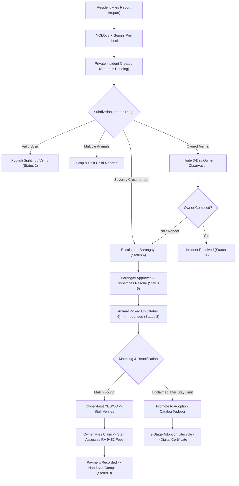

# StraySafe 2.0 — Comprehensive Whole-System & Reporting Process Audit

- **Date:** 2026-11-02 (Current System State)
- **Scope:** Complete StraySafe 2.0 ecosystem: Citizen Stray & Lost Pet Reporting, AI Pipeline & Vision Workers, Subdivision Triage & Observation, Barangay Dispatch & Holding Facilities, Pet Claims & Fee Assessment, 9-Stage Adoption Lifecycle, Smart QR Registry, RBAC Security, Database Schema, and Manuscript Alignment.
- **Method:** Static code analysis (backend FastAPI, frontend React/TypeScript, models, schemas, and routes), database schema comparison (`Database3.3.txt` vs ORM), testing suite inspection, and manuscript check against Chapters 1 & 2.
- **Status:** **Actionable Audit & Roadmap**

---

## Executive Summary

StraySafe 2.0 has achieved an exceptionally high level of functional maturity for its core community stray management workflows. The restoration phases (Phases 1 through 9) have stabilized:
- Multi-animal report splitting and photo cropping
- Incident heatmaps and spatial clustering with geofenced boundaries
- Subdivision Leader temporary custody and 3-day owner observation with strict warning rules
- Barangay holding facility management, stay clock calculations, and veterinarian logs
- Owner-first manual and AI-assisted pet matching (owner YES/NO confirmation before staff verification)
- Holding-contingent pet claiming and legal fee assessment under Republic Act No. 9482 (dog impounding fine ₱500–₱1,000, manual cat assessment)
- End-to-end 9-stage adoption lifecycle with automated digital certificates and Day 7/14/30 post-adoption check-ins
- Digital QR code pet registration and public scan landing pages

However, across the **entire system**, several critical gaps, architectural divergences, unbuilt plans, operational vulnerabilities, and academic requirements remain. This document provides an exhaustive inventory of **what else must be done**.

---

## Master Checklist: What Else Must Be Done

### 1. Academic Thesis & Manuscript Alignment (High Priority for Defense)

| ID | Issue / Topic | Documented in Thesis (Ch. 1 & 2) | Current Code Reality | Required Action |
|---|---|---|---|---|
| **M1** | **Triage Priority Workflow** | Chapters 1 & 2 describe a 2-stage workflow: *Subdivision Leader recommends priority, Barangay Staff finalizes it.* (Problem 6 / Objective 6) | No recommendation or finalization fields exist. Priority is computed by `effective_priority()` via AI or keywords. | **Decision required:** Either (a) update thesis text to reflect AI-suggested priority with human review, or (b) implement `recommended_priority` and `final_priority` fields in `reports` table, API, and UI. |
| **M2** | **Report Visibility Selection** | Thesis states residents select "Private" or "Public" sighting at form submission. | All citizen reports start strictly as **Private** (`is_public = False`). Only Subdivision Leaders can publish sightings publicly (`publish-sighting`). | **Update Thesis:** Highlight this as an intentional safeguard complying with the Philippine Data Privacy Act (RA 10173). |
| **M3** | **Notification Channels** | Thesis delimitation specifies "in-app and email only". | Web Push is implemented via `pywebpush` and browser service worker (`sw.js`). | **Update Thesis:** Add Web Push to the functional specification and clarify that SMS and native FCM are out of scope. |
| **M4** | **AI Capability Delimitation** | Thesis delimitation lists only animal detection and pet look-alike matching. | Gemini also suggests species, colors, size, estimated breed, risk factors, and triage priority. | **Update Thesis:** Align Chapter 1 delimitation with Chapter 2 and code to avoid panel deductions during defense. |
| **M5** | **Admin Emailed 2FA Code** | Thesis claims admin login requires an emailed OTP code. | Implemented in `auth.py`, but controlled by `ADMIN_LOGIN_2FA` env variable. Disabled by default in development. | Set `ADMIN_LOGIN_2FA=true` in staging/production `.env` or document as optional in thesis. |

---

### 2. Database Schema Synchronization & Integrity (`Database3.3.txt`)

The repository's master database initialization script, `Database3.3.txt`, was last synchronized on **2026-10-03**. Since then, 11 critical tables and numerous column modifications were added in SQLAlchemy models but have **not** been backported to `Database3.3.txt`:

- [ ] **Backport 11 Missing Tables to `Database3.3.txt`**:
  1. `claim_fee_schedules`: Configurable barangay impounding and boarding schedules.
  2. `claim_assessments`: Legal fee assessments (RA 9482 dog fine, cat claiming charges).
  3. `claim_assessment_changes`: Audit trail for payment recordings and fee waivers.
  4. `leader_identity_verifications`: Phase 6 leader identity verification records for disputed matches.
  5. `manual_match_decisions`: Decisions made via `/manual-matching` without AI scores.
  6. `pet_match_confirmation_requests`: Owner-first YES/NO confirmation queue for registered pets.
  7. `owner_followups`: Phase 3/4 3-day owner observation records.
  8. `followup_contact_logs`: In-person/phone contact records and verbal warnings for offline owners.
  9. `owner_observation_updates`: Citizen photo updates submitted during observation.
  10. `owner_observation_update_photos`: Media attachments for observation updates.
  11. `followup_repeated_incidents`: Logged repeat sightings linked to an active observation.
- [ ] **Run Duplicate Chat Threads Cleanup**:
  - The migration script `backend/scripts/merge_duplicate_chat_threads.py --apply` identified 2 duplicate empty report threads that need database consolidation.
- [ ] **Formalize Migration Tooling**:
  - Replace startup `create_all()` and manual inline `ALTER TABLE` statements in `main.py` with Alembic versioned migrations.

---

### 3. AI Pipeline, Worker Operations & Test Dataset (`AI_TODO.md`)

- [ ] **Collect and Label AI Test Dataset for Chapter 4**:
  - Current status: **0 photos collected**. CSV files (`labels_a.csv`, `labels_b.csv`, `pairs_a.csv`, `pairs_b.csv`) contain only headers.
  - Required dataset:
    - ~170 photos and 10 short videos across test conditions (Daylight 30, Low Light 20, Angle 20, Partial 20, Small 20, Breed 30, No Animal 15, Multiple Animals 15).
    - 40 photo comparison pairs (20 same animal, 20 look-alikes).
  - Execute `python scripts/check_test_set.py` and `python scripts/evaluate_ai.py` to produce Chapter 4 confusion matrices, precision, recall, and F1 scores.
- [ ] **Gemini Free Quota (20 requests/day) Safeguard**:
  - `gemini-2.5-flash` on free tier allows only 20 requests/day per project. Heavy rehearsal will trigger `429 Too Many Requests`, causing photos to show "Authenticity not checked (AI offline)".
  - Required action: Procure a backup API key on a separate Google Cloud project or enable billing before defense day.
- [ ] **AI Worker Daemonization**:
  - `python -m app.ai_worker` currently runs in a separate manual terminal.
  - Required action: Create a Windows service or PM2 / supervisor script to keep the background AI queue worker permanently running.
- [ ] **Clean Up Debug Prints**:
  - Remove verbose console logging `[analyze-media] ... detector=..., Gemini=...` from `backend/app/routes/reports.py`.

---

### 4. End-to-End Reporting Process Audit (Domain by Domain)



#### 4.1 Citizen Reporting Wizard (`/report`)
- **Implemented:** 6-step form, interactive location picker with Nominatim reverse geocoding, geofencing boundary validation (`coverage_settings`), media upload with YOLOv8 dog/cat verification, private-by-default visibility.
- **What Must Be Done:**
  - **Single vs Multi-Animal Handling:** When a resident submits a photo with 3 dogs but sets `animal_count = 1`, the split button is hidden from the leader's view. Allow leaders to manually split any report regardless of the reported animal count if they visually identify multiple animals.
  - **Offline Report Drafts:** If network drops during field reporting, form progress is lost. Add `localStorage` draft saving for Step 1–5 inputs.

#### 4.2 Subdivision Leader Triage & Observation (`/subd/reports`, `/subd/under-observation`)
- **Implemented:** Verification and rejection controls, duplicate report detection and merging (Status 18), 3-day countdown timer for pet owner observation, verbal warning logs for owners without accounts, formal written warning generation, repeated incident linking, and status 11 sync upon compliance.
- **What Must Be Done:**
  - **Commit Working Tree Polish:** Finalize and commit the icon removal on summary cards in `SubdHoldingFacility.tsx` and `SubdUnderObservation.tsx`.
  - **Multi-Animal Child Report Batch Actions:** When a group report is split into 3 child reports, closing the parent does not automatically cascade to child reports if they remain open. Ensure bulk resolution options exist.

#### 4.3 Barangay Operations, Dispatch & Impounding (`/brgy/rescue-requests`, `/brgy/holding-facility`)
- **Implemented:** Escalation approval (Status 13), team assignment, OSRM routing directions, holding facility intake (Status 8), stay limits (clock calculation), health logs, and deceased/transfer recording.
- **What Must Be Done:**
  - **Live GPS Responder Tracking (`LIVE_GPS_RESPONDER_TRACKING_PLAN.md`):** Currently **0% built (plan only)**. If live tracking of rescuers on the Leaflet map is required for defense, it must be implemented (moving responder marker, consent screen, geolocation poller). Otherwise, explicitly mark it as a Chapter 5 future recommendation.
  - **Holding Facility Capacity Warnings:** When cages/pens reach 100% capacity, warn staff before new intakes.

#### 4.4 Matching & Reunification (`/manual-matching`, `/claims`)
- **Implemented:** AI suggested matches and manual attribute filtering without AI scores; owner-first verification (owner must confirm YES before staff finalizes); claim eligibility gated on held animal; fee assessment with RA 9482 dog fines (₱500–₱1,000) and manual cat charges; OR receipt logging; handover gate preventing release until paid.
- **What Must Be Done:**
  - **Re-linking "Animal Cannot Be Found" Reports:** Reports closed as "Animal Cannot Be Found" currently terminate. Implement a 30-day candidate retention so subsequent sightings can suggest "May be the animal previously searched for".
  - **Automatic Re-matching on Photo Updates:** Re-trigger matching jobs when a registered pet's owner uploads clearer angle photos (currently only triggers when reports update photos).

#### 4.5 Adoption Pipeline (`/adopt`, `/brgy/adoptions`, `/brgy/adoption-tasks`)
- **Implemented:** Public adoption catalog, animal journey tracking, online application, 9-stage workflow (Verification -> Interview -> Home Visit -> HOA Endorsement -> Agreement -> Fees -> Certificate -> Handover -> Monitoring), single PDF certificate generation, public verification URL (`/verify/certificate/:number`), Day 7/14/30 post-adoption check-ins.
- **What Must Be Done:**
  - **Post-Adoption Failure / Return Workflow:** If an adoption fails during the 30-day monitoring period (e.g., severe pet incompatibility or neglect), define the formal return-to-facility intake status without corrupting the historical adoption certificate.

---

### 5. Mobile & Android App Verification (Capacitor)

- [ ] **Physical Android Device Validation**:
  - The Android debug APK is built via GitHub Actions (`.github/workflows/build-apk.yml`), but testing has been done exclusively on Chrome desktop responsive emulation (320px–430px).
  - Must verify on a physical Android handset:
    1. Native camera capture and photo upload via Capacitor WebView.
    2. Geolocation permissions (`ACCESS_FINE_LOCATION`) and real GPS pin placement.
    3. Hardware back-button navigation handling (preventing accidental app exits).
    4. Two-finger pan/zoom on Leaflet maps without viewport freezing.
- [ ] **Android Push Notifications**:
  - Web Push works on Chrome browsers. Native Android FCM push via Capacitor Push plugin is not yet configured.

---

### 6. DevOps, Security & Deployment Gaps

- [ ] **Backend CI / CD Pipeline**:
  - Currently, no automated tests run on push or pull request for the backend.
  - Add a GitHub Actions workflow to run the backend test suite and frontend `npm run build`.
- [ ] **Dockerization**:
  - Provide `Dockerfile` and `docker-compose.yml` for reproducible local and server deployment (FastAPI backend + MySQL 8 + Vite frontend).
- [ ] **Security Headers & Production Hardening**:
  - Configure FastAPI middleware for Content Security Policy (CSP), `X-Frame-Options: DENY`, `X-Content-Type-Options: nosniff`, and `Strict-Transport-Security` (HSTS).
  - Set `COOKIE_SECURE=true` in `.env` when deploying on HTTPS.
- [ ] **Frontend Lint Debt**:
  - `npm --prefix frontend run lint` currently outputs 2,013 problems (mostly TypeScript `any` annotations and unused imports in legacy files). Run a scoped cleanup on critical components.

---

## Prioritized Implementation Roadmap

```
┌─────────────────────────────────────────────────────────────────────────────┐
│ PHASE A: PRE-DEFENSE MUST-DO (Days 1–3)                                     │
│ 1. Synchronize Database3.3.txt with all 11 missing tables.                  │
│ 2. Run duplicate chat threads migration script.                             │
│ 3. Resolve Manuscript Chapter 1 & 2 triage and visibility discrepancies.    │
│ 4. Collect and label AI test photos (~170) and run evaluation script.       │
│ 5. Secure backup Gemini API key for presentation quota defense.             │
│ 6. Commit working tree UI polish (SubdHoldingFacility / UnderObservation).  │
├─────────────────────────────────────────────────────────────────────────────┤
│ PHASE B: STABILITY & OPERATIONS (Days 4–6)                                  │
│ 7. Test debug APK on physical Android device (camera, GPS, back button).    │
│ 8. Add Dockerfile and docker-compose.yml for reliable hosting.              │
│ 9. Add GitHub Actions CI workflow for backend test suite.                   │
│ 10. Implement security headers and production environment flags.            │
├─────────────────────────────────────────────────────────────────────────────┤
│ PHASE C: ENHANCEMENTS & POST-CAPSTONE (Future Scope)                        │
│ 11. Live GPS Responder Tracking (Leaflet real-time marker).                 │
│ 12. FCM native Android push notifications.                                  │
│ 13. Re-link "Animal Cannot Be Found" reports to 30-day matching pool.      │
│ 14. Full frontend ESLint zero-error refactor.                               │
└─────────────────────────────────────────────────────────────────────────────┘
```

