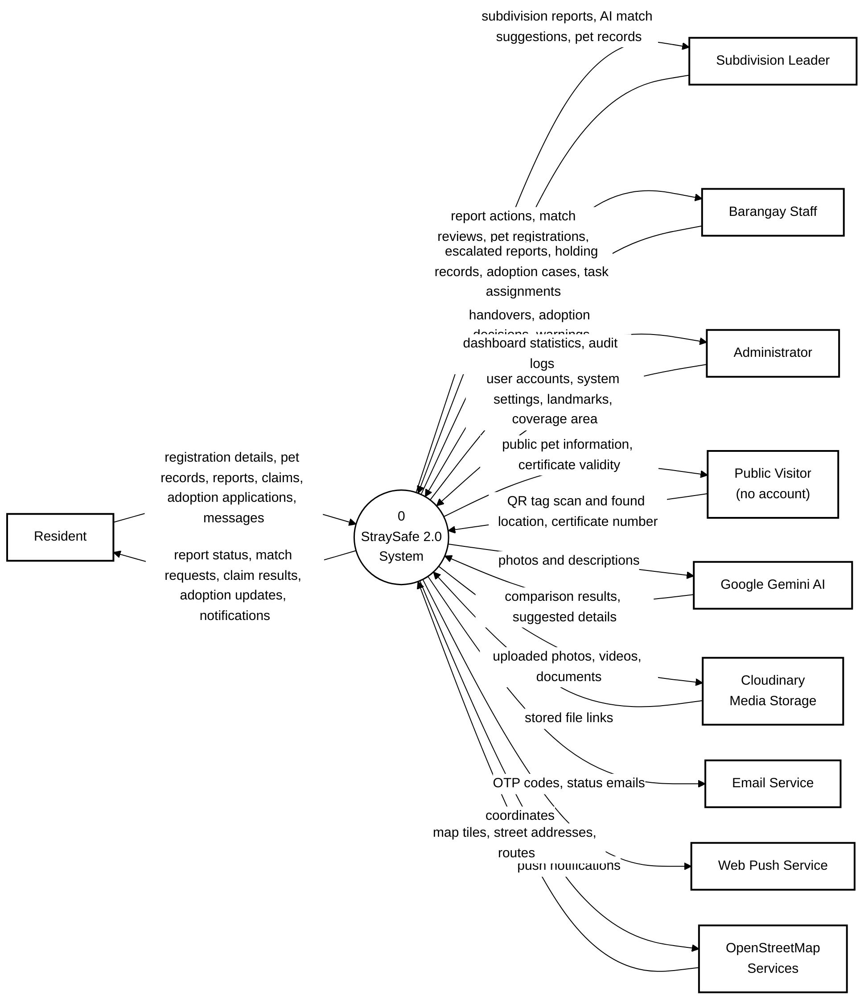

# Context Diagram (Level 0)

## Context Diagram

The context diagram shows StraySafe 2.0 as a single process and every outside party that exchanges data with it: the four user roles, members of the public without an account, and the five outside services the system relies on.

Raw code: [`mermaid/00_context_diagram.mmd`](mermaid/00_context_diagram.mmd)

**Legend.** Rectangle (bold border) = external entity · rounded box = process · grey cylinder = data store ·
dashed rounded box = a process shown on another diagram (connector) · arrow = data flow, labelled with the data that
moves.

| Process | Name                 | Description                                                                                                                                      |
| ------- | -------------------- | ------------------------------------------------------------------------------------------------------------------------------------------------ |
| 0       | StraySafe 2.0 System | The complete system: accounts, pets, reports, AI matching, rescue and holding, claims, adoption, communication, announcements and administration |

### External entities

| Entity                 | Exchanges with the system                                                                                                              |
| ---------------------- | -------------------------------------------------------------------------------------------------------------------------------------- |
| Resident               | Sends registrations, pet records, reports, claims and adoption applications; receives status updates, match requests and notifications |
| Subdivision Leader     | Handles reports in their subdivision, reviews AI matches, registers pets for owners, posts announcements                               |
| Barangay Staff         | Runs rescues and the holding facility, completes handovers, processes adoptions, issues owner warnings                                 |
| Administrator          | Manages user accounts, settings, landmarks and the coverage area; views statistics and audit logs                                      |
| Public Visitor         | Scans a pet's QR tag and reports where it was found; checks whether an adoption certificate is genuine (no sign-in needed)             |
| Google Gemini AI       | Receives photos and descriptions; returns comparison results and suggested animal details                                              |
| Cloudinary             | Stores uploaded photos, videos and documents and returns their links                                                                   |
| Email Service          | Delivers OTP codes and status emails (SMTP / Resend)                                                                                   |
| Web Push Service       | Delivers push notifications to browsers and phones                                                                                     |
| OpenStreetMap Services | Provides map tiles, street addresses (Nominatim) and routes (OSRM)                                                                     |
