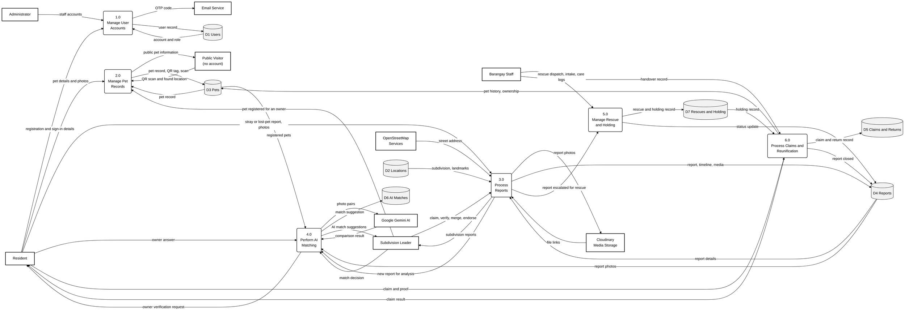
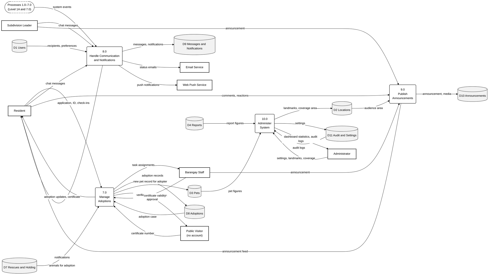

# Level 1 DFD

The Level 1 DFD breaks the system into its ten main processes. To keep it readable on a manuscript page it is drawn on two pages: **1A** covers the core operations (processes 1.0–6.0) and **1B** covers adoption and the supporting processes (7.0–10.0). The data stores D1–D11 correspond to the modules of the ERD.

## Level 1A — Core Operations (1.0–6.0)

Raw code: [`mermaid/01a_level1_core.mmd`](mermaid/01a_level1_core.mmd)

**Legend.** Rectangle (bold border) = external entity · rounded box = process · grey cylinder = data store ·
dashed rounded box = a process shown on another diagram (connector) · arrow = data flow, labelled with the data that
moves.

| Process | Name | Description |
|---|---|---|
| 1.0 | Manage User Accounts | Registers residents (with an emailed OTP), signs users in and out, and lets the administrator create staff accounts |
| 2.0 | Manage Pet Records | Registers pets and QR tags, records QR scans by finders, and handles ownership confirmations and owner warnings |
| 3.0 | Process Reports | Receives stray and lost-pet reports, and lets leaders claim, verify, merge, endorse and update them |
| 4.0 | Perform AI Matching | Analyses report photos and suggests matching reports or registered pets for staff and owners to confirm |
| 5.0 | Manage Rescue and Holding | Dispatches rescues and records animals taken into the holding facility and their care |
| 6.0 | Process Claims and Reunification | Handles owners' claims and records the handover of an animal back to its owner |

Data stores on this page: D1 Users, D2 Locations, D3 Pets, D4 Reports, D5 Claims and Returns, D6 AI Matches, D7 Rescues and Holding.

## Level 1B — Adoption and Support Processes (7.0–10.0)

Raw code: [`mermaid/01b_level1_support.mmd`](mermaid/01b_level1_support.mmd)

**Legend.** Rectangle (bold border) = external entity · rounded box = process · grey cylinder = data store ·
dashed rounded box = a process shown on another diagram (connector) · arrow = data flow, labelled with the data that
moves.

| Process | Name | Description |
|---|---|---|
| 7.0 | Manage Adoptions | Publishes adoptable animals, processes applications through screening, approval, handover, certificate and monitoring |
| 8.0 | Handle Communication and Notifications | Delivers chat messages, in-app notifications, push notifications and emails triggered by the other processes |
| 9.0 | Publish Announcements | Posts community alerts to a barangay or subdivision and records residents' comments and reactions |
| 10.0 | Administer System | Maintains settings, landmarks and the coverage area, and provides dashboard statistics and audit logs |

The dashed connector stands for processes 1.0–7.0, which send events (for example a new report or a claim decision) to process 8.0. Every process also writes an audit entry to D11; these flows are omitted for clarity.
