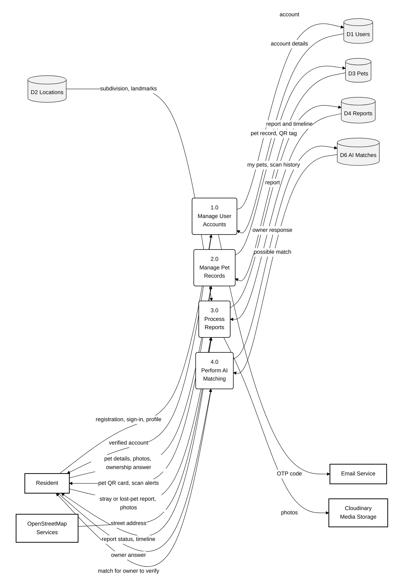
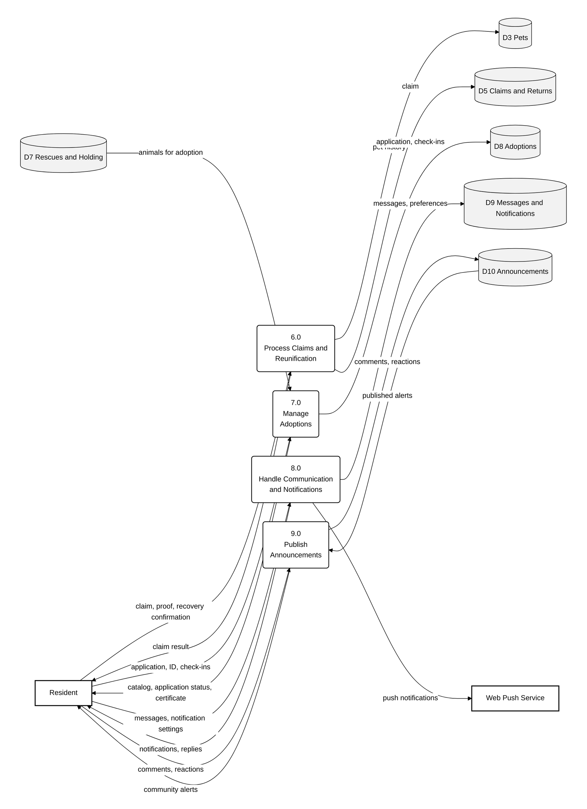
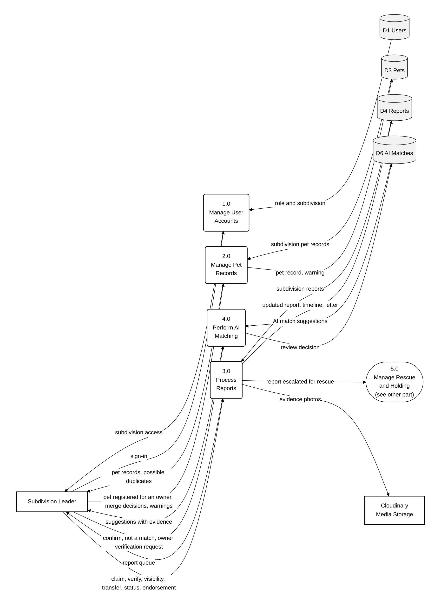
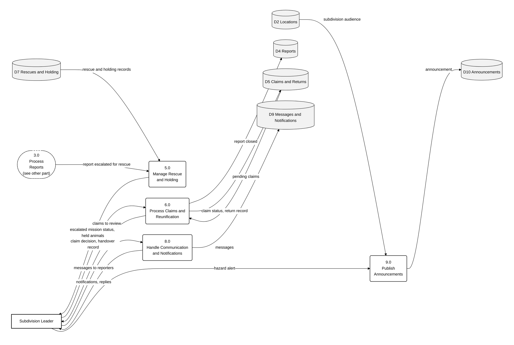
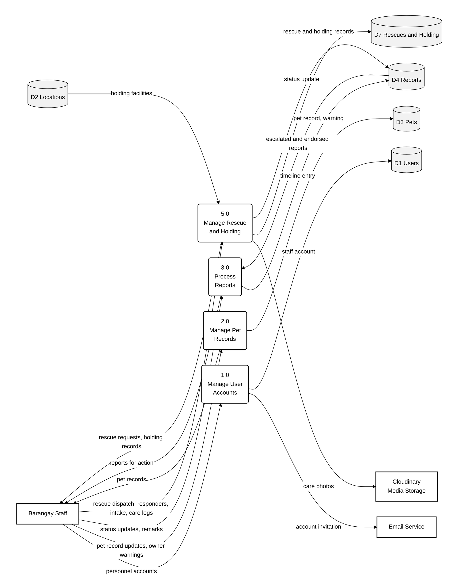
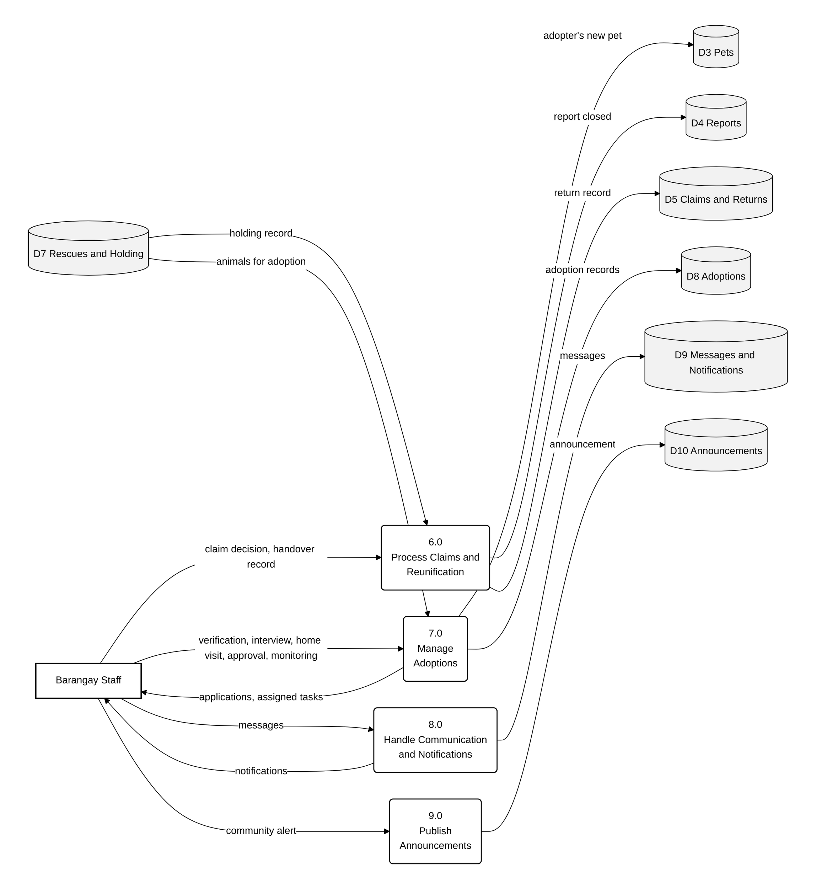
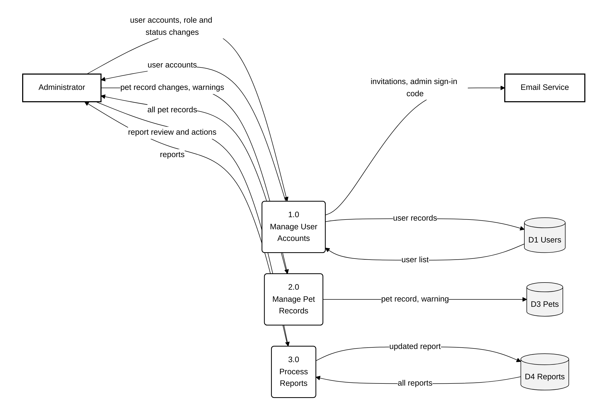
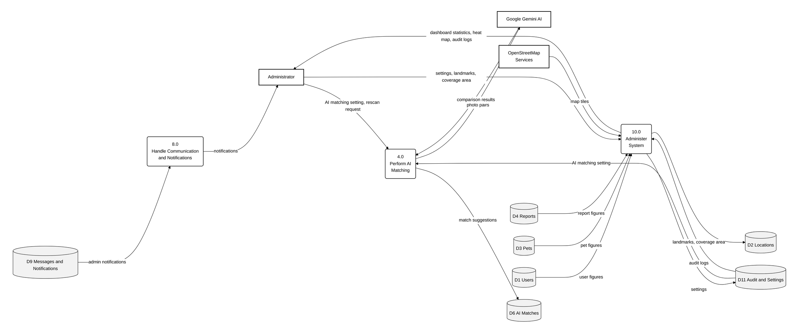

# Level 1 DFDs by User Role

The Level 1 DFD is presented once for each user role, so that every diagram shows only the processes, data flows and data stores that the role actually uses. All four use the same process numbers (1.0–10.0) and the same data stores (D1–D11), so they can be read side by side. Processes a role does not use are left out of that role's diagram.

| Role | Processes used |
|---|---|
| Resident | 1.0, 2.0, 3.0, 4.0, 6.0, 7.0, 8.0, 9.0 |
| Subdivision Leader | 1.0, 2.0, 3.0, 4.0, 5.0, 6.0, 8.0, 9.0 |
| Barangay Staff | 1.0, 2.0, 3.0, 5.0, 6.0, 7.0, 8.0, 9.0 |
| Administrator | 1.0, 2.0, 3.0, 4.0, 8.0, 10.0 |

## Level 1 DFD — Resident, Part 1: Accounts, Pets, Reports and AI Matching

Because the resident uses eight processes, the resident's Level 1 DFD is drawn on two pages. Part 1 covers the resident's account, pets, reports and the AI matches shown to owners. The resident is on the left and the data stores are on the right.

Raw code: [`mermaid/02r1_level1_resident_part1.mmd`](mermaid/02r1_level1_resident_part1.mmd)

**Legend.** Rectangle (bold border) = external entity · rounded box = process · grey cylinder = data store ·
dashed rounded box = a process shown on another diagram (connector) · arrow = data flow, labelled with the data that
moves.

| Process | Name | Description |
|---|---|---|
| 1.0 | Manage User Accounts | Registers with an emailed one-time password, signs in and updates the profile |
| 2.0 | Manage Pet Records | Registers the resident's pets, issues QR tags, shows scan history, and asks the resident to accept ownership changes |
| 3.0 | Process Reports | Receives the resident's stray or lost-pet report with photos and shows its status and timeline |
| 4.0 | Perform AI Matching | Shows the owner a possible sighting of their pet and records whether it is their pet |

## Level 1 DFD — Resident, Part 2: Claims, Adoptions, Communication and Announcements

Part 2 covers the resident's claims for found pets, adoptions, messages and notifications, and community alerts. D3 Pets appears on both pages because it is shared by pet registration (Part 1) and claims (Part 2).

Raw code: [`mermaid/02r2_level1_resident_part2.mmd`](mermaid/02r2_level1_resident_part2.mmd)

**Legend.** Rectangle (bold border) = external entity · rounded box = process · grey cylinder = data store ·
dashed rounded box = a process shown on another diagram (connector) · arrow = data flow, labelled with the data that
moves.

| Process | Name | Description |
|---|---|---|
| 6.0 | Process Claims and Reunification | Receives the owner's claim and proof, returns the decision, and records a self-confirmed recovery |
| 7.0 | Manage Adoptions | Shows the adoption catalog, receives applications and post-adoption check-ins, and issues the certificate |
| 8.0 | Handle Communication and Notifications | Delivers chat replies and notifications (in-app and push) according to the resident's settings |
| 9.0 | Publish Announcements | Shows community alerts and records the resident's comments and reactions |

## Level 1 DFD — Subdivision Leader, Part 1: Accounts, Pets, Reports and AI Matching

The Subdivision Leader's Level 1 DFD is drawn on two pages. Part 1 covers signing in, the subdivision's pet records, report handling and the review of AI match suggestions. The leader is on the left and the data stores are on the right. The dashed box 5.0 is a connector to Part 2, where escalated reports are followed.

Raw code: [`mermaid/02s1_level1_subdivision_leader_part1.mmd`](mermaid/02s1_level1_subdivision_leader_part1.mmd)

**Legend.** Rectangle (bold border) = external entity · rounded box = process · grey cylinder = data store ·
dashed rounded box = a process shown on another diagram (connector) · arrow = data flow, labelled with the data that
moves.

| Process | Name | Description |
|---|---|---|
| 1.0 | Manage User Accounts | Signs the leader in and limits access to their own subdivision |
| 2.0 | Manage Pet Records | Registers pets for owners (including owners without an account), resolves possible duplicate records and issues owner warnings |
| 3.0 | Process Reports | Gives the leader the subdivision's reports to claim, verify, set visibility, transfer, update and endorse to the barangay |
| 4.0 | Perform AI Matching | Presents AI match suggestions for the leader to confirm or reject, and sends owner verification requests |

## Level 1 DFD — Subdivision Leader, Part 2: Rescue Status, Claims, Communication and Announcements

Part 2 covers escalated rescues, owners' claims, messages and notifications, and hazard alerts. The dashed box 3.0 is a connector to Part 1, where the report is escalated. D4 Reports appears on both pages because claims close the reports handled in Part 1.

Raw code: [`mermaid/02s2_level1_subdivision_leader_part2.mmd`](mermaid/02s2_level1_subdivision_leader_part2.mmd)

**Legend.** Rectangle (bold border) = external entity · rounded box = process · grey cylinder = data store ·
dashed rounded box = a process shown on another diagram (connector) · arrow = data flow, labelled with the data that
moves.

| Process | Name | Description |
|---|---|---|
| 5.0 | Manage Rescue and Holding | Shows the status of reports escalated for rescue and the animals held at the facility |
| 6.0 | Process Claims and Reunification | Presents owners' claims for decision and records the handover when the animal goes home |
| 8.0 | Handle Communication and Notifications | Exchanges messages with reporters on reports the leader has claimed and delivers notifications |
| 9.0 | Publish Announcements | Posts hazard alerts to the subdivision |

## Level 1 DFD — Barangay Staff, Part 1: Accounts, Pets, Reports, and Rescue and Holding

The Barangay Staff's Level 1 DFD is drawn on two pages. Part 1 covers personnel accounts, pet records and owner warnings, escalated and endorsed reports, and the rescue and holding facility work. The staff member is on the left and the data stores are on the right.

Raw code: [`mermaid/02b1_level1_barangay_staff_part1.mmd`](mermaid/02b1_level1_barangay_staff_part1.mmd)

**Legend.** Rectangle (bold border) = external entity · rounded box = process · grey cylinder = data store ·
dashed rounded box = a process shown on another diagram (connector) · arrow = data flow, labelled with the data that
moves.

| Process | Name | Description |
|---|---|---|
| 1.0 | Manage User Accounts | Creates personnel accounts and emails the invitation |
| 2.0 | Manage Pet Records | Updates pet records and issues warnings to pet owners |
| 3.0 | Process Reports | Receives reports escalated or endorsed by leaders and records status updates |
| 5.0 | Manage Rescue and Holding | Dispatches rescues, assigns responders, takes animals into holding and logs their care |

## Level 1 DFD — Barangay Staff, Part 2: Claims, Adoptions, Communication and Announcements

Part 2 covers handovers to owners, adoptions, messages and notifications, and community alerts. D3 Pets, D4 Reports and D7 Rescues and Holding appear on both pages because the processes in Part 2 use the records created in Part 1.

Raw code: [`mermaid/02b2_level1_barangay_staff_part2.mmd`](mermaid/02b2_level1_barangay_staff_part2.mmd)

**Legend.** Rectangle (bold border) = external entity · rounded box = process · grey cylinder = data store ·
dashed rounded box = a process shown on another diagram (connector) · arrow = data flow, labelled with the data that
moves.

| Process | Name | Description |
|---|---|---|
| 6.0 | Process Claims and Reunification | Decides claims and records the handover of an animal to its owner |
| 7.0 | Manage Adoptions | Processes adoption applications through verification, interview, home visit, approval and monitoring, and creates the adopter's pet record |
| 8.0 | Handle Communication and Notifications | Exchanges messages with residents and delivers notifications |
| 9.0 | Publish Announcements | Posts barangay-wide community alerts |

## Level 1 DFD — Administrator, Part 1: Accounts, Pets and Reports

The Administrator's Level 1 DFD is drawn on two pages. Part 1 covers user accounts, pet records and reports across all subdivisions. The administrator is on the left and the data stores are on the right.

Raw code: [`mermaid/02a1_level1_administrator_part1.mmd`](mermaid/02a1_level1_administrator_part1.mmd)

**Legend.** Rectangle (bold border) = external entity · rounded box = process · grey cylinder = data store ·
dashed rounded box = a process shown on another diagram (connector) · arrow = data flow, labelled with the data that
moves.

| Process | Name | Description |
|---|---|---|
| 1.0 | Manage User Accounts | Creates and manages user accounts and roles, sends invitations, and emails the administrator's sign-in code |
| 2.0 | Manage Pet Records | Lets the administrator view and manage all pet records and owner warnings |
| 3.0 | Process Reports | Lets the administrator view and act on reports from every subdivision |

## Level 1 DFD — Administrator, Part 2: AI Matching, Notifications and System Administration

Part 2 covers the AI matching setting, the administrator's notifications, and the system settings, landmarks, statistics and audit logs. D1 Users, D3 Pets and D4 Reports appear on both pages because the dashboard in 10.0 reads the records managed in Part 1.

Raw code: [`mermaid/02a2_level1_administrator_part2.mmd`](mermaid/02a2_level1_administrator_part2.mmd)

**Legend.** Rectangle (bold border) = external entity · rounded box = process · grey cylinder = data store ·
dashed rounded box = a process shown on another diagram (connector) · arrow = data flow, labelled with the data that
moves.

| Process | Name | Description |
|---|---|---|
| 4.0 | Perform AI Matching | Switches AI image matching on or off and runs a full rescan of reports (administrator only) |
| 8.0 | Handle Communication and Notifications | Delivers system notifications to the administrator |
| 10.0 | Administer System | Maintains settings, landmarks and the coverage area, and provides dashboard statistics, the report heat map and audit logs |

