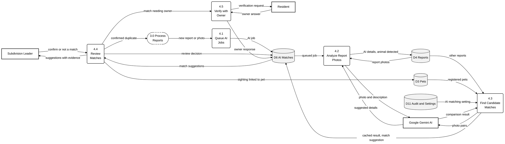
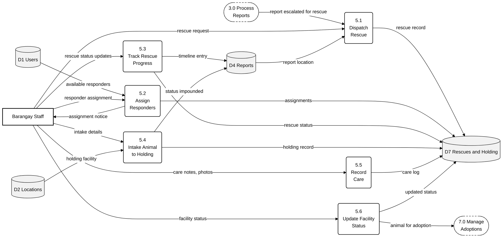
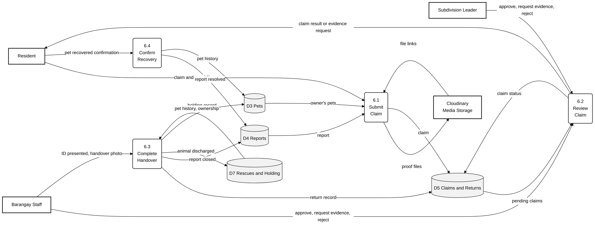

# Level 2 DFDs

Level 2 breaks down the five processes with the most internal steps: 3.0, 4.0, 5.0, 6.0 and 7.0. Processes 1.0, 2.0, 8.0, 9.0 and 10.0 are simple enough to be described at Level 1. Dashed boxes are connectors to processes drawn on other diagrams.

## Level 2 — Process 3.0 Process Reports

Process 3.0 covers the life of a report, from submission until it is resolved, handed to the barangay, or disputed.

Raw code: [`mermaid/02_level2_p3_reports.mmd`](mermaid/02_level2_p3_reports.mmd)

```mermaid
---
config:
  theme: base
  themeVariables:
    background: "#ffffff"
    primaryColor: "#ffffff"
    primaryTextColor: "#000000"
    primaryBorderColor: "#000000"
    lineColor: "#000000"
    textColor: "#000000"
    fontFamily: "Arial, Helvetica, sans-serif"
    fontSize: "15px"
  flowchart:
    curve: basis
    nodeSpacing: 40
    rankSpacing: 70
    useMaxWidth: false
---
flowchart LR
    RES["Resident"]:::ent
    LDR["Subdivision Leader"]:::ent
    STF["Barangay Staff"]:::ent
    CLD["Cloudinary<br/>Media Storage"]:::ent
    MAP["OpenStreetMap<br/>Services"]:::ent
    P31("3.1<br/>Submit<br/>Report"):::proc
    P32("3.2<br/>Claim, Verify and<br/>Transfer Report"):::proc
    P33("3.3<br/>Merge Duplicate<br/>Reports"):::proc
    P34("3.4<br/>Update Status<br/>and Timeline"):::proc
    P35("3.5<br/>Endorse to<br/>Barangay"):::proc
    P36("3.6<br/>Resolve<br/>Disputes"):::proc
    D2[("D2 Locations")]:::store
    D3[("D3 Pets")]:::store
    D4[("D4 Reports")]:::store
    O4(["4.0 Perform<br/>AI Matching"]):::off
    O5(["5.0 Manage Rescue<br/>and Holding"]):::off

    RES -->|"report details, photos, location"| P31
    P31 -->|"photos"| CLD
    CLD -->|"file links"| P31
    MAP -->|"street address"| P31
    D2 -->|"subdivision, landmarks"| P31
    P31 -->|"new report"| D4
    P31 -->|"report for analysis"| O4
    D4 -->|"unclaimed reports"| P32
    LDR -->|"claim, verification, visibility, transfer"| P32
    P32 -->|"assigned and verified report"| D4
    P32 -->|"subdivision report queue"| LDR
    O4 -->|"confirmed duplicate"| P33
    LDR -->|"merge or separate decision"| P33
    P33 -->|"merged case"| D4
    LDR -->|"status, remarks, evidence"| P34
    STF -->|"status, remarks, evidence"| P34
    P34 -->|"timeline entry, media"| D4
    P34 -->|"report escalated for rescue"| O5
    LDR -->|"endorsement letter"| P35
    P35 -->|"letter record"| D4
    P35 -->|"endorsed report"| STF
    RES -->|"dispute and evidence"| P36
    D3 -->|"pet record"| P36
    STF -->|"dispute decision"| P36
    P36 -->|"dispute outcome"| D4
    P36 -->|"decision"| RES

    classDef ent fill:#ffffff,stroke:#000000,stroke-width:2px
    classDef proc fill:#ffffff,stroke:#000000,stroke-width:1.5px
    classDef store fill:#f2f2f2,stroke:#000000,stroke-width:1px
    classDef off fill:#ffffff,stroke:#000000,stroke-width:1px,stroke-dasharray:5 4
```

**Legend.** Rectangle (bold border) = external entity · rounded box = process · grey cylinder = data store ·
dashed rounded box = a process shown on another diagram (connector) · arrow = data flow, labelled with the data that
moves.

| Process | Name | Description |
|---|---|---|
| 3.1 | Submit Report | Saves a resident's report with its photos (stored in Cloudinary), location and landmark, then sends it to AI analysis |
| 3.2 | Claim, Verify and Transfer Report | A Subdivision Leader claims the report, verifies it or marks it a false alarm, decides its visibility, or transfers it to another leader |
| 3.3 | Merge Duplicate Reports | Merges sightings of the same animal into one case after a duplicate match is confirmed, or separates them again |
| 3.4 | Update Status and Timeline | Records each status change with remarks and evidence, and escalates reports that need a rescue |
| 3.5 | Endorse to Barangay | Creates the leader's endorsement letter that forwards a report to the barangay |
| 3.6 | Resolve Disputes | Receives a resident's dispute with evidence and records staff's decision |

## Level 2 — Process 4.0 Perform AI Matching

Process 4.0 shows how the AI helps without making decisions. The AI analyses and compares photos (4.1–4.3), while a Subdivision Leader reviews each suggestion (4.4) and the owner confirms it (4.5).

Raw code: [`mermaid/02_level2_p4_ai_matching.mmd`](mermaid/02_level2_p4_ai_matching.mmd)

**Legend.** Rectangle (bold border) = external entity · rounded box = process · grey cylinder = data store ·
dashed rounded box = a process shown on another diagram (connector) · arrow = data flow, labelled with the data that
moves.

| Process | Name | Description |
|---|---|---|
| 4.1 | Queue AI Jobs | Adds a background job for each new photo or report so the resident does not wait for the AI |
| 4.2 | Analyze Report Photos | Checks that the photo shows a dog or cat and asks Gemini to suggest the animal's details |
| 4.3 | Find Candidate Matches | Compares the sighting with other reports and registered pets (reusing earlier comparisons) and saves likely matches |
| 4.4 | Review Matches | A leader confirms or rejects each suggestion; confirmed duplicates are merged and confirmed pets are linked |
| 4.5 | Verify with Owner | Asks the pet's owner whether the sighting is their pet and records the answer |

## Level 2 — Process 5.0 Manage Rescue and Holding

Process 5.0 follows the animal from the moment a rescue is sent until it is cared for at the holding facility and, if unclaimed, made available for adoption.

Raw code: [`mermaid/02_level2_p5_rescue_holding.mmd`](mermaid/02_level2_p5_rescue_holding.mmd)

**Legend.** Rectangle (bold border) = external entity · rounded box = process · grey cylinder = data store ·
dashed rounded box = a process shown on another diagram (connector) · arrow = data flow, labelled with the data that
moves.

| Process | Name | Description |
|---|---|---|
| 5.1 | Dispatch Rescue | Creates a rescue for an escalated report using the report's location |
| 5.2 | Assign Responders | Assigns one or more responders to the rescue and notifies them |
| 5.3 | Track Rescue Progress | Records each rescue stage (en route, on site, animal secured) and adds it to the report timeline |
| 5.4 | Intake Animal to Holding | Records the animal's arrival at a holding facility and marks the report as impounded |
| 5.5 | Record Care | Logs observations, treatment and photos while the animal is held |
| 5.6 | Update Facility Status | Sets the animal's status (for example healthy or for adoption) and releases it to the adoption process |

## Level 2 — Process 6.0 Process Claims and Reunification

Process 6.0 brings a found animal back to its owner, either through a reviewed claim and a recorded handover, or when the owner confirms they already recovered the pet.

Raw code: [`mermaid/02_level2_p6_claims.mmd`](mermaid/02_level2_p6_claims.mmd)

**Legend.** Rectangle (bold border) = external entity · rounded box = process · grey cylinder = data store ·
dashed rounded box = a process shown on another diagram (connector) · arrow = data flow, labelled with the data that
moves.

| Process | Name | Description |
|---|---|---|
| 6.1 | Submit Claim | The owner claims a reported animal as their pet and uploads proof such as a vaccine card or photos |
| 6.2 | Review Claim | A leader or staff member approves the claim, asks for more evidence, or rejects it |
| 6.3 | Complete Handover | Records the handover (ID presented, handover photo), closes the report, discharges the animal and updates the pet's history |
| 6.4 | Confirm Recovery | The resident confirms that they recovered their own lost pet, which resolves the report |

## Level 2 — Process 7.0 Manage Adoptions

Process 7.0 takes an animal from the holding facility to a new home, following the adoption stages of the system.

Raw code: [`mermaid/02_level2_p7_adoptions.mmd`](mermaid/02_level2_p7_adoptions.mmd)

```mermaid
---
config:
  theme: base
  themeVariables:
    background: "#ffffff"
    primaryColor: "#ffffff"
    primaryTextColor: "#000000"
    primaryBorderColor: "#000000"
    lineColor: "#000000"
    textColor: "#000000"
    fontFamily: "Arial, Helvetica, sans-serif"
    fontSize: "15px"
  flowchart:
    curve: basis
    nodeSpacing: 40
    rankSpacing: 70
    useMaxWidth: false
---
flowchart LR
    RES["Resident"]:::ent
    STF["Barangay Staff"]:::ent
    PUB["Public Visitor<br/>(no account)"]:::ent
    P71("7.1<br/>Publish Catalog<br/>and Apply"):::proc
    P72("7.2<br/>Verify Applicant<br/>and Assign Tasks"):::proc
    P73("7.3<br/>Interview and<br/>Home Visit"):::proc
    P74("7.4<br/>Approve and<br/>Hand Over"):::proc
    P75("7.5<br/>Issue<br/>Certificate"):::proc
    P76("7.6<br/>Monitor<br/>Adoption"):::proc
    D3[("D3 Pets")]:::store
    D7[("D7 Rescues and Holding")]:::store
    D8[("D8 Adoptions")]:::store

    D7 -->|"animals for adoption"| P71
    P71 -->|"adoption catalog"| RES
    RES -->|"application and ID"| P71
    P71 -->|"application"| D8
    STF -->|"verification, case owner, tasks"| P72
    D8 -->|"application"| P72
    P72 -->|"verification, assignments"| D8
    P72 -->|"assigned task"| STF
    STF -->|"schedules and evaluations"| P73
    P73 -->|"interview and visit schedule"| RES
    P73 -->|"interview and visit results"| D8
    STF -->|"approval, handover details"| P74
    RES -->|"signed agreement, receipt confirmation"| P74
    P74 -->|"approved adoption"| D8
    P74 -->|"new pet record"| D3
    P74 -->|"animal adopted"| D7
    P75 -->|"certificate"| D8
    P75 -->|"adoption certificate"| RES
    PUB -->|"certificate number"| P75
    P75 -->|"certificate validity"| PUB
    RES -->|"check-ins, photos"| P76
    STF -->|"assessments, reviews"| P76
    P76 -->|"monitoring logs"| D8

    classDef ent fill:#ffffff,stroke:#000000,stroke-width:2px
    classDef proc fill:#ffffff,stroke:#000000,stroke-width:1.5px
    classDef store fill:#f2f2f2,stroke:#000000,stroke-width:1px
    classDef off fill:#ffffff,stroke:#000000,stroke-width:1px,stroke-dasharray:5 4
```

**Legend.** Rectangle (bold border) = external entity · rounded box = process · grey cylinder = data store ·
dashed rounded box = a process shown on another diagram (connector) · arrow = data flow, labelled with the data that
moves.

| Process | Name | Description |
|---|---|---|
| 7.1 | Publish Catalog and Apply | Shows animals marked for adoption and receives residents' applications with their ID |
| 7.2 | Verify Applicant and Assign Tasks | Checks the applicant's ID, residency and blacklist status, assigns a case owner and assigns tasks to staff |
| 7.3 | Interview and Home Visit | Schedules and records the interview scores and the home visit results |
| 7.4 | Approve and Hand Over | Approves the adoption, records the signed agreement and handover, and creates the adopter's new pet record |
| 7.5 | Issue Certificate | Issues the adoption certificate and lets anyone verify it by its number |
| 7.6 | Monitor Adoption | Records the adopter's check-ins and staff assessments after the animal goes home |

