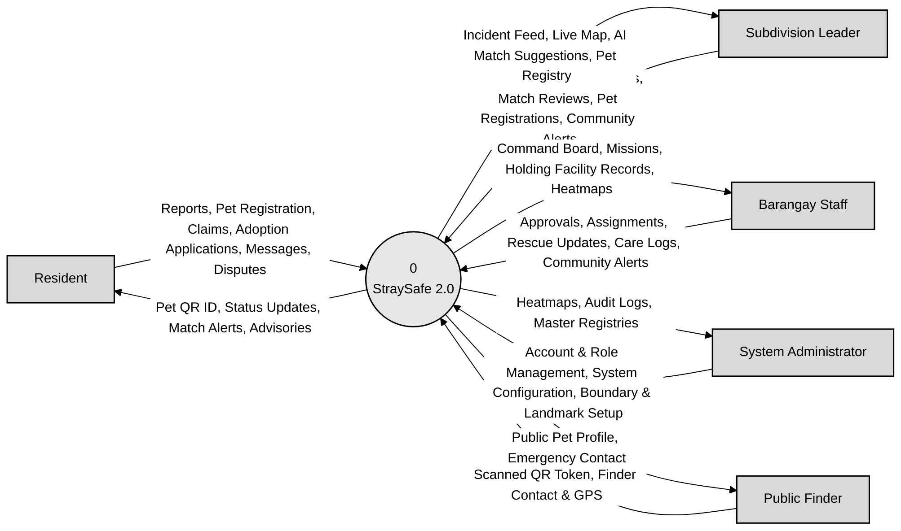
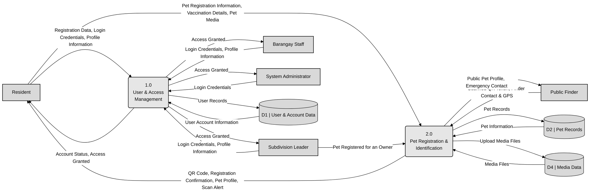
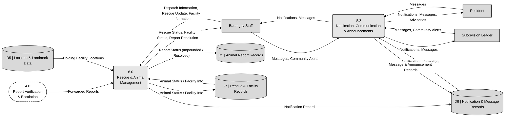
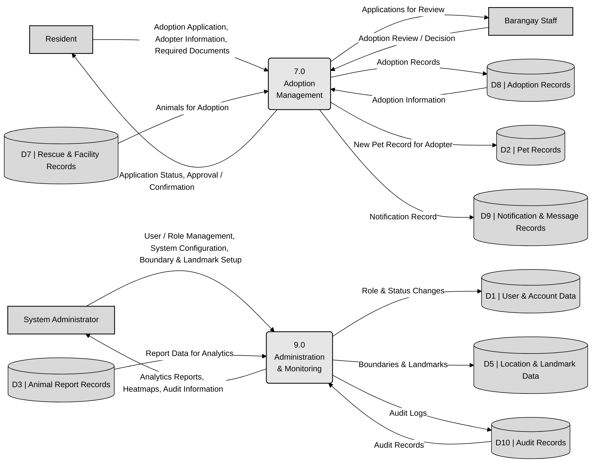

# Corrected DFDs (based on your Level 0 and Level 1)

These keep **your** process names, numbering and data stores. Only the errors from the review were fixed. Each
diagram lists what changed and has a **flow checklist**, so you can redraw it in your design tool arrow by arrow.

**Data stores after correction**

| Store | Name | Note |
|---|---|---|
| D1 | User & Account Data | unchanged |
| D2 | Pet Records | unchanged |
| D3 | Animal Report Records | now also holds verification and escalation (as in the database) |
| D4 | Media Data | now used by 2.0 and 3.0 |
| D5 | Location & Landmark Data | **replaces** "Verification & Escalation Records" (no such separate store exists) |
| D6 | AI Match & Claim Records | unchanged |
| D7 | Rescue & Facility Records | unchanged |
| D8 | Adoption Records | unchanged |
| D9 | Notification & Message Records | unchanged |
| D10 | Audit Records | unchanged |

**Drawing conventions (Gane–Sarson, use one style throughout):** external entity = rectangle · process = rounded
rectangle with its number on top · data store = open-ended rectangle "D# | Name" · arrow = data flow with a label.
If you prefer ellipses for processes (Yourdon style), that's fine, but then use them on every page.

## Level 0 — Context Diagram

StraySafe 2.0 as one process with the five external entities.

**What changed from your version:**
- Administrator arrows **reversed**. Account & Role Management and Boundary & Landmark Setup now go **into** the system; Heatmaps, Audit Logs and Master Registries go **to** the administrator.
- Barangay Staff: "Telemetry" replaced with **Rescue Updates** (the system has no live GPS tracking). "Inventory" replaced with **Holding Facility Records**.
- Subdivision Leader: "AI Diagnostics" renamed **AI Match Suggestions**. Added **Match Reviews** and **Pet Registrations** (leaders review AI matches and register pets for owners). "Disputes" moved to the Resident, who files them.
- Process numbered **0** and named **StraySafe 2.0**.

Raw code: [`mermaid/level0_context.mmd`](mermaid/level0_context.mmd)

**Flow checklist (10 flows)** — redraw every row as one arrow:

| # | From | To | Data flow (label) |
|---|---|---|---|
| 1 | Resident | 0 StraySafe 2.0 | Reports, Pet Registration, Claims, Adoption Applications, Messages, Disputes |
| 2 | 0 StraySafe 2.0 | Resident | Pet QR ID, Status Updates, Match Alerts, Advisories |
| 3 | Subdivision Leader | 0 StraySafe 2.0 | Verifications, Endorsements, Match Reviews, Pet Registrations, Community Alerts |
| 4 | 0 StraySafe 2.0 | Subdivision Leader | Incident Feed, Live Map, AI Match Suggestions, Pet Registry |
| 5 | Barangay Staff | 0 StraySafe 2.0 | Approvals, Assignments, Rescue Updates, Care Logs, Community Alerts |
| 6 | 0 StraySafe 2.0 | Barangay Staff | Command Board, Missions, Holding Facility Records, Heatmaps |
| 7 | System Administrator | 0 StraySafe 2.0 | Account & Role Management, System Configuration, Boundary & Landmark Setup |
| 8 | 0 StraySafe 2.0 | System Administrator | Heatmaps, Audit Logs, Master Registries |
| 9 | Public Finder | 0 StraySafe 2.0 | Scanned QR Token, Finder Contact & GPS |
| 10 | 0 StraySafe 2.0 | Public Finder | Public Pet Profile, Emergency Contact |

## Level 1 — Page 1: Processes 1.0 and 2.0

**What changed from your version:**
- 1.0 now **returns** Account Status / Access Granted to each user (before, nothing came back out of 1.0).
- **Public Finder added** to 2.0 (scan in, public profile out). This fixes the Level 0 balancing error.
- Subdivision Leader → 2.0 "Pet Registered for an Owner" added (leaders register pets for owners without an account).
- Typo fixed: "Pet Registration & Identification".

Raw code: [`mermaid/level1_page1_access_pets.mmd`](mermaid/level1_page1_access_pets.mmd)

**Flow checklist (19 flows)** — redraw every row as one arrow:

| # | From | To | Data flow (label) |
|---|---|---|---|
| 1 | Resident | 1.0 User & Access Management | Registration Data, Login Credentials, Profile Information |
| 2 | Subdivision Leader | 1.0 User & Access Management | Login Credentials, Profile Information |
| 3 | Barangay Staff | 1.0 User & Access Management | Login Credentials, Profile Information |
| 4 | System Administrator | 1.0 User & Access Management | Login Credentials |
| 5 | 1.0 User & Access Management | Resident | Account Status, Access Granted |
| 6 | 1.0 User & Access Management | Subdivision Leader | Access Granted |
| 7 | 1.0 User & Access Management | Barangay Staff | Access Granted |
| 8 | 1.0 User & Access Management | System Administrator | Access Granted |
| 9 | 1.0 User & Access Management | D1 | User & Account Data | User Records |
| 10 | D1 | User & Account Data | 1.0 User & Access Management | User Account Information |
| 11 | Resident | 2.0 Pet Registration & Identification | Pet Registration Information, Vaccination Details, Pet Media |
| 12 | Subdivision Leader | 2.0 Pet Registration & Identification | Pet Registered for an Owner |
| 13 | 2.0 Pet Registration & Identification | Resident | QR Code, Registration Confirmation, Pet Profile, Scan Alert |
| 14 | Public Finder | 2.0 Pet Registration & Identification | Scanned QR Token, Finder Contact & GPS |
| 15 | 2.0 Pet Registration & Identification | Public Finder | Public Pet Profile, Emergency Contact |
| 16 | 2.0 Pet Registration & Identification | D2 | Pet Records | Pet Records |
| 17 | D2 | Pet Records | 2.0 Pet Registration & Identification | Pet Information |
| 18 | 2.0 Pet Registration & Identification | D4 | Media Data | Upload Media Files |
| 19 | D4 | Media Data | 2.0 Pet Registration & Identification | Media Files |

## Level 1 — Page 2: Processes 3.0, 4.0 and 5.0

**What changed from your version:**
- **D5 Verification & Escalation Records removed.** Verification is stored on the report itself (the separate verification table is unused), so 4.0 now reads and updates **D3 Animal Report Records**.
- The floating "Notification Record" label on 4.0 is now a real flow (4.0 → D9).
- **5.0 now has its external entities.** Residents submit claims and answer matches; the Subdivision Leader reviews AI suggestions.
- 3.0 report photos go to **D4 Media Data**, the same store used for pet media.
- Typo fixed: "Escalation".

Raw code: [`mermaid/level1_page2_reports_ai.mmd`](mermaid/level1_page2_reports_ai.mmd)

```mermaid
---
config:
  theme: base
  themeVariables:
    background: "#ffffff"
    primaryColor: "#ffffff"
    primaryTextColor: "#000000"
    primaryBorderColor: "#000000"
    lineColor: "#000000"
    textColor: "#000000"
    fontFamily: "Arial, Helvetica, sans-serif"
    fontSize: "15px"
  flowchart:
    curve: basis
    nodeSpacing: 45
    rankSpacing: 80
    useMaxWidth: false
---
flowchart LR
    RES["Resident"]:::ent
    LDR["Subdivision Leader"]:::ent
    P3("3.0<br/>Stray Animal<br/>Reporting"):::proc
    P4("4.0<br/>Report Verification<br/>& Escalation"):::proc
    P5("5.0<br/>AI Matching &<br/>Ownership Claims"):::proc
    D2[("D2 | Pet Records")]:::store
    D3[("D3 | Animal Report Records")]:::store
    D4[("D4 | Media Data")]:::store
    D6[("D6 | AI Match & Claim Records")]:::store
    D9[("D9 | Notification & Message Records")]:::store

    RES -->|"Report Details, GPS Location, Photos, Information"| P3
    P3 -->|"Report Confirmation, Report Update"| RES
    P3 -->|"Report Records"| D3
    P3 -->|"Report Photos"| D4
    P3 -->|"Notification Record"| D9
    D3 -->|"Report Details"| P4
    LDR -->|"Verification Decision, Rejection / Endorsement, Escalation"| P4
    P4 -->|"Verification Status, Report Details"| LDR
    P4 -->|"Verification Status, Escalation"| D3
    P4 -->|"Notification Record"| D9
    D3 -->|"Report Information"| P5
    D2 -->|"Pet Information"| P5
    LDR -->|"Match Review / Decision"| P5
    P5 -->|"AI Match Suggestions"| LDR
    RES -->|"Claim & Proof of Ownership, Match Answer"| P5
    P5 -->|"Match Alert, Claim Result"| RES
    P5 -->|"Match Results, Claim Records"| D6
    D6 -->|"Match / Claim Information"| P5
    P5 -->|"Pet History Update"| D2

    classDef ent fill:#d9d9d9,stroke:#000000,stroke-width:1.5px
    classDef proc fill:#e6e6e6,stroke:#000000,stroke-width:1.5px
    classDef store fill:#d9d9d9,stroke:#000000,stroke-width:1px
    classDef off fill:#ffffff,stroke:#000000,stroke-width:1px,stroke-dasharray:5 4
```

**Flow checklist (19 flows)** — redraw every row as one arrow:

| # | From | To | Data flow (label) |
|---|---|---|---|
| 1 | Resident | 3.0 Stray Animal Reporting | Report Details, GPS Location, Photos, Information |
| 2 | 3.0 Stray Animal Reporting | Resident | Report Confirmation, Report Update |
| 3 | 3.0 Stray Animal Reporting | D3 | Animal Report Records | Report Records |
| 4 | 3.0 Stray Animal Reporting | D4 | Media Data | Report Photos |
| 5 | 3.0 Stray Animal Reporting | D9 | Notification & Message Records | Notification Record |
| 6 | D3 | Animal Report Records | 4.0 Report Verification & Escalation | Report Details |
| 7 | Subdivision Leader | 4.0 Report Verification & Escalation | Verification Decision, Rejection / Endorsement, Escalation |
| 8 | 4.0 Report Verification & Escalation | Subdivision Leader | Verification Status, Report Details |
| 9 | 4.0 Report Verification & Escalation | D3 | Animal Report Records | Verification Status, Escalation |
| 10 | 4.0 Report Verification & Escalation | D9 | Notification & Message Records | Notification Record |
| 11 | D3 | Animal Report Records | 5.0 AI Matching & Ownership Claims | Report Information |
| 12 | D2 | Pet Records | 5.0 AI Matching & Ownership Claims | Pet Information |
| 13 | Subdivision Leader | 5.0 AI Matching & Ownership Claims | Match Review / Decision |
| 14 | 5.0 AI Matching & Ownership Claims | Subdivision Leader | AI Match Suggestions |
| 15 | Resident | 5.0 AI Matching & Ownership Claims | Claim & Proof of Ownership, Match Answer |
| 16 | 5.0 AI Matching & Ownership Claims | Resident | Match Alert, Claim Result |
| 17 | 5.0 AI Matching & Ownership Claims | D6 | AI Match & Claim Records | Match Results, Claim Records |
| 18 | D6 | AI Match & Claim Records | 5.0 AI Matching & Ownership Claims | Match / Claim Information |
| 19 | 5.0 AI Matching & Ownership Claims | D2 | Pet Records | Pet History Update |

## Level 1 — Page 3: Processes 6.0 and 8.0

The dashed connector 4.0 shows the forwarded reports coming from page 2.

**What changed from your version:**
- 6.0 now **updates the report** in D3 (impounded / resolved) and reads facility locations from D5.
- 8.0 now also serves **Subdivision Leaders and Barangay Staff** and receives **messages**.
- 8.0 renamed **Notification, Communication & Announcements** and receives **Community Alerts**. This covers the "Alerts" and "Advisories" from Level 0, which had no process before.

Raw code: [`mermaid/level1_page3_rescue_notifications.mmd`](mermaid/level1_page3_rescue_notifications.mmd)

**Flow checklist (16 flows)** — redraw every row as one arrow:

| # | From | To | Data flow (label) |
|---|---|---|---|
| 1 | 4.0 Report Verification & Escalation | 6.0 Rescue & Animal Management | Forwarded Reports |
| 2 | Barangay Staff | 6.0 Rescue & Animal Management | Dispatch Information, Rescue Update, Facility Information |
| 3 | 6.0 Rescue & Animal Management | Barangay Staff | Rescue Status, Facility Status, Report Resolution |
| 4 | 6.0 Rescue & Animal Management | D7 | Rescue & Facility Records | Animal Status / Facility Info |
| 5 | D7 | Rescue & Facility Records | 6.0 Rescue & Animal Management | Animal Status / Facility Info |
| 6 | 6.0 Rescue & Animal Management | D3 | Animal Report Records | Report Status (Impounded / Resolved) |
| 7 | D5 | Location & Landmark Data | 6.0 Rescue & Animal Management | Holding Facility Locations |
| 8 | 6.0 Rescue & Animal Management | D9 | Notification & Message Records | Notification Record |
| 9 | D9 | Notification & Message Records | 8.0 Notification, Communication & Announcements | Notification Information |
| 10 | Resident | 8.0 Notification, Communication & Announcements | Messages |
| 11 | Subdivision Leader | 8.0 Notification, Communication & Announcements | Messages, Community Alerts |
| 12 | Barangay Staff | 8.0 Notification, Communication & Announcements | Messages, Community Alerts |
| 13 | 8.0 Notification, Communication & Announcements | Resident | Notifications, Messages, Advisories |
| 14 | 8.0 Notification, Communication & Announcements | Subdivision Leader | Notifications, Messages |
| 15 | 8.0 Notification, Communication & Announcements | Barangay Staff | Notifications, Messages |
| 16 | 8.0 Notification, Communication & Announcements | D9 | Notification & Message Records | Message & Announcement Records |

## Level 1 — Page 4: Processes 7.0 and 9.0

**What changed from your version:**
- 7.0 ↔ Barangay Staff now goes **both ways**: applications go to staff, and decisions come back from staff.
- 7.0 reads **Animals for Adoption** from D7 and creates the **adopter's new pet record** in D2.
- 9.0 arrow **reversed**: analytics, heatmaps and audit information go **to** the administrator.
- 9.0 now reads D10 (audit records) and D3 (report data for analytics). It also writes role changes to D1 and boundaries / landmarks to **D5 Location & Landmark Data**, which takes the D5 number freed above.

Raw code: [`mermaid/level1_page4_adoption_admin.mmd`](mermaid/level1_page4_adoption_admin.mmd)

**Flow checklist (16 flows)** — redraw every row as one arrow:

| # | From | To | Data flow (label) |
|---|---|---|---|
| 1 | Resident | 7.0 Adoption Management | Adoption Application, Adopter Information, Required Documents |
| 2 | 7.0 Adoption Management | Resident | Application Status, Approval / Confirmation |
| 3 | 7.0 Adoption Management | Barangay Staff | Applications for Review |
| 4 | Barangay Staff | 7.0 Adoption Management | Adoption Review / Decision |
| 5 | D7 | Rescue & Facility Records | 7.0 Adoption Management | Animals for Adoption |
| 6 | 7.0 Adoption Management | D8 | Adoption Records | Adoption Records |
| 7 | D8 | Adoption Records | 7.0 Adoption Management | Adoption Information |
| 8 | 7.0 Adoption Management | D2 | Pet Records | New Pet Record for Adopter |
| 9 | 7.0 Adoption Management | D9 | Notification & Message Records | Notification Record |
| 10 | System Administrator | 9.0 Administration & Monitoring | User / Role Management, System Configuration, Boundary & Landmark Setup |
| 11 | 9.0 Administration & Monitoring | System Administrator | Analytics Reports, Heatmaps, Audit Information |
| 12 | 9.0 Administration & Monitoring | D1 | User & Account Data | Role & Status Changes |
| 13 | 9.0 Administration & Monitoring | D5 | Location & Landmark Data | Boundaries & Landmarks |
| 14 | D3 | Animal Report Records | 9.0 Administration & Monitoring | Report Data for Analytics |
| 15 | 9.0 Administration & Monitoring | D10 | Audit Records | Audit Logs |
| 16 | D10 | Audit Records | 9.0 Administration & Monitoring | Audit Records |
