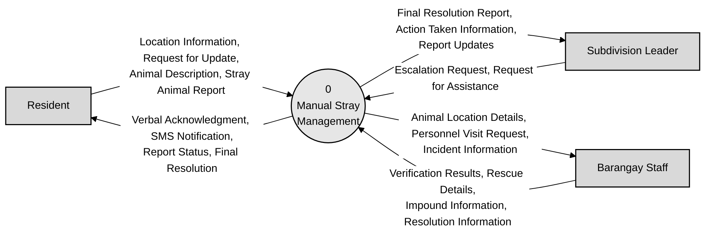
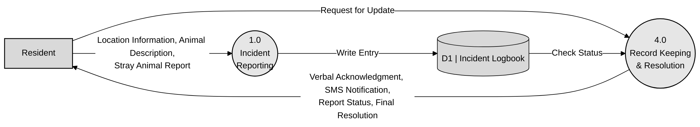
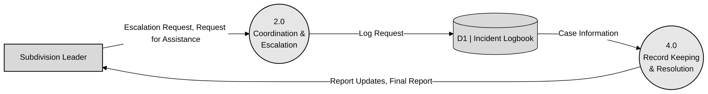
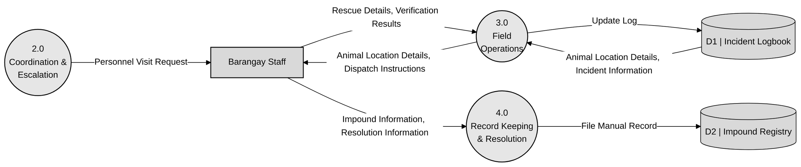

# Existing System DFDs (Figures 2.2–2.5)

Code-based versions of the team's existing-system diagrams with the review corrections applied. They match `MANUSCRIPT_DFD_EXISTING.txt`. Each figure has a flow checklist for redrawing. Processes are circles and data stores are drawn as "D# | Name", as in the original figures.

## Figure 2.2 Existing System Context Diagram

**Corrections applied:** process numbered 0; "Barangay" renamed Barangay Staff; typos fixed (Escalation, Action Taken).

Raw code: [`mermaid/fig2_2_existing_context.mmd`](mermaid/fig2_2_existing_context.mmd)

**Explanation (manuscript text):**

The resident reports a stray animal by visiting or calling the barangay office, giving the animal's description and location, and later asks for updates. In return, the resident receives a verbal acknowledgment, SMS notifications, the report status and the final resolution.

The subdivision leader sends escalation requests and requests for assistance. The leader receives report updates, information on the actions taken and the final resolution report.

The barangay staff receive the animal's location details, personnel visit requests and incident information. They return verification results, rescue details, impound information and the resolution of each case.

**Flow checklist (6 flows)**

| # | From | To | Data flow |
|---|---|---|---|
| 1 | Resident | 0 Manual Stray Management | Location Information, Request for Update, Animal Description, Stray Animal Report |
| 2 | 0 Manual Stray Management | Resident | Verbal Acknowledgment, SMS Notification, Report Status, Final Resolution |
| 3 | Subdivision Leader | 0 Manual Stray Management | Escalation Request, Request for Assistance |
| 4 | 0 Manual Stray Management | Subdivision Leader | Final Resolution Report, Action Taken Information, Report Updates |
| 5 | Barangay Staff | 0 Manual Stray Management | Verification Results, Rescue Details, Impound Information, Resolution Information |
| 6 | 0 Manual Stray Management | Barangay Staff | Animal Location Details, Personnel Visit Request, Incident Information |

## Figure 2.3 Existing System Level 1 Diagram: Resident Module

**Corrections applied:** "Request for Update" moved from 1.0 to 4.0, which is the process that answers status requests.

Raw code: [`mermaid/fig2_3_existing_resident.mmd`](mermaid/fig2_3_existing_resident.mmd)

**Explanation (manuscript text):**

**Flow checklist (5 flows)**

| # | From | To | Data flow |
|---|---|---|---|
| 1 | Resident | 1.0 Incident Reporting | Location Information, Animal Description, Stray Animal Report |
| 2 | 1.0 Incident Reporting | D1 Incident Logbook | Write Entry |
| 3 | Resident | 4.0 Record Keeping & Resolution | Request for Update |
| 4 | D1 Incident Logbook | 4.0 Record Keeping & Resolution | Check Status |
| 5 | 4.0 Record Keeping & Resolution | Resident | Verbal Acknowledgment, SMS Notification, Report Status, Final Resolution |

## Figure 2.4 Existing System Level 1 Diagram: Subdivision Leader Module

**Corrections applied:** process 4.0 uses the same full name as the other figures (Record Keeping & Resolution).

Raw code: [`mermaid/fig2_4_existing_subdivision_leader.mmd`](mermaid/fig2_4_existing_subdivision_leader.mmd)

**Explanation (manuscript text):**

**Flow checklist (4 flows)**

| # | From | To | Data flow |
|---|---|---|---|
| 1 | Subdivision Leader | 2.0 Coordination & Escalation | Escalation Request, Request for Assistance |
| 2 | 2.0 Coordination & Escalation | D1 Incident Logbook | Log Request |
| 3 | D1 Incident Logbook | 4.0 Record Keeping & Resolution | Case Information |
| 4 | 4.0 Record Keeping & Resolution | Subdivision Leader | Report Updates, Final Report |

## Figure 2.5 Existing System Level 1 Diagram: Barangay Module

**Corrections applied:** the invalid Brgy Staff → D1 flow is removed; 3.0 now reads the location and incident details from D1 and passes them to the staff with the dispatch instructions; "Brgy Staff" renamed Barangay Staff.

Raw code: [`mermaid/fig2_5_existing_barangay.mmd`](mermaid/fig2_5_existing_barangay.mmd)

**Explanation (manuscript text):**

When an animal is caught, the staff submit the impound and resolution information to process 4.0. The details are then recorded by hand in the impound registry (D2).

**Flow checklist (7 flows)**

| # | From | To | Data flow |
|---|---|---|---|
| 1 | 2.0 Coordination & Escalation | Barangay Staff | Personnel Visit Request |
| 2 | D1 Incident Logbook | 3.0 Field Operations | Animal Location Details, Incident Information |
| 3 | 3.0 Field Operations | Barangay Staff | Animal Location Details, Dispatch Instructions |
| 4 | Barangay Staff | 3.0 Field Operations | Rescue Details, Verification Results |
| 5 | 3.0 Field Operations | D1 Incident Logbook | Update Log |
| 6 | Barangay Staff | 4.0 Record Keeping & Resolution | Impound Information, Resolution Information |
| 7 | 4.0 Record Keeping & Resolution | D2 Impound Registry | File Manual Record |
